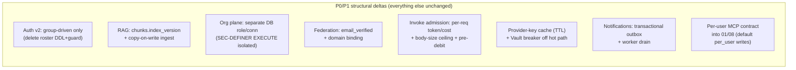

# Agent Platform — Independent Architect Review (fresh pass)

> **Date:** 2026-10-21. **Reviewer role:** independent technical challenger, not a design approver.
> **Method:** re-derived from code + docs *without* reading the prior `architecture-review.md` until the
> reconciliation step (§14), so the findings are independent. Posture: ruthless but balanced — credit what
> is right, attack what is weak, give fix options with trade-offs.
>
> **This file does not replace `docs/architecture-review.md`.** It is a second, independent pass; §14
> reconciles the two. Fold it in or discard it as you like.
>
> **⚠️ RESOLUTION UPDATE (2026-10-22).** The findings below were acted on *after* this review was written
> (`scope.md` decision log revs 1–5; `docs/review-fixes.md`): **C1** (auth) resolved by the claim-based,
> IdP-agnostic model (`09`/`01`/new `18`; FE migrated — one residual, the `executer` caller role in
> `runtime-access.ts`); **C2/C4/H1** closed at design level (rev 4); **C3** reframed as product intent — KB
> content is deliberately **live/independent** of the agent version, with the eval-on-refresh signal
> *parked* (rev 3). All of §13's open questions are now answered (see §13). Finding bodies below are kept as
> the **point-in-time** record — read them with this banner.

## Scope & evidence rule (read first)

The backend is **fully designed, not built.** On disk: `frontend/` (a mock-only Next.js console) + `docs/`.
There is **no `services/` tree, no DB, no running code, no test suite.** So this is a *design &
documentation* review. Almost nothing can be a *confirmed code defect*; findings are classified as:

`confirmed-defect` (a spec/DDL is provably self-contradictory) · `probable-defect` · `architectural-risk` ·
`design-gap` · `documentation-gap` · `unverified-assumption` · `improvement`.

**Evidence base I read directly:** `scope.md`, `spec.md`, `backend/00–05`, `backend/09`, `backend/17`,
and `frontend/src` via reconstruction; `backend/04` verified line-by-line. **Delegated, evidence-cited:**
`backend/06–08`, `10–16`, `channels-design.md`. Every finding cites an artifact. Where I could not verify,
I say so.

**One load-bearing fact about timing:** the most recent commit `88e228d "changes for oauth for mcp tools"`
landed **after** the prior review (`cb51cc4`). It widened the MCP per-user-OAuth surface in the frontend and
doc `17`, but did **not** land the matching schema (`01`) or API surface (`08`). Several of the new findings
below exist only because of that commit.

---

## 1. Executive verdict

**The design is unusually honest and architecturally coherent for a pre-build spec — and it is still not
buildable as written, because its highest-blast-radius decision (the auth/tenancy model) was reversed on
paper but not propagated into the two artifacts an engineer builds from (the DDL and the tenancy guard).**

What is genuinely right and must be protected:

- **One shared `runtime.invoke(snapshot, inputs, ctx)`** behind **four thin callers** (playground, published,
  eval, channel; sub-agents recurse), over a **frozen immutable `VersionSnapshot`**, behind an
  **eval-gated publish**. This is the spine that makes "test == eval == prod" true and "editing changes
  nothing live until an eval-gated re-point" enforceable in code. (`00 §1`, `03 §9`, `05 §5`.)
- **Cost computed from our own versioned capability profiles, never trusted from LiteLLM**; a **fixed,
  versioned judge**; a single **pgvector** store; **semantic-cache fencing** (off by default, banned for
  tool/RAG-cite/security agents). (`02`, `05`, `07 §4.3`.)
- **Candor**: the docs flag their own hard limits — key-custody "degrades to visibility + mandate" without
  egress/IAM (`09 §9.1`), profile currency is "manual-first" (`02 §4.2`), the pgvector 2000-dim ceiling
  (`04 §5`), per-user MCP "not deterministically evaluable" (`17 §7`). That honesty is rare and correct.

What holds it back, in priority order:

1. **The auth/tenancy reversal is caught mid-flight and self-contradictory** — provably, at the DDL level
   (C1). The one module everything else sits on cannot be built unambiguously today.
2. **The RAG path silently breaks the core immutability invariant**: a re-ingest changes what an
   *already-published* endpoint retrieves, because retrieval ignores the pinned `kb_index_version` (C3).
3. **The eval gate — the product's #1 guarantee — depends on hashing invariants that are prose "MUST"s, not
   enforced constraints, and has a TOCTOU window** (C2); and it **cannot govern the flagship per-user /
   side-effecting agents at all** (H8).
4. **Tenant isolation hangs on several single, unguarded assumptions** (C4) — RLS pool mode, the
   SECURITY-DEFINER role boundary, worker GUC scoping, a per-workspace vs per-user DEK contradiction.
5. **The whole 17-doc design was specified ahead of validating the two unknowns the entire value rests on**
   (C5) — which the owner's own 2026-10-19 decision says not to do.

A cross-cutting lens makes it concrete: the **flagship flow** — a developer in Google Chat driving a
*shared* workspace agent with git + Jira *write* tools through SDLC work — is the most compelling use case
and the **least ready**: it federates on a spoofable email key (H1), its per-user identity is PROPOSED-only
and has no published-API path (H8), it **can't be eval-gated** (H8), and it **collides with the 30s / 8-tool
bounds** tuned for short chat (M-runtime).

Infra sophistication (per-workspace Vault DEKs, KEDA 0→N, gVisor per-call sandboxes, HNSW dedup over ~40
agents, a SECURITY-DEFINER cross-tenant plane, 4-node MinIO) runs ahead of a stated workload of "a small
known set of internal users" on a ≤$100/mo build budget. The sandbox is justified (arbitrary tool code is a
real boundary); the crypto/autoscale/HA tier is not yet.

**Readiness verdict:** not production-ready, and not yet MVP-validated. The design quality is high; the gap
is that recent churn (group-driven pivot, MCP-OAuth) was applied to the *frontend* and to *prose* but not
to the *normative build artifacts*, so FE, DDL, API surface, and prose now describe three different systems
in places.

---

## 2. System reconstruction

### 2.1 Intended capability & users
Internal **build → configure → test → publish** platform for LLM agents, for internal developers/PMs in one
org ("small known set of users", `scope.md`). Defensible engineering is in exactly two places: the
**provider abstraction/runtime** and the **eval + drift-detection core**; the other ~90% is deliberately
plain CRUD.

### 2.2 Components (as designed, `00 §2–3`)
- **`api`** (FastAPI): builder REST + published `/v1/.../invoke`; owns HTTP, auth, tenancy, SSE.
- **`worker`** (arq/RQ on Redis): ingestion, eval runs, import, model-deprecation scan, channel events,
  (P2) MCP/tool dispatch.
- **`web`** (Next.js): the existing console (the one built artifact).
- **`sandbox`** (P2): gVisor + egress-proxy per-call MCP/tool execution.
- **`runtime/`**: a pure library (no FastAPI/HTTP imports) imported by `api` + `worker` — the shared core.
- **Backing:** Postgres+pgvector, Redis, Vault, Langfuse, MinIO.

### 2.3 Representative trace — published invoke (production path)
`POST /v1/agents/:id/invoke` → bearer token → tenant/scope/revocation check (`09 §6`) → [P2] concurrency +
[P1] monthly spend check (`07`) → **Vault decrypt provider key into memory** (`09 §9`) → `runtime.invoke`
(input guardrails → retrieval → gateway stream → tool loop → output guardrails) → record Run+Spans+cost →
respond. Bounded by `ctx.deadline_s=30s` and `MAX_TOOL_CALLS=8`.

### 2.4 Flagship trace — SDLC dev agent over Google Chat (shared by a team)
Chat event → `POST /channels/gchat/events` → signature verify → **email → Okta subject federation** (`12
§4`) → mint short-lived token (role `viewer`, `teams`=Okta groups) → worker `runtime.invoke(run_source=
channel)` → agent with git+Jira **write** MCP tools. This path touches: channel federation (`12`), per-user
MCP identity (`17`), the approval gate (`03 §4`), the 30s/8-tool bounds, and the eval gate — and is the
least-ready part of the system on every one of those axes.

### 2.5 What is demonstrable today (frontend)
A complete mock console: dashboard, agents (configure/knowledge/tools/guardrails/access/versions/evals/
publish), playground, runs, evaluations, approvals, knowledge, tools+MCP, channels, skills, settings.
**All reads from seed fixtures; all writes in-memory; auth/tenancy/token-decode/spend/freeze simulated
client-side.** ~130 `@backend` markers map FE→REST contract; ~8 `@backend remove` sites are load-bearing
deletions at integration (notably the dev role/platform-admin override switches — shipping those to prod is
a client-side privilege-escalation toggle).

---

## 3. Requirements traceability (headline rows)

| Requirement (`spec`/`scope`) | Component | Validation evidence today | Gap |
|---|---|---|---|
| Model-agnostic across ≥2 providers | `02` gateway + profiles | design + contract-test *plan* | unbuilt; cost convention unpinned (H5) |
| Drift detected without human reading transcripts | `05` eval/drift | design + seeded-regression *plan* | judge not calibrated; gate hashing unenforced (C2) |
| "Editing changes nothing live until eval-gated re-point" | `00 §4`, `01 §4.2`, `05 §5` | enforced for prompt/model/tools | **broken for RAG** (C3) |
| Per-workspace monthly spend cap (hard, P1) | `07 §3` | design | TOCTOU under concurrency; est from max_tokens only (H4/H5) |
| Secrets never in config/trace/export | `09 §9` | design + CI scan *plan* | Vault on hot path (H3); DEK scope contradiction (C4) |
| Publish < 15 min; first-token p95 < 2s | `08`, `00 §5` | FE flow exists | no NFRs for *production* invoke path (H-nfr) |
| Multi-tenant isolation | `09 §3/§7/§8`, `01 §6` | design + isolation-suite *plan* | single-point assumptions (C4) |

### 3.2 FE ↔ backend-design divergence ledger (the dangerous ones)
- **Auth model:** FE implements Okta-group-driven (live); `09 §1/§3`, `01 §4.1` still implement the deleted
  roster model (C1).
- **Workspace create/hard-delete:** FE does both (mock); `08` has no `POST /v1/workspaces` and models delete
  as soft-archive. Behavior, not just plumbing, diverges.
- **MCP per-user OAuth:** FE ships `authMode: per_user` + a shared OAuth-app registration (`oauth-app.ts`);
  `08`/`01` have **no** connect/callback endpoints or `mcp_user_connections`/`auth_mode` columns — the
  contract exists only in `17`, marked PROPOSED (C-mcp).

---

## 4. SDLC coverage matrix

| Phase | Status | Key findings | Evidence limit |
|---|---|---|---|
| Requirements/discovery | Reviewed | C5 (build-ahead-of-MVP); sparse NFRs (H-nfr) | workload numbers absent |
| System architecture | Reviewed | C1, C4; shared-runtime spine (preserve) | no code |
| AI & data lifecycle | Reviewed | C2, C3, H5, H6 (RAG/eval/cost/guardrails) | no eval data |
| Implementation/code | **Not reviewable** | only FE mock exists | no `services/` |
| Security/threat model | Reviewed | H1 (federation), C4 (SEC-DEFINER), H6 | no pentest |
| Testing/verification | Reviewed (as designed) | isolation + seeded-regression suites *planned* only | no tests exist |
| Deploy/release | Reviewed | M-migrate (k8s), M-canary, M-reindex | no IaC run |
| Operations/incident | Reviewed | M1 (metrics), DLQ gap, Vault SPOF | no runbooks tested |
| Maintenance/evolution | Reviewed | profile currency (H5), embedding migration gap | — |
| Cost/efficiency | Reviewed | strong (07); infra over-reach (M-infra) | no measured spend |

---

## 5. Prioritized findings register (deduplicated)

> IDs are this review's. The map to the prior review's F-IDs is in §14. Severity reflects design-stage
> exposure (nothing in prod yet).

### P0 — design blockers (fix before building the affected module)

**C1 · Auth/tenancy reversal is incompletely applied — self-contradictory at the DDL level.**
`confirmed-defect · Critical.` The 2026-10-20 group-driven pivot is *announced* (`09 §2.1`; `01 §3` comment
lines 81–91: "`workspace_access` … REMOVED", "`memberships` … no longer SoR", "`workspace_invites` …
REMOVED") but *not applied*: `01 §4.1` still **creates** the `access_mode workspace_access` column (line
119), the `memberships` table (142–153) with prose calling it "the system of record" (135), and the
`workspace_invites` table (157–168); the normative guard `09 §3 get_workspace_ctx` still calls
`principal.role_in(ws_id)` + `join_workspace(... access_mode=="open")`. Meanwhile the **FE already
implements the group-driven model.** An Alembic migration generated from `01` would build the model the
design says it deleted. Also unresolved: `member_role` still includes `admin` while the pivot "reserves
admin for platform_admins" — yet `09 §4` documents a full workspace-`admin` (Space Manager). *Failure
scenario:* an engineer builds invite/self-join (per the DDL+guard) while the FE and prose assume
group-driven → the auth layer is wrong on first integration; or they stall. This is the highest-blast-radius
module.

**C2 · Eval-gate integrity rests on unenforced invariants + a TOCTOU window.**
`probable-defect (cluster) · Critical.` The gate is the product's #1 guarantee. Its correctness now depends
on `snapshot_hash` folding in `retrieval_config` + `kb_index_version` + `skill_content_hash` (`05 §6`,
`08 §3`) — but these are prose **MUST**s, not a tested constraint; if any is omitted the verdict cache
serves a **stale PASS** and the gate is bypassed silently. Separately, `assert_publishable` (`05 §5`) reads
`latest_eval_run` and `latest_trigger_time` **non-atomically** — a trigger firing between the two reads, or a
concurrent publish, is a race (it fails *closed*, which is good, but the window isn't specified). *Failure
scenario:* a skill/KB edit whose hash wasn't folded in → cached PASS → gate bypassed on a changed agent.

**C3 · RAG pinning is cosmetic — a re-ingest changes live published retrieval.**
`confirmed-defect · High (undermines a Critical invariant).` `04 §9` claims "the published version still
runs on its pinned `index_version` until an eval-gated re-point," but the `04 §6` retrieval SQL filters only
`workspace_id` + `kb_id` (no `index_version` predicate), and `04 §2` ingest does `upsert_document` +
`write_chunks` **in place** then `bump_index_version`. The single `chunks.embedding vector(N)` column can't
hold two versions. *Verified line-by-line.* *Failure scenario:* someone re-ingests a bound KB; every live
call to the already-published endpoint immediately retrieves the new chunks — "editing changes nothing live"
is false for RAG. It is *flagged* (stale-index warning + re-eval trigger) but not *prevented*; and a mid-loop
ingest failure leaves the KB half-updated with no rollback.

**C4 · Tenant isolation hangs on single unguarded assumptions.**
`architectural-risk · Critical.` Each is one mistake from a cross-tenant leak: (a) RLS only holds if
`SET LOCAL app.workspace_id` can't bleed across pooled checkouts — requires transaction-scoped pool mode
(`09 §7`, stated but not enforced). (b) The org-report **`SECURITY DEFINER`** path (`15 §2`) is RLS-free; the
*only* DB control is who holds `EXECUTE`. The docs never say the app opens a **separate** DB role/connection
for the org plane — if the normal app role holds EXECUTE, any logic bug/SQLi *anywhere* reads all tenants
(the "only via §3 router" guarantee is then Python-only). (c) The **worker** runs jobs for many tenants; it
must set the GUC per job — unspecified. (d) **DEK scope contradiction:** `09 §9` says per-user-MCP creds
"keep the per-workspace DEK"; `17 §3/§8` say "per-user DEK." One is wrong.

**C5 · The full 17-doc design precedes validating the two load-bearing unknowns.**
`architectural-risk (process) · High.` `scope.md` (2026-10-19) + `mvp-spec.md` say the MVP must first prove
(1) drift detection catches a real quality drop on model swap and (2) one provider abstraction holds across
≥2 providers — before the full build. 17 docs of DDL/API/deploy now exist ahead of either. *Risk:* large
sunk design cost in modules (channels, per-user MCP, org governance) that an MVP result could reshape.

### P1 — required before production

**H1 · Channel federation trusts a platform-asserted email as the Okta join key.**
`architectural-risk · High.` `12 §4`: `email = msg.platform_user.email; sub = okta.lookup_subject(email)`.
Signature verification proves the event came from Slack/Google intact — **not** that the sender's email is
owned/verified by them. Slack admins set arbitrary emails; guests / Slack Connect / external GChat members /
personal accounts carry attacker-chosen emails. Any such account whose email **collides** with an internal
Okta user federates into that subject — full agent access as someone else. No `email_verified`/domain-bound
claim check is specified. *This is the single most load-bearing trust assumption in the channel design and it
is implicit.* (Related: `12 §4` Teams **OBO→Okta-audience** exchange is a non-standard cross-IdP flow that
also breaks "teams = Okta groups"; either drop OBO or specify the exchange.)

**H2 · Published invoke has no abuse/cost ceiling + a concurrent cap-bypass.**
`architectural-risk · High.` The spend cap is *monthly* and checked at admission; with concurrency
unenforced in P1, N concurrent invokes read the same pre-debit balance and all pass (TOCTOU) → collective
overshoot far past the cap. There is **no per-request max-token/max-cost ceiling and no request-body-size
limit** (`08`); a single pathological input/long tool loop is bounded only by 30s wall-clock. Real money,
external callers.

**H3 · The published wire-contract breaks external callers on republish.**
`design-gap · High.` The immutable snapshot protects *behavior*, but `/v1/agents/:id/invoke`'s input schema
is the agent's resolved `io_contract` (`08 §5.2`), which changes whenever the owner publishes a version with
a different contract — with **no version namespace or deprecation window**, while the builder API gets `/v1`
versioning + deprecation (`11 §8`). The one surface third parties actually integrate against is the one with
no compatibility guarantee.

**H4 · Vault is a per-invoke hot-path dependency and a single-VM SPOF.**
`architectural-risk · High.` Provider keys are fetched + decrypted **per invoke** (`11 §5`); Vault latency is
now inside the first-token p95<2s budget, and a slow/down Vault fails all invokes. The *recommended* prod
shape is single-VM single-Vault (`11 §7`). No in-memory key cache/TTL decouples the hot path.

**H5 · Money accuracy can silently drift and mis-enforce the hard cap.**
`probable-defect · High.` Three mechanisms: (a) `compute_cost` does `billable_input = input_tokens −
cached_input − cache_write` (`02 §4.1`), correct only if the adapter reports `input_tokens` *inclusive* of
cache tokens — **Anthropic reports them separately, OpenAI inclusive**; the IR never pins the convention, so
one adapter mis-costs systematically. (b) The budget pre-check estimates from `max_tokens` (output only),
ignoring input tokens that dominate RAG/long-history runs → systematic under-reservation (`07 §3`). (c)
Capability-profile currency is manual with no freshness SLA, and it gates cost, import success, **and**
deprecation alerts — one stale catalog degrades all three silently (`02 §4.2`, `16 §3.3`, `14 §4`).

**H6 · Guardrails miss their primary threat vectors (security product).**
`probable-defect / design-gap · High.` (a) Input guardrails see only `concat_user(messages)` (`06 §4`) —
**indirect injection via a retrieved chunk or tool result is unguarded**, the dominant RAG/agent attack; the
grounded-ness defense is deferred to P2. (b) The streaming output `policy_judge` runs **post-stream**
(`06 §5`) — for the default (streaming) path the content is already on the client when "blocked" arrives;
that's detection, not prevention. (c) The 160-char sliding redaction window (`06 §5`) is **shorter than a
JWT/PEM/cloud key**, so a long secret's prefix can flush before the pattern completes. (d) Phasing: full
guardrails are P2 but a P1 success metric requires "≥1 guardrail on every published agent" and the runtime
pipeline assumes them.

**H7 · Notification delivery is best-effort — it re-opens the founding "nobody noticed" problem.**
`design-gap · High.` `16 §2`: emit is "best-effort and out-of-band … a notification write failing must not
fail a publish." For the one subsystem whose entire purpose is "the signal must reach a human," a transient
DB error silently drops it with no outbox/retry — the exact `scope.md` founding failure, now reachable via an
infra hiccup. (Compounding: `16 §1.1` fans **every** per-agent notification to **all** platform-admins,
contradicting the anti-noise thesis `§4.2`; and model-deprecation fires **once** and never escalates toward
`sunset_at`, `16 §3.2` — under-delivering on the one thing it exists to force.)

**H8 · The eval gate cannot govern per-user / side-effecting (flagship) agents, and they have no
published-API path.**
`architectural-risk · High.` `17 §7`: a `per_user` MCP tool's result varies by user, so it is "not
deterministically evaluable" — it either resolves to a shared eval connection (not what ships) or is excluded
+ low-confidence. So the flagship write-tool capability bypasses the quality gate. `17 §6`: a published-token
caller has **no interactive OAuth path** → `403 mcp.connect_required` unless the (purpose-defeating)
shared_service fallback is on. Net: the most valuable agents are the least gatable and can't be called via
the published API at all. Plus the FE ships this today while the backend contract is PROPOSED-only (`08`/`01`
have no endpoints/tables).

**H9 · Idempotency has an in-flight race and covers only invoke.**
`design-gap · High (invoke) / Medium (creates).` `08 §1` caches only the **first completion's** body; a retry
arriving while the first (up-to-30s streaming) invoke is still running has no in-flight lock → both execute,
both bill. The `runs` partial-unique index fires only after commit. No create (`/agents`, `/tokens`,
`/provider-keys`, `/evals`) accepts an idempotency key. (Channel inbound events have the same gap `12 §1`: we
200 before processing, so a worker failure loses an acked event and platform retries can double-invoke.)

**H10 · No DR/rollback for logical artifacts; single-replica SPOF; no canary.**
`design-gap · High.` `11` backs up data but: k8s **migration execution is unspecified** while `readyz` gates
on "migrations at head" (`10 §4`) → stalled rollout; **no canary/auto-rollback** on SLO burn, and the eval
gate validates model behavior, not the new *image's* code (`11 §8`); the DR runbook promises "retrieval
degraded-but-serving during REINDEX" but plain `REINDEX` takes ACCESS EXCLUSIVE (needs `CONCURRENTLY`).

### P2 / P3 — hardening & right-sizing (abbreviated)

| ID | Finding | Class | Direction |
|---|---|---|---|
| M1 | Metric self-contradiction: `10 §4` prose says histograms labeled by ws/agent/source/model; code labels by `source` only | confirmed-defect | pick one; if prose, cardinality bomb — don't |
| M2 | No DLQ / backoff / poison-job quarantine; KEDA scales a crash loop; no `jobs_failed_total` | design-gap | DLQ + max-attempts + success-rate SLO |
| M3 | `enrich_estate` runs on RLS-bound session with no GUC → org report returns empty/errors | probable-defect | route enrichment through definer fns/matview |
| M4 | Private-tier **content** cross-tenant read path named but undesigned (`15 §2.3`) | design-gap | fully specify fields+audit, or gate off |
| M5 | Channel coarse `okta_group` is the sole gate for workspace-default agents | architectural-risk | require restricted policy for channel-bound agents |
| M6 | RAG: empty/low-relevance retrieval unhandled; `threshold=0.2` picked with no data (FE was 0.72) | design-gap + unverified | abstain path; let eval set the threshold |
| M7 | RAG: `content_hash` dedup skips re-embed when embedding model changes → silent no-op re-ingest | probable-defect | key dedup on (content, model, chunk_cfg) |
| M8 | No `PATCH /knowledge-bases/:id`; embedding-model change has no re-index flow | design-gap | per-dim table + backfill/dual-write runbook |
| M9 | Eval bypasses per-caller KB ACL (`04 §6`) | arch-risk (doc'd) | gate eval output visibility to bind trust |
| M10 | Runtime 30s/8-tool bounds cut legitimate agentic SDLC runs (flagship) | improvement | long-running async run class w/ own budget |
| M11 | Single platform-scope provider pool key concentrates blast radius (`14 §1`) | arch-risk | per-provider sub-keys + egress-bound lease |
| M12 | Guardrail/judge LLM spend not in the admission reservation | design-gap | fold into reconcile + per-run cost |
| M13 | Global fail-closed: one down *optional* classifier blocks all traffic | arch-risk | per-stage fail-mode (closed for pii/secret, open+alert for toxicity) |
| M14 | Langfuse on the same Postgres undercuts the "keep payloads off primary DB" rationale | unverified | separate Langfuse datastore in prod |
| M15 | Infra > workload: per-ws DEK, KEDA 0→N, HNSW dedup over ~40 agents, 4-node MinIO | improvement | defer past P1; flat scan for dedup; one platform DEK |
| L1 | `private` metadata (existence/owner/spend) exposed to platform-admins changes the `private` contract | design-gap | surface it in the user-facing `private` description |
| L2 | Branding shape-2 endpoint (if ever built): unauth + `:root` value injection + logo XSS/SSRF | design-gap | allow-list token values; sanitize/host logo |
| L3 | `platform_admins` is a roster in `01 §4.9`/`15` but FE uses `PLATFORM_ADMIN_GROUP` | documentation-gap | reconcile roster-vs-group |
| L4 | BYO-key supersession recorded in `14` but not in `backend-integration-plan.md` Part 4 | documentation-gap | add superseded-by pointer |
| L5 | Pagination envelope `{items,next_cursor}` declared but absent from DTOs; no max `limit` | design-gap | add envelope + cap |

### Downgraded on verification (kept for honesty)
- **"Snapshot hash ignores RAG/skills"** — *not* a current defect: `05 §6` + `08 §3` now explicitly require
  folding `retrieval_config`/`kb_index_version`/`skill_content_hash` in. The residual risk is that it's
  unenforced (C2), not absent.
- **"pgvector 3072-dim HNSW will fail"** — already fixed via the halfvec cast + stated 2000-dim ceiling
  (`04 §5–6`). Not open.
- **"Notification dedupe notifies only one recipient"** — the designer already put `recipient_subject` in the
  partial-unique key *and documented why* (`01 §4.9` lines 750–753). Correct as written.

---

## 6. AI-specific assessment

- **Model/inference:** retry/backoff/jitter + circuit breaker + versioned fallback are sound (`02 §6`); the
  gap is cost-convention (H5a) and that **fallback serves un-evaluated output** in prod (a substitution at
  eval counts against the verdict, but a fallback firing live is only *warned*).
- **Ingestion/RAG:** the reproducibility story is the weakest AI area — C3 (pinning cosmetic), M7 (dedup
  skips re-embed on model change), M8 (no re-index path), M6 (no abstain / unjustified threshold).
- **Retrieval:** namespace-pruned KNN is right; empty-retrieval handling and the 0.2 threshold need to be
  *earned from eval*, not asserted.
- **Agents/tools:** approval gate, depth/fan-out caps, snapshot-frozen tool schemas, egress allow-list are
  all correct in shape; the per-user identity story (H8) is the hole.
- **Eval/governance (the defensible core):** layered deterministic→judge, fixed versioned judge, verdict
  cache, batch, calibration-against-human-labels are **exactly right** and are the thing to protect — the
  caveats are enforcement (C2) and that it can't cover per-user agents (H8), plus batch-latency-vs-interactive
  -gate tension (eval both gates a publish synchronously *and* is routed through the hours-latency Batch API).

---

## 7. Security & reliability assessment

**Top attack paths** (all design-stage):
1. **Email-collision federation takeover** (H1) — external/guest account with a colliding email → acts as an
   internal Okta subject. Highest-severity, concrete, under-specified.
2. **Cross-tenant read via the elevated plane** (C4b) — if the general app role holds `EXECUTE` on the
   SECURITY-DEFINER org functions, any SQLi/logic bug reads all tenants; the sole DB boundary is role grant.
3. **Indirect prompt injection via RAG/tool output** (H6a) → with a write-tool agent, an injected
   instruction in a retrieved doc can drive a side effect the input guardrails never saw.
4. **Pool-key compromise** (M11) — one leaked platform provider key = unmetered org-wide spend + egress.
5. **Secret leak through the redaction gap** (H6c) — long tokens flush before the window completes.

**Reliability single-points:** Vault on the hot path (H4), notification drop (H7), no DLQ/poison-job
quarantine (M2), single-replica + unspecified k8s migration (H10).

**What's genuinely right:** SECURITY-DEFINER function *body* hardening (`search_path`, `stable`, read-only,
`revoke from public`, audited), isolation-suite design (`09 §8`), no service-identity fallback for unmapped
channel users, log/secret redaction as defense-in-depth, append-only audit incl. org-level `workspace_id=NULL`
rows. The *honesty* about key-custody teeth (`09 §9.1`) is correct and the right thing to tell stakeholders.

---

## 8. Testing & release assessment

- **Designed, not built:** the isolation suite (`09 §8`), seeded-regression test (≥80% flagged / <10% FP),
  cross-provider contract test, cost hand-calc test, secret-free export scan, OpenAPI↔FE drift check. These
  are the right tests; none exist yet — **do not claim any pass.**
- **Release gaps:** k8s migration actor (H10), canary/auto-rollback (H10), eval-gate ≠ code-regression gate.
- **Verification the register demands be added:** per-request cost ceiling test (H2), in-flight idempotency
  test (H9), indirect-injection test (H6a), DEK-scope isolation test for per-user MCP (C4d), federation
  `email_verified` negative test (H1).

---

## 9. Scalability & cost assessment

- **Stated workload is sparse** — "small known set of users", ≤$100/mo build budget, playground p95<2s. No
  request volume, concurrency, dataset size, or tenant count is specified. *This absence is itself the
  finding:* right-sizing decisions are being made without a workload.
- **Cost design (07) is the strongest doc** — own `compute_cost`, judge-as-primary-COGS with layered
  controls, semantic-cache fencing, a formula-not-total platform COGS model including ops burden. Preserve.
- **Right-sizing (sophistication ≠ better):** per-workspace DEK buys little isolation across same-company
  workspaces while adding Vault sprawl + hot-path cost (compounds H4); KEDA 0→N and HPA 3→20 and 4-node MinIO
  and an HNSW index over ~40 agents are speculative for the stated scale. The **gVisor/egress sandbox is
  justified** (arbitrary tool code is a real boundary) — keep it. Defer the crypto/autoscale/HA tier until a
  measured workload exists.
- **Conditional bottlenecks (need measurement):** Vault decrypt QPS on the invoke path; pgvector HNSW
  build/RAM past ~5–10M chunks; judge spend = cases × triggers × (rubric+pairwise) without a per-eval dollar
  kill-switch.

---

## 10. Fix-options comparison (P0 + top P1)

**C1 — Auth contradiction.** *A (min):* delete the removed DDL (memberships/invites/access_mode/enums) +
rewrite `09 §3` guard to resolve role from `okta_group → member_role`; make `01`/`09` match the FE. *B (rec):*
A, plus a one-page "auth model v2 (group-driven)" that is the single source and a note at the top of `09`/`01`
pointing to it; delete the "retained for history" paragraphs (history lives in git). *C:* re-litigate
group-driven vs app-roster (only if the owner is unsure). **Prefer B** — the decision is made; the cost is
propagation, not design.

**C2 — Eval-gate integrity.** *A:* unit-test that `snapshot_hash` changes when any of model/params/prompt/
guardrails/tools/retrieval_config/kb_index_version/skill_content_hash changes (a property test over the
trigger set). *B (rec):* A + make the publish-gate read atomic (single query joining latest run vs latest
trigger, or an advisory lock on the version) to close the TOCTOU. **Prefer B.**

**C3 — RAG pinning.** *A (min):* add an `index_version` column to `chunks` + predicate it in retrieval, and
make ingest write a *new* version's chunks before `bump_index_version` (copy-on-write), retaining the old set
until re-point. *B:* separate per-version KB index snapshots (heavier, cleaner). *C (cheapest, honest):*
drop the "runs on pinned index_version" claim and make re-ingest of a bound KB **block** until re-eval
(freeze retrieval by refusing the ingest on a published binding). **Prefer A** — it actually delivers the
advertised invariant; C is acceptable as an interim if storage is a concern.

**C4 — Tenant isolation.** *A:* enforce transaction-scoped pool mode in code + a CI assertion the app role
lacks `BYPASSRLS` *and* `EXECUTE` on org functions; dedicate a separate DB connection/role for the org plane;
specify the worker's per-job GUC set; resolve the DEK-scope contradiction (pick per-user DEK for per-user MCP
and fix `09 §9`). **Prefer A** (there is no cheaper correct option; these are all one-line but load-bearing).

**H1 — Federation.** *A (rec):* require `email_verified` + corporate-domain binding on every federation path;
lock platform installs to no-guests/no-external; document email as a non-authoritative key. *B:* map platform
user-id → Okta via SCIM/directory instead of email. **Prefer A now, B later.**

**H2 — Abuse ceiling.** *A:* add per-request max-input-token + max-cost + body-size limits (pure admission
checks) and a Redis reservation that debits *before* the call with reconcile-after. **Do this in P1** — it's
what makes the advertised hard cap real under concurrency.

**H3 — Published contract.** *A:* namespace the published route by version (`/v1/agents/:id/v:ver/invoke`) or
keep the stable URL but gate `io_contract` changes behind a compatibility check + deprecation header; treat an
incompatible `io_contract` change as requiring a new endpoint, not a silent republish.

**H4 — Vault hot path.** *A:* in-memory key cache with short TTL + Vault circuit breaker + warm pool; keep
decrypt off the per-token critical path. **B:** HA Vault from day one (heavier). **Prefer A.**

**H8 — Per-user identity.** *A:* land the `17` schema/API into `01`/`08` (it's PROPOSED-only today) so FE and
backend agree; default write tools to `per_user`; for eval, require a designated workspace eval connection so
the capability is at least partially gatable; for published API, document that per-user tools are
console/channel-only until OBO ships. **Prefer A** — the FE already shipped the UI; the contract must catch up.

---

## 11. Recommended target architecture (deltas only)

Preserve the spine. The target = current design + the P0/P1 fixes. The only *structural* changes:

Legend: eight targeted changes, no new services. The shared-runtime core, provider gateway, eval engine,
pgvector store, and sandbox topology all stay. Mark these as the P0/P1 build gate; the P2 register is the
hardening backlog.

**Migration sequence:** C1 (auth) → C4 (isolation) first (they block safe multi-tenant build) → C3 (RAG) +
C2 (gate) → H1/H2/H3/H4 (prod-facing) → notifications/MCP. Each is independently shippable; all are
expand/contract-compatible since nothing is live.

---

## 12. Prioritized remediation roadmap

| # | Action | Findings | Acceptance criteria | Effort |
|---|---|---|---|---|
| 1 | Propagate auth-v2 into `01` DDL + `09 §3` guard; delete removed roster artifacts | C1 | DDL has no memberships/invites/access_mode; guard resolves role from group; matches FE; migration builds clean | S |
| 2 | Enforce isolation single-points (pool mode, separate org DB role, worker GUC, DEK scope) | C4 | CI asserts app role lacks BYPASSRLS+EXECUTE; isolation suite incl. per-user-MCP DEK case passes | M |
| 3 | Make RAG pinning real (index_version predicate + copy-on-write ingest) or block re-ingest on published bindings | C3 | re-ingest of a bound KB does not change live retrieval; failed ingest rolls back | M |
| 4 | Harden the eval gate (hash-coverage property test + atomic publish read) | C2 | trigger-set property test green; concurrent publish/trigger cannot serve a stale PASS | S–M |
| 5 | Federation `email_verified` + domain binding; lock platform installs | H1 | negative test: colliding external email is rejected | S |
| 6 | Invoke admission ceilings + pre-debit reservation | H2, H9 | per-request token/cost/body limits enforced; concurrent-cap test holds; in-flight idempotency lock | M |
| 7 | Published-contract compatibility gate / version namespace | H3 | incompatible io_contract change cannot silently break a live caller | S–M |
| 8 | Provider-key cache + Vault breaker; keep off hot path | H4 | first-token p95<2s with Vault latency injected; Vault down → graceful, not total outage | M |
| 9 | Pin cost conventions + input-token estimate + profile staleness SLA | H5 | cost hand-calc test per adapter; cap reserves on projected input+output; CI fails on stale profile | M |
| 10 | Guardrails: guard retrieved/tool content; per-stage fail-mode; window≥max-secret; stream policy stance | H6, M13 | indirect-injection test blocks; long-secret redaction test passes | M |
| 11 | Notifications transactional outbox + delivery semantics (fan-out, deprecation escalation) | H7 | injected emit-failure does not drop the signal; admins get a digest not per-event spam | M |
| 12 | Land per-user MCP contract into 01/08; eval + published-API story | H8 | FE and backend agree; per-user tool is at least partially eval-gatable | M |
| — | P2 hardening table (§5) | M1–M15, L1–L5 | per-item | mixed |

---

## 13. Open questions (only decision-changing ones)

> **Resolved 2026-10-22** (Q1–Q3 by the auth revamp; see `scope.md` revs 1–4). Kept for the trail.

1. ~~**Is `admin` a workspace role or platform-only?**~~ **Answered:** `admin` is a single **app-wide** claim
   (mutating superuser in every workspace); there is **no** per-workspace admin (`09 §1`, `15`).
2. ~~**Is platform-admin membership a roster or a group?**~~ **Answered:** neither a `platform_admins` table nor
   an Okta-specific group — it is the adapter's `admin_group_ref` claim (`18 §3`, `01 §4.9`).
3. ~~**Per-user MCP DEK: per-workspace or per-user?**~~ **Answered:** **per-user DEK** (rev 4; `09 §9.1`, `17`).
4. **Does the MVP result gate the full build (C5)?** Still open — if yes, which of channels / per-user MCP / org
   governance should pause until the two unknowns are proven?
5. **Published API + per-user write tools:** still open — "not supported via token caller", or does
   OBO/pre-connect need to ship for the flagship to work over the API?

---

## 14. Reconciliation with the prior review + retained decisions

**This independent pass strongly converges with `docs/architecture-review.md` (F1–F27).** That convergence is
itself a validity signal — two independent derivations landed on the same core picture. Mapping:

| This review | Prior | Note |
|---|---|---|
| C1 auth contradiction | **F1** | Same finding; I add **DDL-level proof** (`01 §4.1` still creates the removed tables/column) + FE-ahead confirmation — stronger evidence than prose alone |
| C2 eval-gate integrity | **F2** | Same; I frame the residual as *unenforced hashing + TOCTOU* (prior also flagged) |
| C3 RAG pinning cosmetic | **F9** (+F15) | Prior framed as "deleted docs searchable"; mine is sharper: re-ingest changes *live published* retrieval — verified line-by-line |
| C4 tenant isolation | **F3** (+gov SEC-DEFINER role boundary) | Same cluster; I add the DEK-scope contradiction (C4d) |
| C5 build-ahead-of-MVP | **F4** | Same |
| H1 federation email key | **F21** (prior: P2) | I **elevate to High** — it's an identity-takeover path, not a P2 nicety |
| H2 abuse/cost ceiling | **F6/F7** | Same area |
| H3 published contract | **F10** | Same |
| H4 Vault hot path | **F11/F18** | Same |
| H5 money accuracy | **F7** | I add the specific cached-token-convention mechanism |
| H6 guardrails | **F5** | I add the 160-char window + indirect-injection specifics |
| H7 notifications | **F12** | Same + fan-out/deprecation specifics |
| H8 per-user/flagship gate | **F25/F22** | Same + **new**: FE-ahead-of-contract from the post-review MCP-OAuth commit |
| H9 idempotency | **F14** | Same |
| H10 DR/rollback/canary | **F11** + §9.5 | Same |
| M1 metric label contradiction | (not obviously in prior register) | **new/sharpened** |
| M-infra, runtime bounds, eval-ACL, etc. | **F23, F20, F16, F17, F19, F24** | Same hardening set |

**Genuinely new (because they postdate the prior review — the `88e228d` MCP-OAuth commit):**
- **C4d** per-workspace vs per-user **DEK contradiction** (`09 §9` ↔ `17 §3/§8`).
- **MCP-OAuth FE-ahead-of-contract:** FE ships `authMode: per_user` + `oauth-app.ts`; `08`/`01` have no
  endpoints/tables (only PROPOSED `17`).
- **M1** histogram-label self-contradiction (`10 §4`).

**The prior review caught things this pass did not independently reach** — credit where due:
- **F26** channel session keyed by thread → **intra-tenant cross-user context leak** (a shared chat thread
  sharing one checkpointer session). I did not derive this independently; it's real and worth keeping.
- **F3(b)** worker-GUC-scoping fix and the "decisions resolved with the owner (2026-10-21)" section suggest
  the prior review already drove doc edits — some of its findings may be further along than this static pass
  can see.

**Retained decisions (keep — explicitly):**
- The shared `runtime.invoke` spine + immutable `VersionSnapshot` + eval-gated publish (`00`, `03`, `05`).
- Cost from own profiles, never LiteLLM; fixed versioned judge; verdict cache; semantic-cache fencing (`02`,
  `05`, `07`).
- Single pgvector store with the stated 2000-dim ceiling + halfvec path (`04`).
- The gVisor/egress sandbox as a real security boundary for tool/MCP code (`11 §1`).
- `registered_at` as a flag not an `agent_status` value (blast-radius reasoning, `14 §2`).
- Honest key-custody narrative ("visibility + mandate" without egress/IAM, `09 §9.1`).

---

### Appendix — methodology & confidence

Load-bearing docs (`scope`, `spec`, `00–05`, `09`, `17`) + `04` were read in full by the reviewer; `06–08`,
`10–16` + `channels-design` were reviewed by delegated agents with evidence-cited findings, spot-reconciled
against the core. The frontend was reconstructed from `src/lib/*` + routes. Confidence is **high** on the
confirmed defects (C1, C3, M1 — each a provable self-contradiction in a cited artifact) and on the
convergence with the prior review; **medium** on severity calibration (design-stage, no workload numbers);
**explicitly uncertain** on anything requiring code or runtime evidence, which does not exist yet.
