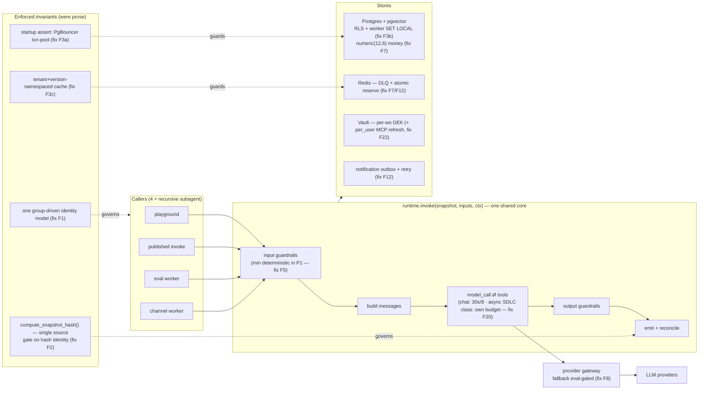

# Agent Platform — Principal-Architect Critical Review

> Independent, evidence-based review across the SDLC. **Date:** 2026-10-21. **Reviewer role:** external
> technical challenger (not a design approver). **Posture:** ruthless but balanced — credit what is right,
> attack what is weak, propose fixes with trade-offs.

### Scope & evidence rule (read first)

The backend is **fully designed but not built**. On disk there is only `frontend/` (a mock-only Next.js
console) and `docs/`; there is **no `services/` tree, no database, no running code, and no test suite**.
Therefore this is a **design & documentation review**. Almost nothing can be a *confirmed code defect*;
findings are classified as:

`confirmed-defect` (a spec/DDL is provably wrong or self-contradictory) · `probable-defect` ·
`architectural-risk` · `design-gap` · `documentation-gap` · `unverified-assumption` · `improvement`.

Every finding cites the artifact. Where evidence is absent, the report says so and names the measurement
required. Two candidate "confirmed defects" were **downgraded on verification** (noted inline) to keep the
register honest. Eight backend docs were **edited mid-review** (00, 01, 07, 08, 09, 11, 16, 17); findings
are re-verified against the current working tree and fixes are credited, not reported as open.

**Evidence base:** `docs/scope.md` (+ decision log), `docs/spec.md`, `docs/backend/00–17`,
`docs/eval-gap-analysis.md`, `docs/backend-integration-map.md`, and `frontend/src` (the one built
artifact). Finding IDs (F1–F27) are stable across this document.

---

## 1. Executive verdict

**The design is unusually honest and architecturally coherent for a pre-build spec — but it is not
production-ready, and it is being specified top-to-bottom ahead of validating the two hypotheses the entire
value rests on.**

What is genuinely right (and should be protected): the load-bearing idea that **playground, published
invoke, eval, and channel all execute the same `runtime.invoke(snapshot, inputs, ctx)`** over a **frozen,
immutable `VersionSnapshot`**, behind an **eval-gated publish** — so "test," "eval," and "production" can't
diverge and "editing an agent changes nothing live" is enforced in code. Cost computed from **our own
capability profiles** (never trusted from LiteLLM), a **fixed+versioned judge**, and a single **pgvector**
store are all correct, well-argued choices. The docs flag their own hard limits more candidly than most
specs do.

What holds it back, in priority order:

1. **The auth/tenancy spec is caught mid-reversal and internally contradictory** (F1) — the
   highest-blast-radius module can't be implemented unambiguously today.
2. **The eval gate — the product's #1 guarantee — rests on prose invariants, not enforced schema** (F2):
   several single-point failures would let a stale PASS serve and bypass the gate silently.
3. **Tenant isolation hangs on single unguarded assumptions** (F3): pool mode, worker scoping, cache
   namespacing, and a SECURITY-DEFINER projection are each one mistake away from a cross-tenant leak.
4. **The whole 17-doc build is specified before the MVP proves drift-detection and provider-abstraction
   work at all** (F4) — the user's own 2026-10-19 decision says not to.

A cross-cutting lens makes the stakes concrete: the **flagship flow** — a developer in Google Chat driving
a *shared* workspace agent with git + Jira tools through end-to-end SDLC work — is the most compelling use
case and the one the current design is *least* ready to govern. It lands almost entirely in **P2+**, its
per-user identity defaults to a **confused-deputy**, it **cannot be eval-gated**, and it **collides with
the 30s / 8-tool runtime bounds** tuned for short chat.

Infra sophistication (KEDA 0→N, gVisor per-call sandboxes, per-workspace Vault DEKs, a SECURITY-DEFINER
cross-tenant plane) runs ahead of a stated workload of "a small known set of users" on a ≤$100/mo build
budget. **Most of this is fixable by *locking and enforcing* what is already designed — not by a
redesign.**

**Readiness limitation:** the one running artifact (the FE) *fakes exactly the three capabilities that make
the platform defensible* — eval is `Math.random`, versioning is cosmetic, there is no runtime invoke. So
100% of the defensible value is unbuilt **and** unproven. Do the MVP before the build.

**Top strengths:** one-core execution · immutable snapshot + eval-gated re-point · cost-from-our-profiles ·
honest self-documentation.
**Top risks:** F1 (auth contradiction) · F2 (eval-gate integrity) · F3 (tenant isolation) · F4 (unproven
core) · F25 (eval can't govern the flagship agent).

---

## 1a. Decisions resolved with the owner (2026-10-21)

Five decision-changing questions (originally §13) were resolved after the first draft. They re-shape
several findings; treat this section as authoritative where it differs from the raw register below.

| # | Decision | Effect on findings |
|---|---|---|
| D1 | **Project = portfolio piece modeling an enterprise product.** | Keep the governance/tenancy *design* for narrative fidelity, but **F23 applies hard**: gVisor, KEDA 0→N, per-workspace Vault DEKs, and the SECURITY-DEFINER plane are **designed-not-built**. F1/F3 become **design-coherence** issues (must be *consistent and correct on paper*), not live production risk. |
| D2 | **Target workload: ~20–30 teams × 5–6 users × ~3 agents, ~10 calls/user/day.** | Concrete NFRs below. **Validates F23**: single-VM compose is right-sized; HA (**F11**) is optional for this scale. **Resolves F6**: the production path now has numbers. |
| D3 | **Flagship "shared chat agent + write tools for SDLC" is a headline** to design/demo properly. | **F25, F26, F20, F22 are must-resolve-in-design** (not standard P2). The composition of identity + runtime bounds + eval is first-class work. |
| D4 | **Shared team-thread memory; tool writes use the *space manager's* credentials ("for now").** | Introduces a **`space_delegated` auth mode** (below). **F26 downgrades** to an intentional, documented feature (enforce space ACL + cross-space isolation). **F22 reframes** to delegated-to-a-named-human (accepted risk). **F25 eases** (one stable tool identity per space) but still needs a tool-mock eval mode. |
| D5 | **Judge trust bar: Cohen's κ ≥ 0.4 (moderate) or accuracy ≥ ~85%** vs human labels, + low-confidence flagging on small suites. | **Sets the F4 gate**: the MVP passes the defensible-core check when the judge clears this bar *and* the drift harness hits the `scope` ≥80%/<10%-FP seeded-regression target. |

**Derived NFRs (from D2) — fold into `spec` A2 / `10 §5`:**
~20–30 workspaces · ~100–180 users · ~60–90 agents · **~1,000–1,800 invokes/day (~30–54K/month)** ·
**single-digit average / low-double-digit peak concurrency** (design headroom ~20–30 concurrent invokes) ·
chunk counts **well under the pgvector 1–5M P1 ceiling**. Proposed targets: published-invoke **p95 < 5s**
(non-tool) / **p99 ≤ 30s** (chat); **99.5%** invoke availability (keep `10 §5`); peak **~30–50 invokes/min**;
eval/ingest **queue start < 60s**. At this scale, right-size to **single-VM Docker Compose, HA as config
later** — do not build KEDA/gVisor/per-ws-DEK for P1.

**`space_delegated` auth mode (from D4) + the strict write rule (from R2) — new design element:**
A third `mcp_auth_mode` between `shared_service` (anonymous workspace token) and `per_user` (each caller
connects). **Scope rule (R2, strict):** `space_delegated` is valid **only for read-only tools**; **every
write/destructive tool requires `per_user`.** So D4's "space-manager creds for writes" is an explicit
**interim scaffold**, not the target — and because the flagship (D3) performs Jira *writes*, **`per_user`
must actually be built for the flagship demo to be legitimate.** `space_delegated` settles into: read-only
tools + an interim step before `per_user` ships.

- **Mechanics (space_delegated, read-only):** the **space manager connects once** via the in-chat link
  (`17 §4`); the space's read-only tool calls use that connection, attributed to the manager.
- **Manager designation & loss (R1):** the **channel creator is the default manager**, reassignable by a
  space/platform admin (channel gains a `manager_subject` field). Connect requires an **explicit consent
  screen** (the manager is delegating their access to the space). On manager **offboard / revoke / expiry**,
  space tool calls **fail-closed** (`mcp.connect_required`) and publishers+admins are **notified** to
  re-designate + reconnect; **read-only retrieval / RAG keeps working**. A write the manager lacks perms for
  returns the **upstream permission error** to the caller (no escalation).
- **`per_user` (required for writes):** each caller connects their own git/Jira once (in-chat link);
  writes act as, and are audited upstream as, the **calling user**. Must ship with the flagship.
- **Eval (F25):** `per_user` tool results vary by user and can't run live in eval → the **tool-mock /
  record-replay eval mode stays required**; `space_delegated` read-only tools have one stable identity and
  can use a designated test/sandbox connection.

**Session model (from D4):** key sessions on `(workspace_id, agent_id, conversation_id)` with memory
**shared per thread** (the current `platform:thread_id` key is acceptable for the shared-thread choice);
store the LangGraph checkpointer in **Postgres** (durable for paused/approval runs); add an **idle-TTL
reaper** (**14 days default, configurable per workspace** — R3) + **compaction** for long sessions, which
**never reaps a session with a pending approval or an in-flight run** and **purges a user's sessions on
offboarding** (doubles as a PII-retention control). The reaper runs **tenant-scoped** — it shares the
**F3(b)** worker-GUC-scoping fix.

---

## 2. System reconstruction

### 2.1 Business capability & intended users

Internal platform to **build → configure → test → publish** LLM agents with guardrails, provider-
agnosticism, and drift-aware evaluation (`spec.md` Context). Users: internal builders/PMs at one org — "a
small known set of users" (`scope.md`). One deployment = one org (`01 §4.9`).

### 2.2 Components & responsibilities (as designed)

| Plane | Component | Responsibility | Status |
|---|---|---|---|
| Edge | `web` (Next.js) | Builder console + playground (SSE) | **built (mock)** |
| API | `api` (FastAPI) | Builder routes + published invoke; auth, tenancy, RLS, SSE | designed |
| Core | `runtime` (pure lib) | `invoke(snapshot, inputs, ctx)`: guardrails → retrieval → gateway → tool loop → emit | designed |
| Core | provider gateway | LiteLLM transport + our capability profiles + cost + retry/fallback/breaker | designed |
| Workers | `worker` interactive / batch | eval, ingest, channel runs, deprecation scan (arq/RQ; batch KEDA 0→N) | designed |
| Isolation | `sandbox` (P2) | gVisor per-call tool/MCP execution behind a Squid egress allow-list | designed (P2) |
| Stores | Postgres+pgvector · Redis · Vault · Langfuse · MinIO | money/tenancy SoR · queue+cache · secrets · traces · blobs | designed |

**The load-bearing invariant:** `runtime` is a library with no FastAPI/HTTP types; **four thin callers**
wrap it — playground, published, eval, channel — plus a recursive fifth `run_source=subagent` (`00 §1`,
post-edit now "four", `01` enum). `invoke()` reads an immutable `VersionSnapshot`, never a live `agents`
row (`00 §4`, `03 §3`).

### 2.3 Representative request trace — published invoke (the production path)

`POST /v1/agents/:id/invoke` → sha256 bearer → `api_tokens` lookup (reject revoked/expired) → `SET LOCAL
app.workspace_id` (RLS pin) → Redis rate-limit + spend reserve → load `VersionSnapshot` + access_policy →
`canUse = config ∩ grants ∩ tenant ∩ policy` → Vault JIT key decrypt → `runtime.invoke` (input guardrails →
build messages → model/tool loop ≤8, ≤30s → output guardrails) → SSE stream → record Run+spans+cost →
reconcile spend (`08`, `09`, `03`). This path is correct in shape; its weak seams are F2/F3/F7/F14.

### 2.4 Flagship user-flow trace — SDLC dev agent over Google Chat, shared by a team

> **Scenario.** Dev A messages a Google-Chat-hosted agent ("pick up JIRA-123, implement + open a PR"). The
> agent has a **git** source and a **Jira** tool and does multi-step SDLC work. Dev B uses the **same**
> agent for their own tickets. This is the product's most compelling story; walking it end-to-end exposes
> cross-cutting issues a per-document sweep under-weights. **Correction from the FE:** *git is a read-only
> RAG connector* (`frontend/src/lib/connectors.ts:66`), *Jira is the read+write MCP tool*
> (`data.ts:684` `create_issue`) — so the write-path risk concentrates on Jira.

1. **Scope reality.** The whole flow is **P2+**: channels (`spec` A1 §7), tools/MCP (A0 #6), per-user MCP
   identity (`17`, "PROPOSED P2+"). The **P1 product cannot do SDLC automation at all** (P1 = chat
   playground + eval + publish + minimal RAG; *no tools, no channels*). The findings below are **P2
   design-integrity issues to resolve before building the P2 that enables this flow** — that is the honest
   counterargument to treating them as live P1 holes.
2. **Ingress + identity (works, with caveats).** `12 §4`: verify webhook → `email` join key → Okta subject
   → mint 15-min token → enqueue → worker `invoke` → post reply. Per-user **cost attribution** works
   (`12 §159`). Caveats: email spoof / guest binding (**F21**); reply depends on queue reliability (**F12**).
3. **The eval gate cannot govern this agent (F25).** A `per_user` tool's result varies by user and eval
   runs with `principal_id=None` (`17 §7`), and a real eval of an SDLC agent would *execute destructive
   Jira writes* — no mock/dry-run **eval** mode exists (`test-invoke` is a single-tool dry-run, `08`). The
   agents that most need the publish gate are the ones it can't cover.
4. **Channel session is keyed by thread, not user (F26).** `12`: `session_id = f"{platform}:{thread_id}"`,
   "NEW TURN ONLY" — history loads from the checkpointer by that key. In a multi-person Google Chat space,
   teammates **share memory/retrieved context**; RLS is *workspace*-scoped and does not isolate users
   within a tenant. The doc flags "pin the new-turn-vs-full-history contract before shipping" (unresolved).
5. **Per-user identity defaults to a confused-deputy (F22).** `auth_mode` defaults to `shared_service`
   (`17 §2`) and the FE implements *only* that mode (one workspace Jira token for everyone,
   `frontend/src/lib/mcp.ts`). So today every teammate's Jira writes happen as one service identity — wrong
   audit, privilege bleed. `per_user` is the right fix (+ channel connect-link, `17 §4`); the mid-review
   edit removed the *silent* fallback, but the default is still shared.
6. **Runtime bounds vs agentic work (F20).** Full SDLC is >8 tool calls and >>30s; `deadline_s=30s` +
   `MAX_TOOL_CALLS=8` abort it mid-run ("8 serial tools ×10s = 80s > 30s", `03 §8`).
7. **Destructive governance over async chat (F18 + indirect injection F5).** Jira writes are
   `requires_approval` → pause via `interrupt()`, routing approval to **publisher+** (not the Dev who
   asked), no inline chat approve UX, **undefined expiry**. The agent reads untrusted Jira/git content that
   can drive a destructive write (indirect injection) while sandbox+egress+approval are all **P2**.
8. **Shared-agent operational seams (F7/F12/F14).** Workspace-only spend cap → one dev's runs trip the 402
   and DoS teammates (per-caller budget is P2). A worker crash mid-run has no DLQ → no reply + a partial,
   non-idempotent side effect (committed/filed but no PR; retry → double writes).

**Net:** identity (17), runtime bounds (03), and eval (05) are each reasonable alone but **mutually in
tension for this flagship case**; composing them is the main pre-P2 work.

### 2.5 Frontend-flow grounding (what is demonstrable today)

The console is a **faithful control surface** for the full lifecycle, the Okta-group access model,
channels, tools/MCP config, and eval authoring + a **real 3-part publish gate**
(`store.ts:publishAgent` blocks `eval_failing` / `needsReEval` / `low_confidence`+override). But it **fakes
the three defensible capabilities**:

- Eval is `Math.random` (`store.ts:simulateEvalRun`), the deterministic hard-assertion floor `hardFail` is
  never computed, versioning is cosmetic (re-freeze / "save as new version" are toasts; no `snapshot_hash`;
  `Version` is a seed array), and there is no runtime invoke (`addRun` is client-side).
- **Per-user tool identity is absent end-to-end** — only `shared_service`; no `auth_mode`/`per_user`/connect
  surface exists (grep-empty). Confirms F22/F25 in the built artifact.
- The FE has **already committed to the Okta-group access model** (`iam.ts`; members tab read-only) — which
  makes F1 a *cleanup* (delete the superseded roster prose in `09`), not an open design question.

---

## 3. Requirements traceability

### 3.1 Requirements → component → validation evidence

| Requirement (source) | Component | Validation designed | Evidence today |
|---|---|---|---|
| Playground first-token p95 <2s (`scope` metric 4) | playground→runtime→gateway | `Part D` p95 test | none (no runtime) |
| Drift detect ≥80% / FP <10% (`scope` metric 2) | evals/drift | seeded-regression test (`Part D`) | **none — eval is `Math.random`** |
| ≥1 guardrail on every published agent (`scope` metric 3) | runtime guardrails | — | **contradicted:** guardrails P2 (**F5**) |
| Provider abstraction holds ≥2 providers (`scope` unknown 2) | gateway + profiles | contract tests (`Part D`) | none (unproven, **F4**) |
| New agent → endpoint <15 min (`scope` metric 1) | api/publish/export | manual | FE flow present |
| Versions immutable & reproducible (`spec` A2) | `agent_versions` freeze + `snapshot_hash` | freeze rule | **rule bypassable (F2d); FE cosmetic** |
| Multi-tenant isolation (`spec` A2) | RLS + app scope | isolation suite (`09 §8`) | **assumptions unguarded (F3)** |
| Secrets never plaintext/exported (`spec` A2/B12) | Vault Transit | secret-scan (`Part D`) | FE masks refs |
| Every model call logged (`spec` A2) | obs span helper | — | FE shows runs (seeded) |
| Hard monthly spend cap (P1, 2026-10-19) | BudgetGuard | over-budget test (`Part D`) | **precision/atomicity gaps (F7)** |

**Takeaway:** the four *measurable, defensible* requirements (drift detection, provider abstraction, p95,
spend cap) have **zero validating evidence** today, and two have design-level defects. The CRUD/control
surface is well-traced; the engineering that matters is unproven.

### 3.2 FE ↔ backend-design divergence ledger

| Divergence | Class | Evidence |
|---|---|---|
| Eval scored by `Math.random`; `hardFail` never computed | confirmed (mock placeholder) | `store.ts:simulateEvalRun` vs `05 §2` |
| Versioning cosmetic (toasts; no `snapshot_hash`) | confirmed | `store.ts`, `page.tsx` vs `01 §4.2` |
| Per-user MCP identity absent (only `shared_service`) | backend-ahead | FE grep-empty vs `17` |
| Tool/MCP test-invoke (dry-run) absent | backend-ahead | FE vs `08`, `11 §1` |
| Adoption / governance / notifications surfaces | backend-ahead | zero FE vs `14/15/16` |
| Self-serve workspace create / hard-delete / reactivate | FE-ahead (no endpoint) | `store.ts` vs `backend-integration-map` |
| Eval **authoring** present + P1 gate depends on it | phasing (**F27**) | `SuiteAuthoring` vs `spec` P2 tag |
| Access model = Okta-group-driven | backend-ahead, FE realigned | `iam.ts` vs `09 §2.1` |

---

## 4. SDLC coverage matrix

| SDLC phase | Reviewed | Key findings | Evidence limit |
|---|---|---|---|
| A. Requirements / product | ✅ | F4, F6, F5, F27 | NFRs for prod path absent |
| B. System architecture | ✅ | F1, F3, F11, F23 | no code; topology from docs |
| C. AI & data architecture | ✅ | F2, F7, F8, F9, F15, F16, F19, F24 | eval/gateway unbuilt |
| D. Implementation / code | ⚠️ partial | FE only (mock); backend has none | can't review backend code |
| E. Security / threat model | ✅ | F1, F3, F5, F13, F14, F21, F22, F25 | controls designed, untested |
| F. Testing / verification | ✅ | F4 (no tests exist), F25 | `Part D` designed, 0 implemented |
| G. Deployment / release | ✅ | F10, F11, F18 | IaC not on disk |
| H. Operations / incident | ✅ | F11, F12, F18 | runbooks are one-liners |
| I. Maintenance / evolution | ✅ | F1 (churn), F10, F15 | decision log shows 3× reversals |
| J. Cost / efficiency | ✅ | F7, F19, F23 | no measured workload |

---

## 5. Prioritized findings register

> P0 = fix in the design before building · P1 = required before production · P2 = hardening · P3 =
> future/strategic. A/B/C options for P0+P1 (+ flagship F25/F26, F20/F22) are in §10; P2/P3 in §9.5 table.

### P0 — design blockers

**F1 · Auth/tenancy spec is mid-reversal and self-contradictory.** `confirmed-defect · Critical.`
`09 §2.1` declares the app-managed `memberships`/invites/`access:open` model **removed** (2026-10-20 group
pivot), yet `09 §1/§3/§4/§5` still present `get_workspace_ctx` membership checks, `Principal.memberships` /
`role_in()`, and self-join of open spaces as current (lines 12, 26–30, 47–51, 85–86, 121–126). The identity
model was reversed 3× in the decision log. *Failure scenario:* two engineers implement two different auth
models; RLS pins and token issuance built on the wrong one. The FE already picked **group-driven**
(`iam.ts`), so this is a **cleanup**, not an open question. *(Mid-review: `16` was fixed to match; `09` body
was not.)*

**F2 · Eval-gate integrity rests on unenforced invariants.** `probable-defect (cluster) · Critical.` The
publish gate is "the single most important behavioral guarantee" (`05 §5`), but: (a) `snapshot_hash`
completeness is prose across three notes (`05 §6`) — one unfolded field (retrieval_config / kb_index_version
/ skill hash) → stale PASS served from cache, gate bypassed silently; (b) `assert_publishable` gates on
`latest.started_at < last_trigger` (timestamp), **not** on `candidate_hash == snapshot_hash` (hash
identity) — verified `05 §5` L220; (c) `DRIFT_TRIGGERS` omit `memory_config`/`context_config` though
compaction invokes a model (`03 §6/§7`); (d) the immutability rule fires only `where old.snapshot_hash is
distinct from new.snapshot_hash` — verified `01 §4.2` L243–245 — so an UPDATE that edits a frozen field
while leaving the hash stale **passes the DB "belt."** *Failure scenario:* a prompt edit with a stale hash
serves an old PASS; drift ships to prod undetected — the exact failure the product exists to prevent.

**F3 · Tenant isolation hangs on single unguarded assumptions.** `architectural-risk · Critical.`
(a) RLS needs PgBouncer **transaction**-pool mode + per-request `SET LOCAL` — acknowledged (`09 §7`,
`11 §7`) but **no startup assertion** that pool mode is correct; (b) background workers write tenant rows
outside the request path that sets the GUC — their scoping is unspecified; (c) Redis cache (exact/semantic/
verdict/embed) is **not** RLS-protected and the semantic-cache lookup shows no `workspace_id`/`snapshot_hash`
namespace (`07 §4.3`); cache is absent from the `09 §8` isolation suite; (d) the SECURITY-DEFINER org-report
function selects every workspace's rows and private-tier protection lives only in Python
`project_estate_row` (`15 §2.3`), not SQL. *Failure scenario:* any one misconfig/omission → cross-tenant
read; for a security-product tenant this is the worst case.

**F4 · The whole build is specified ahead of validating the two load-bearing unknowns.**
`unverified-assumption · High (strategic).` `spec.md` L17 "Assumes the viability MVP has passed," but
`scope.md` 2026-10-19 says the MVP has **not** run and "nothing should hit the full build until [the two
unknowns] are validated." Those unknowns (drift detection ≥80%/<10%; provider abstraction across ≥2
providers) are the entire defensible value. The FE confirms it — eval is `Math.random`. *Failure scenario:*
months of build on a core that can't actually detect drift or hold across providers.

### P1 — required before production

**F5 · Guardrails phasing contradicts a P1 metric and the runtime.** `probable-defect · High.` Guardrails
are P2 (`spec` A0 #10, B9) but `scope` metric 3 requires ≥1 guardrail on every published agent and the
shared runtime runs them as core. Also: streaming LLM-policy guardrail runs **post-stream** (client already
got the tokens, `06 §5`); input injection-scan covers only user text, not retrieved-doc/tool/skill content
re-entering the model (`06 §4`, `09 §10` has no retrieval-injection row).

**F6 · No NFRs for the production invoke path.** `design-gap · High.` Only playground first-token p95 is a
*target*; `10 §5` lists SLOs (p99 ≤30s, 99.5% invoke availability, <2% provider errors) but there is **no**
throughput/RPS, concurrency, tenant-count, dataset-size, or retention target for `POST /v1/.../invoke`.

**F7 · Money accuracy can silently drift and mis-enforce the hard cap.** `probable-defect · High.`
`01 §1.5` mandates `numeric(12,6)` but `spend_limits.monthly_budget_usd` is `numeric(12,2)` and the counter
uses `incrbyfloat` (float) (`01 §4.8`, `07 §3`); reserve→check→rollback is 2 non-atomic round-trips (false
`BudgetExceeded`; leaked reservation on crash/disconnect, `08 §4`); cost comes from hand-maintained profiles
(`02 §4.2` "manual-first… reduces not eliminates") with no reconciliation tolerance/cadence (`07 §9`).

**F8 · Fallback + capability-substitution serve un-evaluated / mispriced output in prod.**
`architectural-risk · High.` Provider outage → gateway streams the pinned fallback model, never
eval-gated, possibly mispriced (`02 §6`); a substitution on a *published* run only *warns* (`02 §5`). The
"nobody noticed it got worse" failure, in the code path meant to prevent it.

**F9 · Deleted/redacted documents remain searchable.** `probable-defect · High.` Ingest is upsert-only; no
delete/tombstone; `documents`/`chunks` lack `deleted_at`; a published version keeps its pinned
`index_version` after re-ingest (`04 §2/§9`). A redacted doc's chunks stay retrievable by live agents.

**F10 · Published API has no backward-compatibility gate.** `design-gap · High.` The per-endpoint OpenAPI is
derived from the agent's mutable `io_contract`; a new version with a changed contract silently breaks
external cURL/SDK callers (`08 §1/§5`); only a URL `/v1` prefix, no deprecation policy.

**F11 · No DR/rollback for logical artifacts; single-replica SPOF.** `design-gap · High.` Backups cover data
stores (`11 §10`) but there is **no rollback runbook** for a regressed live agent/prompt/model re-point (the
model-deprecation migration is "out of scope", `16 §3.3`); start-state Postgres/Redis/Vault/MinIO are
single-replica (`11 §1`) under a 99.5% invoke SLO.

**F12 · Delivery/notification reliability re-opens the founding problem.** `design-gap · High.`
Notifications are best-effort, no outbox/retry — a dropped write "silently re-creates the exact gap the doc
exists to close" (`16 §2`); no DLQ/retry/poison handling on the Redis queue (`10 §9`, `12 §1`).

**F13 · Key-custody enforcement has no teeth without an unbuilt precondition.** `design-gap (acknowledged) ·
Medium-High.` Degrades to "visibility + mandate" without cloud-IAM centralization + egress control, "owned
outside this codebase" (`14 §1`, `09 §9.1`).

**F14 · Idempotency + caller-token identity gaps.** `design-gap · Medium.` Post-TTL retries return only
`result_expired`; concurrent same-key behavior undefined; SSE has no `Last-Event-ID` resume (`08 §1/§4`). A
caller/admin token's subject is self-asserted in scopes and an admin token bypasses `private`-tier for the
whole workspace with no per-call human identity (`09 §5/§6`).
> **⚠️ Partly superseded (2026-10-22 claim-based model; scope.md rev 6).** The "admin token bypasses private"
> half is **moot**: all runtime callers now resolve to the caller-only `executer` role, `admin` is a console
> claim, so there is **no admin token at invoke** and no private-tier bypass. The idempotency gaps remain (see
> `architecture-review-v2.md` H9).

**F25 · (flagship) Eval gate can't govern side-effecting / per-user agents.** `architectural-risk · High.`
See §2.4(3), `17 §7`, `08` test-invoke. Undercuts the defensible core for the product's best use case.

**F26 · (flagship) Channel session keyed by thread → intra-tenant cross-user context leak.**
`probable-defect · High.` See §2.4(4), `12`. RLS does not cover intra-tenant user isolation.

### P2 / P3 — see the hardening table in §9.5

F15–F24, F27. (F20 "30s deadline too tight" and F22 "per-user identity default" are elevated to §10 because
they are load-bearing for the flagship flow.)

### Downgraded on verification (kept for honesty)

- *"`chunks.embedding vector(3072)` is a defect":* **downgraded** — `01 §4.4` explicitly resolves it via
  "one embedding model family per org in P1"; it is a documented P1 constraint, tracked as **F15**.
- *"Tools run unsandboxed in P1":* **downgraded** — spec A0 #6 / `08` mark Tools **P2**; `09 §10`'s "P1
  (http tools)" is a *phasing contradiction* across docs (tracked in **F27**/§10-F5 area), not a live hole.

---

## 6. AI-specific assessment

- **Model & inference.** Gateway design is sound: IR normalization, cost from profiles, retry/breaker/
  fallback (`02`). Gaps: fallback serves un-eval'd/mispriced output (**F8**); profile staleness drifts cost
  (**F7**); no structured-output *enforcement* detail beyond "profile supports it."
- **Eval & drift (the differentiator).** Two-layer (deterministic + fixed judge, rubric + pairwise) is the
  right shape (`05`). But integrity rests on prose invariants (**F2**), the judge is a single-provider
  dependency with no dollar kill-switch and no run-path if it's down (**F19**), small-set honesty exists but
  `allow_low_confidence_override` is a self-authorized bypass, and the whole thing is unproven (**F4**) and
  `Math.random` in the FE. **Side-effecting agents can't be eval-gated at all (F25).**
- **RAG.** Reproducibility binding (embedding model + index_version pinned per version) is correct (`04`).
  Gaps: deleted-doc still searchable (**F9**), embedding-migration/index-rebuild has no runbook (**F15**),
  chunk/doc ACL is P2 and eval bypasses KB ACL (**F16**).
- **Agents & tools.** Bounded loop (≤8 calls, ≤30s), approval gate, sub-agent depth/fanout caps, snapshot of
  tool schemas — all good. Gaps: bounds too tight for real agentic work (**F20**), per-run dollar budget is
  P2 (**F19**), per-user identity is the confused-deputy problem (**F22**), approval-gate expiry undefined
  (**F18**).
- **Governance.** Fixed+versioned judge, audit log, drift triggers, notifications — strong intent.
  `drift` state is only seeded in the FE, never computed from an eval (`eval-gap §5.2`); production-quality
  drift source is designed but unreconciled with trigger-based drift (**F24**).

---

## 7. Security & reliability assessment

**Threats (adversarial view).**
- *Indirect prompt injection via Jira/git/tool/retrieved content → destructive action as the user* (**F5**,
  §2.4). High-value in the flagship flow; sandbox+egress+approval all P2.
- *Confused deputy* — shared agent + `shared_service` tool creds → actions as the bot, privilege bleed
  (**F22**).
- *Cross-tenant read* — pool-mode/worker/cache/SECURITY-DEFINER single points (**F3**).
- *Intra-tenant cross-user leak* — thread-keyed channel sessions (**F26**).
- *PII/residency* — prompts/outputs to 3rd-party providers + Langfuse; ZDR "where compliance requires" is
  not enforced; embeddings not in redaction scope (**→ hardening**, `09 §11`, `10 §2`).
- *Token privilege edge* — admin token bypasses private-tier, self-asserted subject (**F14**).
- *Channel identity spoof* — email as join key, no verified-domain binding (**F21**).

**Reliability / failure modes.**
- Single-replica stateful core vs 99.5% SLO (**F11**); no DLQ/retry (**F12**); no logical-artifact rollback
  (**F11**); Vault mid-run outage path undefined (**→ hardening**); best-effort notifications re-open the
  founding problem (**F12**).

**Positives:** Vault Transit per-workspace DEK, JIT decrypt, hashed tokens, deny-by-default egress (P2),
RLS backstop, one audited SECURITY-DEFINER crossing — the *design* names the right controls; the risk is
that each hinges on a single unenforced guard.

---

## 8. Testing & release assessment

- **No tests exist** (CLAUDE.md; `npm test` absent). `Part D` designs the right suite — provider-abstraction
  contract tests, seeded-regression (≥80%/<10%), RAG retrieval test, publish-gate 409, secret-scan, p95 —
  but 0 are implemented. This is expected pre-build, but it means **every defensible claim is currently
  unfalsified.**
- **Release gaps:** no backward-compat gate on the published contract (**F10**); no canary/rollback for a
  bad version/prompt/model (**F11**); eval-authoring routes tagged P2 while the P1 gate depends on them
  (**F27**).
- **Verification the review itself requires** (what to measure before trusting the design): judge calibration
  κ vs human labels (no number in docs, `05 §8`); cost reconciliation tolerance vs provider billing (`07
  §9`); isolation suite extended to cache + model-context + intra-tenant users; pool-mode startup assertion
  test.

---

## 9. Scalability & cost assessment

### 9.1 Stated workload (sparse)
"Small known set of users" (`scope`); illustrative "~40 agents, ~9K tokens/call, 48K calls/30d" (`07 §11`);
pgvector P1 ceiling "~1–5M chunks/deployment, switch past 5–10M" (`04 §6`); ≤$100/mo build budget. **Absent:**
tenant/workspace counts, concurrency, RPS, dataset sizes, retention numbers, rate-limit values.

### 9.2 Bottlenecks & conditional scenarios
- List DTOs carry per-row rollups → N+1 on list pages (**F17**); unbounded page size (**F17**).
- HNSW build/rebuild is RAM/time-heavy; embedding migration has no plan (**F15**).
- KEDA/sandbox 0→N cold start may exceed the <60s queue SLO + unbounded cost-amplification (**F18**).

### 9.3 Cost
Judge is "the primary cost center… will bankrupt you" (`05 §6`); controls are reducers only, no hard dollar
kill-switch (**F19**). Workspace-only cap → noisy-neighbor DoS on shared agents (**F7**/§2.4-8).

### 9.4 Right-sizing (the "sophistication ≠ better" check)
For "a small known set of users," gVisor per-call sandboxes, KEDA 0→N, per-workspace Vault DEKs, and a
SECURITY-DEFINER cross-tenant plane are **heavier than the workload warrants for P1** (**F23**). Most are
already P2; recommend explicitly **deferring** them and shipping P1 on single-VM compose (HA as config
later) to cut operational and cost surface until measured need.

### 9.5 P2 / P3 hardening & backlog table

| ID | Title | Class | One-line fix |
|---|---|---|---|
| F15 | Embedding-model migration / index rebuild has no runbook | design-gap | per-dim table + backfill/dual-write + HNSW rebuild cost plan |
| F16 | Chunk/doc ACL is P2; eval bypasses KB ACL | arch-risk (doc'd) | doc-level ACL + eval read-scope policy |
| F17 | N+1 list rollups; unbounded pagination; FK/constraint gaps | arch-risk | materialize rollups; max page size; add CHECK/FK/unique; namespace signature HNSW |
| F18 | Ops gaps: cold-start vs SLO, rotation cadence, approval expiry, Vault outage, runbooks | design-gap | warm pools; rotation policy; expiry=auto-deny; Vault breaker; real runbooks |
| F19 | Judge single-provider dep; no dollar kill-switch | arch-risk | judge fallback or eval-blocked-degraded; per-run/eval hard ceiling |
| F20 | 30s/8-tool bounds cut legitimate agentic runs | improvement | long-running async run class w/ own budget (elevated, §10) |
| F21 | Channel email-as-join-key spoofable | arch-risk | require verified corporate-domain binding |
| F22 | Per-user MCP identity PROPOSED; default shared | design-gap | ship `per_user` + versioned; default write tools per_user (elevated, §10) |
| F23 | Infra heavier than workload | improvement | defer gVisor/KEDA-0→N/per-ws-DEK/SECURITY-DEFINER-plane past P1 |
| F24 | Multi-judge/calibration/prod-drift source | improvement | judge κ target; reconcile prod-proxy drift with trigger drift |
| F27 | Eval-authoring P2 but P1 gate depends on it | phasing | pull suite/case/baseline authoring into P1 |

---

## 10. Fix-options comparison (P0 + P1 + elevated flagship findings)

> A = minimal correction · B = recommended · C = strategic. Preferred option in **bold**.

**F1 — Auth spec contradiction.**
A: Add an "authoritative = group-driven" banner atop `09`. *(cheap; leaves contradictory body — rejected.)*
**B: Delete the superseded roster prose from `09 §1/§3/§4/§5`, keep only the group-driven model (match
`iam.ts`), add one worked `get_workspace_ctx` example. Small effort, removes ambiguity before any plumbing.**
C: Re-model identity from scratch. *(unjustified — the FE already settled it.)*
*Validate:* a single doc read yields exactly one membership model; FE `iam.ts` and `09` agree.

**F2 — Eval-gate integrity.**
A: Expand the prose invariants + add tests. *(still prose — rejected.)*
**B: One `compute_snapshot_hash()` as the sole source of truth (unit-tested over every frozen field incl.
retrieval_config/kb_index_version/skill hash); gate on `candidate_hash == snapshot_hash` not timestamps;
add `memory_config`/`context_config` to `DRIFT_TRIGGERS`; change the DB rule to forbid any frozen-column
UPDATE (not just hash-divergent ones). Medium effort; makes the #1 guarantee enforced, not hoped.**
C: Content-addressable versions (hash = primary key). *(elegant, larger migration; revisit post-MVP.)*
*Validate:* property test — any frozen-field mutation either mints a new version or is rejected; a stale-hash
publish attempt 409s.

**F3 — Tenant isolation.**
A: Document the pool-mode requirement louder. *(already documented — insufficient.)*
**B: Enforce it: startup assertion that PgBouncer is transaction-pool (refuse boot otherwise); explicit
`SET LOCAL` in the worker entrypoint; namespace all Redis cache keys by `(workspace_id, snapshot_hash)`;
move private-tier filtering into the SECURITY-DEFINER SQL; extend the `09 §8` isolation suite to cache +
model-context + intra-tenant users. Medium; converts single guards into enforced invariants.**
C: Schema-per-tenant or separate DB per tenant. *(overkill for the workload — F23; rejected for P1.)*
*Validate:* isolation suite (incl. cache) is green in CI; boot fails on session-pool mode.

**F4 — Unproven core.**
**A/B (same, and recommended): Run the `mvp-spec.md` de-risking MVP first — cheap/local models, the two
unknowns as pass/fail — and gate further backend build on it. This is the user's own 2026-10-19 sequence.**
C: Build P1 in parallel with the MVP. *(risks months of rework if an unknown fails — only if timeline forces
it.)*
*Validate:* a seeded-regression report hits ≥80% detect/<10% FP and the IR holds across 2 providers before
the full build proceeds.

**F5 — Guardrails phasing / streaming / injection.**
A: Drop success-metric 3 from P1. *(removes the contradiction but also the trust promise — weak.)*
**B: Pull a *minimal deterministic* guardrail stage (regex/PII/denylist) into P1; gate streaming off for
policy-guarded agents; treat tool/retrieved content as untrusted input (injection scan + provenance tag)
before the model acts. Small-medium; keeps the "trustworthy endpoint" promise real.**
C: Full Guardrails-AI/NeMo pipeline in P1. *(P2-scale effort — defer.)*
*Validate:* a published agent cannot exist with zero guardrails; a golden injection case is blocked.

**F6 — Prod NFRs.**
**B (recommended): Write small explicit numbers — e.g. invoke p95/p99, N concurrent invokes/workspace,
max KB size, runs retention — into `spec` A2 + `10 §5`, even if conservative.** A: reuse the playground p95
only *(insufficient).* C: full capacity model *(premature).*
*Validate:* every SLO has a number and a dashboard target.

**F7 — Money accuracy.**
A: Change the column to `numeric(12,6)`. *(necessary but partial.)*
**B: Single money type end-to-end + atomic Lua reserve/rollback (one round-trip) + profile-staleness alert
(`verified_at` >90d) + a reconciliation SLA vs provider billing. Small-medium; the cap acts on correct
numbers.** C: a ledger/double-entry spend service *(P3.)*
*Validate:* concurrent reservations never false-trip; disconnect frees the reservation; reconciliation
variance < tolerance.

**F8 — Fallback/substitution un-eval'd.**
A: Flag the run degraded + notify. *(cheap, honest.)*
**B: Require the pinned fallback model to pass the same eval baseline (eval the pair), and treat a runtime
capability-substitution as a drift signal, not just a warning. Medium; preserves the drift guarantee under
outage.** C: no automatic fallback (fail over to a queued retry) *(worse UX.)*
*Validate:* an outage-driven fallback either is pre-eval'd or surfaces as degraded + a drift notice.

**F9 — Deleted docs searchable.**
**B (recommended): add `deleted_at` tombstones + cascade on source/doc removal; define redaction
propagation to pinned indexes (force re-point or purge).** A: manual purge script *(error-prone).* C:
per-chunk ACL + soft-delete everywhere *(ties to F16, P2).*
*Validate:* a deleted source's chunks are unreachable by new and pinned runs within a defined window.

**F10 — Published contract back-compat.**
**B (recommended): a compatibility check at re-point (additive-only `io_contract`, else require a new
endpoint/version); publish OpenAPI diff in the audit.** A: document a manual policy *(unenforced).* C:
full API versioning (`/v2`) *(premature.)*
*Validate:* an incompatible `io_contract` change is blocked or routed to a new endpoint.

**F11 — DR/rollback + SPOF.**
A: Document a manual re-point-to-last-good. **B (recommended): a one-command rollback keyed on the immutable
version history (re-point endpoint to the last PASS snapshot) + HA for Postgres/Vault/Redis before prod +
restore drills.** C: active-active multi-region *(far beyond workload.)*
*Validate:* a game-day: regress a live agent, roll back < RTO; kill the primary DB, recover < RTO.

**F12 — Delivery reliability.**
**B (recommended): transactional outbox + retry for notifications; DLQ + backoff + alert for the Redis
queue; on channel-run failure, post a failure reply.** A: best-effort + a reaper *(current — re-opens the
gap).* C: a durable broker (e.g. Kafka) *(overkill.)*
*Validate:* a crashed worker's message lands in DLQ and the user gets a failure reply; a dropped
notification is retried.

**F13 — Key-custody teeth.**
**B (recommended): state it as explicit residual risk in `spec`/`scope`; sequence the cloud-IAM + egress
lift as a named precondition, or scope the "enforcement" claim down to "visibility + mandate" until then.**
A: leave as-is *(overclaims).* C: build the egress/IAM centralization now *(out of codebase scope.)*
*Validate:* the product claim matches the delivered control; no "enforced" language without the precondition.

**F14 — Idempotency / token identity.**
**B (recommended): durable idempotency store (not TTL-only) returning the original result; define
concurrent-same-key semantics (wait-and-replay or 409); `Last-Event-ID` SSE resume; constrain admin-token
private-tier access + audit per-call.** A: extend the TTL *(partial).* C: full exactly-once tool execution
*(F12/C territory.)*
*Validate:* a retried call returns the original output; a dropped SSE resumes; admin-token private access is
audited.

**F20 (elevated) — Runtime bounds vs agentic work.**
A: raise the defaults. *(breaks the p99 guarantee for chat.)*
**B: a distinct long-running/async run class (own deadline + tool budget + progress streaming) selected per
agent; keep 30s/8 for chat. Medium; lets SDLC agents exist without wrecking chat latency.**
C: a full durable-execution engine. *(P3.)*
*Validate:* an SDLC agent completes a 10-step task; a chat agent still hits p99 ≤30s.

**F22 (elevated) — Per-user identity default.**
A: warn when a write tool uses `shared_service`. **B (recommended): ship `per_user` as real, versioned
schema+API; default write/destructive tools to `per_user`; keep the fail-closed `mcp.connect_required`
(already added); never silent-fallback for destructive tools (already added).** C: mandatory per_user for
all tools *(breaks read-only team tools.)*
*Validate:* a shared agent's Jira write acts as the calling user, audited upstream as that user.

---

## 11. Recommended target architecture

The design is largely sound, so the target is **the current architecture with the P0/P1 fixes made
explicit and enforced** — not a redesign. Changes are additive; the immutable version history is the
rollback substrate.

**Deferred to P2 (right-sized for the stated workload — F23):** gVisor per-call sandbox + Squid egress,
KEDA 0→N batch autoscaling, SECURITY-DEFINER org-governance plane, doc-level ACL, per-user MCP (ship with
the tools that need it). P1 runs on single-VM compose, HA as config later.

**Updated critical flows to re-draw in the full design set:** published-invoke (add F2 hash-gate + F7 atomic
reserve), channel ingress (F26 per-user session key + F12 DLQ), eval-drift gate (F2 hash identity + F25
tool-mock eval mode).

---

## 12. Prioritized remediation roadmap

| Pri | Findings | Task | Depends on | Acceptance criteria | Effort |
|---|---|---|---|---|---|
| **P0** | F4 | Run the de-risking MVP; gate the build on it | — | seeded-regression ≥80%/<10% FP; IR holds across 2 providers | M |
| **P0** | F1 | Collapse `09` to the group-driven model; delete superseded prose | — | one membership model in docs; FE `iam.ts` ≡ `09` | S |
| **P0** | F2 | Single `compute_snapshot_hash()`; gate on hash identity; +2 triggers; fix freeze rule | — | frozen-field mutation ⇒ new version or reject; stale-hash publish 409s | M |
| **P0** | F3 | Pool-mode boot assertion; worker `SET LOCAL`; namespace cache; SQL private-tier; extend isolation suite | — | isolation suite (incl. cache) green; boot fails on session-pool | M |
| **P1** | F5 | Minimal P1 guardrail stage; gate streaming; untrusted-content injection scan | F1 | no published agent w/o a guardrail; injection golden blocked | M |
| **P1** | F6 | Define prod-path NFRs (numbers) | — | every SLO has a number + dashboard | S |
| **P1** | F7 | One money type; atomic reserve; staleness alert; reconcile SLA | — | no false trips; reconciliation < tolerance | S-M |
| **P1** | F8 | Eval-gate fallback models; substitution ⇒ drift signal | F2 | outage fallback pre-eval'd or surfaced degraded | M |
| **P1** | F9 | Tombstones + cascade; redaction propagation | — | deleted chunks unreachable in window | M |
| **P1** | F10 | Back-compat check at re-point | — | incompatible `io_contract` blocked/rerouted | S |
| **P1** | F11 | Version-history rollback; HA stateful core; restore drills | — | regress→rollback < RTO; DB-kill recovery < RTO | M-L |
| **P1** | F12 | Notification outbox+retry; queue DLQ+backoff; failure replies | — | crashed msg → DLQ + user failure reply | M |
| **P1** | F13 | State key-custody residual risk; sequence the precondition | — | claim ≡ delivered control | S |
| **P1** | F14 | Durable idempotency; concurrent-key semantics; SSE resume; admin-token audit | — | retry returns original; SSE resumes | M |
| **P1** | F25 | Tool-mock/record-replay eval mode for side-effecting agents | F2 | an SDLC agent is eval-gated without real writes | M-L |
| **P1** | F26 | Key channel session on `(thread, subject)`; isolation test | F3 | no cross-user context in a shared space | S |
| **P2/P3** | F15–F24, F27 | Hardening table (§9.5) | per item | per item | varies |

---

## 13. Open questions

**All decision-changing questions are resolved (2026-10-21) — see §1a.** The four originals (D1 portfolio-
modeling-enterprise · D2 workload · D3 flagship headline · D5 judge bar κ ≥ 0.4 / ≥85%) and the three
residuals they surfaced (R1 manager = creator, fail-closed on loss · R2 strict per_user-for-writes · R3
session TTL 14d) are all decided and folded into §1a.

**One sequencing consequence to carry into the roadmap (not an open question):** R2 (per_user required for
all write tools) + D3 (flagship does Jira writes) means **`per_user` MCP identity must be built for the
flagship demo** — it moves from "P3 future hardening" to a **P2 build dependency of the flagship**.
`space_delegated` writes are an interim scaffold only. No blocking decisions remain.

---

## 14. Retained decisions (keep — explicitly)

These are correct and should **not** be changed:

- **One shared `runtime.invoke()` across all callers** — the load-bearing correctness idea; it is what makes
  the drift guarantee meaningful.
- **Frozen, immutable `VersionSnapshot` + eval-gated re-point** — "editing an agent changes nothing live"
  enforced in code (keep; just *enforce* the hash, F2).
- **Cost computed from our own capability profiles, never trusted from LiteLLM** — correct and defensible.
- **Judge model fixed + versioned** — a drift-detector must not drift.
- **pgvector as the single store** — no extra infra for the stated scale.
- **OSS, portable, container-first stack; LangGraph OSS behind our own FastAPI** (licensing resolved).
- **`numeric` money type (intent)** — keep, unify the precision (F7).
- **Honest self-documentation of hard limits** (key-custody teeth, stale index, overshoot, halfvec cap) —
  rare and valuable; preserve this discipline.

---

### Appendix — methodology & confidence

Evidence gathered by reading `scope.md`/`spec.md` firsthand + four Explore sweeps (3 over `docs/backend/
00–17`, 1 over `frontend/src`), ~60 candidate findings deduplicated to F1–F27. Load-bearing "confirmed"
claims were verified against DDL/pseudocode; **two were downgraded** (vector(3072), unsandboxed-tools).
Findings re-verified against the working tree after mid-review edits to 8 docs (fixes credited). Confidence
is highest on doc-internal contradictions and spec phasing (directly citable) and lowest on runtime/
operational behavior (no code exists) — the latter are labeled risk/gap, never confirmed defect.
