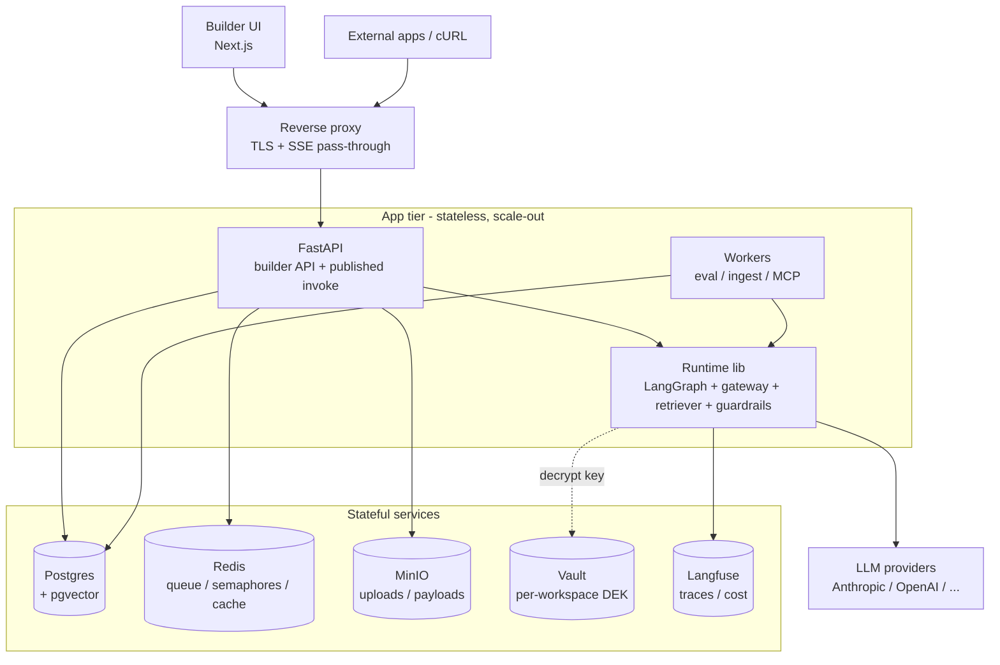
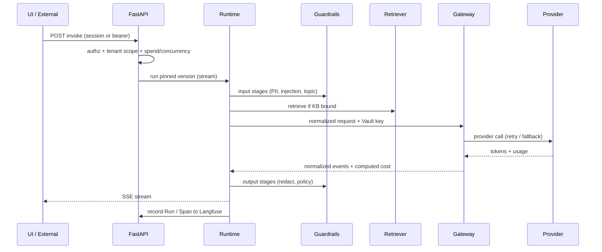
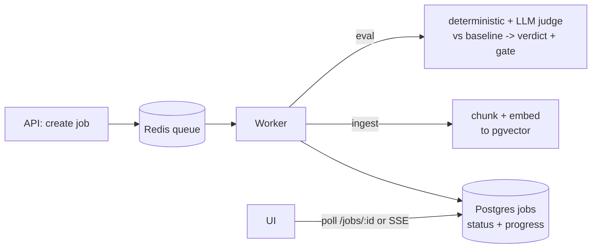
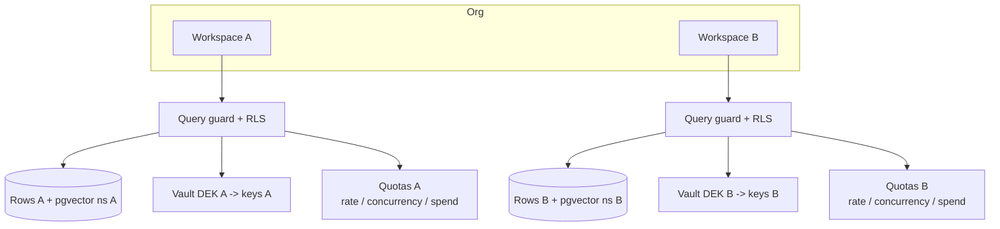

# Agent Catalyst — Backend build, frontend integration, deployment & multi-tenancy

> Companion to `docs/scope.md` and `docs/spec.md`. Roadmap-level plan (steps + complexity + options),
> not a line-level implementation plan.

## Context

The frontend console is built and runs on **mock data**, but no longer reads `data.ts` directly: reads
and writes go through a client store (`frontend/src/lib/store.ts`) seeded from `frontend/src/lib/data.ts`,
auth/tenancy is a mock Trellix-IAM profile (`auth.tsx` + `iam.ts` + `permissions.ts` + `access-policy.ts`),
and the runtime token check is a deterministic decode (`runtime-access.ts`). This plan turns that into a
real product: build the backend per `docs/spec.md` (Python/FastAPI + LangGraph + LiteLLM +
Postgres/pgvector + Redis + Vault + Langfuse + MinIO, portable containers), wire the existing UI to it,
deploy it, and run agents safely for multiple tenants. The frontend data types were authored to mirror
backend entities, so integration is mostly **"swap the data source behind `store.ts`,"** not a UI rewrite.

The code already carries the integration contract inline: **~120 `@backend` markers** name the exact
endpoint for every store hook/action and lib mock (`grep -rn "@backend" frontend/src`). Companion docs
own the detail this roadmap deliberately does not duplicate:
- **`docs/backend-integration-map.md`** — authoritative code-location → endpoint/contract index.
- **`docs/frontend-auth-access-plan.md`** — the dual (console vs runtime) auth/access model.
- **`docs/people-ops-workspace-plan.md`** — the multi-workspace seed (security + People Ops).
- **`docs/backend/00`–`11`** — the detailed backend "HOW" beneath this plan's "WHAT"
  (`08-api-surface.md` is the authority for endpoint paths).

Scope follows the spec phasing: **P1 = chat core + RAG + eval/drift + publish/export**; **P2 = MCP,
sub-agents, full guardrails, spend/concurrency quotas, RBAC hardening**. Voice is out. (Phasing nuance
from `docs/backend`: RBAC *roles*, per-token *rate limits*, and HTTP-tool *egress allow-lists* are P1;
*concurrency + spend quotas*, the *MCP sandbox*, and the *human-approval gate* for high-risk tools are P2.)

---

## Architecture diagrams (reference)

### Deployment / system topology

Legend: App tier scales horizontally; Postgres is the stateful core; the Runtime lib is the single code
path shared by playground, workers, and published invoke.

### Runtime request (playground / published invoke)

### Async job flow (ingestion & eval)

### Multi-tenant isolation

Legend: every row carries `workspace_id`; isolation is enforced in the app guard and again by Postgres
RLS, with per-workspace encryption keys, vector namespaces, and quotas.

---

## Part 1 — Backend: major steps & complexity

Complexity = engineering difficulty + risk (Low / Med / High). The two High-risk cores are the
**provider gateway** and the **eval/drift engine** (per `docs/spec.md`); everything else is
well-understood CRUD/infra.

| # | Step | What it delivers | Complexity |
|---|------|------------------|-----------|
| 0 | Scaffold + dev stack | FastAPI app, Alembic, `docker-compose` (postgres+pgvector, redis, vault-dev, langfuse), config/secrets loader | Low |
| 1 | Data model + migrations | All spec B3 entities with a `workspace_id` on every row; indexes; Alembic | Med |
| 2 | Auth + tenancy middleware | OIDC login, session, **workspace-scoping guard** on every query, RBAC roles | Med-High |
| 3 | CRUD API (the boring 90%) | agents, versions (immutable snapshots), prompts, IO contract, params; OpenAPI emitted | Med (volume) |
| 4 | **Provider gateway** | LiteLLM wrapper + per-(provider,model,apiVersion) **capability profiles** + own cost calc + normalized IR + `capability_substitution` events | **High** |
| 5 | **Runtime (LangGraph)** | One shared graph: system prompt + params + tools + retrieval-as-tool + guardrail pipeline + **SSE streaming**; used by playground, eval, and published invoke | **High** |
| 6 | Knowledge / RAG | Ingestion workers (extract→chunk→embed→pgvector), retriever, retrieval bindings pinned per version | Med-High |
| 7 | **Eval / drift engine** | Baseline freeze, deterministic checks + fixed LLM-judge, quality+efficiency verdict, **publish gate**, async workers, verdict caching + Batch API | **High** |
| 8 | Guardrails pipeline | Ordered input/output stages (PII, injection, topic, profanity, policy-judge) via Guardrails AI / NeMo behind one interface | Med |
| 9 | Publish + export + runtime endpoint | `POST /v1/agents/:id/invoke` (caller-token auth, pinned version, per-token rate limit P1 / spend+concurrency P2), secret-free cURL/TS/Python export from OpenAPI | Med-High |
| 10 | Observability | Langfuse per-call logging (model, prompt version, latency, cost, success) → runs/spans feed the Runs page | Low-Med |
| 11 | Secrets | Vault Transit envelope encryption (per-workspace DEK) for provider/tool/source creds; log redaction | Med |
| 12 | MCP + sub-agents (P2) | Server registry, connect/discover, egress-restricted worker, tool-schema snapshot, LangGraph subgraph delegation | High |
| 13 | Tests + CI | Two-layer: deterministic unit/integration + versioned-prompt eval set gated in CI | Med |

**Repo shape (recommended):** keep the monorepo — `frontend/` (exists) + `services/api`,
`services/runtime` (shared lib: gateway + graph + retriever + guardrails), `services/workers`
(eval + ingest + mcp), `migrations/`, `deploy/`.

---

## Part 2 — Attaching the frontend

The UI already renders real-shaped data through `store.ts`; integration swaps the store's mock
reads/writes for API calls. Every swap point is already marked in code (`@backend`) and indexed in
`docs/backend-integration-map.md` — this section is the roadmap view, not that contract. Endpoint paths
below follow the backend API surface (`docs/backend/08-api-surface.md`): **builder/console routes are
`/api/v1/*` (console-session auth); the published runtime is `/v1/agents/:id/invoke` (caller-token
auth).** The FE markers write the shorthand `/v1/...`; those resolve under `/api/v1/...` through the
reverse proxy.

**Steps**
1. **Typed client from OpenAPI (recommended)** — generate `frontend/src/lib/api/` types+client from the
   backend's OpenAPI doc (the spec already makes OpenAPI the source of truth). Alternative: hand-written
   fetch wrappers. Generated keeps FE/BE types in sync, powers the cURL export, and gates an OpenAPI→TS
   drift check in CI (`docs/backend/11`).
2. **Data fetching layer** — wrap calls in **TanStack Query** behind the *existing store-hook
   signatures* (`useAgents`, `useAgent`, `useKnowledgeBases`, …) so pages don't change; add
   `NEXT_PUBLIC_API_URL`, reverse-proxy `/api` to the backend (avoids CORS), and buffer-off SSE.
3. **Auth & access (two planes)** — the FE already models both in mock:
   - *Console session:* Auth.js (NextAuth) + **Trellix IAM OIDC**; middleware-protect `(app)/*`; the
     signed-in user's **role per workspace** drives `can()` gating. Replaces `MOCK_PROFILE` and the
     dev role/team switcher (deleted when real IAM lands).
   - *Caller token (runtime):* `runtime-access.ts`'s decode is a **Playground preview only**; the server
     validates the caller JWT and computes effective access at invoke.
   - *Per-resource access policies:* persisted via `PUT /api/v1/{agents|knowledge|tools|mcp}/:id/access-policy`
     and **re-enforced server-side** on read/manage and at invoke; client `canUse`/`canManage` are
     UI-gating only. See `frontend-auth-access-plan.md`.
4. **Streaming** — wire the Playground (standalone `/playground` + the agent-detail tab, both canned
   today) and published invoke to **the same** `POST /v1/agents/:id/invoke` SSE endpoint (one code path;
   `run_source` distinguishes playground/api). Render normalized events: `run_start`, `text_delta`,
   `reasoning_delta`, `tool_call_start|delta|end`, `retrieval`, `citation`, `guardrail`, `usage`, `done`.
5. **Incremental swap, page by page** — behind unchanged store-hook signatures. Add **loading skeletons
   + error + empty states** (the mock is always-success today). Delete the seed hydration +
   `tagResource`/`WS_OVERRIDES`/`POLICY_OVERRIDES` normalization (marked `@backend remove`); keep the
   mock as a test fixture.

**Mapping (frontend `store.ts`/lib → API)** — `/api/v1/*` = console session · `/v1/*` = caller token.

| Frontend (store hook / symbol) | Endpoint(s) |
|---|---|
| `useAgents`, `useAgent`, `getAgent`, per-agent dashboard | `GET /api/v1/agents?workspace=:id`, `GET /api/v1/agents/:id`, `GET /api/v1/agents/:id/dashboard` |
| `addAgent`, `updateAgent` (config/lifecycle/bind/rollback), `deleteAgent`, `duplicateAgent` | `POST /api/v1/agents`, `PATCH /api/v1/agents/:id`, `DELETE /api/v1/agents/:id`, `POST /api/v1/agents/:id/duplicate` |
| `getVersions`, Versions tab (save-as-new / clone) | `GET /api/v1/agents/:id/versions`, `POST /api/v1/agents/:id/versions`, `POST /api/v1/versions/:vid/clone` |
| `MODELS` / model picker | `GET /api/v1/models` (provider catalog + capability profiles + pricing) |
| `useKnowledgeBases`, `useKnowledgeBase`, `addKnowledgeBase`, `addDataSource`, `reingest`, `useIngestionJobs`, `source-picker` | `GET /api/v1/knowledge-bases[?workspace=:id` \| `/:id]`, `POST /api/v1/knowledge-bases`, `POST …/:id/sources` (async), `POST …/:id/reingest` (async), `GET /api/v1/ingestion-jobs` (poll/SSE), `GET /api/v1/connectors` (connector registry / field specs) + `POST /api/v1/connectors/credentials` (secret/file → vault → `{masked,vaultPath}`) + presigned upload, `POST /api/v1/versions/:vid/retrieval-bindings` |
| `useTools`, `addTool`, `useMcpServers`, `useMcpServer`, `addMcpServer` **(MCP P2)** | `GET`/`POST /api/v1/tools` (HTTP tool carries `httpConfig`; secret → vault, only `authRef` persisted), `GET /api/v1/mcp-servers[/:id]`, `POST /api/v1/mcp-servers` (connect + discover), `POST …/:id/discover`, `POST /api/v1/versions/:vid/tools` |
| `useEvalRuns`/`useEvalRunsForAgent`, `addEvalRun`, baseline, suites/cases, starter-set + rollback remedies | `GET /api/v1/evals` · `GET /api/v1/agents/:id/evals`, `POST /api/v1/agents/:id/evals` (async), `GET /api/v1/jobs/:id`, `POST /api/v1/agents/:id/eval-suites`·`/cases`, `POST /api/v1/versions/:vid/baseline` |
| `useRuns`/`useRunsForAgent`, dashboard/runs charts + stat tiles | `GET /api/v1/runs[?workspace=:id` \| `/:id]`, `GET /api/v1/metrics/{spend,volume,latency,activity}` |
| Publish & Export, endpoint OpenAPI/snippets | `POST /api/v1/versions/:vid/publish` (**409** if no PASS eval), `POST /api/v1/agents/:id/repoint`, `GET /api/v1/endpoints/:eid/export?format=curl\|ts\|python`, `GET …/openapi.json` |
| `useTokens`, `addToken`, `revokeToken` | `GET`/`POST /api/v1/agents/:id/tokens` (secret shown once), `DELETE /api/v1/tokens/:id` |
| `useProviderKeys`, `addProviderKey` (+rotate/revoke), `useMembers` | `GET /api/v1/provider-keys?workspace=:id`, `POST /api/v1/provider-keys` (+`/rotate`,`/revoke`; admin), `GET /api/v1/members?workspace=:id` (IAM read-only; Invite deep-links to IAM) |
| `setAccessPolicy`, `canUse`/`canManage` | `PUT /api/v1/{agents\|knowledge\|tools\|mcp}/:id/access-policy` (admin; server-enforced) |
| Guardrails tab, topbar/list search | `GET`/`PUT /api/v1/agents/:id/guardrails`, `GET /api/v1/search?q=` |
| Playground `send()` / published invoke, run feedback | `POST /v1/agents/:id/invoke` (SSE; token or session; `run_source`), `POST /v1/runs/:id/feedback` |

**Client-only (no backend):** the ML glossary tooltips (`glossary.ts` + `term.tsx`), the eval-onboarding
*explainer copy* (`eval-explainer.tsx`), and the dev role/team switcher are pure-FE affordances — the
switcher is deleted at IAM cutover; the other two stay. (The "Generate starter eval set" and "Roll back
to baseline" *actions* still hit the eval/version APIs above.)

**Integration complexity:** Low-Med overall (shapes match, and the auth/access model is already built in
mock — wiring is "point it at IAM + enforce server-side," not new UX). The only hard part remains
**streaming** (SSE through the proxy, backpressure, reconnect).

---

## Part 3 — Deployment

**Containers:** `api`, `worker` (eval+ingest+mcp), `web` (Next.js standalone) + stateful deps
Postgres(+pgvector), Redis, Vault, Langfuse, and **MinIO** (S3-compatible object store for uploads +
large trace/eval payloads), all self-hosted OSS, no cloud-managed lock-in ("portable").

| Concern | Approach |
|---|---|
| Dev | One `docker-compose up` brings up every service with seed data |
| Prod (start) | **Docker Compose on a hardened VM** (recommended for internal scale; simplest) |
| Prod (scale) | **Kubernetes + Helm** when HA/autoscale needed: API Deployment (HPA), worker Deployment (scale by queue depth), Postgres via operator or managed-in-cluster, PgBouncer pooling |
| Networking | `web` and `api` behind one reverse proxy (same origin `/api`); SSE requires proxy buffering off + long timeouts |
| CI/CD | Build images → run two-layer tests + **eval gate** → push to internal registry (Trellix Artifactory) → deploy QA on green → **prod only on explicit confirmation** |
| Secrets | Vault only; nothing in images or committed env files |
| Observability | Langfuse (LLM traces/cost) + OTel app metrics + health/readiness probes |
| Scaling shape | API stateless (scale out); workers scale by queue depth; Postgres is the stateful core; Redis = queue + concurrency semaphores + cache |
| Telemetry store | Transactional entities in Postgres; high-volume traces/cost in Langfuse (or ClickHouse later); partition + retention on `runs`/`spans` so the primary DB does not bloat |
| Backup / DR | Postgres PITR backups; pgvector reindex runbook; Vault backup + unseal/key-recovery plan; periodic restore drills |
| Zero-downtime | Expand/contract migrations, rolling deploys, `/v1` API-contract policy with deprecation windows |

Recommendation: **Compose-on-VM now, design cloud-agnostic so a later lift to k8s is config, not rewrite.**

---

## Part 4 — Multi-tenant agents

**Tenancy model:** Org → Workspace → Agent. Every row carries `workspace_id`; a global query guard
enforces scoping in the app layer, with **Postgres row-level security (RLS)** as defense-in-depth.

**Already modeled in the frontend (mock):** every seed resource carries `workspaceId` + an
`accessPolicy`; the store scopes all reads to the active workspace and stamps it on creates.
`permissions.ts` defines the `viewer|builder|publisher|admin` roles and `access-policy.ts` the
per-resource policy (visibility `workspace|restricted` + use/manage by role and IAM team). There are
**four workspaces** — `trellix-xdr` (security demo), `trellix-grc`, `trellix-labs`, and `trellix-people`
(People Ops / HR, the non-security persona) — each with per-workspace metrics. The runtime grant is
`effective = agent config ∩ caller token ∩ tenant ∩ resource policy`. The backend's job is to
**enforce** this server-side (RLS + policy re-check at invoke), not to invent it. See
`frontend-auth-access-plan.md` and `people-ops-workspace-plan.md`.

| Dimension | Approach |
|---|---|
| Data isolation | Row-level `workspace_id` + RLS; **pgvector namespaced per KB and workspace** (filter on both); schema-per-tenant only for unusually large tenants |
| Secret isolation | **Per-workspace DEK** in Vault; provider/tool/source keys scoped to the workspace; never cross-tenant, never in logs/exports |
| Provider keys | Support **BYO per-workspace** (true isolation + per-tenant cost) with an optional platform-shared pool fallback |
| Compute isolation | Runtime workers are **stateless**; each task carries tenant context; no shared in-memory tenant state |
| Memory / sessions | LangGraph checkpointer keyed by `(workspace_id, agent_id, session_id)`; long-term memory scoped per workspace/end-user |
| Fairness (noisy neighbor) | Per-workspace + per-endpoint **rate limits, concurrency caps (Redis semaphores), spend quotas** (pre-call reservation + reconciliation); per-tenant or weighted queues |
| Cost attribution | Every Run tags `workspace_id` + computed cost → per-tenant rollups for quotas/chargeback |
| RBAC + audit | `viewer/builder/publisher/admin` per workspace; publish + key/MCP mgmt gated; per-workspace audit log |
| Runtime pools | Separate **interactive** pool (playground/published, latency-sensitive) from **batch** pool (eval/ingest, autoscaled by queue depth) |
| MCP blast radius (P2) | Egress-restricted per-call sandbox; vaulted tool creds; depth/fan-out caps |

**Hardest multi-tenant risks:** cross-tenant data/secret leakage (mitigate with RLS + per-workspace
DEK + tests that assert isolation), and spend/concurrency races under load (Redis reservation +
bounded overshoot + hard-cap backstop).

---

## Part 5 — Cross-cutting concerns

Unglamorous, high-consequence items. Most are Med complexity but would hurt badly if skipped.

- **Async job model + status delivery.** Ingestion and eval runs are long/async and the UI shows live
  status. Need a `jobs` table + queue and a delivery path: `GET /jobs/:id` polling now, SSE/webhook push
  later. *(Med; blocks M3/M4 UX.)*
- **Long-running agent requests.** Tool loops + sub-agents run for minutes. Pick sync-with-SSE vs
  async-job-with-stream; enforce per-request timeout, cancellation, and idempotency keys on published
  invoke. *(Med-High.)*
- **Security / threat model (critical, Trellix context).** Agents execute tools + MCP that reach
  internal systems; prompt injection can weaponize them (SSRF, exfiltration, destructive calls).
  Controls: per-tool **egress allow-lists**, network-isolated tool/MCP sandbox, no secrets in prompts,
  tool-arg + output validation, **human-approval gate for high-risk tools**, and a written threat model
  + security review before any external exposure. *(High; non-negotiable.)*
- **Data retention & PII.** Prompts/traces/eval cases hold sensitive data; Langfuse stores inputs and
  outputs. Per-workspace retention policy, PII redaction before logging, trace scrubbing, and provider
  **zero-data-retention / inference-geo** where compliance requires. *(Med-High.)*
- **Provider resilience.** Handle 429/5xx/refusal with retries + backoff, circuit breaker, and the
  versioned **fallback model**; record the fallback/substitution on the run. *(Med.)*
- **Object storage + upload safety.** MinIO for uploads and large payloads; stream uploads, enforce
  size/type limits, and **virus-scan** uploaded files. *(Low-Med.)*
- **Eval data lifecycle.** Seed suites + **capture real production failures back into suites**
  (feedback loop) + periodic **judge calibration vs human labels**. This is what makes drift detection
  trustworthy. *(Med.)*
- **Version diff + rollback.** Backend for the UI's view-diff / promote / rollback: structural diff of
  version snapshots + one-click re-point to a prior passing version. *(Low-Med.)*
- **Caching as a cost lever.** Provider prompt-caching, embedding cache, judge-verdict cache keyed by
  content hashes. *(Low-Med.)*
- **SLOs + alerting.** Define SLOs (p95 latency, error rate, eval pass rate, spend anomaly) and alert
  via OTel/Prometheus + Alertmanager. *(Med.)*

---

## Complexity at a glance

- **High:** provider gateway, runtime/streaming, eval/drift engine, MCP (P2).
- **Med-High:** RAG ingestion, publish+runtime endpoint, auth/tenancy, multi-tenant isolation.
- **Med:** CRUD volume, guardrails, secrets, tests/CI.
- **Low-Med:** observability, frontend integration (shapes already match), deployment (compose).

---

## Milestones (sequencing + rough sizing)

Effort = rough person-weeks for a small team (2-3 engineers). Treat as planning ranges, not commitments.

- **M1 — Read-path online** *(~3-4 pw)*: scaffold + data model + auth/tenancy + agents/versions CRUD;
  FE lists & detail read from the API. The FE already implements the **dual auth/access model, four
  workspaces (incl. People Ops), per-resource access policies, and per-workspace metrics** in mock, so
  M1 is mostly standing the server up and *enforcing* these, not new UX. **Seed the dev DB from the
  existing `frontend/src/lib/data.ts`** (both the security and People Ops workspaces) so the console
  shows familiar data on day one.
- **M2 — It thinks** *(~4-5 pw)*: provider gateway + runtime + Playground SSE (live chat, ≥2 providers).
- **M3 — It knows** *(~3-4 pw)*: RAG ingestion (async jobs + object storage) + retrieval bindings.
- **M4 — It ships safely** *(~5-6 pw)*: eval/drift engine + publish gate + export + published invoke.
- **M5 — It is observable & bounded** *(~3-4 pw)*: guardrails + spend/concurrency + Langfuse + SLOs.
- **M6 — It extends** *(~4-5 pw)*: MCP + sub-agents + RBAC + the tool/MCP security sandbox.
- **M7 — It scales** *(~3-4 pw)*: deploy hardening + multi-tenant quotas + backup/DR + CI eval gate.

**Total ~25-32 person-weeks** (≈3-4 months calendar with 2-3 engineers). A thin P1 slice (M1-M4,
single-tenant) is demoable in ~15-19 pw; multi-tenant + security hardening (M6-M7) is the long tail.

---

## Verification (per milestone)

- **Cross-cutting:** deterministic unit/integration tests + the versioned eval set gated in CI; a
  tenant-isolation test suite (tenant A can never read/act on tenant B).
- **M1:** FE renders live agents; a request as workspace A returns zero rows of workspace B (RLS test).
- **M2:** same `NormalizedRequest` runs on Anthropic + OpenAI; Playground streams tokens; cost matches
  a hand-calc from the capability profile.
- **M3:** known question retrieves the right chunk; changing the embedding model triggers a re-eval.
- **M4:** publish blocked without a passing eval (409); exported cURL runs against the live endpoint,
  streams, and leaks no secret (automated scan).
- **M5:** over-budget invoke → 402/429; parallel load → excess 429; guardrail block/redact golden cases.
- **M7:** per-tenant spend quota enforced under concurrent load with bounded overshoot.

---

## Risks
1. **LLM-judge reliability & cost** (highest) — calibrate vs human labels; cache verdicts; Batch API.
2. **Provider-abstraction leakage** — capability profiles as versioned data + per-adapter contract tests.
3. **Cross-tenant isolation** — RLS + per-workspace DEK + explicit isolation tests.
4. **SSE through proxies** — buffering/timeouts; test the full proxy path early (M2).
5. **OpenAPI drift** — generate the FE client in CI so FE/BE types never diverge.
6. **Eval + runtime cost at scale** — per-tenant quotas, caching, batch pool autoscaling.
7. **Tool/MCP abuse via prompt injection** (SSRF, exfiltration, destructive calls) — sandbox + egress
   allow-lists + tool-arg validation + human-approval gate for high-risk tools + threat model.
8. **Sensitive data in traces/provider retention** — redaction before logging, per-workspace retention,
   provider ZDR/inference-geo where required.
9. **Telemetry volume** overwhelming Postgres — offload traces to Langfuse/ClickHouse, partition `runs`.
10. **Async UX gaps** — ingestion/eval finish with no signal to the FE; ship job-status delivery with M3.

---

## Open decisions (recommended first; confirm before M1)
1. **Auth:** Auth.js + **Trellix IAM OIDC** — **locked** (FE already built against this model; see
   `frontend-auth-access-plan.md`). Keycloak / in-house superseded.
2. **Deploy:** Compose-on-VM now, k8s-ready *(recommended)* · k8s from day one.
3. **FE integration:** OpenAPI-generated typed client *(recommended; the `@backend` markers + the
   integration map assume it)* · hand-written fetch wrappers.
4. **Provider keys:** per-workspace BYO *(recommended for real multi-tenant)* · platform shared pool.
   FE already models `provider_keys` per workspace (vaulted, masked).
5. **Tenant isolation:** shared DB + row-scoping + RLS — **locked** by `docs/backend/01,09`
   (`SET LOCAL app.workspace_id`). Schema/DB-per-tenant only for outlier tenants.
