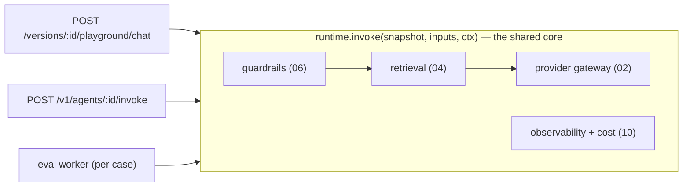

# 00 — Backend Overview & Module Layout

> Implementation-level companion to `docs/spec.md`. This folder (`docs/backend/`) is the layer
> *beneath* the spec: concrete modules, interfaces, DDL, and schemas an engineer can build from.
> Read `docs/scope.md` → `docs/spec.md` → this folder, in that order.

## 1. One idea that shapes the whole backend

> **The playground, the eval workers, and the published endpoint all execute an agent by calling the
> *same* `runtime.invoke(version_snapshot, inputs, ctx)`.**

If "test," "eval," and "production" ran different code paths, a drift report would be a lie — you'd be
evaluating code the published endpoint never runs. So the runtime is a **library**, not a service, and
three thin callers wrap it:



*Three thin callers, one core.* The pipeline (guardrails → retrieval → gateway, with obs cross-cutting) runs identically for all three.

Everything else — dashboards, CRUD, versioning, token mint, export — is **boring, reliable software
with no model in it** (the `scope.md` governing principle). Spend the real care on the gateway (02),
the eval/drift engine (05), guardrails (06), and cost/COGS (07).

## 2. Services and processes

Three deployable units, one shared library. Keep the monorepo.

| Process | Role | Stateless? | Scales on |
|---|---|---|---|
| `api` (FastAPI, uvicorn) | Builder REST API **+** published `/v1/.../invoke`. Owns HTTP, auth, tenancy, SSE. | Yes | request concurrency (HPA / replicas) |
| `worker` (arq/RQ on Redis) | Async jobs: ingestion, eval runs, (P2) MCP discovery, re-sync. | Yes | queue depth |
| `web` (Next.js standalone) | The existing console. | Yes | — |

Shared stateful backing services (see `11-deployment.md`): Postgres+pgvector, Redis, Vault, Langfuse,
MinIO.

> **Why `api` serves both builder and published invoke:** same runtime, same auth primitives, half the
> infra. Separate them into two Deployments later *only* for blast-radius isolation (a runaway public
> caller shouldn't starve the builder UI) — that's a `replicas` + routing change, not a rewrite. The
> code is already split by router, so this is free when you need it.

## 3. Repository layout

```
agent-catalyst/
├─ frontend/                        # exists (Next.js console)
├─ services/
│  ├─ api/                          # FastAPI app — the thin HTTP layer
│  │  ├─ main.py                    # app factory, middleware, router mount, OpenAPI
│  │  ├─ settings.py                # pydantic-settings (§6)
│  │  ├─ deps.py                    # FastAPI dependencies: db session, principal, workspace scope
│  │  ├─ auth/                      # OIDC session, principal, RBAC  (09)
│  │  ├─ tenancy.py                 # workspace-scope guard + RLS session var  (09)
│  │  ├─ routers/                   # one module per resource (agents, versions, kb, evals, …)  (08)
│  │  ├─ schemas/                   # Pydantic request/response models  (08)
│  │  ├─ models.py                  # SQLAlchemy ORM + Alembic target  (01)
│  │  ├─ publish/                   # published-endpoint invoke, token auth, export  (08, 09)
│  │  └─ errors.py                  # typed error → HTTP mapping
│  │
│  ├─ runtime/                      # THE SHARED LIBRARY — imported by api + workers
│  │  ├─ invoke.py                  # runtime.invoke() + RunContext — the single entry point (§1)
│  │  ├─ graph/                     # LangGraph graph, state, nodes, SSE bridge  (03)
│  │  ├─ providers/
│  │  │  ├─ ir.py                   # NormalizedRequest / StreamEvent / Usage  (02)
│  │  │  ├─ gateway.py              # LiteLLM wrapper, retry, fallback, circuit breaker  (02)
│  │  │  ├─ adapters/               # per-provider adapters behind one Protocol  (02)
│  │  │  ├─ cost.py                 # cost computed from profiles, not from LiteLLM  (02, 07)
│  │  │  └─ profiles/*.json         # per-(provider,model,apiVersion) capability profiles  (02)
│  │  ├─ retrieval/                 # retriever + RetrievalConfig  (04)
│  │  ├─ guardrails/                # stage interface + stages + runner  (06)
│  │  ├─ memory/                    # checkpointer config, compaction  (03)
│  │  ├─ cache/                     # exact + semantic + verdict caches  (07)
│  │  └─ obs.py                     # span emission, Langfuse, cost logging  (10)
│  │
│  ├─ evals/                        # drift engine (uses runtime for candidate runs)  (05)
│  │  ├─ drift.py                   # baseline, verdict, publish gate  (05)
│  │  ├─ deterministic.py           # schema/regex/tool-call/refusal checks  (05)
│  │  └─ judge.py                   # LLM-judge (rubric + pairwise), versioned, cached  (05)
│  │
│  ├─ ingestion/                    # extract → chunk → embed → pgvector  (04)
│  └─ mcp/                          # (P2) egress-restricted MCP worker  (spec B7)
│
├─ migrations/                      # Alembic
├─ deploy/                          # compose, Helm, Dockerfiles  (11)
└─ docs/                            # scope, spec, this folder
```

`runtime/` has **no FastAPI import** and **no HTTP types**. It takes a `RunContext` and yields
`StreamEvent`s. That's what lets the eval worker and the HTTP endpoint share it.

## 4. The single entry point

```python
# services/runtime/invoke.py
from collections.abc import AsyncIterator
from dataclasses import dataclass

@dataclass
class RunContext:
    workspace_id: str
    run_source: str                 # "playground" | "api" | "eval"
    principal_id: str | None        # console user (playground) — None for token callers
    caller_token_id: str | None     # published-token caller — None for console
    idempotency_key: str | None
    budget: "BudgetGuard"           # per-run + per-tenant spend guard  (07)
    trace_id: str
    # feature switches the three callers set differently:
    allow_cache: bool = True        # eval sets False for non-cacheable judge paths  (07)
    stream: bool = True
    deadline_s: float = 30.0        # hard wall-clock budget for the whole run — the latency
                                    #   contract behind the p99 SLO (10 §5). invoke() stamps a
                                    #   monotonic start; ctx.past_deadline() / ctx.tool_time_left()
                                    #   expose it to the graph (03 §4). On expiry the run ends with
                                    #   stop_reason="deadline_exceeded" and best-effort partial.

async def invoke(
    snapshot: "VersionSnapshot",    # immutable, resolved config — never a live Agent row  (01)
    inputs: "InvokeInputs",         # messages + declared typed input vars  (08, spec B2.5)
    ctx: RunContext,
) -> AsyncIterator["StreamEvent"]:
    """
    The one function playground, published invoke, and eval all call.
    Pipeline (each step lives in its own module so it is testable in isolation):
      1. validate inputs against the snapshot's IO contract        (08)
      2. budget pre-check + spend reservation                      (07)
      3. input guardrail stages                                    (06)
      4. build LangGraph state from snapshot; run the graph        (03)
           - graph nodes: retrieve? → model(stream) → tool loop → model …
           - gateway computes cost per model call from profiles    (02, 07)
      5. output guardrail stages (streaming sliding-buffer redact) (06)
      6. emit Run + Spans + usage/cost to Langfuse + Postgres      (10)
      7. reconcile spend reservation against actual cost           (07)
    The whole pipeline runs under ctx.deadline_s (default 30s): invoke() wraps the graph task in a
    timeout, so on expiry the in-flight provider stream is aborted, partial usage/cost is still
    recorded (10), and the run ends with stop_reason="deadline_exceeded" (03 §4/§5). MAX_TOOL_CALLS
    bounds COST; the deadline bounds LATENCY — p99 ≤ 30s holds by construction, not by hope (10 §5).
    Yields NormalizedStreamEvents; the HTTP layer re-encodes them as SSE (08).
    """
```

The `VersionSnapshot` is the load-bearing type: a **frozen, fully-resolved** config (prompt, params,
resolved capability profile, retrieval bindings, guardrail config, tool schemas). It is built once
when a version is created and stored immutably (`01-data-model.md §4`). `invoke()` **never reads a
live `agents` row** — that is how "editing the agent changes nothing live until an eval-gated
re-point" is enforced in code, not by convention.

## 5. Request & job lifecycles (the four that matter)

Detailed sequence diagrams live in `backend-integration-plan.md`; here is the module-level flow.

**A. Playground chat (SSE, interactive)** — `08 → runtime.invoke → 02 → provider`
`api/routers/playground.py` authenticates the console session, scopes the workspace, loads the
version snapshot, builds `RunContext(run_source="playground", stream=True)`, and pipes
`invoke()` events to an SSE response. First-token budget: **p95 < 2s** (`scope.md`).

**B. Published invoke (SSE or JSON, external)** — `publish/endpoint.py → runtime.invoke`
Bearer token → tenant/scope/revocation check (09) → `[P2]` concurrency slot + spend check (07) →
decrypt provider key into memory from Vault (09) → `invoke()` → record Run tagged with
`caller_token_id` + `workspace_id` for cost attribution (10). Accepts an **idempotency key**.

**C. Eval run (async job)** — `api → Redis → evals/drift.py`
`POST /versions/:id/eval-runs` enqueues a job and returns `202 {job_id}`. Worker loads the suite,
runs each case through `runtime.invoke(run_source="eval", allow_cache=False)` to get candidates,
scores deterministic + judge, computes the verdict vs the frozen baseline, writes `eval_runs` +
`eval_results`, and flips the version's publishable flag. UI polls `GET /jobs/:id` (10 §async).

**D. Ingestion (async job)** — `api → MinIO + Redis → ingestion/`
Upload to MinIO (presigned) → enqueue → worker extracts → chunks → embeds (gateway) → writes
`chunks` with pgvector embeddings namespaced per `(workspace_id, kb_id)` → updates the generic
`jobs` row (`kind=ingestion`/`reingest`) status (01 §4.8; there is no separate `ingestion_jobs` table).
Re-ingest of a *bound* KB raises a stale-index warning + drift trigger (05).

## 6. Configuration & settings

One typed settings object, env-driven, no secrets in images (Vault for those). `pydantic-settings`:

```python
# services/api/settings.py
from pydantic import PostgresDsn, RedisDsn, AnyUrl
from pydantic_settings import BaseSettings, SettingsConfigDict

class Settings(BaseSettings):
    model_config = SettingsConfigDict(env_prefix="AC_", env_file=".env")

    env: str = "dev"                                  # dev | qa | prod
    database_url: PostgresDsn
    redis_url: RedisDsn
    vault_addr: AnyUrl
    vault_role: str                                   # AppRole auth; token fetched at boot (09)
    langfuse_host: AnyUrl
    minio_endpoint: AnyUrl

    oidc_issuer: AnyUrl                               # Trellix IAM
    oidc_client_id: str
    session_secret: str                               # for signed console sessions

    # cost / COGS controls (07) — tunable without redeploy via DB overrides
    default_workspace_monthly_budget_usd: float = 500.0
    judge_model: str = "claude-haiku-4-5"             # judge is FIXED + versioned (05)
    judge_version: str = "judge-v1"
    semantic_cache_enabled: bool = False              # off by default; opt-in per agent (07)

    # guardrails (06)
    guardrails_fail_mode: str = "closed"              # closed = block on stage error (security default)
```

Runtime-tunable knobs (budgets, cache toggles, thresholds) live in DB tables so ops can change them
per-workspace without a deploy; `Settings` holds only boot-time infra wiring and safe defaults.

## 7. Deltas from `spec.md` (argued, not silent)

These extend or push back on the locked spec. Each is justified in the referenced doc.

| # | Spec says | This design says | Where |
|---|---|---|---|
| 1 | LiteLLM gives unified cost | LiteLLM for *transport + raw usage*; **we compute $ from our own profiles**, never trust its cost field; direct SDK adapters where accounting precision matters | 02, 07 |
| 2 | Guardrails AI / NeMo behind our stage API | Our **own cheap deterministic stages are the default backbone**; OSS libs are optional plugins | 06 |
| 3 | Eval cost via caching + Batch | The **LLM-judge is the primary COGS risk**, treated as a first-class budget with pre-filter gating + verdict cache + Batch | 05, 07 |
| 4 | — | **Semantic response cache is opt-in and banned for tool-calling/security agents** (near-miss hits = wrong answer) | 07 |
| 5 | — | `VersionSnapshot` is a real frozen type that `invoke()` reads **instead of** the live agent row, enforcing immutability in code | 01, this doc |

## 8. Naming conventions (so every doc agrees)

- Tables: `snake_case`, plural (`agent_versions`, `eval_runs`). Every tenant-owned row has
  `workspace_id uuid not null`.
- Primary keys: `id uuid default gen_random_uuid()` unless a natural key is clearer.
- Money: always `numeric(12,6)` USD, column suffix `_usd`. Never float for money.
- Tokens/usage: integer counts, column suffix `_tokens`.
- Timestamps: `timestamptz`, suffix `_at`, UTC.
- Enums: Postgres native enums for closed sets that match the frontend unions (e.g. `agent_status`).
- Python: `snake_case` funcs, `PascalCase` classes/dataclasses; the IR types in `providers/ir.py` are
  the canonical names used across 02/03/05/07.

→ Next: `01-data-model.md` (the schema everything above references).
