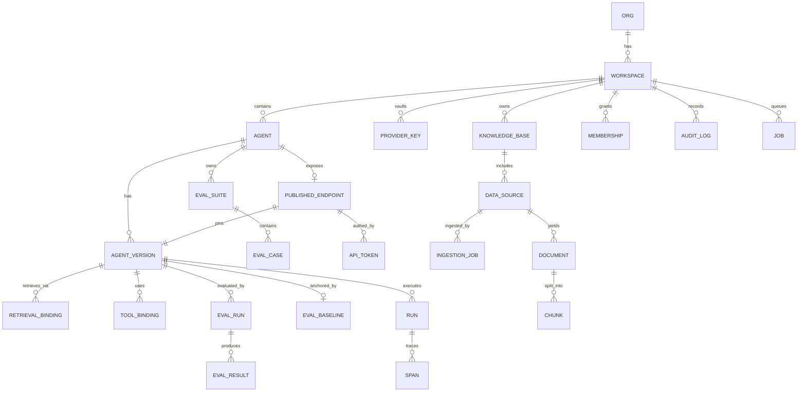

# 01 — Data Model (DDL, ORM, RLS, Versioning)

> Implements `spec.md §B3`. Every table/column/index an engineer needs, the immutability mechanism for
> versions, and the two-layer tenant isolation (RLS + app guard). DDL is Postgres 16; the ORM is
> SQLAlchemy 2.0 (declarative, typed). Migrations: Alembic (§7).

## 1. Principles

1. **One Postgres, shared-DB multi-tenancy.** Every tenant-owned row carries `workspace_id`. Isolation
   is enforced twice: the app-layer scope guard (09) *and* Postgres **RLS** (§6). Schema-per-tenant is
   reserved for an unusually large tenant and is a later migration, not day-one complexity.
2. **Versions are immutable snapshots.** `agents` is mutable config; `agent_versions` is frozen. The
   runtime reads only the snapshot (00 §4). This is the backbone of reproducibility and the eval gate.
3. **pgvector lives in the same DB** (`chunks.embedding`), namespaced by `(workspace_id, kb_id)`.
4. **P2 tables are created in P1, used in P2** (spec B3) — `spend_limits`, `concurrency_limits`,
   `mcp_servers`, `tools`, etc. Additive, so no destructive migration when P2 lands.
5. **Money is `numeric(12,6)` USD; never float.** Token counts are integers.

## 2. Entity map (what owns what)



## 3. Enums (mirror the frontend unions in `data.ts`)

```sql
create type agent_status      as enum ('draft','published','archived','eval_failing');
create type version_status    as enum ('draft','evaluated','published','deprecated');
create type drift_state       as enum ('none','stable','watch','regressed');
create type eval_verdict      as enum ('pass','fail','low_confidence');
create type run_source        as enum ('playground','api','eval');
create type run_status        as enum ('success','error','blocked');
create type provider_name     as enum ('anthropic','openai','google','mistral','meta','azure','bedrock');
create type ingest_status     as enum ('queued','running','completed','failed');
create type member_role       as enum ('admin','publisher','builder','viewer');
create type tool_kind         as enum ('http','builtin','subagent','mcp');       -- mcp used P2
create type data_source_kind  as enum ('file','web','connector','manual');       -- web/connector ingestion P2; FE connector config+credential capture ships ahead of it
create type job_kind          as enum ('ingestion','eval','mcp_discovery','reingest');
create type job_status        as enum ('queued','running','completed','failed','cancelled');
```

## 4. Core DDL

### 4.1 Tenancy & identity

```sql
create table orgs (
  id          uuid primary key default gen_random_uuid(),
  name        text not null,
  created_at  timestamptz not null default now()
);

create table workspaces (
  id          uuid primary key default gen_random_uuid(),
  org_id      uuid not null references orgs(id),
  slug        text not null,                    -- "trellix-xdr", "trellix-people-ops" (matches FE)
  name        text not null,
  created_at  timestamptz not null default now(),
  unique (org_id, slug)
);

-- Membership is IAM-sourced (read-mostly). Role is per-workspace (spec B12, frontend MEMBERS).
create table memberships (
  id            uuid primary key default gen_random_uuid(),
  workspace_id  uuid not null references workspaces(id),
  subject_id    text not null,                  -- OIDC subject (IAM user id)
  email         text not null,
  display_name  text not null,
  role          member_role not null,
  last_active_at timestamptz,
  unique (workspace_id, subject_id)
);
```

### 4.2 Agents & versions (the immutability core)

```sql
create table agents (
  id            uuid primary key default gen_random_uuid(),
  workspace_id  uuid not null references workspaces(id),
  slug          text not null,                  -- "triage-copilot" (matches FE id)
  name          text not null,
  description   text not null default '',
  status        agent_status not null default 'draft',
  owner_subject text not null,                  -- creator / owner (FE: owner)
  tags          text[] not null default '{}',
  -- pointers (mutable):
  active_version_id uuid,                        -- FK added after agent_versions (circular); see note
  drift         drift_state not null default 'none',
  -- access policy (frontend AccessPolicy) stored as jsonb; enforced server-side (09)
  access_policy jsonb not null default '{"mode":"workspace"}'::jsonb,
  created_at    timestamptz not null default now(),
  updated_at    timestamptz not null default now(),
  unique (workspace_id, slug)
);

-- A VersionSnapshot: frozen, fully-resolved config the runtime reads (00 §4).
create table agent_versions (
  id              uuid primary key default gen_random_uuid(),
  workspace_id    uuid not null references workspaces(id),
  agent_id        uuid not null references agents(id),
  label           text not null,                -- "v7" (FE: Version.label)
  status          version_status not null default 'draft',
  created_by      text not null,
  note            text not null default '',
  -- ---- the frozen snapshot (immutable after creation) ----
  model_config    jsonb not null,               -- provider, model, api_version, params, fallback (02)
  profile_snapshot jsonb not null,              -- resolved capability profile at freeze time (02)
  system_prompt   text not null default '',
  prompt_hash     text not null,                -- sha256(system_prompt) — an eval trigger (05)
  io_contract     jsonb not null default '{}',  -- typed inputs + output schema (spec B2.5)
  memory_config   jsonb not null default '{}',  -- window, compaction, persist (03)
  context_config  jsonb not null default '{}',  -- window limit, truncation strategy (03)
  guardrail_config jsonb not null default '{}', -- ordered stages + thresholds (06)
  -- retrieval + tool bindings are snapshotted into child rows (§4.4, §4.6) AND denormalized here
  -- as a hash so the whole snapshot has one identity:
  snapshot_hash   text not null,                -- sha256 over all frozen fields → version identity (05)
  publishable     boolean not null default false,  -- set by a PASS eval newer than last trigger (05)
  created_at      timestamptz not null default now(),
  unique (agent_id, label)
);

alter table agents
  add constraint fk_active_version
  foreign key (active_version_id) references agent_versions(id);

create index on agent_versions (agent_id, created_at desc);
create index on agent_versions (workspace_id);
```

> **Immutability is enforced, not hoped for.** A DB rule + app guard reject any `UPDATE` to the frozen
> columns of `agent_versions`. "Editing a version" always means **creating a new version row** (clone +
> change). Only `status` and `publishable` are mutable post-freeze.

```sql
create rule agent_versions_freeze as on update to agent_versions
  where (old.snapshot_hash is distinct from new.snapshot_hash)
  do instead nothing;   -- belt; the app also refuses. Changing frozen fields => new row.
```

Why both child rows *and* a `snapshot_hash`: child rows (`retrieval_bindings`, `tool_bindings`) make
the snapshot queryable/joinable; `snapshot_hash` gives the version a single content identity so the
eval engine (05) can detect "did anything that affects behavior change?" in one comparison.

### 4.3 Provider keys (vaulted — never plaintext here)

```sql
create table provider_keys (
  id            uuid primary key default gen_random_uuid(),
  workspace_id  uuid not null references workspaces(id),
  provider      provider_name not null,
  label         text not null,
  masked        text not null,                  -- "sk-ant-…x7f2" for display only (FE: masked)
  vault_path    text not null,                  -- where the ciphertext DEK-wrapped key lives (09)
  status        text not null default 'active', -- active | expiring | revoked
  created_at    timestamptz not null default now(),
  rotated_at    timestamptz
);
-- The secret itself is NEVER in this table. vault_path points at Vault Transit ciphertext (09).
```

### 4.4 Knowledge / RAG

```sql
create table knowledge_bases (
  id              uuid primary key default gen_random_uuid(),
  workspace_id    uuid not null references workspaces(id),
  slug            text not null,                -- "xdr-playbooks" (FE)
  name            text not null,
  embedding_model text not null,                -- PINNED (changing it = re-ingest + re-eval) (04,05)
  embedding_dim   int  not null,                -- e.g. 1536 / 3072 — fixes the vector column width
  chunk_config    jsonb not null default '{}',  -- size, overlap, structure-aware flags (04)
  index_version   int  not null default 1,      -- bumped on re-ingest; part of reproducibility (04)
  created_at      timestamptz not null default now(),
  unique (workspace_id, slug)
);

create table data_sources (
  id            uuid primary key default gen_random_uuid(),
  workspace_id  uuid not null references workspaces(id),
  kb_id         uuid not null references knowledge_bases(id),
  name          text not null,
  kind          data_source_kind not null,      -- file (P1); web/connector (P2)
  status        text not null default 'synced',  -- synced | syncing | error (FE DataSource.status)
  config        jsonb not null default '{}',     -- FE DataSourceConfig {connector, fields, credentialRef:{masked,vaultPath}}; crawl depth. Raw creds vaulted; only masked+vaultPath persisted (mirrors provider_keys.masked/vault_path)
  doc_count     int not null default 0,
  updated_at    timestamptz not null default now()
);

create table documents (
  id            uuid primary key default gen_random_uuid(),
  workspace_id  uuid not null references workspaces(id),
  kb_id         uuid not null references knowledge_bases(id),
  source_id     uuid not null references data_sources(id),
  uri           text not null,                   -- MinIO object key or source URL
  title         text,
  content_hash  text not null,                   -- dedupe + change detection on re-sync
  meta          jsonb not null default '{}',
  created_at    timestamptz not null default now()
);

create table chunks (
  id            uuid primary key default gen_random_uuid(),
  workspace_id  uuid not null references workspaces(id),
  kb_id         uuid not null references knowledge_bases(id),
  document_id   uuid not null references documents(id),
  ordinal       int not null,
  text          text not null,
  token_count   int not null,
  embedding     vector(3072),                    -- pgvector; width = kb.embedding_dim (see note)
  meta          jsonb not null default '{}',     -- {source, docId, chunkId, page…} for citations (04)
  created_at    timestamptz not null default now()
);

-- Vector index: HNSW for recall/latency balance. Namespace every query by (workspace_id, kb_id).
create index chunks_embedding_hnsw on chunks
  using hnsw (embedding vector_cosine_ops) with (m = 16, ef_construction = 64);
create index chunks_ws_kb on chunks (workspace_id, kb_id);
```

> **Embedding dimension:** a fixed `vector(N)` column can't vary per row. Options (pick in 04): (a) one
> dimension org-wide (simplest; `vector(3072)` fits common models, smaller models left-pad/resize), or
> (b) a `chunks_{dim}` table per distinct dimension. Recommended: **(a) standardize on one embedding
> model family per org in P1**, revisit if a KB needs a different model. This is called out as a real
> constraint, not hidden.

```sql
-- Which KB(s) a version retrieves from, and how — snapshotted per version (04, reproducibility).
create table retrieval_bindings (
  id            uuid primary key default gen_random_uuid(),
  workspace_id  uuid not null references workspaces(id),
  version_id    uuid not null references agent_versions(id),
  kb_id         uuid not null references knowledge_bases(id),
  kb_index_version int not null,                 -- the KB index_version pinned at freeze (stale warn)
  retrieval_config jsonb not null,               -- top_k, threshold, hybrid, reranker, max_ctx_tokens (04)
  injection     text not null default 'tool',    -- 'tool' | 'always_on' (spec B6.5)
  unique (version_id, kb_id)
);
```

### 4.5 Eval & drift (spec B5, FE EvalRun)

```sql
create table eval_suites (
  id            uuid primary key default gen_random_uuid(),
  workspace_id  uuid not null references workspaces(id),
  agent_id      uuid not null references agents(id),
  name          text not null,
  created_at    timestamptz not null default now()
);

create table eval_cases (
  id            uuid primary key default gen_random_uuid(),
  workspace_id  uuid not null references workspaces(id),
  suite_id      uuid not null references eval_suites(id),
  input         jsonb not null,                  -- messages + input vars
  assertions    jsonb not null default '[]',     -- deterministic checks (schema/regex/tool) (05)
  rubric        jsonb not null default '{}',     -- judge rubric dimensions (05)
  expected      jsonb,                           -- reference answer for pairwise judge (05)
  created_at    timestamptz not null default now()
);

-- Frozen baseline: the trusted point of comparison. Explicit, audited re-freeze (05).
create table eval_baselines (
  id            uuid primary key default gen_random_uuid(),
  workspace_id  uuid not null references workspaces(id),
  agent_id      uuid not null references agents(id),
  suite_id      uuid not null references eval_suites(id),
  version_id    uuid not null references agent_versions(id),   -- baseline anchored to a version
  frozen_by     text not null,
  frozen_at     timestamptz not null default now(),
  results_hash  text not null                    -- identity of the frozen result set
);

create table eval_runs (
  id            uuid primary key default gen_random_uuid(),
  workspace_id  uuid not null references workspaces(id),
  agent_id      uuid not null references agents(id),
  version_id    uuid not null references agent_versions(id),
  baseline_version_id uuid references agent_versions(id),       -- FE: baseline ("v6" / none)
  suite_id      uuid not null references eval_suites(id),
  trigger       text not null,                   -- "Model swap (gpt-5)", "Prompt edit"… (FE trigger)
  verdict       eval_verdict not null,
  quality       numeric(5,2) not null,           -- blended score (FE quality)
  quality_delta numeric(6,2) not null default 0, -- vs baseline (FE qualityDelta)
  cost_delta    numeric(6,2) not null default 0, -- % (FE costDelta)
  latency_delta numeric(8,2) not null default 0, -- ms (FE latencyDelta)
  case_count    int not null,                    -- (FE cases)
  reason        text,                            -- human-readable verdict explanation (FE reason)
  dimensions    jsonb not null default '[]',     -- [{name,score,baseline}] (FE dimensions)
  started_at    timestamptz not null default now(),
  finished_at   timestamptz
);
create index on eval_runs (agent_id, started_at desc);

create table eval_results (                       -- per-case detail (FE failingCases drill-down)
  id            uuid primary key default gen_random_uuid(),
  workspace_id  uuid not null references workspaces(id),
  eval_run_id   uuid not null references eval_runs(id),
  case_id       uuid not null references eval_cases(id),
  passed        boolean not null,
  det_results   jsonb not null default '{}',     -- deterministic check outcomes (05)
  judge_score   numeric(5,2),                    -- rubric blend
  judge_verdict jsonb,                           -- rubric breakdown + pairwise winner (05)
  issue         text,                            -- short failure summary (FE EvalCase.issue)
  candidate_output text,
  cost_usd      numeric(12,6) not null default 0,
  latency_ms    int
);
```

### 4.6 Tools & MCP (P2 — tables exist in P1)

```sql
create table tools (
  id            uuid primary key default gen_random_uuid(),
  workspace_id  uuid not null references workspaces(id),
  name          text not null,
  kind          tool_kind not null,              -- http | builtin | subagent | mcp
  description   text not null default '',
  schema        jsonb not null default '{}',     -- JSON schema of args (FE HttpToolConfig.argsSchema)
  config        jsonb not null default '{}',     -- FE HttpToolConfig {method,url,auth,authRef:{masked,vaultPath},headers}; egress allow-list. Raw creds vaulted; only authRef persisted (09)
  access_policy jsonb not null default '{"mode":"workspace"}'::jsonb,
  created_at    timestamptz not null default now()
);

create table mcp_servers (                        -- P2
  id            uuid primary key default gen_random_uuid(),
  workspace_id  uuid not null references workspaces(id),
  name          text not null,
  transport     text not null,                   -- stdio | http
  config        jsonb not null default '{}',     -- command/args/env OR url; auth ref vaulted (09)
  last_discovery_at timestamptz,
  health        text not null default 'unknown',
  created_at    timestamptz not null default now()
);

create table mcp_tools (                          -- discovered catalog, cached (P2)
  id            uuid primary key default gen_random_uuid(),
  workspace_id  uuid not null references workspaces(id),
  server_id     uuid not null references mcp_servers(id),
  name          text not null,
  description   text,
  input_schema  jsonb not null default '{}',
  enabled       boolean not null default false   -- allow-list (FE McpTool.enabled)
);

-- Tool/MCP tool bound to a version, with the schema SNAPSHOTTED (spec B7.4 reproducibility).
create table tool_bindings (
  id            uuid primary key default gen_random_uuid(),
  workspace_id  uuid not null references workspaces(id),
  version_id    uuid not null references agent_versions(id),
  kind          tool_kind not null,
  tool_id       uuid references tools(id),
  mcp_tool_id   uuid references mcp_tools(id),
  schema_snapshot jsonb not null,                -- frozen at bind; drift source if server changes (05)
  config_snapshot jsonb not null default '{}'
);
```

### 4.7 Publish, tokens, runs, spans

```sql
create table published_endpoints (
  id            uuid primary key default gen_random_uuid(),
  workspace_id  uuid not null references workspaces(id),
  agent_id      uuid not null references agents(id),
  slug          text not null,                   -- "soc-triage-copilot" (FE endpoint)
  pinned_version_id uuid not null references agent_versions(id),
  created_at    timestamptz not null default now(),
  unique (workspace_id, slug)
);

create table api_tokens (                         -- caller tokens for published invoke (FE ApiToken)
  id            uuid primary key default gen_random_uuid(),
  workspace_id  uuid not null references workspaces(id),
  endpoint_id   uuid not null references published_endpoints(id),
  name          text not null,
  prefix        text not null,                   -- shown in UI (FE prefix)
  token_hash    text not null,                   -- sha256 of secret; secret shown ONCE (09)
  scopes        jsonb not null default '{}',     -- tenant/role/teams/scopes claims (runtime-access)
  created_at    timestamptz not null default now(),
  last_used_at  timestamptz,
  expires_at    timestamptz,
  revoked_at    timestamptz
);

create table runs (                               -- one per invoke (FE Run)
  id            uuid primary key default gen_random_uuid(),
  workspace_id  uuid not null references workspaces(id),
  agent_id      uuid not null references agents(id),
  version_id    uuid not null references agent_versions(id),
  source        run_source not null,
  status        run_status not null,
  caller        text,                            -- token name or principal (FE caller)
  subject_type  text,                            -- 'user' | 'service' (FE subjectType)
  caller_token_id uuid references api_tokens(id),
  latency_ms    int not null default 0,
  input_tokens  int not null default 0,
  output_tokens int not null default 0,
  cost_usd      numeric(12,6) not null default 0,
  guardrail     text not null default 'passed',  -- "PII blocked on input" etc. (FE guardrail)
  idempotency_key text,
  trace_id      text,                            -- Langfuse trace id (10)
  created_at    timestamptz not null default now()
);
create index on runs (workspace_id, created_at desc);
create index on runs (agent_id, created_at desc);
create unique index on runs (workspace_id, idempotency_key) where idempotency_key is not null;
-- runs is high-volume → partition by month (11 §telemetry); heavy trace payloads go to Langfuse (10).

create table spans (                              -- per-step trace (model call, tool, retrieval, guardrail)
  id            uuid primary key default gen_random_uuid(),
  workspace_id  uuid not null references workspaces(id),
  run_id        uuid not null references runs(id),
  kind          text not null,                   -- model | tool | retrieval | guardrail | judge
  name          text not null,
  input_tokens  int, output_tokens int, cost_usd numeric(12,6),
  latency_ms    int,
  attrs         jsonb not null default '{}',     -- model, prompt_version, cache_hit, substitution…
  started_at    timestamptz not null default now(),
  finished_at   timestamptz
);
```

### 4.8 Jobs, audit, quotas (quotas P2)

```sql
create table jobs (                               -- async job status for ingestion/eval (00 §5, 10)
  id            uuid primary key default gen_random_uuid(),
  workspace_id  uuid not null references workspaces(id),
  kind          job_kind not null,
  status        job_status not null default 'queued',
  ref_id        uuid,                             -- the eval_run / ingestion target
  progress      jsonb not null default '{}',      -- {done, total, message}
  error         text,
  created_at    timestamptz not null default now(),
  updated_at    timestamptz not null default now()
);

create table audit_logs (                         -- spec B12: publish, re-point, baseline freeze, keys…
  id            uuid primary key default gen_random_uuid(),
  workspace_id  uuid not null references workspaces(id),
  actor         text not null,
  action        text not null,                    -- "publish","repoint","baseline.freeze","token.mint"…
  target        text not null,
  meta          jsonb not null default '{}',
  created_at    timestamptz not null default now()
);

-- P2, created now, enforced later (07)
create table spend_limits (
  id uuid primary key default gen_random_uuid(),
  workspace_id uuid not null references workspaces(id),
  scope text not null,                            -- 'workspace' | 'endpoint'
  scope_id uuid,
  monthly_budget_usd numeric(12,2) not null,
  hard_cap boolean not null default true
);
create table concurrency_limits (
  id uuid primary key default gen_random_uuid(),
  workspace_id uuid not null references workspaces(id),
  scope text not null, scope_id uuid,
  max_concurrent int not null
);
```

## 5. SQLAlchemy ORM (shape, not every line)

```python
# services/api/models.py  (SQLAlchemy 2.0 typed)
from datetime import datetime
from decimal import Decimal
import uuid
from sqlalchemy import ForeignKey, Text, Numeric, func
from sqlalchemy.dialects.postgresql import JSONB, UUID, ARRAY
from sqlalchemy.orm import DeclarativeBase, Mapped, mapped_column, relationship

class Base(DeclarativeBase): ...

class WorkspaceScoped:
    """Mixin: every tenant-owned model gets workspace_id; the tenancy guard (09) relies on it."""
    workspace_id: Mapped[uuid.UUID] = mapped_column(UUID(as_uuid=True), index=True)

class AgentVersion(Base, WorkspaceScoped):
    __tablename__ = "agent_versions"
    id: Mapped[uuid.UUID] = mapped_column(UUID(as_uuid=True), primary_key=True, default=uuid.uuid4)
    agent_id: Mapped[uuid.UUID] = mapped_column(ForeignKey("agents.id"))
    label: Mapped[str]
    status: Mapped[str]
    model_config_: Mapped[dict] = mapped_column("model_config", JSONB)
    profile_snapshot: Mapped[dict] = mapped_column(JSONB)
    system_prompt: Mapped[str] = mapped_column(Text, default="")
    prompt_hash: Mapped[str]
    io_contract: Mapped[dict] = mapped_column(JSONB, default=dict)
    guardrail_config: Mapped[dict] = mapped_column(JSONB, default=dict)
    snapshot_hash: Mapped[str]
    publishable: Mapped[bool] = mapped_column(default=False)
    created_at: Mapped[datetime] = mapped_column(server_default=func.now())
    retrieval_bindings: Mapped[list["RetrievalBinding"]] = relationship()
    tool_bindings: Mapped[list["ToolBinding"]] = relationship()

    def to_snapshot(self) -> "VersionSnapshot":
        """Materialize the frozen, runtime-ready snapshot (00 §4). Pure read; no live agent row."""
        ...
```

`VersionSnapshot` (the runtime's input) is a frozen dataclass assembled from `AgentVersion` + its
bindings. The runtime imports *only* this dataclass, never the ORM — keeping `runtime/` free of DB
coupling (00 §3).

## 6. Row-Level Security (defense-in-depth)

App-layer scoping (09) is the primary guard; RLS is the backstop that makes a forgotten `WHERE
workspace_id = …` fail safe instead of leaking.

```sql
-- Per request, the API sets the tenant on the connection (deps.py, after authz):
--   SET LOCAL app.workspace_id = '<uuid>';
-- Then RLS filters every tenant table automatically.

alter table agents enable row level security;
create policy agents_tenant on agents
  using (workspace_id = current_setting('app.workspace_id')::uuid);
-- …repeat for every WorkspaceScoped table (generated in one migration loop).

-- The app role is NOT the table owner and has no BYPASSRLS. A separate migration role owns DDL.
```

Caveats, stated plainly:
- RLS only helps if `app.workspace_id` is set **and** the connection pooler doesn't leak the setting
  across checkouts. Use `SET LOCAL` inside the request transaction (resets on commit) and a
  transaction-scoped pool mode. Tested by the isolation suite (`backend-integration-plan.md` M1).
- Cross-workspace admin reads (e.g. org dashboards) use a separate, explicitly-elevated path, audited.
- pgvector queries must *also* filter `kb_id` + `workspace_id` in the query — RLS covers the row read
  but you still want the index to prune by namespace (performance, §4.4).

## 7. Migrations (Alembic)

- **Autogenerate from the ORM**, then hand-edit — never trust autogen for enums, RLS, pgvector
  indexes, partitioning, or the freeze rule (add those as `op.execute(...)`).
- **Expand/contract only** (`11-deployment.md §zero-downtime`): add columns nullable → backfill →
  enforce; never rename-in-place on a live table.
- `migrations/env.py` installs extensions first: `create extension if not exists vector;`
  `create extension if not exists pgcrypto;` (for `gen_random_uuid`).
- One migration enables RLS + policies across all tenant tables via a loop over a table list, so new
  tables can't silently ship without a policy (a CI check asserts every `WorkspaceScoped` table has an
  RLS policy).
- Seed migration loads the existing `frontend/src/lib/data.ts` fixtures into the dev DB so the console
  shows familiar data on day one (`backend-integration-plan.md` M1).

## 8. Index summary (the ones that matter under load)

| Table | Index | Why |
|---|---|---|
| `runs` | `(workspace_id, created_at desc)`, `(agent_id, created_at desc)` | dashboard/runs pages; time-series |
| `runs` | partial unique `(workspace_id, idempotency_key)` | dedupe retried published invokes |
| `chunks` | HNSW on `embedding`, `(workspace_id, kb_id)` | retrieval recall + namespace prune (04) |
| `eval_runs` | `(agent_id, started_at desc)` | agent eval history |
| `agent_versions` | `(agent_id, created_at desc)` | version timeline |
| `api_tokens` | `token_hash` | O(1) token auth lookup (09) |
| `spans` | `(run_id)` | trace assembly |

→ Next: `02-provider-gateway.md`.
