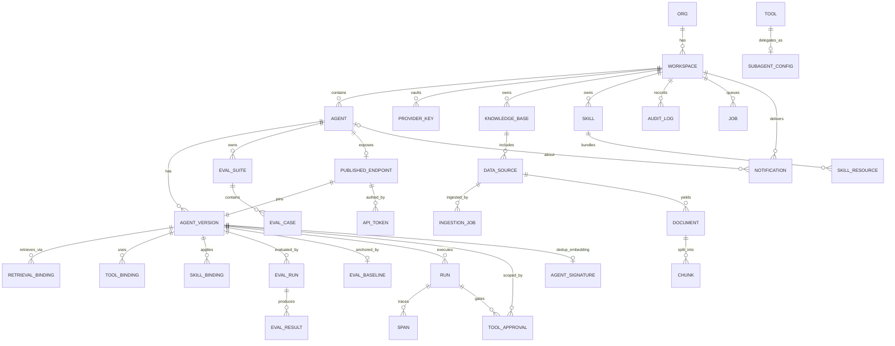

# 01 — Data Model (DDL, ORM, RLS, Versioning)

> Implements `spec.md §B3`. Every table/column/index an engineer needs, the immutability mechanism for
> versions, and the two-layer tenant isolation (RLS + app guard). DDL is Postgres 16; the ORM is
> SQLAlchemy 2.0 (declarative, typed). Migrations: Alembic (§7).

## 1. Principles

1. **One Postgres, shared-DB multi-tenancy.** Every tenant-owned row carries `workspace_id`. Isolation
   is enforced twice: the app-layer scope guard (09) *and* Postgres **RLS** (§6). Schema-per-tenant is
   reserved for an unusually large tenant and is a later migration, not day-one complexity.
2. **Versions are immutable snapshots.** `agents` is mutable config; `agent_versions` is frozen. The
   runtime reads only the snapshot (00 §4). This is the backbone of reproducibility and the eval gate.
3. **pgvector lives in the same DB** (`chunks.embedding`), namespaced by `(workspace_id, kb_id)`.
4. **P2 tables are created in P1, used in P2** (spec B3) — `spend_limits`, `concurrency_limits`,
   `mcp_servers`, `tools`, etc. Additive, so no destructive migration when P2 lands.
5. **Money is `numeric(12,6)` USD; never float.** Token counts are integers.

## 2. Entity map (what owns what)



> **P0 additions (14/15/16):** `AGENT_SIGNATURE` (dedup embeddings) and `NOTIFICATION` (owner-facing) are
> detailed in §4.9. The app-wide `admin` is an Okta group claim (`ap-platform-admin`), **not** a table (§4.9).
> `AGENT.registered_at` gates registration (14).
>
> **P2 additions (tools/approvals):** `SUBAGENT_CONFIG` (a `kind='subagent'` tool delegating to another agent)
> and `TOOL_APPROVAL` (human-in-the-loop gate on a `requires_approval` tool call) are detailed in §4.6.
>
> **P2 additions (skills):** `SKILL` (a reusable, versioned instruction+resource capability package),
> `SKILL_RESOURCE` (bundled reference files in MinIO), and `SKILL_BINDING` (a skill frozen onto a version)
> are detailed in §4.4. Unlike tools/MCP, skills **do not execute code** — there is no risk tier, approval
> gate, or sandbox for them; the only new controls are prompt-injection handling (06/09) and package signing.

## 3. Enums (mirror the frontend unions in `data.ts`)

```sql
create type agent_status      as enum ('draft','published','archived','eval_failing');
create type version_status    as enum ('draft','evaluated','published','deprecated');
create type drift_state       as enum ('none','stable','watch','regressed');
create type eval_verdict      as enum ('pass','fail','low_confidence');
create type run_source        as enum ('playground','api','eval','channel','tool_test','subagent');  -- channel = messaging-channel run, worker-executed (12); tool_test = tool/mcp test-invoke (08); subagent = delegated child run (03 §8)
create type run_status        as enum ('success','error','blocked');
create type provider_name     as enum ('anthropic','openai','google','mistral','meta','azure','bedrock');
-- DEPRECATED: ingestion status uses job_status via the generic `jobs` table (§4.8); this enum is unused. Kept only to avoid a migration churn; do not reference in new DDL.
create type ingest_status     as enum ('queued','running','completed','failed');
-- Claim-based + IdP-agnostic model (2026-10-22; scope.md, 09 §1-§2.1, adapter spec in 18): workspace
--    membership + role come from PER-WORKSPACE IdP group/role claims, mapped to a role by the active identity
--    ADAPTER (18) via workspaces.idp_binding — NOT an app roster, and NOT tied to one IdP. (Okta is one
--    adapter; its `ap-<prefix>-<role>` naming is that adapter's convention, not the universal rule — 18 §3.)
--    • workspace_role = the three per-workspace console roles. `executer` (caller) and `admin` (app-wide) are
--      NOT workspace-membership values: executer rides on api_tokens / channel tokens; admin is the adapter's
--      admin_group_ref (§4.9, 18 §6).
--    • NO memberships / workspace_invites tables; NO access_mode / open-restricted / self-join. [09 §2.1, 15, 18; FE iam.ts]
create type workspace_role     as enum ('viewer','builder','publisher');  -- per-workspace console roles (viewer ⊂ builder ⊂ publisher); viewer = read-only
create type tool_kind         as enum ('http','builtin','subagent','mcp');       -- mcp used P2
create type tool_risk_tier    as enum ('read','write','destructive');           -- risk tier driving the approval gate (P2)
create type approval_status   as enum ('pending','approved','denied','expired'); -- human-in-the-loop tool approval lifecycle (P2)
create type data_source_kind  as enum ('file','web','connector','manual');       -- web/connector ingestion P2; FE connector config+credential capture ships ahead of it
create type skill_status       as enum ('draft','published','deprecated');         -- P2; only 'published' (signed) skills are bindable
create type skill_resource_kind as enum ('instruction','reference');              -- the SKILL.md instruction body vs a bundled reference file (data, not instructions)
create type job_kind          as enum ('ingestion','eval','mcp_discovery','reingest','model_deprecation_scan');  -- model_deprecation_scan: P0 detector (16)
create type job_status        as enum ('queued','running','completed','failed','cancelled');
create type notification_kind as enum ('drift','budget_threshold','model_deprecated','eval_failed','registration_gate','dedup_flag','approval_requested');  -- owner-facing notifications (16); approval_requested = pending tool approval (P2)
```

## 4. Core DDL

### 4.1 Tenancy & identity

```sql
create table orgs (
  id          uuid primary key default gen_random_uuid(),
  name        text not null,
  created_at  timestamptz not null default now()
);

create table workspaces (
  id          uuid primary key default gen_random_uuid(),
  org_id      uuid not null references orgs(id),
  slug        text not null,                    -- "trellix-xdr", "trellix-people-ops" (matches FE). Immutable: it is the published-endpoint URL segment.
  name        text not null,                    -- display name (app-editable by admin)
  idp_binding jsonb not null default '{}',      -- FE: Workspace.groupPrefix + the idpBinding(ws) helper — per-workspace role→native-group map the
                                                --   active identity adapter resolves (18 §3): {viewer,builder,publisher,teams}.
                                                --   Replaces the Okta-only `group_prefix` (which survives as Okta-adapter sugar).
                                                --   IdP-authoritative; app-owned CONFIG, not a per-user roster (09 §2.1, 18).
  default_provider provider_name,              -- FE WorkspaceSettings.defaultProvider (app-editable by admin; PATCH /workspaces/:id)
  default_model text,                           -- FE WorkspaceSettings.defaultModel (app-editable, admin)
  archived_at   timestamptz,                   -- set by POST /workspaces/:id/archive (unpublishes the workspace's endpoints)
  request_timeout_s int not null default 30,   -- FE Limits.requestTimeoutS; per-workspace RunContext.deadline_s default (00 §4)
  -- eval policy (FE EvalPolicy; GET/PUT …/eval-policy — 08). The drift verdict + publish gate (05) read these
  -- for this workspace instead of global constants; set by admin (eval.govern — 09 §4).
  eval_min_cases        int     not null default 10,    -- FE EvalPolicy.minCases — below → low_confidence
  eval_quality_threshold numeric(5,2) not null default 90, -- FE qualityThreshold — PASS requires quality ≥ this
  eval_efficiency_budget_pct numeric(5,2) not null default 10, -- FE efficiencyBudgetPct — FAIL if cost over baseline by more
  eval_allow_low_conf_override boolean not null default false, -- FE allowLowConfidenceOverride — admin may publish a low-conf suite
  created_at  timestamptz not null default now(),
  unique (org_id, slug)
);

-- NO `memberships` / `workspace_invites` tables (claim-based model, 2026-10-22; 09 §2.1, 18). Workspace
-- membership and per-workspace role come from the IdP group/role claims, mapped by the active adapter via
-- `workspaces.idp_binding` (18 §3) — no per-user roster. The app-wide `admin` is the adapter's admin_group_ref
-- (§4.9). Teams (functional IdP groups) ride the same claim and are also not stored. The Members tab
-- (08 `GET /members`) is a read-only PROJECTION resolved through the adapter — no system-of-record row in
-- Postgres for who belongs to a workspace or at what role.

-- Read-model CACHE for async recipient fan-out only (notifications, 16; adapter spec 18 §4). NOT the authz
-- system of record — authz reads live claims from the token. Populated by the adapter's members_of() where the
-- IdP supports it, else upserted from tokens on login; stale/empty degrades to the owner-only floor (16).
create table group_members (
  group_ref  text not null,                      -- native IdP group ref (matches an idp_binding / admin_group_ref value)
  subject    text not null,                       -- OIDC subject
  source     text not null,                       -- 'members_of' | 'login_seen'
  seen_at    timestamptz not null default now(),
  primary key (group_ref, subject)
);
```

### 4.2 Agents & versions (the immutability core)

```sql
create table agents (
  id            uuid primary key default gen_random_uuid(),
  workspace_id  uuid not null references workspaces(id),
  slug          text not null,                  -- "triage-copilot" (matches FE id)
  name          text not null,
  description   text not null default '',
  status        agent_status not null default 'draft',
  owner_subject text not null,                  -- creator / owner — a ROUTABLE OIDC subject (not a display name);
                                                --   the recipient key for owner notifications (16) and the
                                                --   compliance "no-owner" check (15). Captured at registration (14 §2).
  registered_at timestamptz,                    -- P0 registration gate (14 §2): NULL = unregistered → a build/publish
                                                --   attempt returns 409 `registration.gate`. A flag, NOT an agent_status
                                                --   value — keeps the eval→lifecycle state machine untouched.
  tags          text[] not null default '{}',
  -- pointers (mutable):
  active_version_id uuid,                        -- FK added after agent_versions (circular); see note
  drift         drift_state not null default 'none',
  -- access policy (frontend AccessPolicy) stored as jsonb; enforced server-side (09 §5). Shape:
  -- { visibility: 'workspace'|'restricted'|'private', useRoles[], useTeams[], manageRoles[], manageTeams[], owner? }
  access_policy jsonb not null default '{"visibility":"workspace"}'::jsonb,
  created_at    timestamptz not null default now(),
  updated_at    timestamptz not null default now(),
  unique (workspace_id, slug)
);

-- A VersionSnapshot: frozen, fully-resolved config the runtime reads (00 §4).
create table agent_versions (
  id              uuid primary key default gen_random_uuid(),
  workspace_id    uuid not null references workspaces(id),
  agent_id        uuid not null references agents(id),
  label           text not null,                -- "v7" (FE: Version.label)
  status          version_status not null default 'draft',
  created_by      text not null,
  note            text not null default '',
  -- ---- the frozen snapshot (immutable after creation) ----
  model_config    jsonb not null,               -- provider, model, api_version, params, fallback (02)
  profile_snapshot jsonb not null,              -- resolved capability profile(s) frozen at freeze time (02): the
                                                --   primary AND, when model_config.fallback is set, the fallback
                                                --   model's profile — so a fallback run is costed/capability-checked
                                                --   under the same immutability guarantee (02 §6; LLD review A1, 2026-10-24)
  system_prompt   text not null default '',
  prompt_hash     text not null,                -- sha256(system_prompt) — an eval trigger (05)
  io_contract     jsonb not null default '{}',  -- typed inputs + output schema (spec B2.5); edited as
                                                --   draft config in the console (Configure → Input
                                                --   variables builder), frozen here on publish
  memory_config   jsonb not null default '{}',  -- window, compaction, persist (03)
  context_config  jsonb not null default '{}',  -- window limit, truncation strategy (03)
  guardrail_config jsonb not null default '{}', -- ordered stages + thresholds (06)
  -- retrieval + tool bindings are snapshotted into child rows (§4.4, §4.6) AND denormalized here
  -- as a hash so the whole snapshot has one identity:
  snapshot_hash   text not null,                -- sha256 over all frozen behavior-defining fields → version identity
                                                --   (05). Covers model/params/prompt/guardrail/tool+skill bindings/
                                                --   retrieval binding (incl. the injection column) AND memory_config/
                                                --   context_config (added 2026-10-24, LLD review A4). Canonical
                                                --   serialization algorithm: lld/01-data-model.lld.md §4
  publishable     boolean not null default false,  -- set by a PASS eval newer than last trigger (05). FE models the
                                                    --   INVERSE as Agent.needsReEval (FE versioning is cosmetic): a trigger
                                                    --   edit or KB re-ingest sets needsReEval=true (publishable=false); a
                                                    --   PASS clears it. The publish gate (05 §5) reads this flag.
  created_at      timestamptz not null default now(),
  unique (agent_id, label)
);

alter table agents
  add constraint fk_active_version
  foreign key (active_version_id) references agent_versions(id);

create index on agent_versions (agent_id, created_at desc);
create index on agent_versions (workspace_id);
```

> **Immutability is enforced, not hoped for.** A DB rule + app guard reject any `UPDATE` to the frozen
> columns of `agent_versions`. "Editing a version" always means **creating a new version row** (clone +
> change). Only `status` and `publishable` are mutable post-freeze.

```sql
create rule agent_versions_freeze as on update to agent_versions
  where (old.snapshot_hash is distinct from new.snapshot_hash)
  do instead nothing;   -- belt; the app also refuses. Changing frozen fields => new row.
```

Why both child rows *and* a `snapshot_hash`: child rows (`retrieval_bindings`, `tool_bindings`) make
the snapshot queryable/joinable; `snapshot_hash` gives the version a single content identity so the
eval engine (05) can detect "did anything that affects behavior change?" in one comparison.

The frozen-at-bind `tool_bindings.{risk_tier, requires_approval, subagent_config_id}` (§4.6) are part of
the version snapshot and are covered by `snapshot_hash` — so a risk-tier or approval change yields a new
version identity, consistent with the tool-schema-snapshot drift handling referenced to doc 05.

The same discipline covers **bound skills** (§4.4 `skill_bindings`): `snapshot_hash` MUST incorporate each
bound skill's frozen content — the **instruction-text hash + every bundled-resource content hash + the skill
version** (pinned in `skill_bindings.skill_content_hash`). A skill is injected into the prompt like
`system_prompt` (03 §4), so editing its instructions or resources is a behavior change exactly like editing
the prompt. If it did **not** fold into `snapshot_hash`, the eval verdict cache (05 §6) would serve a stale
PASS on a skill edit and the publish re-eval gate would be silently bypassed. So the skill content hash is
part of the version identity, alongside tool-schema snapshot coverage. **Note the deliberate asymmetry with
KBs:** skill content **is** pinned into `snapshot_hash` (instructions = pinned, like the prompt); **KB content
is NOT** — KB content is live & independent of the agent version (04 §9), so `kb_index_version` does **not**
fold into `snapshot_hash` (whether a content refresh gets an eval signal is a parked decision, 05 / review-fixes C3).

### 4.3 Provider keys (vaulted — never plaintext here)

```sql
create table provider_keys (
  id            uuid primary key default gen_random_uuid(),
  workspace_id  uuid not null references workspaces(id),
  provider      provider_name not null,
  label         text not null,
  region        text,                           -- optional, provider-dependent (e.g. Vertex/Bedrock) (FE: region)
  masked        text not null,                  -- "sk-ant-…x7f2" for display only (FE: masked)
  vault_path    text not null,                  -- where the ciphertext DEK-wrapped key lives (09)
  status        text not null default 'active', -- active | expiring | revoked
  created_at    timestamptz not null default now(),
  rotated_at    timestamptz
);
-- The secret itself is NEVER in this table. vault_path points at Vault Transit ciphertext (09).
```

### 4.4 Knowledge / RAG

```sql
create table knowledge_bases (
  id              uuid primary key default gen_random_uuid(),
  workspace_id    uuid not null references workspaces(id),
  slug            text not null,                -- "xdr-playbooks" (FE)
  name            text not null,
  embedding_model text not null,                -- PINNED (changing it = re-ingest + re-eval) (04,05)
  embedding_dim   int  not null,                -- e.g. 1536 / 3072 — fixes the vector column width
  chunk_config    jsonb not null default '{}',  -- size, overlap, structure-aware flags (04)
  index_version   int  not null default 1,      -- bumped on re-ingest; part of reproducibility (04)
  access_policy   jsonb not null default '{"visibility":"workspace"}'::jsonb,  -- FE KnowledgeBase.accessPolicy; server enforces on read/manage + at invoke (09). PUT /knowledge/:id/access-policy (08)
  created_at      timestamptz not null default now(),
  unique (workspace_id, slug)
);

create table data_sources (
  id            uuid primary key default gen_random_uuid(),
  workspace_id  uuid not null references workspaces(id),
  kb_id         uuid not null references knowledge_bases(id),
  name          text not null,
  kind          data_source_kind not null,      -- file (P1); web/connector (P2)
  status        text not null default 'synced',  -- synced | syncing | error (FE DataSource.status)
  config        jsonb not null default '{}',     -- FE DataSourceConfig {connector, fields, credentialRef:{masked,vaultPath}}; crawl depth. Raw creds vaulted; only masked+vaultPath persisted (mirrors provider_keys.masked/vault_path)
  doc_count     int not null default 0,
  updated_at    timestamptz not null default now()
);

create table documents (
  id            uuid primary key default gen_random_uuid(),
  workspace_id  uuid not null references workspaces(id),
  kb_id         uuid not null references knowledge_bases(id),
  source_id     uuid not null references data_sources(id),
  uri           text not null,                   -- MinIO object key or source URL
  title         text,
  content_hash  text not null,                   -- dedupe + change detection on re-sync
  meta          jsonb not null default '{}',
  created_at    timestamptz not null default now()
);

create table chunks (
  id            uuid primary key default gen_random_uuid(),
  workspace_id  uuid not null references workspaces(id),
  kb_id         uuid not null references knowledge_bases(id),
  document_id   uuid not null references documents(id),
  ordinal       int not null,
  text          text not null,
  token_count   int not null,
  embedding     vector(3072),                    -- pgvector; width = kb.embedding_dim (see dimension note)
  meta          jsonb not null default '{}',     -- {source, docId, chunkId, page…} for citations (04)
  created_at    timestamptz not null default now()
);

-- Vector index: HNSW for recall/latency balance. Namespace every query by (workspace_id, kb_id).
-- pgvector's hnsw/ivfflat index the `vector` type up to 2000 dims ONLY; a 3072-dim `vector` column
-- would FAIL index creation. For >2000 dims, index a half-precision cast (`halfvec`, supported to 4000
-- dims) — ~half the storage, negligible recall loss; the column stays full-precision `vector`. Queries
-- cast the probe the same way (`embedding::halfvec(3072)`). For models ≤2000 dims, drop the cast and use
-- `vector_cosine_ops` directly.
create index chunks_embedding_hnsw on chunks
  using hnsw ((embedding::halfvec(3072)) halfvec_cosine_ops) with (m = 16, ef_construction = 64);
create index chunks_ws_kb on chunks (workspace_id, kb_id);
```

> **Embedding dimension (a real, now-fixed constraint).** A fixed `vector(N)` column can't vary per row,
> AND pgvector's ANN indexes cap the `vector` type at **2000 dims**. Two independent choices:
> - **Which dimension:** standardize on **one embedding model family per org in P1** (option (a);
>   revisit with a `chunks_{dim}` table per dimension only if a KB truly needs a different model). The
>   `agent_signatures` dedup table (§4.9) is pinned to **1024** — a ≤2000 model so it indexes with plain
>   `vector_cosine_ops`, no cast.
> - **How to index >2000 dims:** use the `halfvec` cast above (keeps 3072-dim models like
>   `text-embedding-3-large` usable), **or** pick a ≤2000-dim model and index `vector` directly. Either
>   is fine; the DDL above shows the halfvec path because the default `embedding_dim` example is 3072.
>   HNSW-vs-IVFFlat choice + dataset-size ceiling guidance: see `04 §retrieval`.

```sql
-- Which KB(s) a version retrieves from, and how — snapshotted per version (04, reproducibility).
create table retrieval_bindings (
  id            uuid primary key default gen_random_uuid(),
  workspace_id  uuid not null references workspaces(id),
  version_id    uuid not null references agent_versions(id),
  kb_id         uuid not null references knowledge_bases(id),
  kb_index_version int not null,                 -- the KB index_version pinned at freeze (stale warn)
  retrieval_config jsonb not null,               -- top_k, threshold, hybrid, reranker, max_ctx_tokens (04)
  injection     text not null default 'tool',    -- 'tool' | 'always_on' (spec B6.5)
  unique (version_id, kb_id)
);
```

#### Skills (P2 — tables exist in P1; modelled on knowledge_bases)

A **skill** is a reusable, versioned capability *package*: an **instruction fragment** (injected into the
prompt like `system_prompt`, 03 §4) + **bundled reference files** (stored like a KB's documents in MinIO).
It **does NOT execute code** — unlike tools/MCP it never touches the sandbox, egress allow-list, or the
approval gate (09 §10), so a skill is **not** an SSRF/exfiltration primitive. The only new security vectors
are prompt-injection via the instruction text (06 output redaction still applies; no secrets in skill text;
bundled resources are *data, not instructions*) and **package provenance** — skills are **signed at publish**
and only `published` (signed) skills are bindable (09 §10). Skills carry **no credentials**. `access_policy`
and workspace-scoping mirror `knowledge_bases`; governance is **open registration + signing** (any builder+
authors — `skill.manage`, 09 §4), mirroring the MCP open-registration stance (14 §5).

```sql
create table skills (                             -- FE Skill (data.ts); modelled on knowledge_bases
  id            uuid primary key default gen_random_uuid(),
  workspace_id  uuid not null references workspaces(id),
  slug          text not null,                    -- "soc-triage-playbook" (FE)
  name          text not null,
  description   text not null default '',         -- always-loaded summary the model uses to DECIDE to apply the skill (progressive disclosure)
  instructions  text not null default '',         -- the instruction fragment injected into the prompt (03 §4); untrusted content (06/09)
  version       text not null default 'v1',       -- FE Skill.version — the authored skill version label
  content_hash  text not null,                    -- sha256 over {instructions + ordered resource content_hashes + version}; pinned into skill_bindings + folded into snapshot_hash (§4.2, 05 §6)
  status        skill_status not null default 'draft',   -- draft|published|deprecated; only 'published' is bindable
  -- provenance / signing (set by POST /skills/:id/publish, 08): skills are signed at publish, verified at bind.
  signature     text,                             -- detached package signature over content_hash (NULL until published)
  signed_by     text,                             -- OIDC subject that signed/published
  signed_at     timestamptz,
  access_policy jsonb not null default '{"visibility":"workspace"}'::jsonb,  -- FE Skill.accessPolicy; server enforces on read/manage + at invoke (09 §5). PUT /skills/:id/access-policy (08)
  created_at    timestamptz not null default now(),
  updated_at    timestamptz not null default now(),
  unique (workspace_id, slug)
);

create table skill_resources (                    -- bundled files in MinIO; modelled on documents. NO credentials.
  id            uuid primary key default gen_random_uuid(),
  workspace_id  uuid not null references workspaces(id),
  skill_id      uuid not null references skills(id),
  name          text not null,                    -- FE SkillResource.name ("SKILL.md", "severity-matrix.md")
  kind          skill_resource_kind not null,     -- instruction (the SKILL.md body) | reference (bundled file)
  uri           text not null,                    -- MinIO object key
  content_hash  text not null,                    -- dedupe + change detection; folds into skills.content_hash
  size_kb       numeric(10,2),                    -- FE SkillResource.sizeKB (display)
  created_at    timestamptz not null default now()
);

-- Which skill(s) a version applies, with the skill content SNAPSHOTTED. Binding structure mirrors
-- retrieval_bindings, but with a DELIBERATE ASYMMETRY on hash coverage (04 §9): skill content IS pinned into
-- the version — the pinned skill_content_hash folds into agent_versions.snapshot_hash (§4.2) so a skill edit
-- busts the eval verdict cache and re-arms the publish gate (05 §6). KB content is NOT (it is live &
-- independent of the agent version); kb_index_version is recorded on the binding but does not fold into
-- snapshot_hash (whether a KB refresh carries an eval signal is a parked decision — 05, review-fixes C3).
create table skill_bindings (
  id                 uuid primary key default gen_random_uuid(),
  workspace_id       uuid not null references workspaces(id),
  version_id         uuid not null references agent_versions(id),
  skill_id           uuid not null references skills(id),
  skill_content_hash text not null,               -- the skills.content_hash pinned at freeze (stale warn; drift trigger 05 §5)
  unique (version_id, skill_id)
);

create index on skill_resources (workspace_id, skill_id);   -- a skill's bundled files
create index on skill_bindings (version_id);                -- a version's applied skills (snapshot assembly)
create index on skill_bindings (workspace_id, skill_id);    -- bound-agent rollup (FE Skill.boundAgents)
```

### 4.5 Eval & drift (spec B5, FE EvalRun)

```sql
create table eval_suites (
  id            uuid primary key default gen_random_uuid(),
  workspace_id  uuid not null references workspaces(id),
  agent_id      uuid not null references agents(id),
  name          text not null,
  created_at    timestamptz not null default now()
);

create table eval_cases (
  id            uuid primary key default gen_random_uuid(),
  workspace_id  uuid not null references workspaces(id),
  suite_id      uuid not null references eval_suites(id),
  input         jsonb not null,                  -- FE EvalCaseDef: { message: input, vars: {name->value} } — vars typed from the agent io_contract (B2.5, 05 §2a)
  assertions    jsonb not null default '[]',     -- FE Assertion[]: [{kind, detail?, hard}] — detail REQUIRED for regex/required_fields/tool_called/exact (422 otherwise) (05 §2a)
  rubric        jsonb not null default '[]',     -- FE RubricDimension[]: [{name, weight}] — judge scores each 1–5, weighted blend = quality (05)
  expected      jsonb,                           -- OPTIONAL reference answer; omit → scored pairwise vs baseline, not vs golden (05 §2a)
  tags          text[] not null default '{}',    -- incremental-eval tags (05 §6): which prompt section / io_contract var a case exercises; added 2026-10-24 (LLD review)
  created_at    timestamptz not null default now()
);

-- Frozen baseline: the trusted point of comparison. Explicit, audited re-freeze (05).
create table eval_baselines (
  id            uuid primary key default gen_random_uuid(),
  workspace_id  uuid not null references workspaces(id),
  agent_id      uuid not null references agents(id),
  suite_id      uuid not null references eval_suites(id),
  version_id    uuid not null references agent_versions(id),   -- baseline anchored to a version
  frozen_by     text not null,
  frozen_at     timestamptz not null default now(),
  results_hash  text not null                    -- identity of the frozen result set
);

create table eval_runs (
  id            uuid primary key default gen_random_uuid(),
  workspace_id  uuid not null references workspaces(id),
  agent_id      uuid not null references agents(id),
  version_id    uuid not null references agent_versions(id),
  baseline_version_id uuid references agent_versions(id),       -- FE: baseline ("v6" / none)
  suite_id      uuid not null references eval_suites(id),
  trigger       text not null,                   -- "Model swap (gpt-5)", "Prompt edit"… (FE trigger)
  verdict       eval_verdict not null,
  quality       numeric(5,2) not null,           -- blended score (FE quality)
  quality_delta numeric(6,2) not null default 0, -- vs baseline (FE qualityDelta)
  cost_delta    numeric(6,2) not null default 0, -- % (FE costDelta)
  latency_delta numeric(8,2) not null default 0, -- ms (FE latencyDelta)
  case_count    int not null,                    -- (FE cases)
  reason        text,                            -- human-readable verdict explanation (FE reason)
  dimensions    jsonb not null default '[]',     -- [{name,score,baseline}] (FE dimensions)
  started_at    timestamptz not null default now(),
  finished_at   timestamptz
);
create index on eval_runs (agent_id, started_at desc);

create table eval_results (                       -- per-case detail (FE failingCases drill-down)
  id            uuid primary key default gen_random_uuid(),
  workspace_id  uuid not null references workspaces(id),
  eval_run_id   uuid not null references eval_runs(id),
  case_id       uuid not null references eval_cases(id),
  passed        boolean not null,
  det_results   jsonb not null default '{}',     -- deterministic check outcomes (05)
  judge_score   numeric(5,2),                    -- rubric blend
  judge_verdict jsonb,                           -- rubric breakdown + pairwise winner (05)
  issue         text,                            -- short failure summary (FE EvalCase.issue)
  candidate_output text,
  cost_usd      numeric(12,6) not null default 0,
  latency_ms    int
);
```

### 4.6 Tools & MCP (P2 — tables exist in P1)

```sql
create table tools (
  id            uuid primary key default gen_random_uuid(),
  workspace_id  uuid not null references workspaces(id),
  name          text not null,
  kind          tool_kind not null,              -- http | builtin | subagent | mcp
  description   text not null default '',
  risk_tier     tool_risk_tier not null default 'read',  -- drives the approval gate at bind (see tool_bindings.requires_approval)
  schema        jsonb not null default '{}',     -- JSON schema of args (FE HttpToolConfig.argsSchema)
  config        jsonb not null default '{}',     -- FE HttpToolConfig {method,url,auth,authRef:{masked,vaultPath},headers}; raw creds vaulted, only authRef persisted (09). Structured egress sub-schema: config.egress = { mode:'deny_by_default', allow:{ domains text[], cidrs text[], ports int[] } }
  access_policy jsonb not null default '{"visibility":"workspace"}'::jsonb,
  created_at    timestamptz not null default now()
);

create table mcp_servers (                        -- P2
  id            uuid primary key default gen_random_uuid(),
  workspace_id  uuid not null references workspaces(id),
  name          text not null,
  transport     text not null,                   -- stdio | http
  config        jsonb not null default '{}',     -- command/args/env OR url; auth ref vaulted (09). Same structured egress sub-schema as tools: config.egress = { mode:'deny_by_default', allow:{ domains text[], cidrs text[], ports int[] } }
  last_discovery_at timestamptz,
  health        text not null default 'unknown',
  access_policy jsonb not null default '{"visibility":"workspace"}'::jsonb,  -- FE McpServer.accessPolicy; parity with tools/agents (09). PUT /mcp/:id/access-policy (08)
  created_at    timestamptz not null default now()
);

create table mcp_tools (                          -- discovered catalog, cached (P2)
  id            uuid primary key default gen_random_uuid(),
  workspace_id  uuid not null references workspaces(id),
  server_id     uuid not null references mcp_servers(id),
  name          text not null,
  description   text,
  input_schema  jsonb not null default '{}',
  risk_tier     tool_risk_tier not null default 'read',  -- set when an operator enables a discovered tool
  enabled       boolean not null default false   -- allow-list (FE McpTool.enabled)
);

-- A kind='subagent' tool delegates to another agent as a callable (03 §8). One config per tool.
create table subagent_configs (                    -- P2 (WorkspaceScoped)
  id                uuid primary key default gen_random_uuid(),
  workspace_id      uuid not null references workspaces(id),
  tool_id           uuid not null references tools(id),
  target_agent_id   uuid not null references agents(id),
  target_version_id uuid references agent_versions(id),  -- NULL = follow the target's active version; set = pinned
  max_depth         int not null default 2,          -- delegation depth cap (03 §8)
  max_fanout        int not null default 3,          -- concurrent children per turn (03 §8)
  input_mapping     jsonb not null default '{}',     -- how the parent turn's inputs map to the child's io_contract
  created_at        timestamptz not null default now(),
  unique (tool_id)
);

-- Tool/MCP tool bound to a version, with the schema SNAPSHOTTED (spec B7.4 reproducibility).
create table tool_bindings (
  id            uuid primary key default gen_random_uuid(),
  workspace_id  uuid not null references workspaces(id),
  version_id    uuid not null references agent_versions(id),
  kind          tool_kind not null,
  tool_id       uuid references tools(id),
  mcp_tool_id   uuid references mcp_tools(id),
  schema_snapshot jsonb not null,                -- frozen at bind; drift source if server changes (05)
  config_snapshot jsonb not null default '{}',
  -- frozen-at-bind governance snapshot (joins the version-snapshot freeze discipline above — §4.2):
  risk_tier     tool_risk_tier not null default 'read',    -- snapshot of the tool/mcp_tool tier at bind
  requires_approval boolean not null default false,        -- derived at bind: destructive ⇒ true; write ⇒ per workspace policy
  subagent_config_id uuid references subagent_configs(id)  -- nullable; set when kind='subagent'
);

-- Human-in-the-loop approval for a gated (requires_approval) tool call, raised at invoke (WorkspaceScoped).
-- NOTE: run_id references runs (§4.7, created later); Alembic orders the FK — logical placement is here.
create table tool_approvals (                      -- P2
  id              uuid primary key default gen_random_uuid(),
  workspace_id    uuid not null references workspaces(id),
  run_id          uuid not null references runs(id),
  version_id      uuid not null references agent_versions(id),
  tool_binding_id uuid not null references tool_bindings(id),
  tool_call_id    text not null,                   -- model-emitted tool-call id this approval gates
  args_redacted   jsonb not null default '{}',     -- redacted tool args for the approver to review
  status          approval_status not null default 'pending',
  requested_at    timestamptz not null default now(),
  decided_at      timestamptz,
  decided_by      text,                            -- OIDC subject of the approver
  decision_reason text,
  expires_at      timestamptz
);
create index on tool_approvals (workspace_id, status, requested_at);
```

### 4.7 Publish, tokens, runs, spans

```sql
create table published_endpoints (
  id            uuid primary key default gen_random_uuid(),
  workspace_id  uuid not null references workspaces(id),
  agent_id      uuid not null references agents(id),
  slug          text not null,                   -- "soc-triage-copilot" (FE endpoint)
  pinned_version_id uuid not null references agent_versions(id),
  created_at    timestamptz not null default now(),
  unique (workspace_id, slug)
);

create table api_tokens (                         -- caller tokens for published invoke (FE ApiToken)
  id            uuid primary key default gen_random_uuid(),
  workspace_id  uuid not null references workspaces(id),
  endpoint_id   uuid not null references published_endpoints(id),  -- FE selects the endpoint at create time (no endpoint-less tokens)
  name          text not null,
  prefix        text not null,                   -- shown in UI (FE prefix)
  token_hash    text not null,                   -- sha256 of secret; secret shown ONCE (09)
  scopes        jsonb not null default '{}',     -- tenant/teams/scope claims (runtime-access); role is always 'executer' (09 §1/§6)
  created_at    timestamptz not null default now(),
  last_used_at  timestamptz,
  expires_at    timestamptz,                      -- FE Create dialog: none | 30d | 90d (FE ApiToken.expires)
  revoked_at    timestamptz
);

create table runs (                               -- one per invoke (FE Run)
  id            uuid primary key default gen_random_uuid(),
  workspace_id  uuid not null references workspaces(id),
  agent_id      uuid not null references agents(id),
  version_id    uuid not null references agent_versions(id),
  parent_run_id uuid references runs(id),          -- nullable; set for source='subagent' child runs → trace tree / depth accounting (03 §8)
  source        run_source not null,
  status        run_status not null,
  caller        text,                            -- token name or principal (FE caller)
  subject_type  text,                            -- 'user' | 'service' (FE subjectType)
  caller_token_id uuid references api_tokens(id),
  latency_ms    int not null default 0,
  input_tokens  int not null default 0,
  output_tokens int not null default 0,
  cost_usd      numeric(12,6) not null default 0,
  guardrail     text not null default 'passed',  -- "PII blocked on input" etc. (FE guardrail)
  idempotency_key text,
  trace_id      text,                            -- Langfuse trace id (10)
  created_at    timestamptz not null default now()
);
create index on runs (workspace_id, created_at desc);
create index on runs (agent_id, created_at desc);
create index on runs (parent_run_id);
create unique index on runs (workspace_id, idempotency_key) where idempotency_key is not null;
-- runs is high-volume → partition by month (11 §telemetry); heavy trace payloads go to Langfuse (10).

create table spans (                              -- per-step trace (model call, tool, retrieval, guardrail)
  id            uuid primary key default gen_random_uuid(),
  workspace_id  uuid not null references workspaces(id),
  run_id        uuid not null references runs(id),
  kind          text not null,                   -- model | tool | retrieval | guardrail | judge | skill (10)
  name          text not null,
  input_tokens  int, output_tokens int, cost_usd numeric(12,6),
  latency_ms    int,
  attrs         jsonb not null default '{}',     -- model, prompt_version, cache_hit, substitution…
  started_at    timestamptz not null default now(),
  finished_at   timestamptz
);
```

### 4.8 Jobs, audit, quotas (quotas P2)

```sql
create table jobs (                               -- async job status for ingestion/eval (00 §5, 10)
  id            uuid primary key default gen_random_uuid(),
  workspace_id  uuid not null references workspaces(id),
  kind          job_kind not null,
  status        job_status not null default 'queued',
  ref_id        uuid,                             -- the eval_run / ingestion target
  progress      jsonb not null default '{}',      -- {done, total, message}
  error         text,
  created_at    timestamptz not null default now(),
  updated_at    timestamptz not null default now()
);

create table audit_logs (                         -- spec B12: publish, re-point, baseline freeze, keys…
  id            uuid primary key default gen_random_uuid(),
  workspace_id  uuid references workspaces(id),    -- NULLABLE: org-level actions (e.g. 'org.report.read', 15) have
                                                   --   no workspace. A NULL row is invisible to the per-workspace RLS
                                                   --   policy (NULL = app.workspace_id is false) — the §6 carve-out
                                                   --   lets ONLY the admin elevated path (15 §2) read them.
  actor         text not null,
  action        text not null,                    -- "publish","repoint","baseline.freeze","token.mint",
                                                   --   "agent.register","agent.import","dedup.override" (14),
                                                   --   "org.report.read" (15, org-level: workspace_id NULL),
                                                   --   "tool.bind","tool.approval.request","tool.approval.approve",
                                                   --   "tool.approval.deny","tool.test_invoke","mcp.test_invoke" (P2)…
  target        text not null,
  meta          jsonb not null default '{}',
  created_at    timestamptz not null default now()
);

-- Enforcement phasing (revised 2026-10-19): the per-WORKSPACE MONTHLY spend cap (spend_limits,
-- scope='workspace') is ENFORCED in P1 (07 §3 — the pitch sells "caps"). concurrency_limits and
-- per-ENDPOINT spend rows (scope='endpoint') stay P2. The console edits the workspace-scoped rows via
-- PUT /workspaces/:id/limits (admin); that endpoint composes the FE Limits object = { monthlySpendUsd
-- (spend_limits, P1), maxConcurrent (concurrency_limits, P2), requestTimeoutS (workspaces.request_timeout_s) }.
create table spend_limits (
  id uuid primary key default gen_random_uuid(),
  workspace_id uuid not null references workspaces(id),
  scope text not null,                            -- 'workspace' | 'endpoint' (console edits the 'workspace' row; FE Limits.monthlySpendUsd)
  scope_id uuid,
  monthly_budget_usd numeric(12,2) not null,
  hard_cap boolean not null default true
);
create table concurrency_limits (
  id uuid primary key default gen_random_uuid(),
  workspace_id uuid not null references workspaces(id),
  scope text not null, scope_id uuid,             -- console edits the 'workspace' row; FE Limits.maxConcurrent (workspace-wide)
  max_concurrent int not null
);
```

### 4.9 Adoption, notifications & governance (P0 — 14/15/16)

```sql
-- Dedup signatures for the "reuse first" similarity scanner (14 §3). Reuses the chunks HNSW pattern (§4.4):
-- one row per agent_version, embedding over {name, description, system_prompt, io_contract} with a PINNED
-- embedding model. Recomputed on each new version.
create table agent_signatures (
  id            uuid primary key default gen_random_uuid(),
  workspace_id  uuid not null references workspaces(id),
  agent_id      uuid not null references agents(id),
  version_id    uuid not null references agent_versions(id),
  embedding     vector(1024),                     -- dims follow the pinned embed_model (14 §3)
  embed_model   text not null,                    -- pinned embedding model id (reproducibility, same caveat as KB, 04)
  created_at    timestamptz not null default now(),
  unique (version_id)
);
create index on agent_signatures using hnsw (embedding vector_cosine_ops);
create index on agent_signatures (workspace_id, agent_id);

-- Owner-facing notifications (16). OPS alerts (10 §5) go to operators; THESE go to the agent's owner.
create table notifications (
  id                uuid primary key default gen_random_uuid(),
  workspace_id      uuid not null references workspaces(id),
  agent_id          uuid references agents(id),   -- nullable: not every notification is agent-scoped
  recipient_subject text not null,                -- routable OIDC subject = agents.owner_subject (+ ws publishers/admins)
  kind              notification_kind not null,
  severity          text not null default 'info', -- info | warning | critical (matches 10 §5 severity vocab)
  title             text not null,
  payload           jsonb not null default '{}',
  dedupe_key        text not null,                -- hash(agent_id, kind, trigger) — collapses repeated signals (16 §2)
  created_at        timestamptz not null default now(),
  read_at           timestamptz
);
create index on notifications (workspace_id, recipient_subject, read_at);
create index on notifications (workspace_id, created_at desc);
-- Dedupe is PER RECIPIENT: one event fans out to N recipients (owner + ws publishers/admins, 16 §1) as N
-- rows sharing a dedupe_key. recipient_subject MUST be in the key, else the 2nd..Nth inserts collide and
-- only one person is ever notified.
create unique index on notifications (workspace_id, recipient_subject, dedupe_key) where read_at is null;

-- No `platform_admins` table (claim-based model, 2026-10-22). The app-wide `admin` (15 §1) is the
-- `ap-platform-admin` Okta group claim, read live from the OIDC token (09 §1/§2.1): grant/revoke happens in
-- Okta (audited there), and every admin action in-app is audited via `audit_logs`. One deployment = one org
-- (13 §4): there is no `org_memberships` table. admin is elevated + read-only on the cross-tenant path (§6, 15 §2).
```

## 5. SQLAlchemy ORM (shape, not every line)

```python
# services/api/models.py  (SQLAlchemy 2.0 typed)
from datetime import datetime
from decimal import Decimal
import uuid
from sqlalchemy import ForeignKey, Text, Numeric, func
from sqlalchemy.dialects.postgresql import JSONB, UUID, ARRAY
from sqlalchemy.orm import DeclarativeBase, Mapped, mapped_column, relationship

class Base(DeclarativeBase): ...

class WorkspaceScoped:
    """Mixin: every tenant-owned model gets workspace_id; the tenancy guard (09) relies on it."""
    workspace_id: Mapped[uuid.UUID] = mapped_column(UUID(as_uuid=True), index=True)

class AgentVersion(Base, WorkspaceScoped):
    __tablename__ = "agent_versions"
    id: Mapped[uuid.UUID] = mapped_column(UUID(as_uuid=True), primary_key=True, default=uuid.uuid4)
    agent_id: Mapped[uuid.UUID] = mapped_column(ForeignKey("agents.id"))
    label: Mapped[str]
    status: Mapped[str]
    model_config_: Mapped[dict] = mapped_column("model_config", JSONB)
    profile_snapshot: Mapped[dict] = mapped_column(JSONB)
    system_prompt: Mapped[str] = mapped_column(Text, default="")
    prompt_hash: Mapped[str]
    io_contract: Mapped[dict] = mapped_column(JSONB, default=dict)
    guardrail_config: Mapped[dict] = mapped_column(JSONB, default=dict)
    snapshot_hash: Mapped[str]
    publishable: Mapped[bool] = mapped_column(default=False)
    created_at: Mapped[datetime] = mapped_column(server_default=func.now())
    retrieval_bindings: Mapped[list["RetrievalBinding"]] = relationship()
    tool_bindings: Mapped[list["ToolBinding"]] = relationship()
    skill_bindings: Mapped[list["SkillBinding"]] = relationship()

    def to_snapshot(self) -> "VersionSnapshot":
        """Materialize the frozen, runtime-ready snapshot (00 §4). Pure read; no live agent row."""
        ...
```

`VersionSnapshot` (the runtime's input) is a frozen dataclass assembled from `AgentVersion` + its
bindings. The runtime imports *only* this dataclass, never the ORM — keeping `runtime/` free of DB
coupling (00 §3).

The new P2 tables `SubagentConfig` and `ToolApproval` (§4.6) use the same `WorkspaceScoped` mixin as every
other tenant model, so they inherit `workspace_id` and the RLS policy (§6) automatically.

`Skill`, `SkillResource`, and `SkillBinding` (§4.4) likewise use the `WorkspaceScoped` mixin, so they inherit
`workspace_id` + RLS automatically. A version's `skill_bindings` are assembled into the frozen
`VersionSnapshot.to_snapshot()` alongside the retrieval/tool bindings — the runtime reads `snapshot.skills`
(each skill's resolved instructions + bundled resource refs, pinned by `skill_content_hash`) and composes the
instruction fragments in `build_messages` (03 §4). The runtime still imports only the dataclass, never the ORM.

## 6. Row-Level Security (defense-in-depth)

App-layer scoping (09) is the primary guard; RLS is the backstop that makes a forgotten `WHERE
workspace_id = …` fail safe instead of leaking.

```sql
-- Per request, the API sets the tenant on the connection (deps.py, after authz):
--   SET LOCAL app.workspace_id = '<uuid>';
-- Then RLS filters every tenant table automatically.

alter table agents enable row level security;
create policy agents_tenant on agents
  using (workspace_id = current_setting('app.workspace_id')::uuid);
-- …repeat for every WorkspaceScoped table (generated in one migration loop).

-- The app role is NOT the table owner and has no BYPASSRLS. A separate migration role owns DDL.
```

Caveats, stated plainly:
- RLS only helps if `app.workspace_id` is set **and** the connection pooler doesn't leak the setting
  across checkouts. Use `SET LOCAL` inside the request transaction (resets on commit) and a
  transaction-scoped pool mode. Tested by the isolation suite (`backend-integration-plan.md` M1).
- The new `WorkspaceScoped` P0 tables (`notifications`, `agent_signatures`, §4.9) are in the RLS loop like
  any tenant table — they carry `workspace_id` and get a policy automatically.
- The new `WorkspaceScoped` P2 tables (`subagent_configs`, `tool_approvals`, §4.6) likewise carry
  `workspace_id` and join the RLS loop automatically — the §7 CI check (every `WorkspaceScoped` table has
  an RLS policy) enforces it.
- The skill tables (`skills`, `skill_resources`, `skill_bindings`, §4.4) carry `workspace_id` and join the
  RLS loop + the §7 CI check automatically too — no carve-out.
- **Elevated carve-outs (the only tables that intentionally cross or skip tenant scope):**
  - Cross-workspace reads (the **org governance report**, 15) use a separate, explicitly-elevated,
    **audited** path (a `SECURITY DEFINER` function callable only by the app-wide `admin` claim, 15 §2) — the
    single sanctioned exception to the isolation suite (09 §8).
  - `audit_logs` rows with `workspace_id = NULL` (org-level actions, e.g. `org.report.read`) are invisible to
    the per-workspace policy and readable only via that same elevated path.
  - The app-wide `admin` claim (`ap-platform-admin`, §4.9) is **not** `WorkspaceScoped` (deployment-wide, no
    table) → nothing to add to the RLS loop; the elevated cross-tenant path is gated at the application/auth
    layer (15 §1) + the `SECURITY DEFINER` EXECUTE grant, not by RLS.
- pgvector queries must *also* filter `kb_id` + `workspace_id` in the query — RLS covers the row read
  but you still want the index to prune by namespace (performance, §4.4).

## 7. Migrations (Alembic)

- **Autogenerate from the ORM**, then hand-edit — never trust autogen for enums, RLS, pgvector
  indexes, partitioning, or the freeze rule (add those as `op.execute(...)`).
- **Expand/contract only** (`11-deployment.md §zero-downtime`): add columns nullable → backfill →
  enforce; never rename-in-place on a live table.
- `migrations/env.py` installs extensions first: `create extension if not exists vector;`
  `create extension if not exists pgcrypto;` (for `gen_random_uuid`).
- One migration enables RLS + policies across all tenant tables via a loop over a table list, so new
  tables can't silently ship without a policy (a CI check asserts every `WorkspaceScoped` table has an
  RLS policy).
- Seed migration loads the existing `frontend/src/lib/data.ts` fixtures into the dev DB so the console
  shows familiar data on day one (`backend-integration-plan.md` M1).

## 8. Index summary (the ones that matter under load)

| Table | Index | Why |
|---|---|---|
| `runs` | `(workspace_id, created_at desc)`, `(agent_id, created_at desc)` | dashboard/runs pages; time-series |
| `runs` | partial unique `(workspace_id, idempotency_key)` | dedupe retried published invokes |
| `runs` | `(parent_run_id)` | subagent trace tree + delegation-depth accounting (03 §8) |
| `chunks` | HNSW on `embedding`, `(workspace_id, kb_id)` | retrieval recall + namespace prune (04) |
| `eval_runs` | `(agent_id, started_at desc)` | agent eval history |
| `agent_versions` | `(agent_id, created_at desc)` | version timeline |
| `api_tokens` | `token_hash` | O(1) token auth lookup (09) |
| `spans` | `(run_id)` | trace assembly |
| `agent_signatures` | HNSW on `embedding`, `(workspace_id, agent_id)` | dedup similarity scan (14 §3) |
| `notifications` | `(workspace_id, recipient_subject, read_at)`, unique `(workspace_id, recipient_subject, dedupe_key) where read_at is null` | owner inbox + unread count; **per-recipient** dedupe of open notices (16) |
| `tool_approvals` | `(workspace_id, status, requested_at)` | approver queue of pending tool approvals (P2) |
| `skill_bindings` | `(version_id)`, `(workspace_id, skill_id)` | snapshot assembly (a version's applied skills) + bound-agent rollup (`Skill.boundAgents`) (P2) |
| `skill_resources` | `(workspace_id, skill_id)` | a skill's bundled MinIO files (P2) |

→ Next: `02-provider-gateway.md`.
