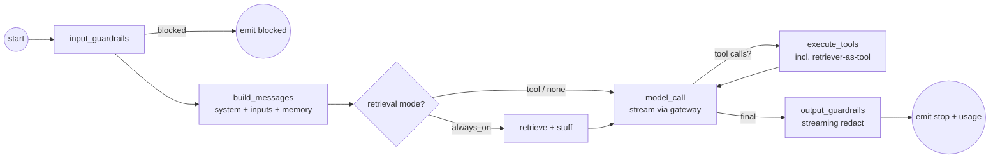

# 03 — Runtime (LangGraph orchestration)

> Implements `spec.md §B4` (topology) + the orchestration half of the "one shared runtime" principle
> (00 §1). This is the graph that the playground, eval workers, and published endpoint all execute. It
> sits above the gateway (02) and below the thin HTTP callers (08).

## 1. Responsibilities

The runtime turns a frozen `VersionSnapshot` + inputs into a stream of `NormalizedStreamEvent`s by
driving: guardrails (06) → retrieval (04) → model call (02) → tool loop → output guardrails → telemetry
(10). LangGraph owns the *loop* (nodes, edges, the agentic tool cycle, the checkpointer); it does **not**
own cost, capability, or provider normalization — that's the gateway (02 §1, the captured pushback).

## 2. Graph shape



## 3. State

```python
# services/runtime/graph/state.py
from typing import TypedDict, Annotated
from operator import add

class GraphState(TypedDict):
    snapshot: "VersionSnapshot"           # frozen config (01, 00 §4) — read-only
    ctx: "RunContext"                     # tenancy, budget, trace (00 §4)
    messages: Annotated[list[dict], add]  # conversation, appended across tool cycles
    inputs: "InvokeInputs"                # declared typed vars (validated vs io_contract)
    retrieved: list[dict]                 # chunks used (for citations, 04)
    tool_calls_made: int                  # loop guard
    usage: "NormalizedUsage"             # accumulated across model calls (cost, 02/07)
    substitutions: list["Substitution"]  # recorded capability leaks (02 §5)
    guardrail_outcome: str | None         # e.g. "PII blocked on input" (06 → runs.guardrail)
    stop_reason: str | None
```

## 4. Nodes (what each does)

```python
# services/runtime/graph/nodes.py
async def input_guardrails(state):          # (06)
    outcome = await run_input_stages(state["messages"], state["snapshot"].guardrail_config, state["ctx"])
    if outcome.blocked:
        return {"guardrail_outcome": outcome.label, "stop_reason": "blocked"}
    return {"messages": outcome.rewritten_messages or state["messages"]}

async def build_messages(state):            # system prompt + input-var templating + memory window
    sys = render_prompt(state["snapshot"].system_prompt, state["inputs"])     # Jinja-safe template
    history = apply_memory_window(state["messages"], state["snapshot"].memory_config)  # §6
    return {"messages": [sys_msg(sys), *history]}

async def retrieve_always_on(state):        # only when injection == "always_on" (04)
    chunks = await retriever.search(state["snapshot"], query=last_user_text(state), ctx=state["ctx"])
    return {"messages": stuff_context(state["messages"], chunks), "retrieved": chunks}

async def model_call(state):                # the streaming provider call (02)
    req = build_normalized_request(state["snapshot"], state["messages"])     # tools incl. retriever-tool
    key = await resolve_provider_key(state["ctx"], state["snapshot"])        # Vault, in-memory (09)
    async for ev in gateway.stream(req, api_key=key, profile=state["snapshot"].profile):
        emit(ev)                            # forwarded to the SSE bridge (§5) as it arrives
        accumulate(state, ev)               # text, tool-call assembly, usage, substitutions
    return reduce_model_turn(state)         # sets stop_reason or pending tool_calls

async def execute_tools(state):             # tool loop body
    if state["tool_calls_made"] >= MAX_TOOL_CALLS:        # COST guard (default 8; from runtime policy)
        return {"stop_reason": "tool_limit"}
    if state["ctx"].past_deadline():                      # LATENCY guard (00 §4, 10 §5) — bounds the tail
        return {"stop_reason": "deadline_exceeded"}       #   stop looping; emit best-effort partial (§5)
    results = await run_tools(state["pending_tool_calls"], state["snapshot"], state["ctx"],
                              time_budget=state["ctx"].tool_time_left())   # total tool-time budget (§8)
    #   retriever tool → retrieval (04); http/mcp tools → sandboxed exec (09 §10, P2)
    return {"messages": results, "tool_calls_made": state["tool_calls_made"] + len(results)}

async def output_guardrails(state):         # streaming sliding-buffer redaction (06)
    ...                                     # see 06 §streaming — redact precedes flush
```

### Edges

```python
# services/runtime/graph/build.py
def build_graph():
    g = StateGraph(GraphState)
    g.add_node("input_guardrails", input_guardrails)
    g.add_node("build_messages", build_messages)
    g.add_node("retrieve_always_on", retrieve_always_on)
    g.add_node("model_call", model_call)
    g.add_node("execute_tools", execute_tools)
    g.add_node("output_guardrails", output_guardrails)

    g.set_entry_point("input_guardrails")
    g.add_conditional_edges("input_guardrails",
        lambda s: "blocked" if s.get("stop_reason") == "blocked" else "build_messages",
        {"blocked": END, "build_messages": "build_messages"})   # .get(): stop_reason unset on the allow path
    g.add_conditional_edges("build_messages", _retrieval_route,
        {"always_on": "retrieve_always_on", "model": "model_call"})
    g.add_edge("retrieve_always_on", "model_call")
    g.add_conditional_edges("model_call", _after_model,
        {"tools": "execute_tools", "final": "output_guardrails"})
    g.add_edge("execute_tools", "model_call")           # the agentic loop
    g.add_edge("output_guardrails", END)
    return g.compile(checkpointer=checkpointer())       # §6
```

## 5. Streaming bridge (graph events → SSE)

LangGraph nodes `emit()` into an async queue; `runtime.invoke()` (00 §4) drains it as
`NormalizedStreamEvent`s. The HTTP layer (08) re-encodes 1:1 as SSE frames. Key properties:
- **Token-level streaming**: `model_call` forwards `TEXT_DELTA`/`REASONING_DELTA` as they arrive from
  the gateway (02 §7) — not after the node finishes — so first-token p95 < 2s is achievable.
- **Tool-call visibility**: `TOOL_CALL_*` events stream too, so the Playground shows the agent's steps.
- **Output guardrails buffer**: the final text passes through a sliding buffer (06) so redaction happens
  *before* a frame is flushed to the client; this adds bounded latency to the tail, never the head.
- **Cancellation**: client disconnect cancels the graph task; in-flight provider stream is aborted;
  partial usage/cost is still recorded (10).
- **Deadline**: `ctx.deadline_s` (default 30s, 00 §4) wraps the whole graph task in a timeout — the
  authoritative latency control. On expiry the in-flight provider stream is aborted and partial
  usage/cost is recorded, exactly like a client disconnect. Loop-boundary checks (`past_deadline()`
  in `execute_tools`, §4) exit *cooperatively* just before the hard timeout, so the common case
  returns a clean partial with `stop_reason="deadline_exceeded"` rather than a truncated frame. This
  is the belt-and-suspenders behind the p99 ≤ 30s SLO (10 §5): `MAX_TOOL_CALLS` bounds cost, the
  deadline bounds latency, and a single long generation that would overrun is cut too (not just the
  loop). Runs cut this way increment `ac_deadline_exceeded_total` (10 §4) — a spiking rate means the
  deadline is masking a latency regression, so it is alerted, not silently absorbed.

## 6. Memory & checkpointer (session memory, P1)

Short-term/session memory uses the LangGraph **checkpointer** keyed by
`(workspace_id, agent_id, session_id)` (spec B8, `backend-integration-plan.md` Part 4).

```python
# services/runtime/memory/checkpointer.py
def checkpointer():
    # Postgres checkpointer for durability; Redis for hot/ephemeral playground sessions.
    return PostgresSaver(conn_pool)      # thread_id = f"{ws}:{agent}:{session}"
```

- `memory_config` (01) controls: window size, compaction strategy (summarize-old-turns), persist toggle.
- Compaction runs in `build_messages` when the window would exceed the context budget — summarize oldest
  turns with the cheap tier model (07) rather than dropping them blindly.
- **Long-term memory is P2** (pgvector-backed, per end-user/agent, retrieved like a writable KB).

## 7. Context management (#9 in the agent anatomy)

`context_config` (01): window limit + truncation/compaction strategy. The runtime enforces the model's
`limits.context_tokens` (from the profile, 02) — if messages + retrieved context + tools would overflow,
it compacts (summarize) or trims oldest turns per strategy, and records a `context_truncation` span
attr. This interacts with COGS: tighter windows = fewer input tokens = lower cost (07 §context).

## 8. Tool execution (P1 http/builtin; P2 mcp/subagent)

- **retriever-as-tool** (P1, default for agentic RAG): a `retrieve(query)` tool the model calls when it
  decides it needs context (04 §injection). Executes in-process.
- **http/builtin tools** (P1): JSON-schema-validated args in, validated results out; **egress
  allow-list enforced** (09 §10); per-tool timeout **plus a per-run total tool-time budget**
  (`ctx.tool_time_left()`, §4). The per-tool timeout alone is not enough: 8 serial tools × a 10s
  per-tool timeout is 80s of wall-clock, which would blow a 30s run on its own. The total budget is
  what keeps the agentic loop inside `ctx.deadline_s` (00 §4, 10 §5).
- **mcp tools / sub-agents** (P2): run in the egress-restricted sandbox worker (09 §10, spec B7); sub-
  agents are LangGraph subgraphs with depth/fan-out caps.

Every tool call is a `span` (01, 10) with args (redacted), result size, latency, cost (for model-backed
sub-agents).

## 9. Why one graph, not three

The eval worker runs `runtime.invoke(run_source="eval")` per case; the playground runs it with
`stream=True`; published invoke runs it behind token auth. Same nodes, same snapshot, same gateway. The
only differences are in `RunContext` flags (cache allowed? streaming?) and the caller's auth — never in
the execution logic. That identity is what makes a drift verdict (05) trustworthy: **you evaluated the
code that ships.**

→ Next: `04-rag.md`.
