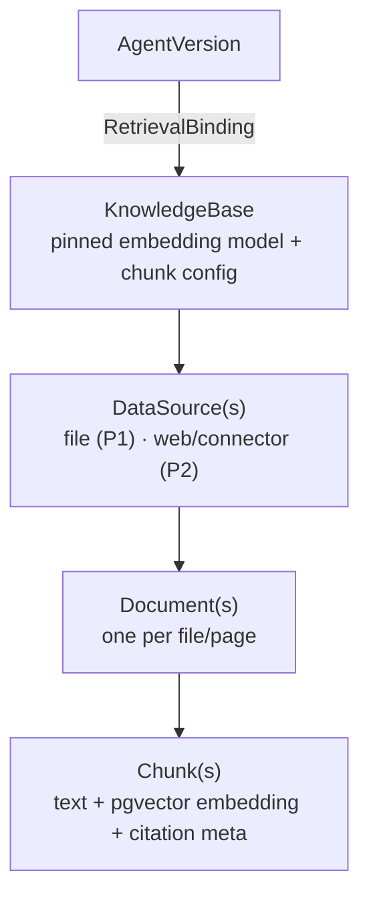

# 04 — Knowledge / RAG

> Implements `spec.md §B6`. Minimal file-upload RAG ships in **P1** (upload → ingest → retrieve-as-tool);
> connectors/crawl/re-sync/reranking are **P2**. Retrieval is a hidden quality lever, so it is pinned per
> version and treated as a drift source (05).

## 1. The shape of knowledge



**Binding config —** `top_k`, `threshold`, `hybrid`, `reranker`, `max_ctx`, `injection`.

Tables in `01-data-model.md §4.4`. The KB is the unit an agent binds to; a binding is snapshotted into
the version (`retrieval_bindings`, with `kb_index_version` pinned) so retrieval is reproducible.

## 2. Ingestion pipeline (async job)

Runs in the `worker` process, tracked by a `jobs` row (01) the UI polls (10 §async).

```python
# services/ingestion/pipeline.py
async def ingest(source_id: str, ctx: JobCtx):
    source = load_source(source_id)
    job = start_job(kind="ingestion", ref=source_id, ctx=ctx)
    try:
        for raw in extract(source):                    # §3 — loaders per file type
            if unchanged(raw.content_hash):            # dedupe on re-sync (documents.content_hash)
                continue
            doc = upsert_document(source, raw)
            chunks = chunk(raw, source.kb.chunk_config) # §4
            vectors = await embed_batch([c.text for c in chunks], source.kb.embedding_model)  # §5
            write_chunks(doc, chunks, vectors)         # pgvector, namespaced (01 §4.4)
            job.progress(done=doc.ordinal, total=raw.total)
        bump_index_version(source.kb)                   # §7 reproducibility
        complete(job)
    except Exception as e:
        fail(job, e)                                    # surfaced in UI with the error
```

## 3. Extraction (P1 files; P2 connectors)

- **P1**: PDF, docx, txt, md, html, and manual text/FAQ. Use LangChain loaders + unstructured for
  parsing (OSS, spec B1) rather than hand-built parsers. Files arrive via MinIO presigned upload (00 §5,
  08); **size/type limits + virus scan** before parsing (`backend-integration-plan.md` upload safety).
- **P2**: web crawl (seed URLs + depth), connectors (S3/GCS, Confluence, Notion, Drive, Git, DB query),
  scheduled re-sync. Connector creds vaulted (09).
- **Frontend note (mock, already shipped):** the connector *configuration* UI exists ahead of the P2
  ingestion backend — a connector registry (`frontend/src/lib/connectors.ts`, field specs per connector)
  drives typed config + credential capture for Confluence (OAuth2, simulated), S3 (access key), Git
  (token), and Google Drive (service-account file). It defines the `data_sources.config` shape
  (`{connector, fields, credentialRef:{masked,vaultPath}}`); raw creds are masked client-side as a vault
  stand-in. Actual extraction/connection stays P2.

## 4. Chunking

```python
# services/ingestion/chunk.py
@dataclass
class ChunkConfig:
    size: int = 800          # tokens
    overlap: int = 120
    structure_aware: bool = True   # split on headings/sections first, then size

def chunk(doc, cfg: ChunkConfig) -> list[Chunk]:
    # structure-aware: respect markdown/html headings, table rows, code blocks; fall back to
    # recursive token splitter within a section. Each chunk keeps {source, docId, page, heading}.
    ...
```

`token_count` is stored per chunk (drives `max_ctx_tokens` budgeting at retrieval, §6, and COGS, 07).

## 5. Embedding

- Model is **pinned per KB** (`knowledge_bases.embedding_model` + `embedding_dim`, 01). Changing it is a
  re-ingest + a drift trigger (§7, 05).
- Called through the gateway's embedding path (LiteLLM embeddings, model-agnostic, spec B1) so cost is
  computed and logged like any model call (02 §4, 10).
- **Embedding cache** (07 §cache): `sha256(text + model)` → vector, so re-ingesting unchanged content or
  re-embedding a repeated chunk costs nothing.
- Batched (`embed_batch`) to amortize request overhead and hit provider batch pricing where available.

> **Dimension constraint (from 01 §4.4):** the `chunks.embedding vector(N)` column is fixed-width.
> Recommended P1: **one embedding model family per org** so all KBs share `N`. If a KB genuinely needs a
> different dimension, add a `chunks_{dim}` table rather than widening everything. Stated as a real
> constraint, not hidden.

## 6. Retrieval

Shared by the retriever-tool (03 §8) and always-on stuffing (03 §4).

```python
# services/runtime/retrieval/retriever.py
@dataclass(frozen=True)
class RetrievalConfig:
    top_k: int = 6
    similarity_threshold: float = 0.2
    hybrid: bool = False            # BM25 + vector (P2 default; P1 vector-only)
    reranker: str | None = None     # OSS bge local (P2) — free
    max_ctx_tokens: int = 2000      # hard cap on injected context (COGS + context mgmt, 03 §7, 07)
    metadata_filters: dict = field(default_factory=dict)

async def search(snapshot, query: str, ctx) -> list[Chunk]:
    binding = snapshot.retrieval_binding                 # pinned KB + index_version + config (01)
    # Invoke-time KB access policy (09 §effective-access): the caller must be entitled to USE this KB.
    # Eval runs (ctx.run_source == "eval") carry principal_id=None (00 §runtime), so they HONOR the frozen
    # snapshot but BYPASS the per-caller KB ACL — the binding was manage-authorized at bind time, and eval
    # tests the snapshot, not a caller's entitlements. Per-chunk/doc-level ACLs remain P2 (§10).
    if ctx.run_source != "eval" and not can_use(binding.kb_access_policy, ctx.principal):
        return []                                        # policy_denied → no retrieval from this KB
    qvec = await embed_one(query, binding.embedding_model)
    rows = await pgvector_knn(                            # namespace-pruned (01 §4.4, 09 §7)
        workspace_id=ctx.workspace_id, kb_id=binding.kb_id,
        qvec=qvec, k=binding.config.top_k * (3 if binding.config.hybrid else 1),
        threshold=binding.config.similarity_threshold, filters=binding.config.metadata_filters)
    if binding.config.hybrid:   rows = fuse(rows, bm25(query, ...))      # P2
    if binding.config.reranker: rows = rerank(binding.config.reranker, query, rows)  # P2
    return trim_to_token_budget(rows, binding.config.max_ctx_tokens)     # never blow the context/COGS
```

pgvector KNN (cosine, HNSW index from 01 §4.4):

```sql
select id, text, meta, 1 - (embedding <=> :qvec) as score
from chunks
where workspace_id = :ws and kb_id = :kb
  and 1 - (embedding <=> :qvec) >= :threshold
order by embedding <=> :qvec
limit :k;
```

> For a >2000-dim model the index is on the `halfvec` cast (01 §4.4), so the probe casts the same way:
> `order by embedding::halfvec(3072) <=> :qvec::halfvec(3072)`. ≤2000-dim models use the plain `vector`
> operator shown above.

### Index choice & scale ceiling (HNSW vs IVFFlat)

- **Default HNSW** (`m=16, ef_construction=64`): best recall/latency for the P1 scale (tens of KBs, up to
  ~1–5M chunks per deployment). Tune recall at query time with `hnsw.ef_search` (raise for recall, lower
  for latency); every query is namespace-pruned by `(workspace_id, kb_id)` (01 §4.4) so effective fan-out
  is per-KB, not the whole table.
- **Dimension ceiling:** pgvector's `vector` ANN index caps at **2000 dims** — >2000 must use the
  `halfvec` cast (01 §4.4) or a ≤2000-dim model. Not optional; a plain `vector(3072)` HNSW index fails.
- **When to switch to IVFFlat / a dedicated vector store:** HNSW build time + memory grow with the vector
  count; past roughly **5–10M chunks per deployment** (or when index build/RAM becomes the bottleneck),
  move to IVFFlat (cheaper build, needs `lists` tuning + periodic reindex) or a dedicated store. This is a
  P2 scale decision — P1 stays on HNSW and records the ceiling rather than pretending it's unbounded.

### P1 defaults vs the FE seed (single source of truth)

The `RetrievalConfig` above is the P1 contract; the mock's `DEFAULT_AGENT_CONFIG.retrieval` (`data.ts`)
must match it. Earlier FE seeds enabled P2 levers and disagreed on two numbers — reconcile the FE to this:

| Field | P1 (backend, this file) | FE seed (before reconcile) | Resolution |
|---|---|---|---|
| `top_k` | 6 | 6 | — |
| `similarity_threshold` | 0.2 | 0.72 | FE → 0.2 |
| `hybrid` | false (P1 vector-only) | true | P2 lever — FE default **off**, still user-selectable |
| `reranker` | none (P2) | "bge" | P2 lever — FE default **none**, still user-selectable |
| `max_ctx_tokens` | 2000 | 4000 | FE → 2000 |
| `metadata_filters` | {} (P2 doc-ACLs, §10) | (no FE field) | P2 only — no P1 FE field |

## 7. Injection strategies (user choice, spec B6.5)

| Mode | When | Behaviour | Best for |
|---|---|---|---|
| **retrieval-as-a-tool** (default) | agent decides it needs context | `retrieve(query)` tool in the graph (03 §8); model may call 0..n times | agentic/multi-step |
| **always-on stuffing** | every turn | prepend top-k chunks once per turn | pure Q&A |

Tool-mode is cheaper on average (retrieves only when needed → fewer input tokens, 07) but can miss
context if the model under-calls; always-on is simpler but pays retrieval cost every turn. The choice is
per `retrieval_binding.injection`.

## 8. Citations

Every retrieved chunk carries `{source, docId, chunkId, score}` (01 `chunks.meta`). When citations are
enabled (io_contract, spec B2.5), responses cite them; the Playground shows them and the published API
returns them. Citations are assembled in `output_guardrails`/finalization, not invented by the model —
they come from `state["retrieved"]` (03 §3).

## 9. Reproducibility & drift tie-in (why RAG is a drift source)

Retrieval silently changes answer quality, so it is version-pinned and change-tracked:
- `embedding_model` + `kb_index_version` are pinned into the `retrieval_binding` snapshot (01).
- **Changing the embedding model or the KB binding = new version + re-eval** (it changes retrieval
  quality → a drift trigger, 05 §triggers).
- **Re-ingesting a bound KB after publish** raises a **stale-index warning** and flags re-eval — the
  published version still runs on its pinned `index_version` until an eval-gated re-point.
- Eval evaluates **retrieval, not just generation** (05): a case can assert "retrieved the right chunk,"
  so an embedding regression is caught even if the generation model is unchanged (spec E risk #3).

## 10. P2 additions (designed, lighter)

- Connectors + web crawl + scheduled re-sync. The `data_sources.config` shape is already defined by the
  FE connector registry and its mock config/credential capture is shipped — the P2 work is the actual
  ingestion/connection + worker cron.
- Hybrid search (BM25 fused with vector) + OSS reranker (bge, local → free).
- Doc-level ACLs (filter chunks by principal/team at retrieval, extends `metadata_filters` + 09).
- MCP ↔ knowledge bridge: MCP *resources* feed a KB or are read inline (spec B6, B7).

→ Next: `05-eval-drift.md`.
