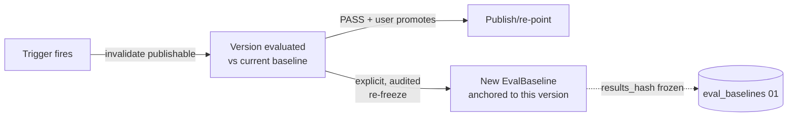
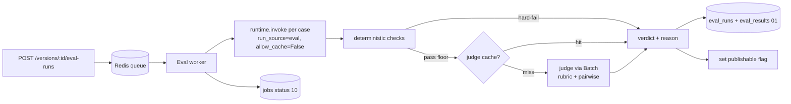

# 05 — Eval & Drift Engine (Hard Core #2, the Defensible Part)

> Implements `spec.md §B5`. This is *the* reason the platform exists (`scope.md`): detecting that an
> agent "quietly got worse" after a model/prompt/knowledge change, **without a human reading every
> transcript**. Everything else is CRUD. This is not. It is also — see 07 — the biggest COGS risk in
> the system, so cost control is designed in from line one, not bolted on.

## 1. What "drift" means here (precise definition)

A version **drifts** when, relative to a frozen trusted **baseline**, its behavior degrades on a fixed
**eval suite**. "Degrades" has two independent axes, and a PASS requires *both* plus hard assertions:

```
PASS  ⟺  quality(candidate) ≥ quality(baseline) − Q_THRESHOLD      (quality axis)
     AND  efficiency(candidate) within EFF_BUDGET of baseline       (cost/latency axis)
     AND  all deterministic hard-assertions green                   (correctness floor)
     AND  suite has ≥ MIN_CASES (else → low_confidence, not pass)    (statistical honesty)
```

This maps 1:1 to the frontend `EvalRun` type (`quality`, `qualityDelta`, `costDelta`, `latencyDelta`,
`verdict ∈ pass|fail|low_confidence`, `dimensions[]`, `failingCases[]`, `reason`).

## 2. The two scoring layers

> **Delta from spec (00 §7.3):** the spec treats judge cost as "caching + Batch." We treat the
> **LLM-judge as the primary cost center of the whole platform** and gate it hard. A 120-case suite ×
> pairwise judging on every trigger, unchecked, can cost more than production traffic. See §6 + 07.

### Layer 1 — Deterministic checks (cheap, run always, first)

Zero model calls. These are the correctness floor and the **pre-filter that keeps judge cost down** —
a case that fails a hard assertion never reaches the judge.

```python
# services/evals/deterministic.py
@dataclass
class DetResult:
    passed: bool
    checks: dict[str, bool]        # {"schema_valid": True, "required_fields": False, ...}
    hard_fail: bool                # a hard_fail forces case FAIL regardless of judge

def run_deterministic(case: EvalCase, output: "CandidateOutput") -> DetResult:
    """
    Checks (configured per case in eval_cases.assertions — 01 §4.5):
      - structured-output schema validity (if io_contract declares a schema)
      - required fields present / non-empty
      - regex / exact-match assertions
      - tool-call correctness: expected tool called with args matching a schema/predicate
      - refusal / empty-output detection (a spiking refusal rate is itself drift)
      - citation presence when RAG is on (04)
    """
```

### Layer 2 — LLM-judge (expensive, gated, cached, versioned)

```python
# services/evals/judge.py
JUDGE_MODEL = settings.judge_model        # FIXED (claude-haiku-4-5) — a cheap, capable judge
JUDGE_VERSION = settings.judge_version    # "judge-v1" — bump = re-run, never silent

@dataclass
class JudgeVerdict:
    rubric_scores: dict[str, float]       # {"accuracy": 4.5, "completeness": 3.0, ...} 1–5
    pairwise_winner: Literal["baseline", "candidate", "tie"]
    rationale: str
    judge_version: str

async def judge_case(case, baseline_out, candidate_out) -> JudgeVerdict:
    """
    Two judgments, one call each where possible:
      (a) RUBRIC: score candidate 1–5 on each dimension in case.rubric (accuracy, completeness,
          faithfulness, safety, rubric-adherence, neutrality — see FE EvalRun.dimensions examples).
      (b) PAIRWISE: baseline vs candidate, which better satisfies the case? (order randomized to
          cancel position bias; run both orders only for close calls — a cost knob, 07).
    The judge model and prompt are VERSIONED so the judge itself can't silently drift — if you change
    the judge, every baseline comparison is re-run under the new judge_version.
    """
```

> **Why a fixed, versioned judge is non-negotiable:** if the judge model upgrades underneath you, your
> "quality" number moves for reasons that have nothing to do with the agent. The one thing a
> drift-detector must never do is drift itself. The judge model id + prompt hash are part of the verdict
> cache key (§6) and stored on `eval_results.judge_verdict`.

## 3. The verdict math

```python
# services/evals/drift.py
def score_quality(results: list[CaseScore], rubric_weights: dict[str, float]) -> float:
    """Weighted blend of per-dimension rubric means, normalized to 0–100 (FE 'quality')."""

def efficiency_delta(candidate: RunAgg, baseline: RunAgg) -> EfficiencyDelta:
    """cost%, latency(ms), tokens, tool-call-count deltas — all from the gateway IR (02)."""

def verdict(quality_c, quality_b, eff, det_all_green, n_cases) -> tuple[Verdict, str]:
    if n_cases < MIN_CASES:                       # default 10 (spec B5 small-set honesty)
        return "low_confidence", _reason_small_set(n_cases)
    if not det_all_green:
        return "fail", _reason_hard_assertions()
    q_drop = quality_b - quality_c
    if q_drop > Q_THRESHOLD:
        return "fail", _reason_quality(q_drop, worst_dimensions)
    if not eff.within_budget(EFF_BUDGET):
        return "fail", _reason_efficiency(eff)     # e.g. "cost +12%, latency +320ms"
    return "pass", _reason_pass()
```

The `_reason_*` helpers produce the human-readable `eval_runs.reason` the UI shows (FE already renders
it — e.g. *"Completeness dropped on multi-day incidents… omitted timeline steps… below the 90% publish
bar."*). The `dimensions[]` and `failingCases[]` come straight from `eval_results` (01 §4.5). The
engine's job is to make that explanation *true and specific*, not generic.

## 4. Baseline lifecycle



- A **baseline** (01 `eval_baselines`) is anchored to a specific version + suite, with a `results_hash`
  identifying the frozen result set. It is the trusted point of comparison.
- **Re-freezing is explicit and audited** (spec B5) — you don't silently adopt a new baseline, because
  that would let quality erode one "small" step at a time. Re-freeze writes an `audit_logs` row.
- First baseline with no prior version → `low_confidence` (FE already shows this: *"First baseline with
  only 12 cases and no prior version to compare against."*).

## 5. Triggers & the publish gate (where this bites)

The gate is the whole point: you **cannot publish or re-point to a version whose behavior changed since
its last passing eval.** Enforced in code, returns `409` otherwise (spec B5, 08).

```python
# a change to ANY of these invalidates a version's `publishable` flag (01) and demands a fresh eval:
DRIFT_TRIGGERS = {
    "model", "provider", "api_version",     # gateway config (02)
    "params",                                # temperature/max_tokens…
    "prompt_hash",                           # system prompt text (01)
    "guardrail_config",                      # guardrails change behavior (06)
    "tool_bindings",                         # tool set / schema snapshot (01, spec B7)
    "embedding_model", "kb_binding",         # RAG affects quality — a hidden lever (04)
    "retrieval_config",                      # top_k/threshold/injection/reranker/hybrid also move retrieval (04)
    "capability_substitution",               # a provider downgrade changed behavior (02)
}

def on_version_change(version, changed: set[str]):
    if changed & DRIFT_TRIGGERS:
        version.publishable = False          # must re-eval; publish → 409 until PASS
```

```python
# the gate, enforced at publish AND re-point (08):
def assert_publishable(version) -> None:
    last_trigger = latest_trigger_time(version)
    latest = latest_eval_run(version)                      # most recent run, ANY verdict (not pre-filtered)
    if latest is None or latest.started_at < last_trigger:
        raise ConflictError(409, "publish.eval_gate: no eval newer than the last behavior-changing edit.")
    if latest.verdict == "fail":
        raise ConflictError(409, "publish.eval_gate: latest eval failed; fix or roll back before publish.")
    if latest.verdict == "low_confidence" and not version.audited_override:
        raise ConflictError(409, "publish.low_confidence: suite below confidence threshold; audited "
                                 "override required.")
    # verdict == "pass" and newer than the last trigger → publishable. (codes mirror 08 error table)
```

> **This is the single most important behavioral guarantee in the product.** "Publish" and "roll
> forward" are the only moments a version becomes live; gating exactly those two on a fresh PASS is what
> makes "nobody noticed it got worse" structurally impossible. Everything upstream exists to make this
> gate trustworthy.

## 6. Cost control (this engine will bankrupt you if you let it)

Judge spend scales with `cases × triggers × (rubric + pairwise) × dimensions`. Controls, in priority
order — see 07 for the dollar model:

| Lever | Mechanism | Savings |
|---|---|---|
| **Deterministic pre-filter** | Hard-assertion failures skip the judge entirely | Skips judge on every broken case |
| **Verdict cache** | Key = `(case_id, baseline_hash, candidate_hash, judge_version)`; cache the judge verdict | Re-runs of an unchanged (case, pair) are free |
| **Batch API** | Non-interactive eval uses the provider Batch API (`batch_multiplier` 0.5 in the profile, 02) | ~50% on all judge calls |
| **Cheap judge model** | Judge is Haiku-class, not the agent's model | Judge ≪ candidate cost per token |
| **Single-order pairwise** | Run both orders only when the first is close (margin < ε) | ~halves pairwise calls |
| **Incremental eval** | On a prompt-only change, re-run only cases whose inputs exercise the change (tagged cases); full suite on model swap | Fewer cases per trigger |
| **Suite size discipline** | `MIN_CASES` floor + `low_confidence` flag discourages giant suites that aren't earning their cost | Bounds the multiplier |

```python
# the verdict cache makes re-eval of an unchanged pair free (candidate_hash = snapshot_hash, 01):
def judge_cache_key(case, baseline_snap, candidate_snap) -> str:
    return sha256(f"{case.id}:{baseline_snap}:{candidate_snap}:{JUDGE_VERSION}")
```

> **Snapshot-hash coverage (RAG).** Because the verdict cache keys on `candidate_hash = snapshot_hash`,
> `snapshot_hash` MUST incorporate the frozen `retrieval_config` **and** each binding's `kb_index_version`
> (alongside model/params/prompt/guardrails/tools). Otherwise a retrieval change — a re-ingest that bumps
> `kb_index_version`, or a `top_k`/`threshold` edit — leaves the hash unchanged, so a stale PASS is served
> from the cache and the publish gate is bypassed silently. This is the hashing counterpart to adding
> `retrieval_config` to `DRIFT_TRIGGERS` above.

## 7. Execution flow (the async job)



- Candidates are produced by **the same `runtime.invoke`** the playground and published endpoint use
  (00 §1) with `allow_cache=False` so a cached response can't mask a regression.
- Progress streams to `jobs` (01, 10); the UI polls `GET /jobs/:id` and patches the `EvalRun` row on
  completion (matches the FE `resolveEvalRun` mock being replaced).

## 8. Trustworthiness: calibrating the judge (the meta-eval)

A drift detector you don't trust is worthless. So the judge itself is evaluated:

- **Judge calibration set:** a held-out set of (case, output) pairs with **human labels**. Measure
  judge agreement with humans (Cohen's κ / accuracy). Target documented; recalibrate on judge-version
  bumps. (Risk #1 in spec E / backend-integration-plan.)
- **Seeded-regression test (the headline Phase-1 verification):** deliberately swap to a weaker/cheaper
  model or degrade the prompt → the harness must flag ≥ 80% of seeded regressions with < 10%
  false-positive rate on an unchanged agent (scope.md success metric 2).
- **Production feedback loop:** real production failures (thumbs-down, corrections, incident reports)
  are captured back into eval suites so the suite tracks reality, not just the cases you imagined
  (10 §drift monitoring, backend-integration-plan Part 5).

## 9. P2 notes (designed, lighter)

- **Retrieval-quality eval:** score recall@k (known Q → right chunk) and citation faithfulness
  separately from generation (04) — retrieval is a hidden quality lever and deserves its own axis.
- **Multi-judge ensembles / judge disagreement flags** for high-stakes agents (security triage).
- **Auto-suite-expansion suggestions** from clustered production failures.

→ Next: `06-guardrails.md`.
