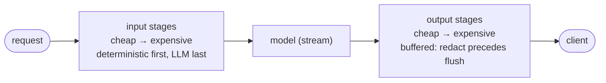

# 06 — Guardrails

> Implements `spec.md §B9`. Guardrails are an **ordered pipeline of stages** wrapping every model call,
> identical across playground, eval, and published invoke (00 §1). This doc is one of the two the user
> emphasized — so it goes past "we use Guardrails AI" into the stage contract, ordering for cost+safety,
> streaming redaction, and the fail-open vs fail-closed decision that actually matters in production.

## 1. The pipeline



Stages are configured **per version** (`agent_versions.guardrail_config`, 01), snapshotted, and
immutable — **changing guardrails = new version = re-eval** (05). The same ordered list runs everywhere,
so a block you see in the Playground is the block a published caller gets.

## 2. The stage interface (our backbone; OSS libs are plugins)

> **Delta from spec (00 §7.2):** spec names Guardrails AI / NeMo as the backbone. In practice those are
> heavier and less reliable than their READMEs suggest, and they want to own the loop. This design makes
> **our own cheap deterministic stages the default backbone** and treats Guardrails AI / NeMo / Presidio
> as *optional plugins* behind the same interface. You can run the whole P1 safety baseline with zero
> third-party guardrail framework.

```python
# services/runtime/guardrails/base.py
from typing import Protocol
from dataclasses import dataclass
from enum import Enum

class Decision(str, Enum):
    ALLOW = "allow"        # pass through unchanged
    REWRITE = "rewrite"    # pass through modified (e.g. redacted)
    BLOCK = "block"        # stop; emit a blocked outcome

@dataclass
class StageResult:
    decision: Decision
    text: str | None = None          # the (possibly rewritten) content
    label: str | None = None         # "PII blocked on input" → runs.guardrail (01), surfaced in UI
    detail: dict | None = None       # matched spans, scores — for traces (10), redacted

class GuardrailStage(Protocol):
    name: str
    phase: str                        # "input" | "output"
    cost_tier: int                    # 0 = deterministic/instant, 2 = LLM call (ordering, §4)
    async def check(self, text: str, ctx: "RunContext") -> StageResult: ...
```

## 3. Concrete stages (P1 baseline, all ours)

| Stage | Phase | Tier | What it does | Backed by |
|---|---|:--:|---|---|
| `pii` | in+out | 0 | detect/redact emails, keys, SSNs, phone, CC, internal IDs | regex + **Presidio** (optional, local) |
| `secret_leak` | out | 0 | block/redact key-shaped + high-entropy strings | our detector + 09 §9 redaction |
| `prompt_injection` | in | 0–1 | heuristic + small-classifier for "ignore previous", tool-hijack, exfil patterns | our heuristics; optional classifier |
| `topic_scope` | in | 0 | allow/deny-list of topics (keep an HR bot out of legal advice) | keyword/embedding match |
| `profanity_toxicity` | in+out | 0–1 | threshold-based filter | OSS detoxify (optional) |
| `jailbreak` | in | 1 | known-jailbreak pattern set | our ruleset |
| `policy_judge` | out | 2 | LLM policy check against a written rubric (last resort, opt-in) | judge model (fixed, 05) |

P2 adds: grounded-ness/hallucination check on RAG outputs, structured-output schema enforcement as a
guardrail, NeMo Guardrails dialog rails for multi-turn policy, human-approval gate for high-risk tool
calls (09 §10).

```python
# services/runtime/guardrails/stages/pii.py
class PiiStage:
    name, phase, cost_tier = "pii", "input", 0
    async def check(self, text, ctx) -> StageResult:
        spans = detect_pii(text)                      # regex fast-path; Presidio if enabled
        if not spans:
            return StageResult(Decision.ALLOW)
        if self.config.mode == "block":
            return StageResult(Decision.BLOCK, label="PII blocked on input",
                               detail={"types": [s.type for s in spans]})
        return StageResult(Decision.REWRITE, text=redact(text, spans), label="PII redacted")
```

## 4. Ordering — cheap first, LLM last (safety *and* COGS)

The runner sorts stages by `cost_tier` within each phase and short-circuits on the first `BLOCK`. This
is both a safety property and a **COGS lever** (07): a request that trips the tier-0 PII/injection block
**never reaches the model**, so you pay nothing for provider tokens or the tier-2 policy judge.

```python
# services/runtime/guardrails/runner.py
async def run_input_stages(messages, cfg, ctx) -> PipelineOutcome:
    text = concat_user(messages)
    fail_mode = cfg.get("fail_mode") or settings.guardrails_fail_mode   # per-version override else global (00 §6)
    for stage in sorted(load_stages(cfg, "input"), key=lambda s: s.cost_tier):
        r = await run_stage(stage, text, ctx, fail_mode)  # fail-mode wrapper (lld/06 §3): a stage error → BLOCK (closed) / ALLOW+alert (open); 2026-10-24
        emit_span("guardrail", stage.name, r, ctx)    # trace every stage (10)
        if r.decision is Decision.BLOCK:
            return PipelineOutcome(blocked=True, label=r.label)      # short-circuit → no model call
        if r.decision is Decision.REWRITE:
            text = r.text
    return PipelineOutcome(blocked=False, rewritten_messages=rewrite(messages, text))
```

> **Why this ordering is non-negotiable for a security product:** running an LLM policy judge *before* a
> free regex PII block would mean paying for (and sending to a provider) content you were always going to
> reject. Deterministic, local, free checks gate the expensive ones.

## 5. Streaming output redaction (the hard part)

Output stages must redact **before** a frame reaches the client, but the model streams token-by-token.
Solution: a **sliding buffer** — hold the smallest window that could contain a match, flush the safe
prefix, keep the tail.

```python
# services/runtime/guardrails/streaming.py
class RedactingStream:
    def __init__(self, stages, ctx, window=None):     # ctx needed by _scrub; window derived from patterns (lld/06 §4), 2026-10-24
        self.stages = [s for s in stages if s.phase == "output" and s.cost_tier == 0]  # tier-0 output redactors only (hot path)
        self.ctx, self.window, self.buf = ctx, window or required_window(self.stages), ""
    async def feed(self, delta: str):
        self.buf += delta
        if len(self.buf) > self.window:
            scrubbed = await self._scrub(self.buf)    # scrub the WHOLE buffer — a match straddling the flush
            yield scrubbed[:-self.window]             #   boundary is caught (lld/06 §4), not just the head; 2026-10-24
            self.buf = self.buf[-self.window:]        # retain the RAW tail for re-scrubbing with the next delta
    async def flush(self):
        yield await self._scrub(self.buf)             # final tail
    async def _scrub(self, s):
        for stage in self.stages:                     # tier-0 redactors only on the hot path
            r = await stage.check(s, self.ctx)
            if r.decision is Decision.REWRITE: s = r.text
            if r.decision is Decision.BLOCK:  raise OutputBlocked(r.label)
        return s
```

- Adds bounded latency to the **tail** only (last `window` chars), never first-token — so p95 first-token
  stays < 2s.
- The expensive `policy_judge` can't run per-token; it runs **after** the full response is assembled
  (post-stream), and if it blocks, the client gets a terminal `blocked` event. For agents where that
  "too late" window is unacceptable, use non-streaming mode for the published endpoint (per-version).

## 6. Fail-open vs fail-closed (the production decision)

When a guardrail stage itself errors (classifier timeout, Presidio down, judge 500), what happens?

| Mode | On stage error | Use when |
|---|---|---|
| **fail-closed** (default) | treat as BLOCK | security/compliance agents — a down PII detector must not mean PII flows |
| **fail-open** | treat as ALLOW + alert | availability-critical internal tools where a false block is worse |

Set globally (`AC_GUARDRAILS_FAIL_MODE`, 00 §6) with per-version override. Default is **closed** — for a
Trellix security platform, the safe failure is to refuse, not to leak. Every fail-mode trigger is a span
attr + an alert (10), because silently failing closed looks like a quality regression and silently
failing open is a breach.

## 7. How guardrails surface everywhere

- **Run record**: the outcome label populates `runs.guardrail` (01) — exactly the strings the frontend
  already renders ("PII blocked on input", "passed", "n/a (provider timeout)").
- **Playground**: blocked/redacted events render inline so builders see guardrails working.
- **Eval**: a guardrail stage is part of the version snapshot, so the eval runs them too — a change that
  makes guardrails over-block shows up as a quality/refusal-rate regression (05).
- **Traces**: every stage emits a span (10) with matched types (not raw matched PII — that's redacted in
  the trace itself, 09 §11).

## 8. Testing (spec §D Phase-2 golden cases, pulled earlier for safety)

- Golden block cases: known-PII input → blocked/redacted with the right label.
- Golden redact cases: output containing a secret → redacted before flush (assert the client never saw
  the raw span, including across the streaming buffer boundary).
- Injection corpus: a set of prompt-injection strings → blocked; measured false-positive rate on benign
  inputs.
- Fail-mode test: force a stage to raise → fail-closed blocks, fail-open allows + alerts.
- Ordering test: a tier-0 block prevents any model/judge call (assert zero provider cost on blocked runs).

→ Next: `07-cost-cogs.md`.
