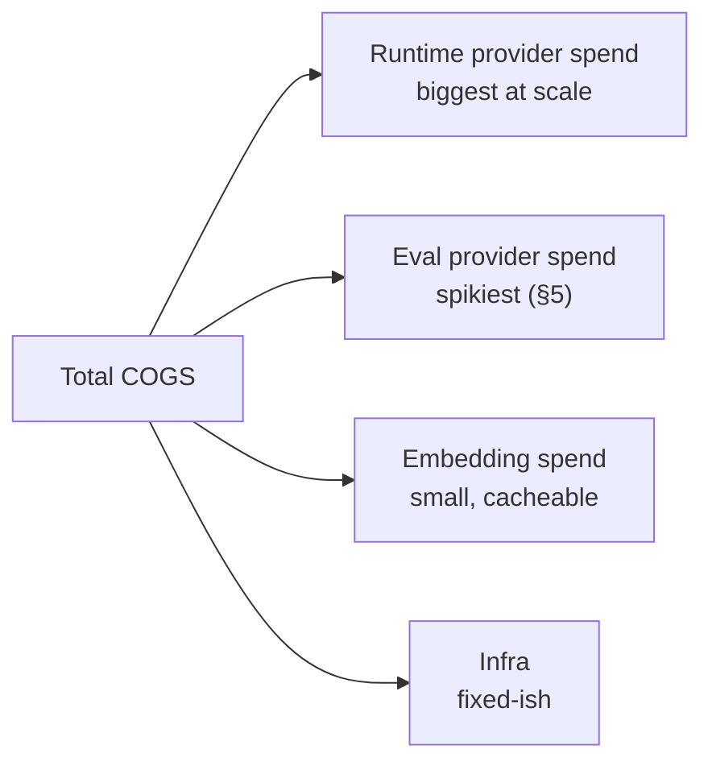
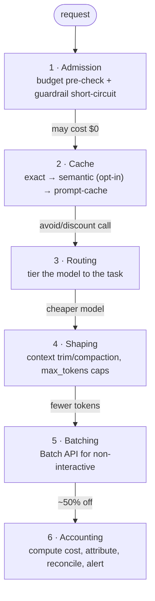

# 07 — Cost & COGS Architecture

> The cost-savings design, end to end. COGS here = provider spend (runtime + **eval** + embeddings) plus
> the infra to run the platform. The thesis of this doc: **the LLM-judge in the eval engine, not
> production traffic, is the most likely thing to blow the budget** — so cost control is architected, not
> bolted on. Every lever below has an expected-impact estimate and an implementation hook. Pairs with
> `10-observability-monitoring.md` (you can't cut what you don't measure).

## 1. Where the money goes (model the spend before optimizing)



**Legend —** Runtime: per-call input/output/reasoning tokens × traffic. Eval: judge calls × cases × suites × triggers. Embedding: ingestion (one-time/doc) + query embeds. Infra: Postgres/pgvector, Redis, workers, Langfuse, MinIO.

Two non-obvious truths this drives:
1. **Eval cost is bursty and can exceed runtime cost** for a low-traffic agent with a large suite —
   a 120-case suite judged pairwise on every prompt edit is 240+ judge calls *per edit*.
2. **The cheapest token is the one you never send** — ordering (guardrails 06 §4), caching, and context
   trimming beat any per-token price negotiation.

## 2. The cost control stack (defense in depth, cheapest layer first)



**Layer refs —** 1 Admission (§3, 06 §4) · 2 Cache (§4) · 3 Routing (§6) · 4 Shaping (§7) · 5 Batching (§5, §8) · 6 Accounting (§9, 10). Cheapest layer first (defense in depth).

## 3. Admission: budget guard + spend reservation

Every run passes a `BudgetGuard` (00 §4) before touching a provider. Budgets live in `spend_limits` (01).
**Phasing (revised 2026-10-19):** the **per-workspace monthly spend cap is P1-enforced** — the pitch sells
"caps," so v1 must actually refuse spend past the ceiling, not just display a number. The finer-grained
controls stay **P2**: per-*endpoint* budgets, **concurrency** caps (Redis semaphores), and the
tight-overshoot reservation races. The P1 cap tolerates bounded overshoot (below); P2 tightens it.

```python
# services/runtime/cache/budget.py  (Redis-backed)
class BudgetGuard:
    async def reserve(self, workspace_id, est_usd) -> Reservation:
        spent = await redis.incrbyfloat(f"spend:{workspace_id}:{month}", est_usd)
        if spent > self.cap(workspace_id):
            await redis.incrbyfloat(f"spend:{workspace_id}:{month}", -est_usd)   # roll back
            raise BudgetExceeded()                       # → HTTP 402 budget.exceeded (08; rate-limit is a separate 429)
        return Reservation(workspace_id, est_usd)
    async def reconcile(self, res: Reservation, actual_usd: float):
        await redis.incrbyfloat(f"spend:{res.workspace_id}:{month}", actual_usd - res.est_usd)
```

- Pre-call estimate from `max_tokens` × profile pricing (02); reconciled to actual after the call.
- **Bounded overshoot (P1 cap)**: concurrent reservations can exceed the cap by at most (in-flight × est);
  the hard-cap backstop (`spend_limits.hard_cap`) refuses once real spend crosses the ceiling → HTTP 402
  (spec E risk #5). This single per-workspace monthly check is cheap (one Redis counter) and ships in P1;
  eliminating the overshoot window under heavy concurrency (semaphore reservation) is the P2 tightening.
- **Owner notification (16):** when `reconcile` crosses an **80% / 90% of monthly budget** threshold,
  emit a `budget_threshold` owner notification (deduped per threshold per month) — so the owner hears it
  *before* the 402 hard-cap, not after. This is an **owner** notice, separate from the ops `SpendAnomaly`
  page in `10 §5`; it rides on the same reservation math.
- Guardrail short-circuit (06 §4) means a blocked request costs **$0** — admission's cheapest outcome.

## 4. Caching — three layers, each with a different safety profile

| Layer | Key | Hit saves | Safety | Default |
|---|---|---|---|---|
| **Exact response cache** | `sha256(snapshot_hash + normalized_inputs)` | the whole call | safe (identical input→output) | on for deterministic/`temperature=0` versions |
| **Provider prompt cache** | provider-managed, we place breakpoints | ~90% on cached input tokens | safe (provider feature) | on where `profile.features.prompt_caching` |
| **Semantic response cache** | embedding similarity ≥ floor | the whole call | **risky — near-miss = wrong answer** | **off**; opt-in per agent (§4.3) |
| **Embedding cache** | `sha256(text + embed_model)` | the embed call | safe | on |
| **Judge-verdict cache** | `(case_id, baseline_hash, candidate_hash, judge_version)` | a judge call | safe | on (§5) |

### 4.1 Exact response cache

```python
# services/runtime/cache/response.py
def exact_key(snapshot, inputs) -> str:
    return sha256(f"{snapshot.snapshot_hash}:{canonical_json(inputs)}")
# Only cache when the version is effectively deterministic (temperature 0, no tools, no time-sensitive
# retrieval). TTL short (minutes–hours). Never cache tool-calling or RAG-with-fresh-index responses.
```

### 4.2 Provider prompt caching (the quiet 90% win)

System prompts, few-shot blocks, and bound-knowledge preambles are large and **repeated every call**.
Placing provider cache breakpoints on the stable prefix (`NormalizedRequest.cache_hints`, 02) makes the
provider bill those tokens at the `cached_input` rate (profile pricing, 02 §4) — up to ~90% off on the
prefix. This is the highest-ROI, lowest-risk lever for most agents and needs **no behavior change**.

```python
# cache_hints mark the stable prefix (system + tools + KB preamble) as cacheable:
req.cache_hints = [{"upto": "end_of_system"}, {"upto": "end_of_tools"}]
# the adapter (02) translates to the provider's cache-control; usage.cached_input_tokens comes back and
# compute_cost prices it at the discounted rate → real, measured savings in runs.cost_usd.
```

### 4.3 Semantic cache — opt-in, fenced, never for security/tool agents

> **Delta / hard stop (00 §7.4):** a semantic cache returns a *previous* answer for a *similar* query.
> For a SOC triage copilot, "similar alert" ≠ "same verdict" — a near-miss hit is a **wrong security
> decision**. So semantic cache is: **off by default**, opt-in per agent, **banned for tool-calling,
> RAG-with-citations, and security-classified agents**, gated by a high similarity floor, and every hit
> is logged with its similarity score so you can audit it. Suitable only for stable FAQ-style Q&A.

```python
if snapshot.semantic_cache_enabled and snapshot.is_qa_safe():   # refuses tool/sec/cite agents
    hit = await semantic_cache.get(embed(query), floor=0.97)
    if hit: return cached(hit, reason="semantic_cache", similarity=hit.score)   # logged (10)
```

## 5. Eval COGS — the primary risk, treated as a first-class budget

A naive eval engine re-judges every case on every trigger. For N cases × pairwise (candidate vs
baseline) × every prompt tweak, judge spend dominates. Controls (also in 05 §cost-control):

1. **Deterministic pre-filter gates the judge.** Run free checks (schema, regex, tool-call correctness,
   refusal/empty) first; **a case that hard-fails a deterministic assertion never reaches (or costs) the
   LLM-judge.** Every case that passes the deterministic floor and isn't already in the verdict cache
   goes to the judge — matching the 05 §7 flow exactly (the pre-filter + verdict cache are the levers;
   there is no separate "ambiguity" gate).
2. **Verdict cache** keyed by `(case_id, baseline_hash, candidate_hash, judge_version)` (01, §4) — if
   neither the candidate output nor the baseline nor the judge changed, reuse the verdict for $0.
3. **Cheap, fixed judge model.** The judge is `claude-haiku-4-5` by default (00 §6), pinned + versioned
   (05) — a capable-but-cheap tier, not the frontier model.
4. **Batch API for eval runs** (non-interactive) — ~50% off (§8).
5. **Small-suite honesty, not small-suite waste.** Suites < N cases are flagged low-confidence (05)
   rather than silently re-judged repeatedly.

> **Rule of thumb to put in the runbook:** estimate `judge_cost ≈ cases × (judge_in+out tokens) ×
> haiku_price × triggers_per_week`. If that exceeds the agent's weekly *runtime* spend, widen the
> deterministic pre-filter or shrink the suite — don't just eat it.

## 6. Model routing / tiering

Not every call needs the frontier model. Tier by task, and let the expensive model be the exception.

| Job | Default tier | Rationale |
|---|---|---|
| Production runtime | the version's pinned model | user's choice, eval-gated |
| **Memory compaction / summarization** (03 §6) | cheap tier (haiku/gpt-5-mini) | mechanical task |
| **Query rewriting for retrieval** | cheap tier | short, structured |
| **LLM-judge** | cheap fixed tier (05) | must be stable + cheap |
| **Guardrail policy stage** (06) | cheap tier | classification |
| Self-hosted llama (data.ts) | $0 provider cost | for high-volume non-critical paths |

Routing is explicit in code (each internal call names its tier), not a magic auto-router — predictability
matters for a platform whose whole point is detecting quality drops. A/B "cheaper model" experiments go
**through the eval harness** (that's literally what it's for) so a cost cut that degrades quality is
caught before it ships (scope.md success metric #2).

## 7. Token/context shaping

- **max_tokens caps** per version (profile-bounded, 02) — stop paying for runaway generations.
- **Context compaction** (03 §7): summarize old turns with the cheap tier instead of resending full
  history; enforce the window so input tokens don't creep.
- **Retrieval budget**: `max_ctx_tokens` on the retrieval binding (04 §6) hard-caps injected chunks —
  the single biggest input-token lever for RAG agents.
- **Retrieval-as-tool over always-on** (04 §7): retrieve only when the model asks, not every turn.
- **Trim tool schemas**: only bind the tools a version needs; every tool definition is input tokens on
  every call.

## 8. Batch & async pricing

Non-interactive work (eval runs, bulk ingestion embeds, backfills) goes through provider **Batch APIs**
(~50% off, higher latency, fine for jobs). The gateway (02) exposes a batch path; workers (00 §2) use it
for eval and ingestion. Interactive paths (playground, published invoke) never batch — latency matters
there.

## 9. Cost attribution & the feedback loop

- **Every Run and Span carries computed cost** (`runs.cost_usd`, `spans.cost_usd`, 01) from our own
  `compute_cost` (02 §4) — tagged with `workspace_id` + `caller_token_id` for per-tenant, per-endpoint,
  per-model rollups (10).
- These rollups power: per-tenant **quotas/chargeback** (spec Part 4), the dashboards the frontend
  already renders (`SPEND_SERIES`, `cost30d`), and **spend-anomaly alerts** (10 §alerts).
- **Reconcile against provider billing** periodically; a gap means our pricing table (02 profiles) drifted
  — itself an alert, because wrong cost numbers corrupt every budget decision above (spec E risk #6).

## 10. Expected impact (order-of-magnitude, to prioritize)

| Lever | Typical saving | Effort | Priority |
|---|---|---|---|
| Provider prompt caching on stable prefix | 30–60% of input-token cost | Low | **do first** |
| Guardrail/admission short-circuit | 100% on blocked runs | Low (already in 06) | **do first** |
| Eval: deterministic pre-filter + verdict cache | 50–90% of judge spend | Med | **do first (biggest risk)** |
| Batch API for eval/ingest | ~50% of that spend | Low | high |
| Model tiering for internal calls (compaction/judge/guardrail) | 60–90% on those paths | Low | high |
| Context/retrieval token budgeting | 10–40% of RAG input cost | Med | medium |
| Exact response cache | varies (high for repetitive Q&A) | Med | medium |
| Semantic cache (fenced) | high where safe | Med | low (risk-gated, §4.3) |

> **Sequencing advice:** ship prompt caching + admission short-circuit + eval pre-filter/verdict-cache
> first — they're low-effort, low-risk, and hit the two biggest cost centers (runtime input tokens and
> judge spend). Treat semantic cache as a last, carefully-fenced resort.

## 11. A worked example (so the levers are concrete)

Illustrative, for one published agent — *plug real numbers from the cost dashboard (10)*; the point is
that the levers **stack multiplicatively**.

```
Agent: SOC Triage Copilot, claude-opus-5-5, ~9K tokens/call, 48K calls/30d   (frontend data.ts)
Naive:          48,000 × (8K in × $4/M + 1K out × $20/M)              ≈ $2,500/mo
+ prompt cache  (2K stable system prefix, ~80% hit, reads at $0.4/M)   → cuts cached input ~90%
+ tiering       (route ~60% of simple triage → sonnet $2/$10, eval-proven) → −40–50% blended
+ context budget (retrieval top-k 8→5, history compaction)            → −15–25% input tokens
= landed cost materially below naive, WITH an eval report proving quality held.
  (FE shows cost30d ≈ $1,285 for this agent — consistent with a *tuned*, not naive, number.)
```

The arithmetic is illustrative; the architecture is the point. **Prompt caching × tiering × context
budget compound**, and the eval gate (05) is what lets you apply all three without flying blind — the
product's whole value is that downgrading for cost becomes *safe* (§6, scope.md metric #2).

## 12. The platform's OWN COGS (a cost-governance tool must cost itself)

Everything above is the *agents'* inference spend (pass-through, attributed per workspace). This section is
the bill for **running Agent Platform itself** — the part a cost-governance pitch cannot leave as "TBD."
Two buckets:

**A. Platform-induced inference COGS (the part that compounds).** Beyond agent runtime, the platform
*itself* spends on models in two places:
- **Eval/judge spend** (§5) — the primary risk. Formula: `judge_cost ≈ Σ_agents (eval_runs/mo × cases ×
  judge_tokens × judge_price) × (1 − cache_hit) × (pairwise ? ~2 : 1) × batch_mult`. It **compounds with
  governance pressure**: more agents × more model-affecting changes × re-eval on every change. At ~40
  agents each re-evaluated on a handful of changes/month with a cheap pinned judge (`claude-haiku`,
  batched, verdict-cached), this is **tens of $/mo**, not thousands — *but only because* pre-filter +
  cache + batch (§5) hold. Without them it can rival runtime spend. This line is the one to watch on the
  cost dashboard (10 §6).
- **Embedding spend** — KB ingestion (04) + the dedup-scan signatures (14 §3); one-time per doc/version,
  small.

**B. Platform infra COGS (the 6 stateful services + compute).** Self-hosted OSS, so this is infra, not
SaaS per-call — but it is real money and real ops. Order-of-magnitude for a single-deployment internal
install (one org, ~40 agents), to be replaced with real quotes:

| Component | Drives cost | Rough monthly (self-host) |
|---|---|---|
| Postgres + pgvector | rows + vector index RAM (HNSW resident) | the big one — size to index RAM (§4 ceiling, 01 §4.4) |
| Langfuse (traces) | trace volume × retention | grows with run volume; cap via retention TTL (09 §11) |
| Redis | cache + queue + budget counters | small |
| Vault | secrets | small |
| MinIO | uploaded docs | small, storage-bound |
| `api` + `worker` compute | request + eval/ingest concurrency | scales with load (00 §2, 11 §7) |

> **The honest number is a formula, not a total** (matches the CxO cheat-sheet rule). Platform COGS ≈
> *(eval/judge + embedding inference)* + *(infra for 6 stateful services + compute)*. The inference half
> is governed by §§4–8; the infra half is **fixed-ish and dominated by Postgres/pgvector RAM + Langfuse
> retention**. Build-time dev/eval budget is the scoped **~$100/mo** (scope.md); steady-state infra is a
> separate capex/opex line that **must be sized against real quotes before the full build** — it is an
> input to the build-vs-buy case, not an afterthought.

**Ops burden is part of the cost.** Six stateful services (Postgres, Redis, Vault, Langfuse, MinIO, +
the worker fleet) need an owning team, backups, and the Vault-custody drill (11 §10). That staffing is a
real COGS line the "lean, OSS, no per-call SaaS" framing must not hide.

→ Next: `08-api-surface.md`.
