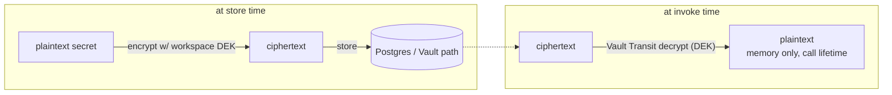

# 09 — Security, Auth & Multi-Tenancy

> Implements `spec.md §B12` and `backend-integration-plan.md Part 4`, and makes the frontend's existing
> auth/access model (`docs/frontend-auth-access-plan.md`) real on the server. Trellix context: these
> agents execute tools/MCP that reach internal systems, so this doc is not optional hardening — it is
> the thing that keeps a prompt-injected agent from becoming an SSRF/exfiltration primitive.

## 1. Three auth planes (do not conflate them)

> **Claim-based, IdP-agnostic model (2026-10-22; `scope.md`, adapter spec `18`).** Workspace membership +
> role come from **per-workspace IdP group/role claims**, mapped to a role by the active **identity adapter**
> (`18`) via `workspaces.idp_binding` — not an app-managed roster, and **not tied to one IdP** (Okta, Ping,
> Entra, Cognito, custom). There is **no** `memberships`/`workspace_invites` table, no invite/self-join, no
> `access_mode`. This supersedes both the 2026-10-15 app-roster model *and* the 2026-10-20
> one-group-per-workspace model. **Roles:** per-workspace `viewer` (read-only) < `builder` < `publisher`;
> one app-wide `admin`; the caller role `executer`.

| Plane | Who | Credential | Authorization basis | Used by |
|---|---|---|---|---|
| **Console** | a signed-in viewer/builder/publisher (a human) | OIDC session (IdP via the active adapter, 18) | **per-workspace role claim** (IdP group → `viewer`\|`builder`\|`publisher`, mapped by `idp_binding`) + RBAC + resource policy | all `/api/v1/*` builder routes |
| **Caller (`executer`)** | a cURL app/service **or** a channel end user (Slack/Teams/GChat) | scoped bearer token **or** channel-federated minted token | fixed role **`executer`** (execute-only) + per-resource policy; tenant pinned by the token/channel | `POST /v1/agents/:id/invoke`, `POST /channels/{platform}/events` |
| **Admin** (app-wide, 15) | a deployment superuser (leadership / central ops) | OIDC session **+** the adapter's admin claim (`admin_group_ref`, 18 §6) | the one claim **unique to the application** — spans **all** workspaces | all builder routes in every workspace **+** `GET /api/v1/org/*` |

The **caller** plane unifies the old caller-token and channel planes: both resolve to the single
execute-only role `executer`, differing only in *how* identity is sourced (a bearer token vs. a
verified-email→IdP federation, 12 §4). Neither needs a membership row — the tenant is pinned by the token
or channel binding and RLS (§7) partitions every query.

The **admin** plane is the one claim unique to the application (not per-workspace): one deployment = one org
(13 §4). admin does everything a builder/publisher can in **every** workspace, owns all governance (keys,
eval policy, baseline, access policy, limits) and **workspace CRUD**, and reads the whole estate through the
`SECURITY DEFINER` path in §7 (writing an `org.report.read` audit row per call, §12). The org read is
**metadata only** for `private`-tier resources (15 §2).

> **Accepted tradeoff (2026-10-22).** admin subsumes the old platform-admin, so "govern a space" and "read
> every tenant" are the same claim. Mitigation: admin is a small, audited set (every admin + org-read action
> writes `audit_logs`, §12); org content for a `private` resource needs the separate `org.report.content_read`
> action (15 §2.3), never a side effect of the estate read.

The FE console is **migrated** to this model (2026-10-22, scope.md rev 5): `lib/iam.ts` resolves per-workspace
`ap-<prefix>-<role>` claims via an `idpBinding(ws)` helper (the Okta adapter's convention) and a claim-based
`roleFor` (highest held claim; `admin` from the platform-admin claim); `viewer` retained; `Workspace` carries
`groupPrefix` (no more `oktaGroup`/`memberRole`). The caller planes now resolve to the **`executer`** role
(`lib/runtime-access.ts` + the `CallerRole` type in `access-policy.ts`): token/channel callers are
execute-only, no longer typed as a console role (`npm run build` green). The FE decode is **preview-only** —
the server is the source of truth (Playground shows what a token *would* resolve to; the real check is
server-side).

## 2. Console authN — OIDC/SSO

- FE: Auth.js (NextAuth) against Trellix IAM (OIDC). Session cookie is httpOnly, SameSite=Lax, signed.
- BE: validate the OIDC token / session on every request; build a `Principal`.

```python
# services/api/auth/principal.py
from dataclasses import dataclass

@dataclass(frozen=True)
class Principal:
    subject_id: str            # OIDC sub
    email: str
    display_name: str
    workspace_roles: dict[str, str]  # {workspace_id: "viewer"|"builder"|"publisher"} — resolved by the active
                                     #   adapter from per-workspace IdP claims via idp_binding (§2.1, 18); NOT a roster
    is_admin: bool                   # the adapter's app-wide admin claim → admin in EVERY workspace (15, 18 §6)
    teams: frozenset[str]            # functional IdP groups, from the OIDC `groups` claim (access policy, §5)

    def role_in(self, workspace_id: str) -> str | None:
        if self.is_admin: return "admin"            # the app-wide admin is every workspace's superuser
        return self.workspace_roles.get(workspace_id)
```

```python
# services/api/deps.py
async def get_principal(request: Request, idp: IdentityProvider = Depends(get_idp)) -> Principal:
    token = _session_token(request)                 # cookie or Authorization for API clients
    claims = await idp.verify_token(token)          # adapter: OIDC verify (sig/iss/aud/exp/nbf) or SAML (18 §2)
    if not claims:
        raise Unauthorized()
    # The ADAPTER maps native groups/roles into the three kinds (§2.1, 18 §3): per-workspace role claims →
    # workspace_roles (via idp_binding), the admin claim → is_admin, functional groups → teams. The core
    # never parses a vendor-specific claim shape itself.
    return await idp.build_principal(claims)
```

CSRF: state-changing console routes require a CSRF token (double-submit cookie) since the session is
cookie-based. Pure bearer API clients (no cookie) are exempt.

### 2.1 Claim sourcing — the adapter maps native claims into three kinds (keep them distinct)

Identity is the org's IdP (OIDC; SAML via a heavier adapter, 18 §5). The **active adapter** (`18`) reads the
IdP's native group/role claim and maps it — via `workspaces.idp_binding` (01 §4.1) + the deployment
`admin_group_ref` — into **three kinds** that drive three different things. The native identifier may be a
group *name* (Okta), a group *GUID* (Entra), a `memberOf` DN or SAML attribute (Ping), etc.; the core never
sees the vendor shape, only the mapped result:

- **Workspace role claims → `workspace_roles`.** The native ref bound to `viewer`/`builder`/`publisher` for a
  workspace (01 `idp_binding`) **is** that workspace's access + role. A user mapped to publisher in XDR and
  builder in Labs gets `{xdr: publisher, labs: builder}`. **No app roster, no invites, no self-join** — the
  IdP claim (through the adapter) is the system of record; the Members tab (08) is a read-only projection
  resolved through the adapter. *(The Okta adapter derives these from the `ap-<prefix>-<role>` naming
  convention; other adapters use explicit `idp_binding` refs — 18 §3.)*
- **The admin claim → `is_admin`.** The deployment's `admin_group_ref` (18 §6) — the single app-wide claim
  (§1). *(Okta adapter default: `ap-platform-admin`.)*
- **Teams** (functional IdP groups: SOC, Detection, …) — normalized by the adapter into `Principal.teams`,
  used **only** for the per-resource `access_policy` team dimension (§5) and the channel end-user gate (12 §4).
  Teams are **not** workspace membership and **not** roles; the same `teams` semantics are reused by the
  channel plane, so console and chat share one access model.

Requires the IdP to emit a groups/roles claim scoped to this product (configured on the IdP app registration;
per-adapter notes in 18 §5). **No SCIM or directory sync is needed for authZ** — claims are read live from the
token on each request, so an IdP grant/revoke takes effect on next login. (Async recipient *enumeration* —
16 — does need the adapter's `members_of` where available; see 18 §4.)

## 3. Workspace scoping — the tenancy guard (layer 1)

Every tenant route resolves an **active workspace** and asserts the role claim, then pins it on the DB
connection so RLS (layer 2, §7) filters automatically.

```python
# services/api/tenancy.py
async def get_workspace_ctx(
    request: Request,
    principal: Principal = Depends(get_principal),
    db: AsyncSession = Depends(get_db),
) -> WorkspaceCtx:
    # Client SELECTS the workspace (header or ?workspace=); the claim check below is what makes it
    # unforgeable — selection is not authority, the IdP role claim (via the adapter) is (08 §1 "cannot be forged").
    ws_id = request.headers.get("X-Workspace-Id") or request.query_params.get("workspace")
    if not ws_id:
        raise BadRequest("no workspace selected")   # header/query param is required
    role = principal.role_in(ws_id)                 # admin → "admin"; else the group-conferred role; else None
    if role is None:
        raise Forbidden("not a member of this workspace")   # no invite/self-join — access IS the group claim
    # role_in() returns "admin" for ANY ws_id string (the app-wide admin is every workspace's superuser), so
    # an admin with a typo'd/probed id would otherwise skip straight to SET LOCAL and pin a non-existent tenant
    # — an authorized-but-empty context instead of a 404. Validate existence before pinning. (This matters only
    # on the ADMIN path: a non-admin's claim can't resolve for an unknown/deleted workspace — role_in returns
    # None → the Forbidden above (403) fires first, before this check. Admins get 404; non-admins get 403.)
    # Archived/inactive is a separate read-only concern enforced on the write path, not here (reads of an
    # inactive ws still resolve).
    if not await workspace_exists(db, ws_id):       # SELECT 1 FROM workspaces WHERE id = :w  (admin path)
        raise NotFound("workspace not found")
    # Pin tenant for RLS — SET LOCAL resets at txn end, so this is per-request (01 §6).
    await db.execute(text("SET LOCAL app.workspace_id = :w"), {"w": ws_id})
    return WorkspaceCtx(workspace_id=ws_id, role=role, principal=principal)
```

> **Why both this guard and RLS?** The guard is the primary control and gives clean 403s. RLS is the
> backstop: if a query ever forgets `WHERE workspace_id = …`, RLS returns zero rows instead of leaking
> another tenant's data. One without the other is a single point of failure. The isolation test suite
> (§8) proves both hold.

## 4. RBAC — claims and what they gate

Three per-workspace console roles (01 `workspace_role`): `viewer < builder < publisher` (publisher ⊃ builder ⊃
viewer). **`viewer`** is read-only console access — the auditor/compliance tier (e.g. GRC). One app-wide claim:
**`admin`** — the deployment superuser (§1), which holds every capability in every workspace. One caller role:
**`executer`** — execute-only (cURL/channel), never a console role.

| Action | executer | viewer | builder | publisher | admin (app) |
|---|:--:|:--:|:--:|:--:|:--:|
| **Execute** an agent (cURL / channel / playground) | ✓ (cURL/channel) | ✓ (playground) | ✓ | ✓ | ✓ |
| Read agents/runs/evals | | ✓ | ✓ | ✓ | ✓ |
| Create/edit agents, versions, KBs; run playground | | | ✓ | ✓ | ✓ |
| Run eval (`eval.run`), author suites/cases (`eval.author`) | | | ✓ | ✓ | ✓ |
| MCP servers/tools/connectors (`mcp.manage`/`tool.manage`); skills (`skill.manage`) | | | ✓ | ✓ | ✓ |
| **Publish / re-point / unpublish** | | | | ✓ | ✓ |
| **Mint/revoke caller tokens** | | | | ✓ | ✓ |
| **Approve/deny high-risk tool calls** (`tool.approve`) | | | | ✓ | ✓ |
| **Provider keys** (`key.manage`) | | | | | ✓ |
| **Eval policy, baseline re-freeze, low-confidence override** (`eval.govern`) | | | | | ✓ |
| **Set access policy, retention** | | | | | ✓ |
| **Edit workspace config + limits** | | | | | ✓ |
| **Workspace CRUD** (create / edit / delete / (de)activate) | | | | | ✓ |
| **Org-wide estate/spend/compliance read** (`org.report.read`, 15) | | | | | ✓ |

> **`viewer` = read-only console.** It can read agents/runs/evals/config and exercise the playground, but
> cannot create, edit, publish, or govern — the auditor tier. (A `viewer` is still a *console* role; a caller
> `executer` is not — it never reads the console, only invokes.) Governance (provider keys, eval policy +
> baseline re-freeze, per-resource access policy, workspace config + limits), **workspace CRUD**, and the
> org-wide read are **admin-only** — the single app-wide claim (§1); there is no per-workspace admin.
> Caller-token mint/revoke stays **publisher+**, since a publisher owns the endpoints they publish. There is
> **no self-join** — workspace access is the per-workspace role claim itself, mapped by the adapter (§2.1, 18).

> **Eval governance split (05).** Authoring eval suites/cases (`eval.author`) is a **builder** capability —
> builders own their agent's tests. But the *policy* that decides pass/fail (min cases, quality bar,
> efficiency budget, low-confidence override) and **re-freezing the trusted baseline** (`eval.govern`) are
> **admin-only**: they change what "passing" means for the whole workspace and must not erode one quiet step
> at a time. Re-freeze and an enabled low-confidence override are audited (`audit_logs`).

> **Tool/MCP management is a builder capability; only provider keys stay admin.** Registering MCP servers,
> defining HTTP/builtin tools (incl. test-invoke dry-runs, 08), and wiring connectors are `mcp.manage` /
> `tool.manage`, held by **builder+** — a builder owns the tools their agent uses. Only **provider keys**
> remain admin-gated (`key.manage`): they are the custody spine (§9.1), so they do **not** move down with
> MCP/tools/connectors as the old combined row implied. Setting a tool's **risk tier** (read/write/
> destructive) stays admin. **Approving/denying a high-risk (write/destructive) tool call** at the runtime
> gate (03 §2) is `tool.approve`, held by **publisher+** — the same bar as publishing, since both decide what
> actually runs in production.

> **Skills are a builder capability (`skill.manage`), mirroring `tool.manage`/`mcp.manage`.** Any **builder+**
> may author, edit, add resources to, and **publish-sign** a skill (08). Governance is **open registration +
> signing** (mirroring the MCP open-registration stance, 14 §5): trust comes from the eval gate + per-resource
> access policy + the signed package + audit, **not** a pre-approval catalog. Unlike tools/MCP there is **no
> risk tier and no approval gate** for a skill — it does not execute code (§10), so there is nothing to gate at
> invoke beyond the access-policy `can_use` check. Skills carry **no credentials** (§9).

**The app-wide admin claim (15).** `admin` is **not** a per-workspace role — it is the single claim unique to
the application (§1), sourced from the `ap-platform-admin` group. It is builder+publisher in **every**
workspace, owns all governance + workspace CRUD, and additionally holds **`org.report.read`**: the
whole-estate governance report (15 §3) through the elevated path (§7), **metadata only** for `private`-tier
resources. Every admin + org-read action is audited (§12).

```python
# services/api/auth/rbac.py
RANK = {"executer": 0, "viewer": 1, "builder": 2, "publisher": 3, "admin": 4}  # executer = caller-only; viewer = read-only console; admin = app-wide

def require_role(min_role: str):
    async def dep(ctx: WorkspaceCtx = Depends(get_workspace_ctx)) -> WorkspaceCtx:
        if RANK[ctx.role] < RANK[min_role]:
            raise Forbidden(f"requires {min_role}")
        return ctx
    return dep

# usage:  @router.post("/versions/{vid}/publish", dependencies=[Depends(require_role("publisher"))])
```

## 5. Per-resource access policies

Agents/KBs/tools/MCP/channels/**skills** carry an `access_policy` jsonb (01) with the **same shape as the FE
`AccessPolicy`** (`access-policy.ts`): `{ visibility, useRoles, useTeams, manageRoles, manageTeams, owner? }`.
One shape, three sharing tiers (modelled on Google Chat / MS Teams / Splunk):

- **`workspace`** — every space member may use/manage (default).
- **`restricted`** — gated by **role AND team**, evaluated **separately for use vs manage**; a restricted
  policy that names neither a role nor a team **fails closed** (grants no one). **Caller rule (2026-10-23):**
  `useRoles` gate **console** principals only — an `executer` caller has no console role, so it is gated on
  **`useTeams` alone**; a role-only `restricted` policy therefore **denies all callers** (fail closed), while a
  team-named one admits a caller on a matching team. This keeps the channel model "channel `okta_group` ∩ agent
  `access_policy`" (12) team-based for callers; role restriction stays a console-side control.
- **`private`** — only the **owner** (+ the app-wide admin) may use/manage.

The FE `canUse`/`canManage` is **UI gating only**; the server re-checks identically on read, manage, and
— critically — **at invoke**.

```python
# services/runtime/access.py  (shared by api reads AND runtime invoke)
def _matches(roles, teams, *, role, user_teams) -> bool:
    if not roles and not teams: return False                  # restricted naming neither → fail closed
    # Caller plane (role == "executer"): `roles` gate CONSOLE principals only; a caller has no console role,
    # so it is gated on TEAMS alone — a role-only policy (no team) denies callers (fail closed). Keeps the
    # channel model "channel okta_group ∩ agent access_policy" (12) team-based for callers.
    if role == "executer":
        return bool(teams) and bool(user_teams & set(teams))
    role_ok = not roles or role in roles
    team_ok = not teams or bool(user_teams & set(teams))
    return role_ok and team_ok

def can_use(policy: dict, *, role: str, teams: set[str], subject: str | None) -> bool:
    vis = policy.get("visibility", "workspace")
    if vis == "workspace":  return True                        # any workspace member (builder/publisher/exec)
    if role == "admin":     return True                        # app-wide admin bypass
    if vis == "private":    return subject is not None and subject == policy.get("owner")
    return _matches(policy.get("useRoles", []), policy.get("useTeams", []), role=role, user_teams=teams)

def can_manage(policy: dict, *, role: str, teams: set[str], subject: str | None) -> bool:
    vis = policy.get("visibility", "workspace")
    if vis == "workspace":  return True
    if role == "admin":     return True                        # app-wide admin can always fix a restricted/private policy
    if vis == "private":    return subject is not None and subject == policy.get("owner")
    return _matches(policy.get("manageRoles", []), policy.get("manageTeams", []), role=role, user_teams=teams)
```

At invoke, the caller's resolved identity (`role="executer"` + teams + optional subject) is fed to `can_use`
before the runtime touches a provider — so access policy is enforced on the **runtime path**, not just the
console. A **bound skill** is `can_use`-checked at invoke exactly like a bound KB: a skill whose instruction
fragment a caller may not use is not composed into the prompt (03 §4). (There is no execute path to gate for a
skill — the only control is this read/`can_use` check; §10.) A caller (`executer`) carries **no owner
subject**, so a `private` resource is denied to every caller (fail closed) — `admin` is a **console claim**,
not a caller role, so there is no "admin token" bypass at invoke. The `teams` argument has three sources, one
model: **console** = `Principal.teams` (IdP groups via the adapter, §2.1); **channel** = the minted token's
`teams` (the end user's IdP groups, 12 §4); **cURL token** = the token's `scopes.teams` (09 §6).

## 6. Caller tokens (published invoke authN)

```python
# services/api/publish/token_auth.py
import hashlib

async def resolve_caller(authorization: str, db) -> CallerCtx:
    secret = authorization.removeprefix("Bearer ").strip()
    token_hash = hashlib.sha256(secret.encode()).hexdigest()      # we store only the hash (01)
    tok = await db.scalar(select(ApiToken).where(ApiToken.token_hash == token_hash))
    if not tok or tok.revoked_at:        raise Unauthorized("revoked or unknown token")
    if tok.expires_at and tok.expires_at < now():  raise Unauthorized("expired")
    await rate_limit(tok.id)                                       # Redis sliding window (10, 07)
    # the caller role is always `executer` (execute-only, §1); scopes carry tenant/teams/scope claims
    # (mirrors FE runtime-access.ts, server-authoritative)
    return CallerCtx(workspace_id=tok.workspace_id, token_id=tok.id, role="executer",
                     teams=set(tok.scopes.get("teams", [])),
                     scopes=set(tok.scopes.get("scopes", [])),
                     subject=tok.scopes.get("subject"))
```

Token lifecycle: minted by publisher/admin, **secret shown exactly once** (only the `prefix` + hash
persist), revocable (sets `revoked_at` → immediate), optional `expires_at`, per-token rate limit. Never
logged, never in exports.

## 7. RLS backstop (layer 2)

Covered in `01-data-model.md §6` (policies, `SET LOCAL app.workspace_id`, non-owner app role, no
`BYPASSRLS`). Operational caveats that bite in practice:

- Use a **transaction-scoped** connection checkout so `SET LOCAL` can't bleed across pooled sessions
  (PgBouncer in `transaction` mode, or SQLAlchemy per-request txn).
- pgvector queries still filter `kb_id` + `workspace_id` explicitly — RLS gates the row, the predicate
  prunes the HNSW namespace for latency (01 §4.4).
- **Elevated cross-workspace reads (the org governance report, 15) — now specified, not just named.**
  They never use the default session role. The path is a Postgres **`SECURITY DEFINER`** function owned by
  the migration role (which may cross tenants) and `EXECUTE`-granted only to a dedicated `platform_report`
  reader role; the normal app role still has no `BYPASSRLS`. The API calls it **only** from the
  admin plane (§1, `org.report.read`), and **every call writes an org-level audit row**
  (`audit_logs.workspace_id = NULL`, §12, 01 §4.8). It returns **metadata only** for `private`-tier
  resources (15 §2). This is the single sanctioned exception to §8 — see there.

## 8. Tenant-isolation test suite (non-negotiable)

A dedicated suite asserts tenant A can never read or act on tenant B, run in CI (gate):
- read: every list/detail endpoint as A returns zero B rows (RLS + guard).
- write: A cannot PATCH/DELETE a B resource id (404, not 403 — don't confirm existence).
- vector: a retrieval in A never returns B chunks even with a colliding query — including the new
  `agent_signatures` dedup index (14 §3): a scan in A never matches B signatures.
- secrets (three parts, since §9.1 splits custody): (a) no workspace session can resolve the platform-held
  **provider-pool** key (replaces the old per-workspace provider-key test, now that provider keys are a
  platform pool); **(b)** tenant A's decrypt path cannot resolve tenant B's **per-workspace tool / connector /
  channel** secret (per-workspace DEKs, §9.1); **and (c)** the **per-user-MCP** secret — held under a
  **per-USER DEK** (§9.1, 17 §3) — cannot be decrypted **across tenants *or* across users** (A can't read B's,
  and user U can't read user V's within a tenant). This least-privilege scope matches the per-user audit goal.
- invoke: a B caller-token cannot invoke an A endpoint.
- **worker GUC scoping (C4):** every worker job `SET LOCAL app.workspace_id` for its tenant at job start and
  resets at job end; a test asserts a job cannot read another tenant's rows and the GUC does not leak to the
  next job on a reused connection.
- **org-plane DB boundary (C4):** a **DB-level** test that the general app role has **no `EXECUTE`** on the
  `org_report_*` `SECURITY DEFINER` functions — only the dedicated `platform_report` role, on a **separate
  connection** (15 §2), may call them — so an SQLi/logic bug on the normal app path cannot cross tenants.
- **notifications:** a recipient in A never sees B's notifications (workspace RLS + app-level
  `recipient_subject` filter, 16 §1).
- **skills:** a list/detail in A never returns B's skills, and A cannot bind B's skill onto an A version
  (`POST /versions/:vid/skills`) — `skills`/`skill_resources`/`skill_bindings` are `WorkspaceScoped` (01 §4.4),
  so bindings inherit the version's `workspace_id` and RLS + the guard partition every query; a cross-tenant
  bind is a 404, not a leak.
- **tool dry-runs & sub-agents:** a `tool_test` dry-run (08; also covers MCP test-invoke) and a sub-agent **child** run (03 §8)
  stay within the caller's tenant — the child `runtime.invoke` inherits the parent `workspace_id` (never
  crosses), and the approvals inbox + `POST /approvals/:id/decide` are workspace-filtered so A can neither see
  nor decide B's `tool_approvals`.
- **the one sanctioned exception:** only the admin elevated path (§7, 15) may cross workspaces,
  and the suite asserts (a) no *other* role/plane can call the `SECURITY DEFINER` reader, and (b) every
  successful cross-tenant read emitted an `org.report.read` audit row. Anything else crossing = a failure.

## 9. Secrets — Vault Transit envelope encryption

Provider keys, tool creds, connector creds, MCP auth — **none are ever stored plaintext** (01
`provider_keys` holds only `masked` + `vault_path`). Base envelope scheme, **per-workspace DEK** (the
diagram + code below show this tier; **two exceptions** — **provider keys** move to a *platform-scope* pool DEK
per **§9.1**, and **per-user-MCP creds use a per-USER DEK** (17 §3; least-privilege per connected user). Tool /
connector / channel creds keep the per-workspace DEK):



**Legend —** the DEK itself is wrapped by the Vault Transit root key; the root never leaves Vault in clear.

```python
# services/runtime/secrets.py
class KeyVault(Protocol):
    async def encrypt(self, workspace_id: str, plaintext: bytes) -> str: ...   # returns ciphertext ref
    async def decrypt(self, workspace_id: str, ciphertext: str) -> bytes: ...   # in-memory only

class VaultTransit(KeyVault):
    """Per-workspace DEK key name: transit/keys/ws-<workspace_id>. Root never exported."""
    async def decrypt(self, workspace_id, ciphertext):
        return await self._transit_decrypt(f"ws-{workspace_id}", ciphertext)   # Vault API
```

```python
# at invoke (00 §5): decrypt just-in-time, never persist, never log
provider_secret = await vault.decrypt(ctx.workspace_id, provider_key.vault_path)
try:
    async for ev in gateway.stream(req, api_key=provider_secret):  # (02)
        yield ev
finally:
    del provider_secret   # best-effort; also: never put it in a dataclass that gets logged
```

- Vault auth at boot via **AppRole** (00 §6 `vault_role`); the app fetches a short-lived token, renews.
- **Log redaction**: a logging filter scrubs key-shaped strings (`sk-…`, bearer, high-entropy) from
  every log record and every Langfuse payload (10) before it leaves the process.
- Secrets never enter: agent config blobs, version snapshots, traces, exported cURL/SDK (08), error
  messages.
- **Skills carry NO credentials.** A skill is an instruction fragment + bundled reference files (01 §4.4) —
  it never holds a provider/tool/connector secret and never decrypts anything at invoke (it does not execute
  code). Skill instruction text is treated as untrusted content, and the output-guardrail + log redaction
  passes above catch any secret a skill author mistakenly pastes into it.

### 9.1 Key custody as the enforcement spine (14)

The P0-1 enforcement lever (14 §1) narrows provider-credential handling:

- **Provider keys become a platform-custodied pool, not per-workspace BYO.** The per-workspace BYO option
  from `backend-integration-plan.md` Part 4 is **superseded for enforcement**: if a team holds a usable
  provider key it can bypass the platform, so the platform must hold the *only* usable key. The envelope
  scheme above is unchanged; the DEK for the provider pool is platform-scoped rather than per-workspace.
  **Tool / connector / shared-MCP creds stay per-workspace DEK; per-user-MCP creds use a per-USER DEK**
  (17 §3 — ratified 2026-10-22, resolving the old `09 §9` ↔ `17` contradiction). Only the *provider* key moves
  to the platform pool.
- **Cost + tenancy survive the change:** per-tenant cost attribution still works (computed from our own
  profiles per Run tagged `workspace_id`, 02/07, not from a per-tenant key); the pool key is never exposed
  to any workspace, so cross-tenant secrecy holds (the §8 secrets test is rescoped accordingly).
- **The honest prerequisite:** custody alone is porous — a team could call a provider with a personal or
  other-account key. Real enforcement requires **cloud-model-IAM centralization + network egress control**
  to provider endpoints (cloud SCP / VPC egress allow-list, reusing the per-tool egress machinery in §10).
  **Without it, the spine degrades to "visibility + mandate"** (the registration gate + scanner + org
  compliance report still apply, but nothing *blocks* a direct call). This is a political/infra lift; 14 §1
  states it as a precondition rather than overstating enforcement.

## 10. Threat model → controls (Trellix-grade)

The dangerous surface is **tool/MCP execution driven by model output**, weaponizable via prompt
injection. Controls:

| Threat | Vector | Control | Phase |
|---|---|---|---|
| SSRF via HTTP tool | injected prompt makes agent call internal URL | per-tool **egress allow-list** (domains/CIDRs); deny-by-default | P1 (http tools), P2 (MCP) |
| Data exfiltration | agent sends context to attacker endpoint | egress allow-list + output validation + no secrets in prompt | P1/P2 |
| Destructive tool call | injected "delete all" to a write tool | **approval gate** (03 §2): `tool_risk_tier` (01) classifies read/write/destructive; a `requires_approval` binding pauses at the `tool_approval_gate` node and writes `tool_approvals(status='pending')` (01), resumed only by a publisher+ decision (`tool.approve`, §4); `tool.approval.{request,approve,deny}` audited (§12) + tool-arg validation | P2 |
| Untrusted MCP server | malicious server returns poisoned tools/results | **gVisor-sandboxed** exec unit behind an **egress proxy** (11 §1,§12) running the official `mcp` Python SDK client; schema snapshot (01) + result validation | P2 |
| Secret leakage in output | model echoes an injected/known secret | output guardrail redaction (06) + log redaction (§9) | P1 |
| Token theft/replay | leaked caller token | hashed-at-rest, expiry, revoke, rate limit, scopes (§6) | P1 |
| Cross-tenant access | bug in scoping | guard + RLS + isolation suite (§3,7,8) | P1 |
| Prompt-injection via skill instructions | a malicious/compromised skill instruction fragment steers the agent | skill instruction text is **untrusted content injected into the system prompt** (03 §4) — output-guardrail redaction (06) still applies, no secrets in skill text, bundled resources are **data, not instructions**; a skill has **no execute path**, so injection cannot drive a tool/egress action | P2 |
| Malicious / tampered skill package | an unsigned or altered skill is bound onto a version | **package provenance/signing**: skills are **signed at publish** (`signature`/`signed_by`, 01 §4.4) and the signature is **verified at bind**; only `published` (signed) skills are bindable, and `skill_content_hash` is pinned into the version `snapshot_hash` so post-bind tampering changes the version identity (05 §6) | P2 |

> **Skills are deliberately NOT an SSRF/exfiltration vector.** Unlike tools/MCP (the rows above), a skill
> **does not execute code**: it never enters the sandbox, the egress allow-list, or the approval gate. That is a
> deliberate scope reduction — a skill is an instruction fragment + reference data (01 §4.4), so its entire new
> attack surface is the two rows just added (prompt-injection text + package provenance). There is intentionally
> **no skill risk tier, no approval gate, no test-invoke, and no sandbox unit** for skills.

> **Gate before external exposure:** no published endpoint faces outside the org until a written threat
> model + a security review (and for Trellix, the internal registry/scanning path, `backend-integration
> -plan.md` CI/CD) are signed off. P2 MCP/sub-agents additionally require the egress sandbox + depth/
> fan-out caps live before enablement.

Tool execution isolation (P2): each tool/MCP call runs in the egress-restricted **sandbox unit** (11 §1 —
the single definition of the exec substrate), with egress governed by the structured `config.egress` schema
(`{mode:'deny_by_default', allow:{domains,cidrs,ports}}`, 01 §4.6) rather than an ad-hoc per-server list,
vaulted creds injected at connect, per-tool timeouts, and depth/fan-out caps on sub-agents (spec B7, B12;
03 §8).

## 11. Data retention & PII

- Prompts, traces, eval cases, and run I/O hold sensitive data; **Langfuse stores inputs/outputs** (10).
- **PII redaction before logging**: the PII guardrail stage (06) runs on the request path; a scrubbing
  pass also runs before any trace/log write, independent of guardrail config (defense in depth).
- **Per-workspace retention policy**: TTL on `runs`/`spans` partitions (11) and on Langfuse data;
  configurable per workspace for compliance.
- **Provider data handling**: use provider **zero-data-retention / inference-geo** options where
  compliance requires; the capability profile (02) records whether a model/endpoint is ZDR-eligible.

## 12. Audit log

Every sensitive action writes an `audit_logs` row (01): `publish`, `repoint`, `unpublish`,
`baseline.freeze`, `provider_key.{create,rotate,revoke}`, `token.{mint,revoke}`, `mcp.{register,
discover}`, `source.{create,rotate}`, `access_policy.set`, `eval.override` (small-set/low-confidence
publish override, 05), the P0 actions `agent.{register,import}` + `dedup.override` (14), and the P2 tool
actions `tool.bind` (incl. risk-tier set), `tool.approval.{request,approve,deny}` (03 §2),
`tool.test_invoke` / `mcp.test_invoke` (08), and the skill actions `skill.publish` (sign + publish a skill,
08) and `skill.bind` (freeze a skill onto a version, 08). Fields:
actor, action, target, meta, ts. Append-only; surfaced per workspace.

**Org-level audit (15).** The admin plane's reads write `org.report.read` (and, for the rare
private-content read, `org.report.content_read`) with **`workspace_id = NULL`** — these are not
workspace-surfaced; they are the audit trail for the elevated cross-tenant path (§7) and are readable only
through it. This is the one audit class that is org-scoped rather than per-workspace.

→ Next: `10-observability-monitoring.md`.
