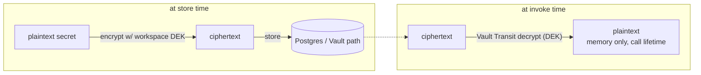

# 09 — Security, Auth & Multi-Tenancy

> Implements `spec.md §B12` and `backend-integration-plan.md Part 4`, and makes the frontend's existing
> auth/access model (`docs/frontend-auth-access-plan.md`) real on the server. Trellix context: these
> agents execute tools/MCP that reach internal systems, so this doc is not optional hardening — it is
> the thing that keeps a prompt-injected agent from becoming an SSRF/exfiltration primitive.

## 1. Three auth planes (do not conflate them)

| Plane | Who | Credential | Authorization basis | Used by |
|---|---|---|---|---|
| **Console session** | a signed-in builder/PM (a human) | OIDC session (Trellix IAM) | **workspace `memberships`** (role_in) + RBAC + resource policy | all `/api/v1/*` builder routes |
| **Caller token** | an external app/service calling a published agent | scoped bearer token | token's `{tenant, role, teams, scopes}` + resource policy | `POST /v1/agents/:id/invoke` only |
| **Channel** (12) | an end user in Slack/Teams/GChat | federated → minted Catalyst token | channel `okta_group` ∩ resource policy — **membership-independent** (no `memberships` row required) | `POST /channels/{platform}/events` |

The frontend already models this split (`lib/auth.tsx` session vs `lib/runtime-access.ts` token decode,
which also has a channel arm). The server is now the source of truth; the FE token decode becomes
**preview-only** (Playground shows what a token *would* resolve to; the real check is server-side).

> **Note the differing authorization bases.** Only the console plane requires workspace `memberships`
> (`get_workspace_ctx`, §3). The caller-token and channel planes authorize off the token's resolved
> identity (tenant pinned by the token/channel) + per-resource policy — a channel end user can invoke a
> workspace's agent **without** a `memberships` row (12 §4). Tenancy is still enforced: the channel is
> pinned to one `workspace_id` and RLS (§7) partitions every query.

## 2. Console authN — OIDC/SSO

- FE: Auth.js (NextAuth) against Trellix IAM (OIDC). Session cookie is httpOnly, SameSite=Lax, signed.
- BE: validate the OIDC token / session on every request; build a `Principal`.

```python
# services/api/auth/principal.py
from dataclasses import dataclass

@dataclass(frozen=True)
class Principal:
    subject_id: str            # OIDC sub
    email: str
    display_name: str
    memberships: dict[str, str]  # {workspace_id: role}  — app-managed, from the memberships table (01)
    teams: frozenset[str]        # Okta groups, from the OIDC `groups` claim (NOT the memberships table)

    def role_in(self, workspace_id: str) -> str | None:
        return self.memberships.get(workspace_id)
```

```python
# services/api/deps.py
async def get_principal(request: Request) -> Principal:
    token = _session_token(request)                 # cookie or Authorization for API clients
    claims = await oidc.verify(token)               # signature, iss, aud, exp, nbf
    if not claims:
        raise Unauthorized()
    teams = groups_to_teams(claims.get("groups", []))   # Okta groups claim -> teams (see 2.1)
    return await load_principal(claims["sub"], teams=teams)   # joins memberships (01); teams from claim
```

CSRF: state-changing console routes require a CSRF token (double-submit cookie) since the session is
cookie-based. Pure bearer API clients (no cookie) are exempt.

### 2.1 Teams = Okta groups (the group dimension)

`teams` is the group dimension of the access model, and it is sourced from **Okta groups** carried in the
OIDC **`groups` claim** — not from the `memberships` table and not stored in Postgres. `groups_to_teams`
normalizes the claim (e.g. maps each group's display name / id to a team slug) into `Principal.teams`.
Keep this decoupled from tenancy:

- **Workspace + role-per-workspace stay app-managed** in `memberships` (§1, §3) — Okta-group membership does
  **not** grant workspace access; app access is still "member of ≥1 workspace".
- **Teams (Okta groups) drive fine-grained access** only: the `teams` term of per-resource `access_policy`
  (§5) and the channel end-user gate (12). The same `teams` semantics are reused by the channel plane
  (12 §4), so console and chat share one model.
- Requires the IdP to emit a `groups` claim scoped to this product (configure the scope/claim on the
  Trellix IAM / Okta app registration). No SCIM or directory sync is needed for teams — they are read live
  from the token on each request.

> *Deferred:* if group membership should instead gate **workspace entry** (the literal "workspace = Okta
> group" model), that is a different design — group-per-workspace-role groups + a claim parser that
> JIT-provisions `memberships` + deprovisioning — and is out of scope here.

## 3. Workspace scoping — the tenancy guard (layer 1)

Every tenant route resolves an **active workspace** and asserts membership, then pins it on the DB
connection so RLS (layer 2, §7) filters automatically.

```python
# services/api/tenancy.py
async def get_workspace_ctx(
    request: Request,
    principal: Principal = Depends(get_principal),
    db: AsyncSession = Depends(get_db),
) -> WorkspaceCtx:
    # Client SELECTS the workspace (header or ?workspace=); the membership check below is what makes it
    # unforgeable — selection is not authority, membership is (reconciles 08 §1 "cannot be forged").
    ws_id = request.headers.get("X-Workspace-Id") or request.query_params.get("workspace")
    role = principal.role_in(ws_id)
    if role is None:
        raise Forbidden("not a member of this workspace")
    # Pin tenant for RLS — SET LOCAL resets at txn end, so this is per-request (01 §6).
    await db.execute(text("SET LOCAL app.workspace_id = :w"), {"w": ws_id})
    return WorkspaceCtx(workspace_id=ws_id, role=role, principal=principal)
```

> **Why both this guard and RLS?** The guard is the primary control and gives clean 403s. RLS is the
> backstop: if a query ever forgets `WHERE workspace_id = …`, RLS returns zero rows instead of leaking
> another tenant's data. One without the other is a single point of failure. The isolation test suite
> (§8) proves both hold.

## 4. RBAC — roles and what they gate

Roles per workspace (01 `member_role`): `viewer | builder | publisher | admin`.

| Action | viewer | builder | publisher | admin |
|---|:--:|:--:|:--:|:--:|
| Read agents/runs/evals | ✓ | ✓ | ✓ | ✓ |
| Create/edit agents, versions, KBs, run playground | | ✓ | ✓ | ✓ |
| Run eval, freeze baseline | | ✓ | ✓ | ✓ |
| **Publish / re-point / unpublish** | | | ✓ | ✓ |
| **Mint/revoke caller tokens** | | | ✓ | ✓ |
| **Provider keys, MCP servers, connectors** | | | | ✓ |
| Set access policy, manage members, retention | | | | ✓ |
| **Edit workspace config + limits, archive workspace** | | | | ✓ |

> Workspace config (default provider/model), per-workspace limits (spend/concurrency/timeout), and archive
> are **admin-only** — the FE gates them on the `settings.manage` permission. Caller-token mint/revoke stays
> **publisher+** (above), since a publisher owns the endpoints they publish.

```python
# services/api/auth/rbac.py
RANK = {"viewer": 0, "builder": 1, "publisher": 2, "admin": 3}

def require_role(min_role: str):
    async def dep(ctx: WorkspaceCtx = Depends(get_workspace_ctx)) -> WorkspaceCtx:
        if RANK[ctx.role] < RANK[min_role]:
            raise Forbidden(f"requires {min_role}")
        return ctx
    return dep

# usage:  @router.post("/versions/{vid}/publish", dependencies=[Depends(require_role("publisher"))])
```

## 5. Per-resource access policies

Agents/KBs/tools/MCP carry an `access_policy` jsonb (01), mirroring the FE `AccessPolicy`. The FE
`access-policy.ts` `canUse`/`canManage` is **UI gating only**; the server re-checks identically on read,
manage, and — critically — **at invoke**.

```python
# services/runtime/access.py  (shared by api reads AND runtime invoke)
def can_use(policy: dict, *, role: str, teams: set[str], subject_id: str) -> bool:
    mode = policy.get("mode", "workspace")
    if mode == "workspace":   return True                      # any workspace member
    if mode == "teams":       return bool(teams & set(policy["teams"]))
    if mode == "principals":  return subject_id in policy["principals"]
    if mode == "private":     return subject_id == policy["owner"]
    return False
```

At invoke, the caller-token's resolved identity (teams/scopes) is fed to `can_use` before the runtime
touches a provider — so access policy is enforced on the **runtime path**, not just the console. On the
**console** path the `teams` argument is `Principal.teams` (the Okta groups from the OIDC groups claim,
§2.1); on the **channel** path it is the minted token's `teams` (the end user's Okta groups, 12 §4) — one
`can_use`, three sources of `teams`.

## 6. Caller tokens (published invoke authN)

```python
# services/api/publish/token_auth.py
import hashlib

async def resolve_caller(authorization: str, db) -> CallerCtx:
    secret = authorization.removeprefix("Bearer ").strip()
    token_hash = hashlib.sha256(secret.encode()).hexdigest()      # we store only the hash (01)
    tok = await db.scalar(select(ApiToken).where(ApiToken.token_hash == token_hash))
    if not tok or tok.revoked_at:        raise Unauthorized("revoked or unknown token")
    if tok.expires_at and tok.expires_at < now():  raise Unauthorized("expired")
    await rate_limit(tok.id)                                       # Redis sliding window (10, 07)
    # scopes carry tenant/role/teams/scope claims (mirrors FE runtime-access.ts, server-authoritative)
    return CallerCtx(workspace_id=tok.workspace_id, token_id=tok.id,
                     teams=set(tok.scopes.get("teams", [])),
                     scopes=set(tok.scopes.get("scopes", [])),
                     subject=tok.scopes.get("subject"))
```

Token lifecycle: minted by publisher/admin, **secret shown exactly once** (only the `prefix` + hash
persist), revocable (sets `revoked_at` → immediate), optional `expires_at`, per-token rate limit. Never
logged, never in exports.

## 7. RLS backstop (layer 2)

Covered in `01-data-model.md §6` (policies, `SET LOCAL app.workspace_id`, non-owner app role, no
`BYPASSRLS`). Operational caveats that bite in practice:

- Use a **transaction-scoped** connection checkout so `SET LOCAL` can't bleed across pooled sessions
  (PgBouncer in `transaction` mode, or SQLAlchemy per-request txn).
- pgvector queries still filter `kb_id` + `workspace_id` explicitly — RLS gates the row, the predicate
  prunes the HNSW namespace for latency (01 §4.4).
- Elevated cross-workspace reads (org dashboards) use a separate, explicitly-audited path; never the
  default session role.

## 8. Tenant-isolation test suite (non-negotiable)

A dedicated suite asserts tenant A can never read or act on tenant B, run in CI (gate):
- read: every list/detail endpoint as A returns zero B rows (RLS + guard).
- write: A cannot PATCH/DELETE a B resource id (404, not 403 — don't confirm existence).
- vector: a retrieval in A never returns B chunks even with a colliding query.
- secrets: A's decrypt path cannot resolve B's provider key (per-workspace DEK, §9).
- invoke: a B caller-token cannot invoke an A endpoint.

## 9. Secrets — Vault Transit envelope encryption

Provider keys, tool creds, connector creds, MCP auth — **none are ever stored plaintext** (01
`provider_keys` holds only `masked` + `vault_path`). Envelope scheme, **per-workspace DEK**:



**Legend —** the DEK itself is wrapped by the Vault Transit root key; the root never leaves Vault in clear.

```python
# services/runtime/secrets.py
class KeyVault(Protocol):
    async def encrypt(self, workspace_id: str, plaintext: bytes) -> str: ...   # returns ciphertext ref
    async def decrypt(self, workspace_id: str, ciphertext: str) -> bytes: ...   # in-memory only

class VaultTransit(KeyVault):
    """Per-workspace DEK key name: transit/keys/ws-<workspace_id>. Root never exported."""
    async def decrypt(self, workspace_id, ciphertext):
        return await self._transit_decrypt(f"ws-{workspace_id}", ciphertext)   # Vault API
```

```python
# at invoke (00 §5): decrypt just-in-time, never persist, never log
provider_secret = await vault.decrypt(ctx.workspace_id, provider_key.vault_path)
try:
    async for ev in gateway.stream(req, api_key=provider_secret):  # (02)
        yield ev
finally:
    del provider_secret   # best-effort; also: never put it in a dataclass that gets logged
```

- Vault auth at boot via **AppRole** (00 §6 `vault_role`); the app fetches a short-lived token, renews.
- **Log redaction**: a logging filter scrubs key-shaped strings (`sk-…`, bearer, high-entropy) from
  every log record and every Langfuse payload (10) before it leaves the process.
- Secrets never enter: agent config blobs, version snapshots, traces, exported cURL/SDK (08), error
  messages.

## 10. Threat model → controls (Trellix-grade)

The dangerous surface is **tool/MCP execution driven by model output**, weaponizable via prompt
injection. Controls:

| Threat | Vector | Control | Phase |
|---|---|---|---|
| SSRF via HTTP tool | injected prompt makes agent call internal URL | per-tool **egress allow-list** (domains/CIDRs); deny-by-default | P1 (http tools), P2 (MCP) |
| Data exfiltration | agent sends context to attacker endpoint | egress allow-list + output validation + no secrets in prompt | P1/P2 |
| Destructive tool call | injected "delete all" to a write tool | **human-approval gate** for high-risk tools; tool-arg validation | P2 |
| Untrusted MCP server | malicious server returns poisoned tools/results | network-isolated **sandbox worker**, schema snapshot (01), result validation | P2 |
| Secret leakage in output | model echoes an injected/known secret | output guardrail redaction (06) + log redaction (§9) | P1 |
| Token theft/replay | leaked caller token | hashed-at-rest, expiry, revoke, rate limit, scopes (§6) | P1 |
| Cross-tenant access | bug in scoping | guard + RLS + isolation suite (§3,7,8) | P1 |

> **Gate before external exposure:** no published endpoint faces outside the org until a written threat
> model + a security review (and for Trellix, the internal registry/scanning path, `backend-integration
> -plan.md` CI/CD) are signed off. P2 MCP/sub-agents additionally require the egress sandbox + depth/
> fan-out caps live before enablement.

Tool execution isolation (P2): each tool/MCP call runs in an egress-restricted container with a
per-server allow/deny list, vaulted creds injected at connect, per-tool timeouts, and depth/fan-out
caps on sub-agents (spec B7, B12).

## 11. Data retention & PII

- Prompts, traces, eval cases, and run I/O hold sensitive data; **Langfuse stores inputs/outputs** (10).
- **PII redaction before logging**: the PII guardrail stage (06) runs on the request path; a scrubbing
  pass also runs before any trace/log write, independent of guardrail config (defense in depth).
- **Per-workspace retention policy**: TTL on `runs`/`spans` partitions (11) and on Langfuse data;
  configurable per workspace for compliance.
- **Provider data handling**: use provider **zero-data-retention / inference-geo** options where
  compliance requires; the capability profile (02) records whether a model/endpoint is ZDR-eligible.

## 12. Audit log

Every sensitive action writes an `audit_logs` row (01): `publish`, `repoint`, `unpublish`,
`baseline.freeze`, `provider_key.{create,rotate,revoke}`, `token.{mint,revoke}`, `mcp.{register,
discover}`, `source.{create,rotate}`, `access_policy.set`, `eval.override` (small-set/low-confidence
publish override, 05). Fields: actor, action, target, meta, ts. Append-only; surfaced per workspace.

→ Next: `10-observability-monitoring.md`.
