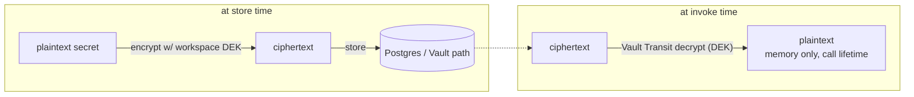

# 09 — Security, Auth & Multi-Tenancy

> Implements `spec.md §B12` and `backend-integration-plan.md Part 4`, and makes the frontend's existing
> auth/access model (`docs/frontend-auth-access-plan.md`) real on the server. Trellix context: these
> agents execute tools/MCP that reach internal systems, so this doc is not optional hardening — it is
> the thing that keeps a prompt-injected agent from becoming an SSRF/exfiltration primitive.

## 1. Four auth planes (do not conflate them)

| Plane | Who | Credential | Authorization basis | Used by |
|---|---|---|---|---|
| **Console session** | a signed-in builder/PM (a human) | OIDC session (Trellix IAM) | **workspace `memberships`** (role_in) + RBAC + resource policy | all `/api/v1/*` builder routes |
| **Caller token** | an external app/service calling a published agent | scoped bearer token | token's `{tenant, role, teams, scopes}` + resource policy | `POST /v1/agents/:id/invoke` only |
| **Channel** (12) | an end user in Slack/Teams/GChat | federated → minted Agent Platform token | channel `okta_group` ∩ resource policy — **membership-independent** (no `memberships` row required) | `POST /channels/{platform}/events` |
| **Platform-admin** (15) | a deployment-wide governance owner (leadership) | OIDC session **+** `platform_admins` roster (01 §4.9) | spans **all** workspaces; **read-only**; `org.report.read` permission (§4) | `GET /api/v1/org/*` only, via the elevated audited path (§7) |

The platform-admin plane is the deliberate exception to per-workspace scoping: one deployment = one org
(13 §4), so it is a single app-managed role (not `org_id`-scoped). It reads the whole estate through the
`SECURITY DEFINER` path in §7 and writes an `org.report.read` audit row on every call (§12). It can
**mutate nothing** and sees **metadata only** for `private`-tier resources (15 §2).

The frontend already models this split (`lib/auth.tsx` session vs `lib/runtime-access.ts` token decode,
which also has a channel arm). The server is now the source of truth; the FE token decode becomes
**preview-only** (Playground shows what a token *would* resolve to; the real check is server-side).

> **Note the differing authorization bases.** The console plane authorizes off workspace `memberships`
> (`get_workspace_ctx`, §3) — a user is a member by invite or by self-joining an `access: "open"` space
> (§2.1). The caller-token and channel planes authorize off the token's resolved identity (tenant pinned by
> the token/channel) + per-resource policy — a channel end user can invoke a workspace's agent **without** a
> `memberships` row (12 §4). Tenancy is still enforced: the channel is pinned to one `workspace_id` and RLS
> (§7) partitions every query.

## 2. Console authN — OIDC/SSO

- FE: Auth.js (NextAuth) against Trellix IAM (OIDC). Session cookie is httpOnly, SameSite=Lax, signed.
- BE: validate the OIDC token / session on every request; build a `Principal`.

```python
# services/api/auth/principal.py
from dataclasses import dataclass

@dataclass(frozen=True)
class Principal:
    subject_id: str            # OIDC sub
    email: str
    display_name: str
    memberships: dict[str, str]  # {workspace_id: role}  — app-managed, from the memberships table (01)
    teams: frozenset[str]        # Okta groups, from the OIDC `groups` claim (NOT the memberships table)

    def role_in(self, workspace_id: str) -> str | None:
        return self.memberships.get(workspace_id)
```

```python
# services/api/deps.py
async def get_principal(request: Request) -> Principal:
    token = _session_token(request)                 # cookie or Authorization for API clients
    claims = await oidc.verify(token)               # signature, iss, aud, exp, nbf
    if not claims:
        raise Unauthorized()
    teams = groups_to_teams(claims.get("groups", []))   # Okta groups claim -> teams (see 2.1)
    return await load_principal(claims["sub"], teams=teams)   # joins memberships (01); teams from claim
```

CSRF: state-changing console routes require a CSRF token (double-submit cookie) since the session is
cookie-based. Pure bearer API clients (no cookie) are exempt.

### 2.1 Teams = Okta groups (the group dimension)

> ⚠️ **REVERSED (2026-10-20 group-driven pivot; scope.md).** Workspace membership + role are **no longer an
> app-managed roster**. Each workspace binds **ONE authoritative Okta group** (`workspaces.okta_group`) that
> confers a single base role (`workspaces.member_role ∈ {viewer,builder,publisher}`); a deployment-wide
> **platform-admin group** (→ `platform_admins`, §7/15) is admin everywhere and the only principal that can
> create/delete/(de)activate/edit workspaces. **Removed:** `memberships` as SoR, `workspace_invites`,
> self-join, and `access: open/restricted`. **Visibility = group membership** (platform-admins see all);
> `Principal.memberships`/`role_in()` below are superseded by *group → member_role* resolution. `teams`
> (functional Okta groups, this section) are a **separate** dimension and are unchanged. The paragraphs
> below describing the invite/self-join roster are retained for history but no longer authoritative.

`teams` is the group dimension of the access model, and it is sourced from **Okta groups** carried in the
OIDC **`groups` claim** — not from the `memberships` table and not stored in Postgres. `groups_to_teams`
normalizes the claim (e.g. maps each group's display name / id to a team slug) into `Principal.teams`.
Keep this decoupled from tenancy:

- **Workspace membership + role-per-workspace are app-managed** in `memberships` (§1, §3): a user joins a
  space either by a **space admin's invite** or by **self-joining an `access: "open"` space** (Google Chat /
  Teams model). App entry = **member of ≥1 space, OR at least one open space to join** (§3). Identity still
  comes from org Okta; the *roster* is the app's.
- **Teams (Okta groups) drive fine-grained access** only: the `teams` term of per-resource `access_policy`
  (§5) and the channel end-user gate (12). The same `teams` semantics are reused by the channel plane
  (12 §4), so console and chat share one model. Teams are **distinct** from the optional per-space backing
  group below — functional groups (SOC/…) are not space membership.
- Requires the IdP to emit a `groups` claim scoped to this product (configure the scope/claim on the
  org Okta app registration). No SCIM or directory sync is needed for teams — they are read live
  from the token on each request.

> **Optional per-space backing Okta group (reversal of the earlier "deferred" decision).** Earlier revisions
> deferred the "workspace = Okta group" model as out of scope. We now **adopt a bounded version**: a
> workspace MAY carry an optional backing Okta group (`workspaces.okta_group`, 01) that **auto-grants
> membership** to users in that group at the default join role — useful for team-backed/open spaces. It is
> **optional and not authoritative**: the app `memberships` roster remains the system of record (invites and
> self-joins write to it), so a space needs no backing group and group removal is reconciled on next login.
> We deliberately did **not** adopt group-per-workspace-**role** proliferation; role is an app roster
> attribute, assigned on invite/join, not encoded in the group.

## 3. Workspace scoping — the tenancy guard (layer 1)

Every tenant route resolves an **active workspace** and asserts membership, then pins it on the DB
connection so RLS (layer 2, §7) filters automatically.

```python
# services/api/tenancy.py
async def get_workspace_ctx(
    request: Request,
    principal: Principal = Depends(get_principal),
    db: AsyncSession = Depends(get_db),
) -> WorkspaceCtx:
    # Client SELECTS the workspace (header or ?workspace=); the membership check below is what makes it
    # unforgeable — selection is not authority, membership is (reconciles 08 §1 "cannot be forged").
    ws_id = request.headers.get("X-Workspace-Id") or request.query_params.get("workspace")
    role = principal.role_in(ws_id)
    if role is None:
        # Not a member yet. Open spaces are joinable by any org member (self-service, default join role);
        # restricted spaces require an invite, so selecting one you don't belong to is still a 403.
        ws = await load_workspace(ws_id)
        if ws and ws.access_mode == "open":
            role = await join_workspace(principal.subject_id, ws_id, role=DEFAULT_JOIN_ROLE)  # upsert membership
        else:
            raise Forbidden("not a member of this workspace")
    # Pin tenant for RLS — SET LOCAL resets at txn end, so this is per-request (01 §6).
    await db.execute(text("SET LOCAL app.workspace_id = :w"), {"w": ws_id})
    return WorkspaceCtx(workspace_id=ws_id, role=role, principal=principal)
```

> **Why both this guard and RLS?** The guard is the primary control and gives clean 403s. RLS is the
> backstop: if a query ever forgets `WHERE workspace_id = …`, RLS returns zero rows instead of leaking
> another tenant's data. One without the other is a single point of failure. The isolation test suite
> (§8) proves both hold.

## 4. RBAC — roles and what they gate

Roles per workspace (01 `member_role`): `viewer | builder | publisher | admin`. **`admin` is the Space
Manager** — it owns member management, access policy, keys, and workspace settings (no separate role).

| Action | viewer | builder | publisher | admin |
|---|:--:|:--:|:--:|:--:|
| Read agents/runs/evals | ✓ | ✓ | ✓ | ✓ |
| Create/edit agents, versions, KBs, run playground | | ✓ | ✓ | ✓ |
| Run eval (`eval.run`), **author suites/cases** (`eval.author`) | | ✓ | ✓ | ✓ |
| **Govern eval policy, re-freeze baseline, low-confidence override** (`eval.govern`) | | | | ✓ |
| **Publish / re-point / unpublish** | | | ✓ | ✓ |
| **Mint/revoke caller tokens** | | | ✓ | ✓ |
| **Approve/deny high-risk tool calls** (`tool.approve`) | | | ✓ | ✓ |
| **MCP servers, tools, connectors** (`mcp.manage` / `tool.manage`) | | ✓ | ✓ | ✓ |
| **Skills** — author/edit/publish-sign (`skill.manage`) | | ✓ | ✓ | ✓ |
| **Provider keys** (`key.manage`) | | | | ✓ |
| Set access policy, retention | | | | ✓ |
| **Invite / remove members, change member role, set `access_mode`** | | | | ✓ |
| **Edit workspace config + limits, archive workspace** | | | | ✓ |

> Member management (invite / remove / role change), the space's `access_mode`, workspace config (default
> provider/model), per-workspace limits, and archive are **admin-only** (the Space Manager) — the FE gates
> member management on `member.manage` and the rest on `settings.manage`. Caller-token mint/revoke stays
> **publisher+**, since a publisher owns the endpoints they publish. **Self-joining an `access: "open"`
> space is not a per-role action** — any authenticated org member may join (§3), landing at the default
> join role (`viewer`).

> **Eval governance split (05).** Authoring eval suites/cases (`eval.author`) is a **builder** capability —
> builders own their agent's tests. But the *policy* that decides pass/fail (min cases, quality bar,
> efficiency budget, low-confidence override) and **re-freezing the trusted baseline** (`eval.govern`) are
> **admin-only**: they change what "passing" means for the whole workspace and must not erode one quiet step
> at a time. Re-freeze and an enabled low-confidence override are audited (`audit_logs`).

> **Tool/MCP management is a builder capability; only provider keys stay admin.** Registering MCP servers,
> defining HTTP/builtin tools (incl. test-invoke dry-runs, 08), and wiring connectors are `mcp.manage` /
> `tool.manage`, held by **builder+** — a builder owns the tools their agent uses. Only **provider keys**
> remain admin-gated (`key.manage`): they are the custody spine (§9.1), so they do **not** move down with
> MCP/tools/connectors as the old combined row implied. Setting a tool's **risk tier** (read/write/
> destructive) stays admin. **Approving/denying a high-risk (write/destructive) tool call** at the runtime
> gate (03 §2) is `tool.approve`, held by **publisher+** — the same bar as publishing, since both decide what
> actually runs in production.

> **Skills are a builder capability (`skill.manage`), mirroring `tool.manage`/`mcp.manage`.** Any **builder+**
> may author, edit, add resources to, and **publish-sign** a skill (08). Governance is **open registration +
> signing** (mirroring the MCP open-registration stance, 14 §5): trust comes from the eval gate + per-resource
> access policy + the signed package + audit, **not** a pre-approval catalog. Unlike tools/MCP there is **no
> risk tier and no approval gate** for a skill — it does not execute code (§10), so there is nothing to gate at
> invoke beyond the access-policy `can_use` check. Skills carry **no credentials** (§9).

**Above the per-workspace roles: the platform-admin plane (15).** `platform_admin` is **not** a fifth
workspace role — it is a deployment-wide plane (§1) whose only permission is **`org.report.read`**: read the
whole-estate governance report (15 §3) through the elevated path (§7). It grants **no** mutation anywhere and
**no** content access to `private`-tier resources (metadata only). Membership is the `platform_admins` roster
(01 §4.9), app-managed and audited — orthogonal to every workspace `memberships` row.

```python
# services/api/auth/rbac.py
RANK = {"viewer": 0, "builder": 1, "publisher": 2, "admin": 3}

def require_role(min_role: str):
    async def dep(ctx: WorkspaceCtx = Depends(get_workspace_ctx)) -> WorkspaceCtx:
        if RANK[ctx.role] < RANK[min_role]:
            raise Forbidden(f"requires {min_role}")
        return ctx
    return dep

# usage:  @router.post("/versions/{vid}/publish", dependencies=[Depends(require_role("publisher"))])
```

## 5. Per-resource access policies

Agents/KBs/tools/MCP/channels/**skills** carry an `access_policy` jsonb (01) with the **same shape as the FE
`AccessPolicy`** (`access-policy.ts`): `{ visibility, useRoles, useTeams, manageRoles, manageTeams, owner? }`.
One shape, three sharing tiers (modelled on Google Chat / MS Teams / Splunk):

- **`workspace`** — every space member may use/manage (default).
- **`restricted`** — gated by **role AND team**, evaluated **separately for use vs manage**; a restricted
  policy that names neither a role nor a team **fails closed** (grants no one).
- **`private`** — only the **owner** (+ space admins) may use/manage.

The FE `canUse`/`canManage` is **UI gating only**; the server re-checks identically on read, manage, and
— critically — **at invoke**.

```python
# services/runtime/access.py  (shared by api reads AND runtime invoke)
def _matches(roles, teams, *, role, user_teams) -> bool:
    if not roles and not teams: return False                  # restricted naming neither → fail closed
    role_ok = not roles or role in roles
    team_ok = not teams or bool(user_teams & set(teams))
    return role_ok and team_ok

def can_use(policy: dict, *, role: str, teams: set[str], subject: str | None) -> bool:
    vis = policy.get("visibility", "workspace")
    if vis == "workspace":  return True                        # any space member
    if role == "admin":     return True                        # space admin (Space Manager) bypass
    if vis == "private":    return subject is not None and subject == policy.get("owner")
    return _matches(policy.get("useRoles", []), policy.get("useTeams", []), role=role, user_teams=teams)

def can_manage(policy: dict, *, role: str, teams: set[str], subject: str | None) -> bool:
    vis = policy.get("visibility", "workspace")
    if vis == "workspace":  return True
    if role == "admin":     return True                        # admins can always fix a restricted/private policy
    if vis == "private":    return subject is not None and subject == policy.get("owner")
    return _matches(policy.get("manageRoles", []), policy.get("manageTeams", []), role=role, user_teams=teams)
```

At invoke, the caller-token's resolved identity (role/teams) is fed to `can_use` before the runtime touches
a provider — so access policy is enforced on the **runtime path**, not just the console. A **bound skill** is
`can_use`-checked at invoke exactly like a bound KB: a skill whose instruction fragment a caller may not use is
not composed into the prompt (03 §4). (There is no execute path to gate for a skill — the only control is this
read/`can_use` check; §10.) A token/channel
caller carries **no owner subject**, so a `private` resource is denied to every run-time caller except an
admin token (fail closed). On the **console** path the `teams` argument is `Principal.teams` (the Okta
groups from the OIDC groups claim, §2.1) and `subject` is the signed-in user; on the **channel** path
`teams` is the minted token's `teams` (the end user's Okta groups, 12 §4) — one model, three sources of
`teams`.

## 6. Caller tokens (published invoke authN)

```python
# services/api/publish/token_auth.py
import hashlib

async def resolve_caller(authorization: str, db) -> CallerCtx:
    secret = authorization.removeprefix("Bearer ").strip()
    token_hash = hashlib.sha256(secret.encode()).hexdigest()      # we store only the hash (01)
    tok = await db.scalar(select(ApiToken).where(ApiToken.token_hash == token_hash))
    if not tok or tok.revoked_at:        raise Unauthorized("revoked or unknown token")
    if tok.expires_at and tok.expires_at < now():  raise Unauthorized("expired")
    await rate_limit(tok.id)                                       # Redis sliding window (10, 07)
    # scopes carry tenant/role/teams/scope claims (mirrors FE runtime-access.ts, server-authoritative)
    return CallerCtx(workspace_id=tok.workspace_id, token_id=tok.id,
                     teams=set(tok.scopes.get("teams", [])),
                     scopes=set(tok.scopes.get("scopes", [])),
                     subject=tok.scopes.get("subject"))
```

Token lifecycle: minted by publisher/admin, **secret shown exactly once** (only the `prefix` + hash
persist), revocable (sets `revoked_at` → immediate), optional `expires_at`, per-token rate limit. Never
logged, never in exports.

## 7. RLS backstop (layer 2)

Covered in `01-data-model.md §6` (policies, `SET LOCAL app.workspace_id`, non-owner app role, no
`BYPASSRLS`). Operational caveats that bite in practice:

- Use a **transaction-scoped** connection checkout so `SET LOCAL` can't bleed across pooled sessions
  (PgBouncer in `transaction` mode, or SQLAlchemy per-request txn).
- pgvector queries still filter `kb_id` + `workspace_id` explicitly — RLS gates the row, the predicate
  prunes the HNSW namespace for latency (01 §4.4).
- **Elevated cross-workspace reads (the org governance report, 15) — now specified, not just named.**
  They never use the default session role. The path is a Postgres **`SECURITY DEFINER`** function owned by
  the migration role (which may cross tenants) and `EXECUTE`-granted only to a dedicated `platform_report`
  reader role; the normal app role still has no `BYPASSRLS`. The API calls it **only** from the
  platform-admin plane (§1, `org.report.read`), and **every call writes an org-level audit row**
  (`audit_logs.workspace_id = NULL`, §12, 01 §4.8). It returns **metadata only** for `private`-tier
  resources (15 §2). This is the single sanctioned exception to §8 — see there.

## 8. Tenant-isolation test suite (non-negotiable)

A dedicated suite asserts tenant A can never read or act on tenant B, run in CI (gate):
- read: every list/detail endpoint as A returns zero B rows (RLS + guard).
- write: A cannot PATCH/DELETE a B resource id (404, not 403 — don't confirm existence).
- vector: a retrieval in A never returns B chunks even with a colliding query — including the new
  `agent_signatures` dedup index (14 §3): a scan in A never matches B signatures.
- secrets (two parts, since §9.1 splits custody): (a) no workspace session can resolve the platform-held
  **provider-pool** key (replaces the old per-workspace provider-key test, now that provider keys are a
  platform pool); **and (b)** tenant A's decrypt path cannot resolve tenant B's **per-workspace tool /
  connector / channel** secret (those keep per-workspace DEKs, §9.1) — this cross-tenant case must stay in
  the suite, not be dropped in the rescope.
- invoke: a B caller-token cannot invoke an A endpoint.
- **notifications:** a recipient in A never sees B's notifications (workspace RLS + app-level
  `recipient_subject` filter, 16 §1).
- **skills:** a list/detail in A never returns B's skills, and A cannot bind B's skill onto an A version
  (`POST /versions/:vid/skills`) — `skills`/`skill_resources`/`skill_bindings` are `WorkspaceScoped` (01 §4.4),
  so bindings inherit the version's `workspace_id` and RLS + the guard partition every query; a cross-tenant
  bind is a 404, not a leak.
- **tool dry-runs & sub-agents:** a `tool_test`/`mcp_test` dry-run (08) and a sub-agent **child** run (03 §8)
  stay within the caller's tenant — the child `runtime.invoke` inherits the parent `workspace_id` (never
  crosses), and the approvals inbox + `POST /approvals/:id/decide` are workspace-filtered so A can neither see
  nor decide B's `tool_approvals`.
- **the one sanctioned exception:** only the platform-admin elevated path (§7, 15) may cross workspaces,
  and the suite asserts (a) no *other* role/plane can call the `SECURITY DEFINER` reader, and (b) every
  successful cross-tenant read emitted an `org.report.read` audit row. Anything else crossing = a failure.

## 9. Secrets — Vault Transit envelope encryption

Provider keys, tool creds, connector creds, MCP auth — **none are ever stored plaintext** (01
`provider_keys` holds only `masked` + `vault_path`). Envelope scheme, **per-workspace DEK**:



**Legend —** the DEK itself is wrapped by the Vault Transit root key; the root never leaves Vault in clear.

```python
# services/runtime/secrets.py
class KeyVault(Protocol):
    async def encrypt(self, workspace_id: str, plaintext: bytes) -> str: ...   # returns ciphertext ref
    async def decrypt(self, workspace_id: str, ciphertext: str) -> bytes: ...   # in-memory only

class VaultTransit(KeyVault):
    """Per-workspace DEK key name: transit/keys/ws-<workspace_id>. Root never exported."""
    async def decrypt(self, workspace_id, ciphertext):
        return await self._transit_decrypt(f"ws-{workspace_id}", ciphertext)   # Vault API
```

```python
# at invoke (00 §5): decrypt just-in-time, never persist, never log
provider_secret = await vault.decrypt(ctx.workspace_id, provider_key.vault_path)
try:
    async for ev in gateway.stream(req, api_key=provider_secret):  # (02)
        yield ev
finally:
    del provider_secret   # best-effort; also: never put it in a dataclass that gets logged
```

- Vault auth at boot via **AppRole** (00 §6 `vault_role`); the app fetches a short-lived token, renews.
- **Log redaction**: a logging filter scrubs key-shaped strings (`sk-…`, bearer, high-entropy) from
  every log record and every Langfuse payload (10) before it leaves the process.
- Secrets never enter: agent config blobs, version snapshots, traces, exported cURL/SDK (08), error
  messages.
- **Skills carry NO credentials.** A skill is an instruction fragment + bundled reference files (01 §4.4) —
  it never holds a provider/tool/connector secret and never decrypts anything at invoke (it does not execute
  code). Skill instruction text is treated as untrusted content, and the output-guardrail + log redaction
  passes above catch any secret a skill author mistakenly pastes into it.

### 9.1 Key custody as the enforcement spine (14)

The P0-1 enforcement lever (14 §1) narrows provider-credential handling:

- **Provider keys become a platform-custodied pool, not per-workspace BYO.** The per-workspace BYO option
  from `backend-integration-plan.md` Part 4 is **superseded for enforcement**: if a team holds a usable
  provider key it can bypass the platform, so the platform must hold the *only* usable key. The envelope
  scheme above is unchanged; the DEK for the provider pool is platform-scoped rather than per-workspace.
  **Tool / connector / MCP creds stay per-workspace DEK** — only the *provider* key moves to the pool.
- **Cost + tenancy survive the change:** per-tenant cost attribution still works (computed from our own
  profiles per Run tagged `workspace_id`, 02/07, not from a per-tenant key); the pool key is never exposed
  to any workspace, so cross-tenant secrecy holds (the §8 secrets test is rescoped accordingly).
- **The honest prerequisite:** custody alone is porous — a team could call a provider with a personal or
  other-account key. Real enforcement requires **cloud-model-IAM centralization + network egress control**
  to provider endpoints (cloud SCP / VPC egress allow-list, reusing the per-tool egress machinery in §10).
  **Without it, the spine degrades to "visibility + mandate"** (the registration gate + scanner + org
  compliance report still apply, but nothing *blocks* a direct call). This is a political/infra lift; 14 §1
  states it as a precondition rather than overstating enforcement.

## 10. Threat model → controls (Trellix-grade)

The dangerous surface is **tool/MCP execution driven by model output**, weaponizable via prompt
injection. Controls:

| Threat | Vector | Control | Phase |
|---|---|---|---|
| SSRF via HTTP tool | injected prompt makes agent call internal URL | per-tool **egress allow-list** (domains/CIDRs); deny-by-default | P1 (http tools), P2 (MCP) |
| Data exfiltration | agent sends context to attacker endpoint | egress allow-list + output validation + no secrets in prompt | P1/P2 |
| Destructive tool call | injected "delete all" to a write tool | **approval gate** (03 §2): `tool_risk_tier` (01) classifies read/write/destructive; a `requires_approval` binding pauses at the `tool_approval_gate` node and writes `tool_approvals(status='pending')` (01), resumed only by a publisher+ decision (`tool.approve`, §4); `tool.approval.{request,approve,deny}` audited (§12) + tool-arg validation | P2 |
| Untrusted MCP server | malicious server returns poisoned tools/results | **gVisor-sandboxed** exec unit behind an **egress proxy** (11 §1,§12) running the official `mcp` Python SDK client; schema snapshot (01) + result validation | P2 |
| Secret leakage in output | model echoes an injected/known secret | output guardrail redaction (06) + log redaction (§9) | P1 |
| Token theft/replay | leaked caller token | hashed-at-rest, expiry, revoke, rate limit, scopes (§6) | P1 |
| Cross-tenant access | bug in scoping | guard + RLS + isolation suite (§3,7,8) | P1 |
| Prompt-injection via skill instructions | a malicious/compromised skill instruction fragment steers the agent | skill instruction text is **untrusted content injected into the system prompt** (03 §4) — output-guardrail redaction (06) still applies, no secrets in skill text, bundled resources are **data, not instructions**; a skill has **no execute path**, so injection cannot drive a tool/egress action | P2 |
| Malicious / tampered skill package | an unsigned or altered skill is bound onto a version | **package provenance/signing**: skills are **signed at publish** (`signature`/`signed_by`, 01 §4.4) and the signature is **verified at bind**; only `published` (signed) skills are bindable, and `skill_content_hash` is pinned into the version `snapshot_hash` so post-bind tampering changes the version identity (05 §6) | P2 |

> **Skills are deliberately NOT an SSRF/exfiltration vector.** Unlike tools/MCP (the rows above), a skill
> **does not execute code**: it never enters the sandbox, the egress allow-list, or the approval gate. That is a
> deliberate scope reduction — a skill is an instruction fragment + reference data (01 §4.4), so its entire new
> attack surface is the two rows just added (prompt-injection text + package provenance). There is intentionally
> **no skill risk tier, no approval gate, no test-invoke, and no sandbox unit** for skills.

> **Gate before external exposure:** no published endpoint faces outside the org until a written threat
> model + a security review (and for Trellix, the internal registry/scanning path, `backend-integration
> -plan.md` CI/CD) are signed off. P2 MCP/sub-agents additionally require the egress sandbox + depth/
> fan-out caps live before enablement.

Tool execution isolation (P2): each tool/MCP call runs in the egress-restricted **sandbox unit** (11 §1 —
the single definition of the exec substrate), with egress governed by the structured `config.egress` schema
(`{mode:'deny_by_default', allow:{domains,cidrs,ports}}`, 01 §4.6) rather than an ad-hoc per-server list,
vaulted creds injected at connect, per-tool timeouts, and depth/fan-out caps on sub-agents (spec B7, B12;
03 §8).

## 11. Data retention & PII

- Prompts, traces, eval cases, and run I/O hold sensitive data; **Langfuse stores inputs/outputs** (10).
- **PII redaction before logging**: the PII guardrail stage (06) runs on the request path; a scrubbing
  pass also runs before any trace/log write, independent of guardrail config (defense in depth).
- **Per-workspace retention policy**: TTL on `runs`/`spans` partitions (11) and on Langfuse data;
  configurable per workspace for compliance.
- **Provider data handling**: use provider **zero-data-retention / inference-geo** options where
  compliance requires; the capability profile (02) records whether a model/endpoint is ZDR-eligible.

## 12. Audit log

Every sensitive action writes an `audit_logs` row (01): `publish`, `repoint`, `unpublish`,
`baseline.freeze`, `provider_key.{create,rotate,revoke}`, `token.{mint,revoke}`, `mcp.{register,
discover}`, `source.{create,rotate}`, `access_policy.set`, `eval.override` (small-set/low-confidence
publish override, 05), the P0 actions `agent.{register,import}` + `dedup.override` (14), and the P2 tool
actions `tool.bind` (incl. risk-tier set), `tool.approval.{request,approve,deny}` (03 §2),
`tool.test_invoke` / `mcp.test_invoke` (08), and the skill actions `skill.publish` (sign + publish a skill,
08) and `skill.bind` (freeze a skill onto a version, 08). Fields:
actor, action, target, meta, ts. Append-only; surfaced per workspace.

**Org-level audit (15).** The platform-admin plane's reads write `org.report.read` (and, for the rare
private-content read, `org.report.content_read`) with **`workspace_id = NULL`** — these are not
workspace-surfaced; they are the audit trail for the elevated cross-tenant path (§7) and are readable only
through it. This is the one audit class that is org-scoped rather than per-workspace.

→ Next: `10-observability-monitoring.md`.
