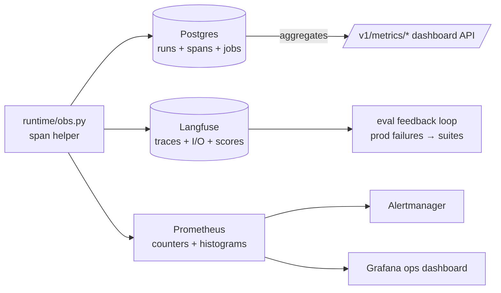

# 10 — Observability & Monitoring

> Implementation-level companion to `spec.md A2/B` and `backend-integration-plan.md` Part 5. Covers the
> per-call log contract, the three-store telemetry split, metrics/SLOs/alerts, the cost↔COGS monitoring
> bridge, drift/quality monitoring (the feedback loop that makes eval trustworthy), async job status
> delivery, and provider-resilience monitoring. Reads on top of `00-overview.md` (§3 `runtime/obs.py`,
> `RunContext.trace_id`) and `01-data-model.md` (`runs`, `spans`, `jobs`).

## 1. The one rule: every model call is logged, from one place

`spec.md A2` is a hard contract: **every model call logs `{model, prompt_version, input, output,
latency, cost, success}`.** The only way that stays true across playground, eval, and published invoke
is to emit it from the *shared* runtime (00 §1), never from the three callers. There is exactly one
span-emission helper, and every graph node (03) and every gateway call (02) goes through it.

```python
# services/runtime/obs.py
from __future__ import annotations
import time, contextlib
from dataclasses import dataclass, field
from .providers.ir import NormalizedUsage

@dataclass
class SpanRecord:
    kind: str                 # model | tool | retrieval | guardrail | judge
    name: str
    input_tokens: int = 0
    output_tokens: int = 0
    cost_usd: float = 0.0
    latency_ms: int = 0
    attrs: dict = field(default_factory=dict)   # model, prompt_version, cache_hit, substitution…
    success: bool = True
    error: str | None = None

@contextlib.asynccontextmanager
async def span(ctx: "RunContext", kind: str, name: str, **attrs):
    """
    The ONE helper every node uses. On exit it:
      1. writes a `spans` row (Postgres, transactional)              (01)
      2. mirrors a Langfuse generation/span under ctx.trace_id       (§3)
      3. increments Prometheus counters/histograms                   (§4)
    A model span additionally carries usage+cost computed from profiles (02/07), never LiteLLM's field.
    """
    rec = SpanRecord(kind=kind, name=name, attrs=dict(attrs))
    t0 = time.perf_counter()
    try:
        yield rec                                # node fills rec.usage/cost/attrs as it runs
    except Exception as e:
        rec.success, rec.error = False, repr(e)
        raise
    finally:
        rec.latency_ms = int((time.perf_counter() - t0) * 1000)
        await _persist_span(ctx, rec)            # Postgres spans row  (01)
        _emit_langfuse(ctx, rec)                 # Langfuse generation  (§3)
        _emit_metrics(ctx, rec)                  # Prometheus           (§4)

def set_usage(rec: SpanRecord, usage: NormalizedUsage):
    rec.input_tokens = usage.input_tokens
    rec.output_tokens = usage.output_tokens
    rec.cost_usd = usage.cost_usd               # from cost.py profile calc (02 §4.1 / 07)
    # model is already on the span name (f"model:{snapshot.model}"); NormalizedUsage carries only token
    # classes (02 §2) — field names must match the IR exactly or this AttributeErrors.
    rec.attrs |= {"cached_input_tokens": usage.cached_input_tokens,
                  "cache_write_tokens": usage.cache_write_tokens,
                  "reasoning_tokens": usage.reasoning_tokens}
```

A run is closed by `finalize` (03) which rolls the spans up into one `runs` row (01): summed tokens,
summed `cost_usd`, max/clock `latency_ms`, terminal `status`, and the `guardrail` outcome string the
frontend `Run.guardrail` expects (e.g. `"PII blocked on input"`).

```python
# model_call node (03) uses it like this (signature + event shape per 02 §6 / §2):
async with span(ctx, "model", f"model:{snapshot.model}",
                prompt_version=snapshot.prompt_hash) as sp:
    async for ev in gateway.stream(req, api_key=key, profile=snapshot.profile):
        if ev.type == EventType.USAGE:
            set_usage(sp, ev.data["usage"])         # USAGE payload is ev.data["usage"]; cost from profile
        yield ev
```

> **Why one helper, not a decorator per caller:** if the published endpoint logged differently from the
> eval worker, a drift report would describe code production never ran (00 §1). Centralizing it is what
> makes "test == eval == prod" true at the telemetry layer too.

## 2. Three stores, three jobs

Telemetry has three very different access patterns; forcing them into one store either bankrupts
Postgres on trace volume or makes dashboards slow. Split by purpose:



| Store | Holds | Access pattern | Retention |
|---|---|---|---|
| **Postgres** (`runs`, `spans`) | transactional, tenant-attributed call records + cost for billing/quotas | per-tenant queries, dashboard rollups, cost attribution | partition `runs`/`spans` by month; retain 90d hot, archive/drop older (`01 §4.7`, `11`) |
| **Langfuse** (self-hosted OSS) | full prompt/response I/O, nested traces, judge scores, latency breakdown | debugging a single run, judge calibration, exporting failures | per-workspace retention policy; PII-redacted before write (§7, 09) |
| **Prometheus** | numeric time-series (rates, histograms, gauges) | real-time ops dashboards + alerting | 15–30d; long-term via remote-write if needed |

> **Why Langfuse holds the heavy payloads, not Postgres:** prompt/response bodies are large and
> high-volume. Keeping them out of the primary DB is what lets `runs` stay a lean, partitioned,
> index-friendly table for cost rollups and quota checks (`01 §4.7` note, `11 §telemetry`). Postgres is
> the source of truth for **money and tenancy**; Langfuse is the source of truth for **what was said**.

### 3. Langfuse integration

```python
# services/runtime/obs.py (cont.)
from langfuse import Langfuse
_lf = Langfuse(host=settings.langfuse_host, ...)   # keys via Vault/env (09)

def _emit_langfuse(ctx: "RunContext", rec: SpanRecord):
    gen = _lf.generation(
        trace_id=ctx.trace_id,                      # threads the whole run (00 §4)
        name=rec.name,
        model=rec.attrs.get("model"),
        usage={"input": rec.input_tokens, "output": rec.output_tokens,
               "total_cost": rec.cost_usd},         # our cost, not provider's
        metadata={"workspace_id": ctx.workspace_id, "run_source": ctx.run_source,
                  "cache_hit": rec.attrs.get("cache_hit"),
                  "substitution": rec.attrs.get("substitution")},   # (02)
        level="ERROR" if not rec.success else "DEFAULT",
    )
```

- **`ctx.trace_id`** is minted in `runtime.invoke()` (00 §4) and stored on the `runs.trace_id` column
  (01) so the console can deep-link a run to its Langfuse trace.
- **Scores** (`_lf.score(...)`) carry two things back onto a trace: (a) eval verdicts from the drift
  engine (05), and (b) **in-product feedback** (§6) — thumbs/corrections from the playground.
- Langfuse datasets double as eval-suite scaffolding (spec B1); the feedback loop (§6) writes captured
  production failures into a dataset that seeds new `eval_cases` (05).

## 4. Metrics (OTel → Prometheus)

Instrument the `api` and `worker` with OpenTelemetry; export to Prometheus. The histograms must be
labeled by `workspace_id`, `agent_id`, `run_source`, and `model` so every SLO and cost view can slice.

```python
# services/runtime/obs.py (cont.)
from prometheus_client import Counter, Histogram, Gauge

REQ      = Counter("ac_runs_total", "runs", ["workspace", "source", "status"])
FIRST_TOK= Histogram("ac_first_token_seconds", "first-token latency", ["source"],
                     buckets=[.25,.5,1,1.5,2,3,5,10])      # SLO bucket at 2s (scope.md)
E2E      = Histogram("ac_run_latency_seconds", "end-to-end", ["source"],
                     buckets=[.5,1,2,5,10,15,20,25,30,40,60])  # SLO bucket at 30s (§5); needs headroom
                                                               # past 30s or a breach is invisible
TOKENS   = Counter("ac_tokens_total", "tokens", ["workspace","model","dir"])  # dir=in|out
COST     = Counter("ac_cost_usd_total", "cost", ["workspace","agent","model"])
CACHE    = Counter("ac_cache_total", "cache lookups", ["layer","result"])     # layer=exact|semantic|verdict|embed; result=hit|miss (07)
QUEUE    = Gauge("ac_queue_depth", "jobs queued", ["kind"])                   # drives worker autoscale (11)
EVALPASS = Gauge("ac_eval_pass_ratio", "rolling eval pass ratio", ["workspace"])
PROV_ERR = Counter("ac_provider_errors_total", "provider errs", ["provider","code"])  # §8
DEADLINE = Counter("ac_deadline_exceeded_total", "runs cut by the wall-clock deadline", ["source"])  # 00 §4 / 03 §4
```

| Metric | What it answers | Source |
|---|---|---|
| `ac_runs_total` rate | request volume per tenant/source | span finalize |
| `ac_first_token_seconds` p95 | the headline playground SLO | playground SSE first frame |
| `ac_run_latency_seconds` p50/p95/p99 | overall latency health | finalize |
| `ac_tokens_total`, `ac_cost_usd_total` | tokens/sec, cost/min, cost by model | model spans (02) |
| `ac_cache_total` hit ratio | COGS lever effectiveness (07) | cache layer (07) |
| `ac_queue_depth` | worker backlog → autoscale trigger | Redis queue (00 §2) |
| `ac_eval_pass_ratio` | are agents staying healthy | eval runs (05) |
| `ac_provider_errors_total` | provider resilience (§8) | gateway (02) |
| `ac_deadline_exceeded_total` rate | runs cut by the 30s wall-clock deadline (00 §4) | finalize (03 §4) |

**Health/readiness probes** (used by k8s + the reverse proxy, 11):
- `GET /healthz` — liveness: process up.
- `GET /readyz` — readiness: Postgres reachable, Redis reachable, Vault token valid (09), migrations at
  head. The published-invoke path refuses traffic until `readyz` is green so no request runs against a
  half-initialized Vault (secret-injection would fail mid-run).

## 5. SLOs & alerting

Concrete objectives, how each is measured, and the Alertmanager trigger. Error budget is burned on the
SLI; page only on fast burn.

| SLO | Objective | SLI (Prometheus) | Alert trigger |
|---|---|---|---|
| Playground first token | p95 < 2s (scope.md success metric #4) | `histogram_quantile(0.95, ac_first_token_seconds{source="playground"})` | > 2s for 10m → warn; > 3s 10m → page |
| End-to-end run latency | **p99 ≤ 30s** (hard deadline, 00 §4 / 03 §4) | `histogram_quantile(0.99, sum by (le,source) (rate(ac_run_latency_seconds_bucket[10m])))` | p99 > 25s 10m → warn; p99 > 30s 10m → page; `rate(ac_deadline_exceeded_total)/rate(ac_runs_total)` > 1% → page |
| Published invoke availability | 99.5% success (non-5xx, non-provider-timeout) | `1 - rate(ac_runs_total{source="api",status="error"}) / rate(ac_runs_total{source="api"})` | success < 99% 5m → page |
| Eval pass rate | ≥ 90% of published agents green | `ac_eval_pass_ratio` | drop > 5pp day-over-day → warn |
| Spend anomaly | within budget + no spikes | `rate(ac_cost_usd_total)` per workspace vs 7d baseline | > 3× baseline 15m, or ≥ 90% monthly budget → page (07) |
| Queue latency | eval/ingest start < 60s | job `queued→running` delay | p95 > 5m → warn (autoscale, 11) |
| Provider errors | < 2% | `rate(ac_provider_errors_total) / rate(ac_runs_total)` | > 5% 5m → warn; circuit-breaker open → page (§8) |

```yaml
# deploy/alertmanager/rules.yml (skeleton)
groups:
- name: agent-catalyst
  rules:
  - alert: PlaygroundFirstTokenSlow
    expr: histogram_quantile(0.95, sum by (le) (rate(ac_first_token_seconds_bucket{source="playground"}[10m]))) > 2
    for: 10m
    labels: {severity: warning}
    annotations: {summary: "Playground first-token p95 over 2s SLO"}
  - alert: RunLatencyP99High
    expr: histogram_quantile(0.99, sum by (le) (rate(ac_run_latency_seconds_bucket[10m]))) > 30
    for: 10m
    labels: {severity: critical}
    annotations: {summary: "End-to-end run p99 over the 30s SLO — the 00 §4 deadline is not holding"}
  - alert: DeadlineCutRateHigh
    expr: sum(rate(ac_deadline_exceeded_total[10m])) / sum(rate(ac_runs_total[10m])) > 0.01
    for: 10m
    labels: {severity: warning}
    annotations: {summary: ">1% of runs cut by the wall-clock deadline — latency regression hiding behind the cap"}
  - alert: SpendAnomaly
    expr: sum by (workspace) (rate(ac_cost_usd_total[15m])) > 3 * sum by (workspace) (rate(ac_cost_usd_total[15m] offset 7d))
    for: 15m
    labels: {severity: critical}
    annotations: {summary: "Workspace {{ $labels.workspace }} spend 3x week-ago (07)"}
```

## 6. Cost monitoring — the monitoring↔COGS bridge

Monitoring is where the COGS levers in `07-cost-cogs.md` are *proven* and *enforced*. Every cost
number on the dashboard comes from `runs.cost_usd`/`spans.cost_usd` (01), which the gateway computes
from capability profiles (02) — so the dashboard and the quota engine (07) use the identical figure
(no "estimated vs billed" drift inside the platform).

- **Rollups** feed the FE dashboard/runs charts (`SPEND_SERIES`, `RUNS_SERIES`, `dashStats`) via the
  `/v1/metrics/*` endpoints (08). Rollup granularity: per `workspace_id` (quota + chargeback), per
  `agent_id` (which agent costs most), per `caller_token_id`/endpoint (which consumer costs most).

```sql
-- per-workspace daily spend, the query behind /v1/metrics/spend (08) and quota checks (07)
select date_trunc('day', created_at) d, workspace_id, sum(cost_usd) usd, count(*) runs
from runs where created_at >= now() - interval '30 days'
group by 1,2 order by 1;
```

- **Cache-hit & model-mix dashboards** make the COGS story legible: `ac_cache_total` hit ratio per
  layer (exact/semantic/verdict/embedding, 07) and a stacked cost-by-model panel showing the
  tiering/routing effect (cheap model share rising = routing working, 07).
- **Spend anomaly detection**: the §5 alert plus a per-workspace budget burn-down the quota engine
  reads before admitting a published invoke (07 `BudgetGuard`). Monitoring surfaces it; 07 enforces it.
- **Judge spend is tracked separately** (`spans.kind='judge'`): per the design delta (00 §7), the
  LLM-judge is the primary COGS risk, so it gets its own cost panel and its own budget alert distinct
  from production traffic (05/07).

> **The cost loop:** profile-based cost (02) → `runs`/`spans` (01) → Prometheus + `/v1/metrics` (this
> doc) → anomaly alert + budget burn-down → `BudgetGuard` admission (07). One number, end to end.

## 7. Drift & quality monitoring (the feedback loop)

Deterministic + judge eval (05) catches regressions *before* publish. Production monitoring catches the
ones that only appear on real traffic, and **feeds them back into the eval set** — this is what makes
drift detection trustworthy over time (`backend-integration-plan.md` Part 5, "eval data lifecycle").

1. **In-product feedback signals.** The playground and (optionally) published responses carry a
   feedback affordance (thumbs / "this is wrong" / inline correction). Each writes a Langfuse `score`
   on the run's trace and a row the capture job reads.

```python
# api/routers/runs.py
@router.post("/v1/runs/{run_id}/feedback")
async def feedback(run_id, body: FeedbackIn, p=Depends(principal)):
    _lf.score(trace_id=run.trace_id, name="user_feedback",
              value=body.rating, comment=body.note)      # -1 | 0 | +1 (+ optional correction)
    await save_feedback(run_id, body, p)                 # for the capture job below
```

2. **Capture production failures into suites.** A periodic worker scans low-rated runs + guardrail
   blocks + errors, de-duplicates, and proposes them as new `eval_cases` (01) on the agent's suite
   (human-reviewed before they become baseline-affecting). This closes the loop: real failures become
   regression tests (05).
3. **Judge calibration over time.** The judge is fixed + versioned (05), but to trust it we periodically
   score a held-out, human-labeled set and track judge-vs-human agreement as a metric. A calibration
   drop is itself an alert — a drifting judge silently corrupts every verdict.
4. **Production quality proxies** (no ground truth needed per request): refusal rate, empty-output
   rate, guardrail-block rate, citation-presence rate (for RAG agents), output-schema-valid rate. A
   spike in any of these on a published agent is an early drift signal even before the next eval run.

## 8. Provider-resilience monitoring

The gateway (02) handles retries/fallback/circuit-breaking; this doc makes its behavior *visible*.

- `ac_provider_errors_total{provider,code}` — 429/5xx/refusal rates per provider.
- **Fallback & substitution events** (02): when the gateway downgrades a request to fit a provider or
  falls back to the versioned fallback model, it records a `capability_substitution` on the span
  (`attrs.substitution`) and increments a counter. These are surfaced to the user *and* the eval (02),
  and alerted on if they spike (a quietly-degrading provider is a drift source).
- **Circuit-breaker state** exported as a gauge per `(provider, model)`; breaker-open pages (§5) and is
  shown on the ops dashboard so an operator sees "Anthropic breaker open, traffic on fallback."

## 9. Async job status delivery

Ingestion (04) and eval (05) are long async jobs; the UI shows live status. The `jobs` table (01) is
the delivery substrate.

```python
# worker updates progress as it goes (01 jobs.progress jsonb)
await update_job(job_id, status="running", progress={"done": i, "total": n, "message": f"embedding {i}/{n}"})
```

| Phase | Delivery | Notes |
|---|---|---|
| **P1 (now)** | `GET /v1/jobs/:id` polling (08) | UI polls every ~1–2s while a job is running; simplest, robust |
| **P1.5** | SSE stream `GET /v1/jobs/:id/events` | push progress; same generator pattern as invoke SSE (08) |
| **P2** | webhook on completion | for external callers who kicked a job via API |

The FE ingestion-jobs and eval pages (`useIngestionJobs`, `resolveEvalRun` in `backend-integration-map`)
read exactly this. Job rows carry `workspace_id` so status is tenant-scoped like everything else (09).

> **Don't lose the terminal state.** A worker that crashes mid-job must leave the job recoverable: jobs
> have a heartbeat (`updated_at`); a reaper marks jobs `failed` if a running job goes silent past a
> timeout, so the UI never spins forever. Eval/ingest are idempotent per `ref_id` so a retried job
> re-runs cleanly.

## 10. Dashboards (what exists, what backs each)

| Dashboard | Panels | Data source |
|---|---|---|
| **Ops** (Grafana) | request rate, latency p50/p95/p99, error rate, queue depth, circuit-breaker state, readiness | Prometheus |
| **Cost** (Grafana + in-app) | spend/day per workspace+agent+endpoint, cost by model, cache-hit ratio, judge spend, budget burn-down | Postgres rollups (§6) + Prometheus |
| **Eval / drift** (in-app) | eval pass ratio, verdict history, quality-dimension deltas, judge-calibration trend, production quality proxies | `eval_runs`/`eval_results` (01) + Langfuse scores |
| **Run explorer** (in-app) | per-run trace drill-down, spans, tokens, cost, guardrail outcome, deep-link to Langfuse | `runs`/`spans` (01) + Langfuse `trace_id` |

The in-app dashboards are served by the `/v1/metrics/*` and `/agents/:id/dashboard` endpoints (08); the
Grafana ops/cost boards are for operators and read Prometheus + Postgres directly.

→ Next: `11-deployment.md`
