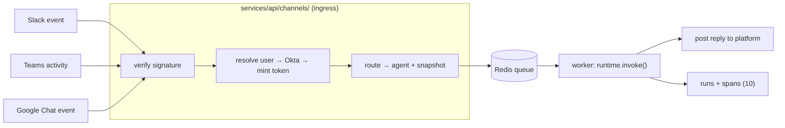

# 12 — Messaging Channels (inbound adapter)

> Implementation-level design for hosting agents behind Slack / Microsoft Teams / Google Chat. The
> product/cross-cutting view is `docs/channels-design.md`; this doc is the backend module. It builds on
> the one-shared-runtime principle (`00 §1`) and the auth planes (`09 §1`). **P2** — lands after the
> published-invoke path (`08`) is solid.

## 1. Principle: a channel is a fourth thin caller

The playground, the published endpoint, and the eval worker all wrap the same
`runtime.invoke(snapshot, inputs, ctx)` (`00 §1`). A channel adapter is the **fourth** such caller. It
adds *ingress + identity federation + reply delivery* around that call — and nothing inside it. The
runtime stays HTTP-free (`00 §1`); all transport lives in `services/api/channels/`.



**Ack-fast, process-async.** Platforms demand a 2–3s ack. The ingress route verifies + enqueues and
returns `200` immediately; the `worker` runs `invoke()` and posts the reply back out-of-band (the same
split ingestion and evals already use, `00 §2`). The existing P2 outbound "webhook on completion"
(`10 §9`) is the delivery-direction analog.

## 2. Module layout

```
services/api/channels/
  router.py          # POST /channels/{platform}/events  — one ingress route per platform
  verify.py          # per-platform signature/JWT verification (the trust anchor)
  normalize.py       # platform event → InboundMessage (text, thread_id, platform_user, channel_id)
  federate.py        # platform email → Okta subject → minted Agent Platform token (09)
  route.py           # channel + message → (agent_id, version_snapshot)
  deliver.py         # reply back to the platform (buffer SSE → single message, v1)
  install.py         # builder-side: create/connect a Channel, store vaulted creds (08)
```

`federate.py` and `install.py` depend on `09` (auth) and Vault (`11`); everything else is transport. The
`worker` imports `runtime.invoke` + `deliver.post_reply`.

## 3. Data model (`01` delta)

```sql
CREATE TYPE channel_platform AS ENUM ('slack','teams','gchat');
CREATE TYPE channel_status   AS ENUM ('connected','error','disconnected','setup_pending');
CREATE TYPE channel_routing  AS ENUM ('slash','picker','default');
CREATE TYPE channel_identity AS ENUM ('federated','service');

CREATE TABLE channels (
  id            uuid PRIMARY KEY DEFAULT gen_random_uuid(),
  workspace_id  uuid NOT NULL REFERENCES workspaces(id),       -- one channel -> one workspace
  platform      channel_platform NOT NULL,
  name          text NOT NULL,
  status        channel_status NOT NULL DEFAULT 'setup_pending',
  routing       channel_routing NOT NULL DEFAULT 'default',
  identity_mode channel_identity NOT NULL DEFAULT 'federated',
  default_agent_id uuid REFERENCES agents(id),
  okta_group    text,                                          -- group granted this workspace
  config        jsonb NOT NULL DEFAULT '{}',                   -- non-secret per-platform config
  credentials   jsonb NOT NULL DEFAULT '{}',                   -- {field: {masked, vault_path}} MULTI-SECRET
  installed_by  uuid REFERENCES users(id),
  created_at    timestamptz NOT NULL DEFAULT now(),
  updated_at    timestamptz NOT NULL DEFAULT now(),
  last_event_at timestamptz
);

-- one channel -> many agents (routing targets)
CREATE TABLE channel_agents (
  channel_id uuid NOT NULL REFERENCES channels(id) ON DELETE CASCADE,
  agent_id   uuid NOT NULL REFERENCES agents(id)   ON DELETE CASCADE,
  slash      text,                                             -- e.g. '/triage' (routing='slash')
  PRIMARY KEY (channel_id, agent_id)
);
```

- `credentials` is a **multi-secret** map (bot token + signing secret), each value a `{masked,vault_path}`
  ref — the raw secret is POSTed once to Vault on install and never returned (same envelope as
  `provider_keys`, `09 §8`). This is the backend of the frontend's `Record<string, CredentialRef>`.
- RLS applies as to every tenant-owned table (`09 §7`): `workspace_id` is the partition.
- **`run_source`** enum gains `'channel'` (or per-platform values); **`subject_type` is unchanged**
  (`user` for a federated human, `service` for a service account) — the Okta model needs no new subject
  class. `runs.caller` carries the platform handle for attribution.

## 4. Identity federation (`09` delta)

A **third ingress plane** beyond console-session and caller-token (`09 §1`):

```python
CHANNEL_INVOKE_ROLE = "viewer"   # baseline; see "Role & membership" below

def resolve_channel_principal(ch: Channel, msg: InboundMessage) -> MintedToken:
    if ch.identity_mode == "service":
        return mint_service_token(ch.okta_service_account)      # client-credentials
    email = msg.platform_user.email                             # from verified event
    sub = okta.lookup_subject(email)                            # email is the join key
    if sub is None:
        raise Unmapped(email)                                   # -> friendly in-chat denial
    groups = okta.groups_for(sub)                               # the user's Okta groups (= teams)
    if ch.okta_group and ch.okta_group not in groups:          # COARSE GATE — enforce it here, before mint
        raise NotInChannelGroup(email)                          # -> friendly in-chat denial
    if ch.platform == "teams":
        # OBO-exchanged token must resolve to the same {CHANNEL_INVOKE_ROLE, teams = Okta groups}.
        return entra_obo_exchange(msg.platform_token, target=OKTA_AUD)   # true token exchange
    # Direct mint (slack, gchat): baseline role, teams = the user's Okta groups.
    return mint_platform_token(sub, workspace=ch.workspace_id, role=CHANNEL_INVOKE_ROLE, teams=groups)
```

The minted token feeds the unified `can_use(policy, *, role, teams, subject)` (`09 §5`) exactly like a
caller token — Okta groups are the `teams`, the **same model the console uses** (`09 §2.1`). A channel
caller has no owner `subject`, so a `private` agent is denied (admin excepted). Note the channel's
`okta_group` (this gate) is distinct from a workspace's optional backing group (`workspaces.okta_group`,
`01`): one gates *this channel's* end users, the other may auto-grant *space membership*.
**End-user access = two gates:** the channel `okta_group` (coarse — checked above, before mint) ∩ the
agent's `access_policy` (fine — evaluated in `resolveRun`). Both must pass.

**Role & membership.** The channel plane is **membership-independent** (`09 §1`): a federated end user needs
**no workspace `memberships` row** (unlike the console `get_workspace_ctx` guard, `09 §3`). The minted
`role` is a fixed **baseline invoke role** (`CHANNEL_INVOKE_ROLE`) — invoke requires no builder+ privilege,
so any `useRoles`-based policy treats channel users as this baseline and real authorization rides on
`teams` (Okta groups) ∩ the agent's policy. Role is **not** derived from Okta groups (consistent with the
console: groups → teams, not roles). Tenancy still holds: the channel is pinned to one `workspace_id` and
RLS (`09 §7`) partitions every query, so a channel user can reach only **that** workspace's bound agents.

## 5. Invoke mapping (`03`)

```python
inbound → InvokeInputs(messages=[{"role":"user","content": msg.text}],
                       session_id=f"{ch.platform}:{msg.thread_id}")   # NEW TURN ONLY (03 open contract)
ctx = RunContext(workspace_id=ch.workspace_id, run_source="channel",
                 principal_id=sub, caller_token_id=None, trace_id=…, deadline_s=30)
```

Pin the new-turn-vs-full-history contract (`session-memory-status.md`) before shipping: channels deliver
one turn at a time, so **new-turn** is both correct and the only option that doesn't double-count the
`messages` append-reducer (`03 §state`).

## 6. Security (`09 §10`, `11`)

- **Signature verification is the sole proof of identity** (we trust the platform's assertion, not a
  user-presented token). Per `ChannelDef.verification`: Slack HMAC over raw body+timestamp (replay
  window), Teams Bot Framework JWT (audience/issuer), Google Chat Google JWT (audience = app). Reject on
  any mismatch; rate-limit per channel.
- Inbound untrusted text → model → tools is the named dangerous surface (`09 §10`): egress allow-lists
  apply; no channel faces outside the org until a written threat model is signed off (`09 §12`).
- Strongest case yet to split public invoke into its own Deployment for blast-radius isolation (`00 §2`).

## 7. Observability (`10` delta)

`run_source='channel'` added to the per-call log, the Prometheus labels (`workspace_id, agent_id,
run_source, model`), and Langfuse metadata. Per-user cost attribution now works because the run carries a
real Okta `principal_id` — a first for external-origin traffic.

## 8. Phasing

- **P2.a:** Slack only, `routing='default'` (one channel → one default agent), federated identity,
  buffer-to-final reply. Proves the ingress + federation + reply loop end-to-end.
- **P2.b:** Teams (Entra OBO) + Google Chat; slash/picker routing; per-platform native formatting;
  edit-to-stream.

→ Related: `00` (callers), `03` (invoke/session), `08` (API surface), `09` (auth/tenancy), `10` (obs).
