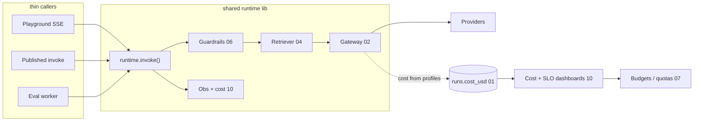

# Agent Catalyst — Backend Implementation Design

> The **implementation-level** backend design for Agent Catalyst: the layer *beneath* `docs/spec.md`.
> Where `scope.md` decides *whether*, `spec.md` decides *what*, this folder decides **how** — concrete
> modules, DDL, interfaces, Pydantic/SSE schemas, and the two things most under-served elsewhere:
> **guardrails** and **cost/COGS**. Code is real skeletons, copy-paste-adaptable.

## How this relates to the other docs

```
scope.md      → does AI even make sense? risks, phasing, what's cut        (the WHY)
spec.md       → requirements + technical spec B1–B12, data model, phasing  (the WHAT)
backend-integration-plan.md / -map.md → roadmap, deploy, FE↔API contract   (the PLAN)
docs/backend/ → modules, interfaces, DDL, schemas, cost, guardrails        (the HOW)  ← you are here
```

Read `scope.md` → `spec.md` → this folder. Nothing here contradicts the locked stack
(FastAPI + LangGraph + LiteLLM + Postgres/pgvector + Redis + Vault + Langfuse + MinIO, portable
containers); where it **extends or pushes back**, the delta is argued inline (see `00 §7`).

## Reading order

| # | Doc | What it covers |
|---|---|---|
| — | [README.md](README.md) | This index |
| 00 | [00-overview.md](00-overview.md) | The one-shared-runtime principle, service/module layout, the `runtime.invoke()` entry point, config, the deltas-from-spec table |
| 01 | [01-data-model.md](01-data-model.md) | Full SQL DDL + SQLAlchemy, enums, **RLS**, version-snapshot immutability, Alembic, indexes |
| 02 | [02-provider-gateway.md](02-provider-gateway.md) | **Hard core #1** — IR, adapter Protocol, capability profiles, our own cost calc, substitutions, retry/fallback/circuit-breaker |
| 03 | [03-runtime.md](03-runtime.md) | LangGraph state/nodes/edges, SSE bridge, checkpointer/session memory, retrieval-as-tool, tool loop |
| 04 | [04-rag.md](04-rag.md) | Ingestion pipeline, chunking, pgvector retrieval, injection modes, citations, reproducibility pinning |
| 05 | [05-eval-drift.md](05-eval-drift.md) | **Hard core #2** — baseline, deterministic + LLM-judge, verdict math, publish gate, triggers, judge cost control |
| 06 | [06-guardrails.md](06-guardrails.md) | **Emphasis** — stage interface, concrete stages, cheap-first ordering, streaming redaction, fail-open vs fail-closed |
| 07 | [07-cost-cogs.md](07-cost-cogs.md) | **Emphasis** — the cost model, levers ranked by impact, tiering/caching/budgets, worked example |
| 08 | [08-api-surface.md](08-api-surface.md) | REST + SSE endpoints, Pydantic mapped to `frontend/data.ts`, OpenAPI → cURL/TS/Python export |
| 09 | [09-security-tenancy.md](09-security-tenancy.md) | OIDC/token auth, RBAC + access policies, RLS + Vault envelope encryption, threat model, PII/retention |
| 10 | [10-observability-monitoring.md](10-observability-monitoring.md) | Per-call log contract, Langfuse, metrics/SLOs/alerts, cost + drift monitoring, async job status |
| 11 | [11-deployment.md](11-deployment.md) | Containers, compose→k8s, CI/CD + eval gate, secrets, scaling, zero-downtime, backup/DR |

## The two ideas that shape everything

1. **One shared runtime (00 §1).** Playground, eval workers, and the published endpoint all call the
   *same* `runtime.invoke(version_snapshot, …)`. If they didn't, a drift report would be evaluating code
   production never runs. The runtime is a library with no HTTP coupling; three thin callers wrap it.

2. **Immutable version snapshots (01 §4).** `agents` is mutable config; `agent_versions` is a frozen,
   fully-resolved snapshot the runtime reads *instead of* the live agent row. This is what makes
   reproducibility, the eval gate, and "editing an agent changes nothing live until an eval-gated
   re-point" true in code, not by convention.

## The four load-bearing / emphasis areas

| Area | Doc | Why it's where the real engineering is |
|---|---|---|
| Provider gateway | 02 | Model-agnosticism and cost accuracy either hold or quietly leak here. We compute cost ourselves from versioned profiles; LiteLLM is transport only. |
| Eval / drift | 05 | The defensible core — detect "it quietly got worse" without a human reading every transcript. Also the biggest COGS risk. |
| Guardrails | 06 | Our own cheap deterministic stages are the backbone; OSS libs are plugins. Cheap-first ordering + streaming redaction + fail-closed. |
| Cost / COGS | 07 | Inference spend *is* the COGS. Tiering + prompt caching + judge gating + context budget stack multiplicatively; the eval gate makes downgrading safe. |

## Overview topology



## Status & provenance

- **Phasing:** P1 (chat core, RAG, eval/drift, publish/export, guardrails baseline, cost accounting) is
  specified at full implementation depth; P2 (MCP, sub-agents, full guardrail library, spend/concurrency
  enforcement, RBAC hardening, connectors) is designed but lighter. Matches `spec.md Part C`.
- These docs are a **design**, not generated from code — the backend (`services/`) is not yet built.
  `spec.md "First files to create"` + `backend-integration-plan.md` milestones M1–M7 are the build order.
- Every doc cross-references the others as `(NN)`; follow the `→ Next:` footer to read in sequence.
