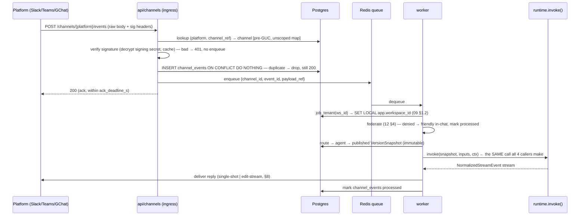

# 12 (LLD) — Messaging Channels (inbound adapter, the 4th caller)

> **⚠️ Secret custody — as built (feature 014, 2026-11-11):** secret custody now runs through a pluggable secrets backend (**AWS Secrets Manager** / LocalStack / `local`), **not** HashiCorp Vault Transit. The Vault / DEK channel-credential detail in this LLD is the **superseded design baseline** for the still-unbuilt channel family (P2) — to be re-reconciled when channels are built. See `docs/scope.md` (2026-11-11) and [`../09-security-tenancy.md §9`](../09-security-tenancy.md).

> **Parent:** [`../12-channels.md`](../12-channels.md) (the four-callers principle, module layout, the DDL
> sketch, identity federation `§4`, the invoke mapping `§5`, security `§6`, phasing). The parent **amends
> `00 §1`** — three → four callers — and fixes the model plus the H1 (non-authoritative email) / H1.5 (inbound
> idempotency) hardening. It leaves at HLD altitude: the **caller-peer contract** (how the channel wraps the
> *identical* `invoke()` the other three do), the **ingress ↔ worker split boundary** (the parent diagram puts
> federation at ingress; the ack budget says otherwise), the **signature-verify + credential-decrypt mechanics**,
> the **dedup / dead-letter state machine**, the **reply-delivery drain** (SSE → a chat message), and the
> **exact `RunContext` construction**. This doc makes those buildable.

## What this adds over parent `12`

| Gap in `12` | Filled here |
|---|---|
| "a channel is the fourth thin caller" (`§1`) — asserted, but the *peer contract* (same `invoke(snapshot, inputs, ctx)`, same immutable `VersionSnapshot`) is never laid beside the other three | §1 — the 4-caller (+ subagent) peer table + the one-line invariant the channel must not break |
| `CHANNEL_DEFS` is a frontend registry (`channels.ts`); the **backend** registry (verify fn + normalize fn + capability flags) is only named in the module layout (`§2`) | §2 — the backend `ChannelDef`, the per-platform verify/normalize, capability flags, `GET /v1/channel-defs` |
| `credentials jsonb = {field:{masked,vault_path}}` (`§3`) — but the **09 DEK envelope** wiring (which scope, encrypt on install, decrypt on the hot path) is unspecified | §3 — per-workspace DEK scope, `install.py` encrypt, the signing-secret decrypt + in-process cache |
| DDL sketch (`§3`) has the three tables but no indexes, no ingress-lookup key, no `channel_events` state machine, no re-drive source | §4 — the refined `01` delta: lookup index, `channel_events` states, `payload_ref`, RLS note |
| `§1` diagram routes **verify → federate → route** all at ingress, then enqueues; `§1` prose also says "verify + enqueue and return 200" — the two disagree on where federation runs | §5 — the decision: **verify + dedup + enqueue** at ingress, **federate + route + invoke + deliver** on the worker; the sequence; the tenant-GUC bootstrap |
| `§5` builds `ctx` with `principal_id=sub, caller_token_id=None` — predates the resolved `RunContext.principal` field (`01` LLD §2, 2026-10-24) and the `principal_id` attribution question | §6 — the exact `RunContext`, `principal.subject=None` (fail-closed `private`), the `principal_id`-attribution flag |
| H1.5 "dedup on the platform event id + dead-letter" (`§4` DDL comment) — the *mechanism* (race, drop-not-replay, the sweep) is undefined; its tie to `00 §3` is implicit | §7 — the dedup/dead-letter flow tied to `00-conventions §3`, and the published-invoke vs channel idempotency contrast |
| "buffer SSE → single message (v1)" / "edit-to-stream (P2.b)" (`§2`/`§8`) — no drain, no throttle, no delivery-failure path | §8 — `deliver.post_reply` draining `invoke()`, single-shot vs edit-stream, delivery retry |
| no error taxonomy — `§6` names signature verification but not which failures are HTTP vs in-chat | §9 — the `00-conventions §1` three-category map for the channel path + the edge cases |

Python 3.12, `from __future__ import annotations`. Snippets compile (§11). `RunContext`/`InvokeInputs`/`Message`/
`Principal`: see [`01-data-model.lld.md §2`](01-data-model.lld.md). `invoke`: see [`03-runtime.lld.md §2`](03-runtime.lld.md).
`AppError`/idempotency `§3`/`AsyncSession` `§4`: see [`00-conventions.lld.md`](00-conventions.lld.md). `VaultEnvelope`
(the DEK envelope): [`09-security-tenancy.lld.md §3`](09-security-tenancy.lld.md); `set_tenant_guc`/`job_tenant`:
[`09` LLD §1](09-security-tenancy.lld.md). `can_use`: `09 §5`. Federation `resolve_channel_principal`: **see `12 §4` — not restated.**

---

## 1. The channel is a fourth *peer* caller (never a divergent path)

The load-bearing invariant (`00 §1`, amended by `12 §1`): **one** function — `runtime.invoke(snapshot, inputs, ctx)`
(`03` LLD §2) — is wrapped by every surface. If a caller ran a *different* code path, drift reports (`05`) would
evaluate code the endpoint never runs. The channel adapter adds **ingress + identity federation + reply delivery**
*around* that call and **nothing inside it** — the runtime stays HTTP-free (`00 §1`). The four peers (+ the
recursive subagent path), side by side:

| Caller | Entry | `ctx.run_source` | Identity source | Reads | `stream` | The call |
|---|---|---|---|---|---|---|
| **Playground** | `POST` console (`08`) | `playground` | **session** — console user | published **or** draft snapshot | yes (SSE→browser) | `invoke(snapshot, inputs, ctx)` |
| **Published invoke** | `POST /v1/agents/:id/invoke` (`08`) | `api` | caller **token** → `executer` | published `VersionSnapshot` | yes (SSE/JSON) | **same** |
| **Channel** (this doc) | `POST /channels/{platform}/events` → worker | `channel` | **federated Okta subject on `ctx`** (no session) | **published** `VersionSnapshot` | per channel capability (§8) | **same** |
| **Eval** | eval worker job (`05 §7`) | `eval` | system (`allow_cache=False`) | candidate snapshot | no (collected) | **same** |
| *(Subagent)* | recursive from a tool (`03 §6`) | `subagent` | inherited `ctx.child()` | child snapshot | n/a | **same** |

Two things the channel caller **must** honor to stay a peer, not a fork:

1. **It invokes the published snapshot, never a live agent row.** `route.py` resolves `(channel, message) →
   agent_id → the agent's *published* version → VersionSnapshot` (frozen, `01`/`03`). A channel is a
   **distribution surface for published agents** — identical to the published-invoke caller — so "editing an
   agent changes nothing live until an eval-gated re-publish" (`03` LLD) holds for channels for free. A draft or
   an agent with no published version is **not** reachable from a channel (§9 edge case).
2. **It calls the one `invoke()` with a `RunContext` built like any other** (§6). The channel's *only* additions
   are the three wrappers (ingress, federation, delivery). It does **not** re-implement the graph, budget,
   guardrails, or persistence — those are inside `invoke()` and shared verbatim.

> **Confirms the `00 §1` amendment.** Callers of `runtime.invoke()` = **four** (playground, published, channel,
> eval) **+ the recursive subagent path** — `run_source` is an open `str`, not a closed 3-value enum
> (`run_source ∈ {playground, api, channel, eval, tool_test, subagent}`, `01 §3`). Nothing in this doc presents
> the count as three.

---

## 2. The backend channel registry (the server half of `channels.ts`)

`channels.ts` (`CHANNEL_DEFS`) is the **frontend** registry: per-platform config fields, the multi-secret
credential shape, and the `verification` scheme (the trust anchor). The backend needs the same declarative
registry **plus** the executable `verify` / `normalize` and the reply **capability flags** the delivery path
reads. One registry so adding a platform is a data change, not new route code (mirrors `02`'s profile files).

```python
from __future__ import annotations
from dataclasses import dataclass
from collections.abc import Callable


@dataclass(frozen=True)
class ChannelCaps:
    ack_deadline_s: float          # platform's inbound-ack budget — the ingress route MUST return within this
    supports_edit_stream: bool     # chat.update / activity-update available → edit-to-stream reply (§8); else single-shot
    max_message_len: int           # split/truncate long replies to the platform cap (§8)
    verified_email_claim: bool     # platform JWT carries an email_verified claim (H1, 12 §4); Slack=False → users.info lookup


@dataclass(frozen=True)
class ChannelDef:
    platform: str                                       # 'slack' | 'teams' | 'gchat' (channels.ts ChannelPlatform)
    label: str
    verification: str                                   # 'signing_secret' | 'bot_framework_jwt' | 'jwt_audience'
    secret_fields: tuple[str, ...]                      # MULTI-SECRET (channels.ts secretFields): slack=(botToken,signingSecret)
    verify: "Callable[[bytes, dict, dict], None]"       # (raw_body, headers, creds) -> None | raises BadSignature (§9)
    normalize: "Callable[[dict], InboundMessage]"       # platform event -> InboundMessage (§5)
    caps: ChannelCaps


@dataclass(frozen=True)
class InboundMessage:
    platform_event_id: str         # the platform's unique event/message id — the dedup key (§7)
    text: str
    thread_id: str                 # reply target; also the invoke session_id suffix (§6)
    channel_ref: str               # platform channel/space id (for the ingress channel lookup, §4)
    platform_user: "PlatformUser"  # email + email_verified + platform handle (12 §4 federation input)
    platform_token: str | None     # Teams: the Bot Framework token for OBO exchange (12 §4); else None


CHANNEL_REGISTRY: dict[str, ChannelDef] = {
    "slack":  ChannelDef("slack",  "Slack",            "signing_secret",   ("botToken", "signingSecret"),
                         verify_slack,  normalize_slack,
                         ChannelCaps(ack_deadline_s=3.0, supports_edit_stream=True,  max_message_len=40000, verified_email_claim=False)),
    "teams":  ChannelDef("teams",  "Microsoft Teams",  "bot_framework_jwt", ("clientSecret",),
                         verify_teams,  normalize_teams,
                         ChannelCaps(ack_deadline_s=15.0, supports_edit_stream=True,  max_message_len=28000, verified_email_claim=True)),
    "gchat":  ChannelDef("gchat",  "Google Chat",      "jwt_audience",     ("serviceAccountKey",),
                         verify_gchat,  normalize_gchat,
                         ChannelCaps(ack_deadline_s=30.0, supports_edit_stream=False, max_message_len=4000,  verified_email_claim=True)),
}
```

- **`@backend GET /v1/channel-defs`** (noted in `channels.ts`) serves the *non-executable* projection
  (`platform`, `label`, `verification`, config/secret field specs) so the console form is driven by what the
  server actually supports — the `verify`/`normalize`/`caps` stay server-side.
- `verified_email_claim=False` for Slack is the H1 (`12 §4`) consequence: Slack's event has no `email_verified`
  JWT claim, so federation resolves the sender's email via a `users.info` call on the bot token and treats the
  Slack-workspace membership + `allowed_email_domains` bind as the verification (`12 §4`). Teams/GChat carry a
  verifiable email claim directly.

### 2.1 Per-platform verification (the trust anchor, `12 §6`)

Signature verification is the **sole** proof of identity (`12 §6`): we trust the platform's assertion, not a
user-presented token. Each is a pure function raising `BadSignature` (§9) on any mismatch.

```python
from __future__ import annotations
import hashlib, hmac, time

SLACK_REPLAY_WINDOW_S = 300        # reject events older than 5 min (replay defense, 12 §6)


def verify_slack(raw_body: bytes, headers: dict, creds: dict) -> None:
    ts = headers.get("x-slack-request-timestamp", "")
    sig = headers.get("x-slack-signature", "")
    if not ts or abs(time.time() - int(ts)) > SLACK_REPLAY_WINDOW_S:
        raise BadSignature("stale or missing timestamp")                 # replay window (12 §6)
    base = f"v0:{ts}:{raw_body.decode('utf-8')}".encode("utf-8")
    expected = "v0=" + hmac.new(creds["signingSecret"].encode("utf-8"), base, hashlib.sha256).hexdigest()
    if not hmac.compare_digest(expected, sig):                           # constant-time compare
        raise BadSignature("hmac mismatch")


def verify_teams(raw_body: bytes, headers: dict, creds: dict) -> None:
    """Bot Framework JWT in Authorization: validate signature against the Bot Framework OpenID JWKS, then
    issuer + audience == creds['botAppId'] (12 §6). JWKS cached; raises BadSignature on any failure."""
    _validate_jwt(headers.get("authorization", ""), jwks=_bf_jwks(), audience=creds["botAppId"])


def verify_gchat(raw_body: bytes, headers: dict, creds: dict) -> None:
    """Google-issued bearer JWT: validate against Google certs, audience == the app's project number (12 §6)."""
    _validate_jwt(headers.get("authorization", ""), jwks=_google_jwks(), audience=creds["projectNumber"])
```

---

## 3. Config + credential storage via the `09` DEK envelope

`channels.credentials` is a **multi-secret** map (`12 §3`) — the backend of the frontend's
`Record<string, CredentialRef>` (`channel-credentials.ts finalizeChannelCredentials`). Channel/connector/tool
creds use the **per-workspace** DEK scope (`09` LLD §3.1 table) — `scope="workspace"`, `ref=workspace_id`,
Transit key `ws-<workspace_id>`. On install each secret field is envelope-encrypted; only the envelope (+ a
display mask) is persisted. The raw secret is POSTed once and never returned (same rule as `provider_keys`,
`09 §9`).

```python
# services/api/channels/install.py  — builder-side connect (12 §2). RBAC: channel.manage at builder+ (08/09).
async def install_channel(ws_id: str, platform: str, config: dict, raw_secrets: dict,
                          *, env: "VaultEnvelope", db) -> "Channel":
    cdef = CHANNEL_REGISTRY[platform]
    credentials: dict = {}
    for field in cdef.secret_fields:                         # MULTI-SECRET: slack = botToken + signingSecret (§2)
        raw = raw_secrets[field].encode("utf-8")
        envelope = await env.encrypt("workspace", ws_id, raw)       # 09 LLD §3.2 → {wrapped_dek,nonce,ct,key}
        credentials[field] = {"masked": _mask(raw_secrets[field]), "env": envelope}
        # raw dropped here — only {masked, env} is persisted; plaintext never touches the row (09 §9)
    return await _insert_channel(db, ws_id, platform, config, credentials, status="connected")
```

### 3.1 Decrypt on the hot path (and why the signing secret is cached)

Signature verification needs the **signing secret on every inbound event**, synchronously, before the ack (§5).
Decrypting via Vault per event would add a Transit round-trip to the ack-critical path. **Decision:** an
in-process LRU of decrypted signing secrets, keyed by `channel_id`, short TTL (e.g. 300s), so the common case is
a memory read; a miss does one `env.decrypt` (`09` LLD §3.2). The **bot token** (used only on the worker, for
reply delivery / Slack `users.info`) is decrypted lazily there, not cached on the ingress path.

```python
async def signing_secret_for(ch: "Channel", *, env: "VaultEnvelope") -> str:
    hit = _SIG_CACHE.get(ch.id)
    if hit is not None:
        return hit
    secret = (await env.decrypt("workspace", ch.workspace_id, ch.credentials["signingSecret"]["env"])).decode("utf-8")
    _SIG_CACHE.set(ch.id, secret, ttl=300)                   # invalidated on channel re-install / rotate (09 §3.3)
    return secret
```

The DEK envelope + the RLS row scope mean a channel secret is gated **twice** (`09 §3.1`): the row is
tenant-scoped by RLS (§4), the DEK is workspace-scoped by key name — a stolen row for tenant A cannot be
decrypted as tenant B.

---

## 4. Data model delta (refines `12 §3`)

The HLD DDL is the shape; this adds the **ingress-lookup index**, the `channel_events` **state machine + re-drive
source**, and the RLS note. (Enums `channel_platform`/`channel_status`/`channel_routing`/`channel_identity` and
the base columns are `12 §3` — not restated.)

```sql
-- channels: as 12 §3, PLUS the ingress lookup key. The webhook arrives with a platform channel/space ref and no
-- workspace context; we must map (platform, channel_ref) -> channel -> workspace. One unique index serves it.
CREATE UNIQUE INDEX channels_platform_ref ON channels (platform, (config ->> 'channel_ref'));
CREATE INDEX channels_ws ON channels (workspace_id);                       -- RLS + console list

-- channel_agents: as 12 §3 (channel -> many agents, slash routing). No change.

-- channel_events: dedup ledger + dead-letter state machine (H1.5). Refines 12 §3.
CREATE TABLE channel_events (
  channel_id        uuid NOT NULL REFERENCES channels(id) ON DELETE CASCADE,
  platform_event_id text NOT NULL,                        -- the platform's unique event id (dedup key, §7)
  status            text NOT NULL DEFAULT 'received',      -- received | processed | dead_letter (state machine, §7)
  payload_ref       text,                                  -- MinIO object key for the raw body → re-drive source (§7)
  attempts          smallint NOT NULL DEFAULT 0,           -- worker attempts; caps retries before dead_letter
  received_at       timestamptz NOT NULL DEFAULT now(),
  processed_at      timestamptz,
  PRIMARY KEY (channel_id, platform_event_id)              -- dedup: a 2nd delivery of the same id is a no-op (§7)
);
CREATE INDEX channel_events_sweep ON channel_events (status, received_at)
  WHERE status = 'received';                               -- partial index drives the dead-letter sweep (§7)
```

- **RLS** applies to all three as to every tenant-owned table (`09` LLD §2): `workspace_id` is the partition
  (`channel_events`/`channel_agents` inherit the tenant via `channel_id` → the sweep/worker run inside
  `job_tenant`, §5). The **one** read that *cannot* be tenant-scoped is the ingress `channels_platform_ref`
  lookup — it is the map *from* an untrusted request *to* a workspace, so it runs **before** the GUC is set (§5).
- **`run_source` gains `'channel'`** (`01 §3`, already enumerated §1); `runs.caller` carries the platform handle
  for attribution (`12 §3`); `subject_type` is unchanged (`user` federated / `service`).
- **`payload_ref`**: the raw inbound body is written to MinIO at ingress and referenced here, so the dead-letter
  sweep can **re-drive** an acked-but-unprocessed event even if the Redis job was lost (§7). The queue job also
  carries the payload for the fast path; `payload_ref` is the durable backstop.

---

## 5. Inbound flow — the ingress ↔ worker split

**The decision (amends the `12 §1` diagram).** The `12 §1` diagram routes `verify → federate → route` all at
ingress; the same section's prose says "verify + enqueue and return `200`." These disagree. **Federation
(`resolve_channel_principal`, `12 §4`) runs on the worker, not at ingress** — it makes IdP network calls
(`resolve_subject`, `groups_for`, Teams OBO `exchange_obo`) that are slow/flaky and would risk the platform's
2–3s ack budget (`ChannelCaps.ack_deadline_s`, §2), causing platform retries (which then need the dedup anyway).
A federation **denial** also needs a *friendly in-chat* reply (§6/§9) — which is a delivery, and delivery lives
on the worker. So the boundary is:

- **Ingress (synchronous, pre-ack):** resolve channel by `(platform, channel_ref)` → verify signature →
  **dedup-insert** `channel_events` → persist raw to MinIO → **enqueue** → return `200`. Cheap and bounded: an
  HMAC/JWT check, two writes, one enqueue.
- **Worker (asynchronous, post-ack):** set tenant GUC → **federate** → route to agent + published snapshot →
  build `ctx` → access-resolve → **`invoke()`** (the shared call) → **deliver** reply → mark `processed`.



```python
# services/api/channels/router.py  — one ingress route per platform (12 §2). FAST: verify + dedup + enqueue.
async def ingress(platform: str, request: "Request", *, db, env, queue) -> "Response":
    cdef = CHANNEL_REGISTRY.get(platform) or _raise(NotFound("unknown channel platform"))
    raw = await request.body()
    msg = cdef.normalize(await request.json())
    ch = await _lookup_channel(db, platform, msg.channel_ref)    # UNSCOPED map (pre-GUC) — the one exception (§4)
    if ch is None:
        raise NotFound("channel not connected")                 # §9 — unknown channel
    cdef.verify(raw, _headers(request), await _creds_for_verify(ch, env=env))   # raises BadSignature → 401 (§9)
    # H1.5 dedup: record the event id BEFORE enqueue. ON CONFLICT DO NOTHING → a platform retry inserts 0 rows.
    inserted = await _record_event(db, ch.id, msg.platform_event_id, payload_ref=await _stash(raw))
    if not inserted:                                             # duplicate delivery → drop, but still ack 200 (§7)
        return _ack()
    await queue.enqueue("channel_invoke", channel_id=ch.id, event_id=msg.platform_event_id)
    return _ack()                                               # 200 within ack_deadline_s (§2)
```

> ⚠️ **Latency callout — `_stash(raw)` is a third write on the ack-critical path.** As written, ingress does two
> Postgres writes (lookup + `channel_events` insert) **and** a MinIO `PUT` (`_stash`) before the `200`, all inside
> the platform's ~3s ack budget (`ChannelCaps.ack_deadline_s`, Slack = 3.0, §2). A slow/degraded object store
> would then blow the ack deadline and trigger a platform retry. **Recommendation:** make the stash non-blocking —
> enqueue with the raw payload inline on the job (the fast path already carries it, §4) and write `payload_ref`
> **async** (post-ack, on the worker or a fire-and-forget task), with the `channel_events` row as the durable
> backstop (status `received` + the dead-letter sweep, §7, re-drives even if the stash never landed). If the stash
> must stay synchronous, give it a tight timeout (well under the remaining ack budget) and fall back to the
> payload-on-job path on timeout — so a slow MinIO can never cost the ack.

```python
# services/worker/channels.py  — SLOW: federate + route + invoke + deliver. AsyncSession throughout (00 §4.1).
import json


async def run_channel_invoke(channel_id: str, event_id: str, *, db, env, idp, queue) -> None:
    ch = await _load_channel_system(db, channel_id)             # system read to get workspace_id, then scope
    async with job_tenant(db, ch.workspace_id):                 # 09 LLD §1.2 — SET LOCAL app.workspace_id (RLS)
        ev = await _load_event(db, ch.id, event_id)
        if ev.status == "processed":                            # belt-and-braces: a re-driven already-done event
            return
        raw = await _unstash(ev.payload_ref)
        cdef = CHANNEL_REGISTRY[ch.platform]
        msg = cdef.normalize(json.loads(raw))           # raw bytes → dict → InboundMessage (ChannelDef.normalize, §2)
        try:
            principal = resolve_channel_principal(ch, msg, idp)        # 12 §4 — federation (may deny)
            snapshot  = await _route_to_published_snapshot(db, ch, msg)  # §1 — immutable, published only
            if not _access_ok(snapshot, principal):                     # §6 — channel okta_group ∩ agent policy
                raise ChannelAccessDenied("Sorry — you don't have access to this assistant.")  # .friendly → in-chat (§9)
        except ChannelDenial as denied:                                # federation OR access denial
            await post_reply(ch, msg.thread_id, denied.friendly, env=env)   # friendly in-chat, NOT HTTP (§9)
            await _mark(db, ev, "processed")
            return
        ctx = build_channel_ctx(ch, msg, principal, snapshot)          # §6
        inputs = InvokeInputs(messages=[Message("user", msg.text)], inputs={})
        await deliver(ch, msg.thread_id, invoke(snapshot, inputs, ctx), env=env)   # §8 — drains the SAME invoke()
        await _mark(db, ev, "processed")
```

The tenant GUC is set from `ch.workspace_id` (resolved by the unscoped ingress map, carried on the job) **before
any tenant query** — so the federation, routing, and `invoke()` persist/run writes are all RLS-partitioned
(`09` LLD §1.2). One transaction per job → `SET LOCAL` resets at job end, no cross-tenant bleed.

---

## 6. Identity, `ctx`, and access resolution (runtime-access parity)

Federation (`resolve_channel_principal`, **`12 §4` — not restated**) turns the platform's signed assertion into a
minted identity: a federated human → a `user` subject with `teams = idp.groups_for(subject)` and role
**`executer`** (the caller plane's single execute-only role, `12 §4`); a service account → a `service` subject.
This is the backend of `runtime-access.ts`: **channel identity is carried on `ctx`, not a session** — the
channel `RunCtx` passes `session=undefined`, and `resolveRun` reads identity off the ctx arm, not `session`.

### 6.1 Building the `RunContext` (the exact fields)

```python
def build_channel_ctx(ch: "Channel", msg: "InboundMessage", principal_min: "MintedToken",
                      snapshot: "VersionSnapshot") -> "RunContext":
    cdef = CHANNEL_REGISTRY[ch.platform]
    return RunContext(
        workspace_id=ch.workspace_id,
        run_source="channel",                              # 01 §3 — the 4th caller's source
        trace_id=_new_trace_id(),
        budget=BudgetGuard.for_workspace(ch.workspace_id),  # 07 §3 — same per-run/per-tenant guard
        principal_id=principal_min.subject,                # ATTRIBUTION: the Okta subject (per-user cost, 12 §7) — see flag
        caller_token_id=None,                              # channels carry no caller token (identity is federated)
        principal=Principal(role="executer", teams=principal_min.teams),   # subject OMITTED → private agent denied
        session_id=f"{ch.platform}:{msg.thread_id}",       # checkpointer thread_id suffix (12 §5, 03 §6)
        deadline_s=30.0,
        stream=cdef.caps.supports_edit_stream,             # drives single-shot vs edit-stream delivery (§8)
    )
```

- **`principal.subject` is intentionally omitted** (not the Okta subject). A `private` (owner-only) agent checks
  `subject == owner`; a channel caller has no owner subject, so `private` is **denied** — the fail-closed
  behavior `runtime-access.ts` previews (and `access-policy.ts` enforces). `restricted` policies gate the
  `executer` caller on **`teams` alone** (`09 §5`, decision 2026-10-23): a team-named policy admits a channel
  user on a matching Okta group; a role-only `restricted` policy denies all callers (fail closed). This is the
  "channel `okta_group` ∩ agent `access_policy`" rule (`12 §4`).
- **Two gates, both must pass:** the channel `okta_group` (coarse, checked *before* mint in
  `resolve_channel_principal`, `12 §4`) **∩** the agent's `access_policy` (fine, `_access_ok` → `can_use`,
  `09 §5`). `_access_ok` mirrors `resolveRun`'s `canUse(agent.accessPolicy, principal)` exactly — the frontend
  is the preview, this is authoritative.

> **Reconciled in `01` LLD §2, 2026-10-24:** `principal_id` = the IdP (Okta) subject for channel callers (the
> service-account id for `service` mode), distinct from `principal.subject`. It is the *attribution* identity that
> `12 §7`'s per-user cost feature needs; `principal.subject` stays `None` so a `private` (owner-only) agent is
> denied (fail-closed). `01` LLD §2 now carries this channel-subject semantics ("None for **token** callers; the
> Okta subject for **channel-federated** callers"), so this is no longer an open cross-doc conflict.

### 6.2 Invoke input mapping (`12 §5`)

Channels deliver **one turn at a time**, so `InvokeInputs.messages` is the single new user turn (`12 §5`) —
**new-turn**, never full history, so the `messages` append-reducer (`03 §state`) isn't double-counted. Prior
context comes from the checkpointer keyed on `session_id = {platform}:{thread_id}` (§6.1), exactly as the other
callers resume a session. `inputs={}`: a channel message has no declared typed vars (a channel-bound agent must
have an empty-or-all-defaulted `io_contract`, else `validate_inputs` raises `InputInvalid` inside `invoke()`,
surfaced as a friendly in-chat error — §9).

---

## 7. Inbound idempotency & dead-letter (ties to `00-conventions §3`)

A platform **will** redeliver an event (its own retry on a slow/lost ack). H1.5: a duplicate must **not**
double-invoke the agent — one event id = one `runtime.invoke`. This is the channel analog of `00 §3`
idempotency, with deliberate differences.

### 7.1 Dedup = the `channel_events` PK (the `00 §3` "bind-to-the-row" variant)

The event id is recorded **before enqueue** (§5); the PK `(channel_id, platform_event_id)` makes the insert the
dedup gate — exactly as the published-invoke path leans on the `runs (workspace_id, idempotency_key)`
partial-unique index (`00 §3`, `01 §4.7`). The two-concurrent-delivery race is resolved the same way `00 §3`
uses `SET NX`: here `INSERT … ON CONFLICT DO NOTHING` — exactly one delivery inserts a row (→ enqueues), the
loser inserts zero rows (→ dropped). **Both still return `200`** so the platform stops retrying.

| | Published invoke (`00 §3`) | Channel inbound (here) |
|---|---|---|
| Dedup key | client `Idempotency-Key` | platform's `platform_event_id` |
| Durable gate | `runs` partial-unique index + Redis `SET NX` | `channel_events` PK (`ON CONFLICT DO NOTHING`) |
| On duplicate | **replay** the stored body (client wants the answer) | **drop** + `200` (the platform wants *not to re-act*, not a body) |
| In-flight race | `409 idempotency.in_progress` | loser drops silently, acks `200` |
| Body cached? | yes (Redis, TTL) | **no** — no end user is awaiting a verbatim JSON replay |

The channel case is the "bind only to the persisted row" variant `00 §3.3` names as the oversize fallback — here
it's the **default**, because a chat platform redelivering an event wants idempotent *action*, not a cached
response payload.

### 7.2 Dead-letter (the acked-but-unprocessed gap)

Because ingress acks `200` **before** the worker runs, a worker crash (or a poison event) leaves a `received`
row the platform will never resend. The `channel_events_sweep` partial index (§4) drives a periodic sweep:

```python
async def sweep_dead_letters(db, *, stale_after_s: float = 120.0, max_attempts: int = 5) -> None:
    """Find 'received' events older than stale_after_s (the worker never reached 'processed') and re-drive from
    payload_ref, or dead-letter after max_attempts. Runs per-workspace inside job_tenant (09 §1.2)."""
    for ev in await _stale_received(db, older_than=stale_after_s):     # uses channel_events_sweep index (§4)
        if ev.attempts >= max_attempts:
            await _mark(db, ev, "dead_letter")                        # surfaced to ops (10); not silently lost (H1.5)
        else:
            await _bump_attempts(db, ev)
            await _requeue(ev)                                        # re-drive from payload_ref (§4)
```

So an event is never silently dropped: it is `processed`, or retried, or `dead_letter`-ed and alerted (`10`).

---

## 8. Reply delivery — single-shot vs edit-stream

`deliver.post_reply` **drains the same `invoke()` async iterator** the HTTP layer drains (`03` LLD §2) and turns
`NormalizedStreamEvent`s into a platform message. Capability-driven (`ChannelCaps.supports_edit_stream`, §2):

```python
async def deliver(ch: "Channel", thread_id: str, events: "AsyncIterator[NormalizedStreamEvent]",
                  *, env: "VaultEnvelope") -> None:
    cdef = CHANNEL_REGISTRY[ch.platform]
    if not cdef.caps.supports_edit_stream:                   # P2.a / GChat: buffer to a single message (12 §8)
        buf: list[str] = []
        async for ev in events:
            if ev.type is EventType.TEXT_DELTA:
                buf.append(ev.data["text"])
        await _post(ch, thread_id, _clip("".join(buf), cdef.caps.max_message_len), env=env)
        return
    # P2.b / Slack+Teams: post an initial message, then throttle chat.update / activity-update (12 §8)
    msg_id, buf, last = None, [], 0.0
    async for ev in events:
        if ev.type is not EventType.TEXT_DELTA:
            continue
        buf.append(ev.data["text"])
        if msg_id is None:
            msg_id = await _post(ch, thread_id, "".join(buf), env=env)
        elif _now() - last >= EDIT_THROTTLE_S:               # throttle: don't exceed the platform's update rate limit
            await _update(ch, msg_id, _clip("".join(buf), cdef.caps.max_message_len), env=env)
            last = _now()
    await _update(ch, msg_id, _clip("".join(buf), cdef.caps.max_message_len), env=env)   # final flush
```

- **In-chat MCP connect affordance** (`17 §4`): when the caller hits a per-user MCP tool they haven't connected,
  `17 §4` returns a `ToolUnavailable(connect_url=…)` **tool result**, surfaced on the `invoke()` stream as a
  tool-unavailable event — *not* as model text. `deliver()` watches for that event and appends a connect
  affordance (a link/button to `connect_url`, rendered as a platform action where supported, else an inline link)
  to the reply, so the channel user actually gets the connect prompt instead of it only appearing if the model
  happens to echo the URL in its text. Both delivery branches (single-shot and edit-stream) emit the affordance
  on the final flush.
- **The run is persisted by `invoke()` regardless of delivery** (its `finally`, `03` LLD §2) — so cost/tokens
  are captured even if delivery later fails; delivery is a separate concern from the run record.
- **Long replies stay on the worker path** — the full drain happens off the ack-critical ingress (§5); the
  worker holds the stream to completion, so a 30s run never pressures the platform ack budget.
- **Delivery failure** (platform 429 / 5xx on `_post`/`_update`) is **category B** (`00 §1`): retry with backoff
  on the worker (bounded); on permanent failure, `dead_letter` the event (§7) + alert (`10`). The run already
  succeeded — only the message out failed.
- **`AsyncSession` throughout** the worker path (`00 §4.1`): the run/span persist inside `invoke()` and the
  `_mark`/`channel_events` writes are all `await`ed on the one job session, never a blocking sync `Session`.

---

## 9. Error taxonomy & edge cases (`00-conventions §1`)

The channel path spans all three `00 §1` categories — and the surface differs because **the HTTP response goes
to the *platform* (the ack), while an end-user-facing failure is a *delivered chat message*, not an HTTP body.**

| Failure | Category (`00 §1`) | Surface |
|---|---|---|
| **Bad signature** (HMAC/JWT mismatch, stale timestamp) | **A** — HTTP-surfacing | `401 channel.bad_signature` to the platform, **no enqueue**. A genuine bad sig keeps failing → never invokes. |
| **Unknown channel** (`(platform, channel_ref)` not connected) | **A** | `404 not_found` to the platform (can't verify an unknown channel — no secret to check). |
| **Unknown platform** | **A** | `404 not_found` at the router. |
| **Duplicate event id** | not an error | drop + `200` (§7). |
| **Federation denied** (unverified/foreign-domain email, unmapped subject, not in channel `okta_group`) | **C-like** (a delivered outcome) | **friendly in-chat** denial on the worker; ack was already `200`; event → `processed`. |
| **Access denied** (`private`, or `restricted` with no matching team) | **C-like** | **friendly in-chat** denial; not an HTTP body (the ack is long gone). |
| **Disabled / unpublished agent** (no published version, agent disabled, channel `disconnected`) | **C-like** | **friendly in-chat** "agent unavailable"; event → `processed`. |
| **`InputInvalid` / `BudgetExceeded`** raised inside `invoke()` (pre-stream guards, `03` LLD §2) | A inside invoke → delivered | caught by the worker, rendered as a friendly in-chat message (no human is reading a 400). |
| **Guardrail BLOCK / `deadline_exceeded`** (run outcomes, `03` LLD §5) | **C** — run `stop_reason` | the blocked/partial outcome is delivered as the reply; `run_status` recorded; HTTP was 200. |
| **Provider exhausted** (`ProviderUnavailable`, `02 §6`) mid-run | B→C (`00 §1`) | `stop_reason="error"`; delivered as a friendly "couldn't complete" message. |
| **Reply delivery failure** (platform 429/5xx) | **B** — internally caught | worker retry w/ backoff; permanent → `dead_letter` + alert (§7/§8). |

> **Folded into parent `08 §1`.** The error table now carries **`bad channel signature → 401
> channel.bad_signature`** (the one channel failure that becomes an HTTP body — to the platform, not a user). Its
> class is a sibling of the `00 §1.2` set (shown below).

```python
class BadSignature(AppError):          # channel ingress trust-anchor failure (12 §6) — sibling of 00 §1.2
    http_status, code = 401, "channel.bad_signature"


class ChannelDenial(Exception):
    """Base for a POST-ACK channel denial (federation OR agent-access). NOT an AppError — 00 §1 cat. C-like:
    the ingress already acked 200 (§5), so this never becomes an HTTP body; it is surfaced as a friendly
    in-chat message via deliver.post_reply (§5/§8). `.friendly` is that user-facing text."""
    def __init__(self, friendly: str):
        super().__init__(friendly)
        self.friendly: str = friendly


# raised by resolve_channel_principal (12 §4) — federation denials:
class UnverifiedEmail(ChannelDenial): ...          # sender email not verified (H1, 12 §4)
class ExternalSenderRejected(ChannelDenial): ...   # email outside allowed_email_domains (12 §4)
class Unmapped(ChannelDenial): ...                 # platform subject maps to no IdP identity (12 §4)
class NotInChannelGroup(ChannelDenial): ...        # sender not in the channel's okta_group (12 §4)
# raised at the agent access gate (§5):
class ChannelAccessDenied(ChannelDenial): ...      # private / restricted-no-matching-team (§6)
```

The single `except ChannelDenial as denied` in the worker (§5) catches all of them, and `denied.friendly` is
guaranteed by the base — one friendly in-chat reply path for every denial, no HTTP error (the ack is long gone).

**Principle (mirrors `03` LLD §5):** once the ingress has acked `200`, **every** downstream failure is a
*delivered chat message* or a *run outcome* — never an HTTP error. Only the pre-ack ingress guards (bad
signature, unknown channel/platform) escape as HTTP, and they go to the platform, never to a person.

---

## 10. Phasing (confirms `12 §8`)

- **P2.a:** Slack only, `routing='default'` (one channel → one default agent), federated identity,
  **single-shot** reply (`supports_edit_stream` unused). Proves ingress + federation + `invoke()` + delivery
  end-to-end against the shared runtime.
- **P2.b:** Teams (Entra OBO via the IdP adapter, `12 §4`) + Google Chat; slash/picker routing (`channel_agents`,
  §4); **edit-to-stream** where `supports_edit_stream` (Slack/Teams); per-platform native formatting.

---

## 11. Verification performed

1. **Snippet compile** — every `python` block via `compile()` (same harness as `01`/`00`/`02`/`03` LLD); the
   `sql`/`mermaid` blocks checked for PostgreSQL-16 / mermaid-sequence syntax.
2. **The 4th-caller invariant** — the channel caller is specified as a **peer** (§1 table): same
   `invoke(snapshot, inputs, ctx)` (`03` LLD §2), same **immutable published `VersionSnapshot`**, adding only
   ingress + federation + delivery. **No section presents the caller count as three**; `00 §1`'s "three callers"
   is explicitly superseded (§1, consistent with the `channel-fourth-caller` memory concept and `scope.md`
   2026-10-07).
3. **Cross-ref** — against the docs read in full: `12` HLD (principle `§1`, layout `§2`, DDL `§3`, federation
   `§4`, invoke map `§5`, security `§6`, obs `§7`, phasing `§8`); `03` LLD §2 (`invoke`/`RunContext` wrapping) +
   §8 (resume); `00-conventions §1` (3-category taxonomy), §3 (idempotency — the channel dedup contrast), §4
   (`AsyncSession` on the run/worker path); `09` LLD §1.2 (`job_tenant`/worker GUC), §2 (RLS), §3 (DEK
   envelope / per-workspace scope); `01` LLD §2 (`RunContext`/`InvokeInputs`/`Message`/`Principal`);
   `runtime-access.ts` (channel identity on `ctx`, `session=undefined`, `executer`, `private` fail-closed,
   `restricted` on teams); `channels.ts`/`channel-credentials.ts` (registry + multi-secret parity).
4. **Grep sweep** — `invoke`/`caller`/`VersionSnapshot`/`ctx`/`workspace_id`/`channel` terms reconciled against
   `03` LLD + `12` HLD + `scope.md`; the single `invoke()` contract confirmed identical across callers.
5. **Two previously-flagged callouts now resolved in their parents:** the `principal_id` channel-attribution
   reconciliation is folded into `01` LLD §2 (§6.1), and the `channel.bad_signature` row is folded into `08 §1`
   (§9) — both are stated here as reconciled, not as open cross-doc conflicts.

→ Related: `00` (callers/idempotency), `03` (invoke/session/resume), `08` (API surface/errors), `09`
(auth/tenancy/DEK), `10` (obs/dead-letter alerts), `12` HLD (parent).
