# Backend Design — Diagrams (Mermaid)

Mermaid renderings of the archify diagram set in this folder (`*.html` are the styled deliverables; `*.json` are their specs). One section per diagram, grouped the same way as the system map. Each diagram's design notes (the archify cards) follow its Mermaid block verbatim.

> These Mermaid diagrams are converted from the archify `.json` specs in this folder; the matching `.html` files remain the styled, exportable deliverables. Regenerate the HTML with the archify `finalize` command.

## Contents

- **Overview**
  - [Backend Design — Diagram Map](#backend-design--diagram-map)
- **Foundation**
  - [Backend Deployment & Data Plane](#backend-deployment--data-plane)
- **Shared runtime core**
  - [runtime.invoke() — the one shared core](#runtimeinvoke--the-one-shared-core)
  - [Provider Gateway — one IR, our cost, resilient transport](#provider-gateway--one-ir-our-cost-resilient-transport)
  - [RAG — Ingestion & Retrieval Lineage](#rag--ingestion--retrieval-lineage)
- **Governance — eval gate**
  - [Agent Version Lifecycle — the publishable pivot](#agent-version-lifecycle--the-publishable-pivot)
  - [Eval & Drift Gate — the publish guard](#eval--drift-gate--the-publish-guard)
  - [Adoption & Enforcement — register → dedup → gate](#adoption--enforcement--register--dedup--gate)
- **Entry planes**
  - [Published Invoke — the production request lifecycle](#published-invoke--the-production-request-lifecycle)
  - [Channel Ingress — the 4th thin caller](#channel-ingress--the-4th-thin-caller)
  - [Per-User MCP Access via In-Chat Connect  [PROPOSED]](#per-user-mcp-access-via-in-chat-connect--proposed)
- **Operations**
  - [Observability — the per-call log & telemetry](#observability--the-per-call-log--telemetry)
  - [Owner Notifications — triggers → fan-out → inbox](#owner-notifications--triggers--fan-out--inbox)
  - [Org Governance — the platform-admin reporting plane](#org-governance--the-platform-admin-reporting-plane)
- **Platform & config**
  - [Branding & White-labeling — org ≠ workspace](#branding--white-labeling--org--workspace)
- **Data model**
  - [Core Schema — Authoring, Versioning, Knowledge, Skills, Evals](#core-schema--authoring-versioning-knowledge-skills-evals)
  - [Runtime & Governance Schema — Tools/MCP, Publish, Runs, Ops, Adoption](#runtime--governance-schema--toolsmcp-publish-runs-ops-adoption)

---

# Overview

## Backend Design — Diagram Map

*The 16 diagrams in this folder: four entry planes → one shared runtime core → governance gate, with operations and a platform + data-model foundation*

`architecture` · source: `system-map.json` / `system-map.html`

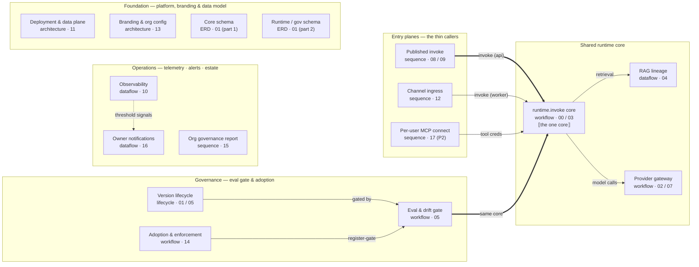

**How to read this map**

- Each box is a diagram file in this folder; open the matching .html. The sublabel gives its archify type + the backend doc(s) it draws from
- Arrows mean 'calls / drills into': the entry planes all funnel into the SAME runtime.invoke core — the load-bearing idea
- Operations (telemetry, notifications, estate reporting) is cross-cutting — it observes the whole system, not just the one edge drawn

**Suggested reading order**

- 1) Deployment & data plane → 2) runtime.invoke core → 3) Provider gateway (cost + resilience)
- 4) Eval & drift gate + Version lifecycle (the publish guarantee) → 5) Published / Channel / MCP entry planes → 6) RAG lineage
- Then governance+ops: Adoption, Org-governance report, Observability, Owner notifications; the two ERDs are the data model underneath

**Coverage — now complete**

- Every backend doc has a diagram: 00–05, 07, 08, 09, 10, 11, 12, 13, 14, 15, 16, 17 (+ data model 01 as the 2 ERDs)
- 06 guardrails is shown inline in the runtime core (no standalone diagram); 13 branding → branding-org-config
- Per-user MCP (17) is PROPOSED/P2+; everything else reflects the locked design

**Source**

- Index of docs/diagrams/backend-design/ — regenerate any node with: archify finalize <type> <json> <html> --quality <profile> (fresh --out-dir per rerun)
- Backing docs: docs/backend/00–17 · design-intent chain: docs/scope.md → spec.md → backend/

---

# Foundation

## Backend Deployment & Data Plane

*Deployable units, the state they own, and the two isolation boundaries — designed services/ tree (not yet built)*

`architecture` · source: `backend-deployment-plane.json` / `backend-deployment-plane.html`

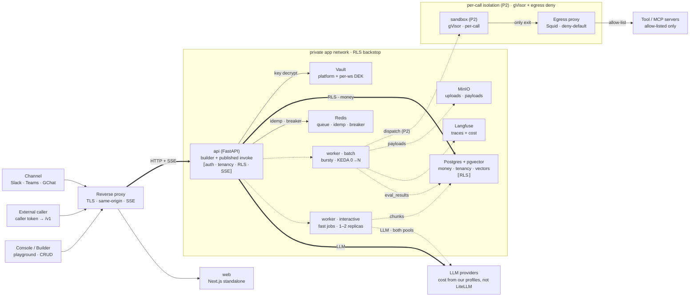

**Deployable units**

- api (FastAPI) serves BOTH builder /api/v1 (session) and published /v1 invoke (caller token) — split into two Deployments later only for blast-radius
- worker splits into interactive + batch (KEDA 0→N) by latency/scaling, NOT by job — both pools run eval + ingestion; the split just keeps a 120-case eval from starving a user's upload
- web + api sit behind one same-origin reverse proxy (kills CORS; the hard part is SSE buffering OFF)

**Who owns state**

- Postgres+pgvector is the single source of truth for money, tenancy AND vectors — RLS is the layer-2 backstop; api writes runs/cost, workers write chunks + eval_results, all under the workspace guard
- Redis = queue + idempotency store + circuit-breaker + rate-limit window; Vault decrypts creds just-in-time (memory-only) — provider keys use a platform-custodied pool (platform-scope DEK), tool/connector/channel creds use a per-workspace DEK
- Both api AND worker call providers through the same runtime (api for invoke, worker for eval runs + ingestion embeddings); Langfuse = traces/cost; MinIO = uploads + large payloads

**Isolation boundaries**

- Private app network: nothing reaches api/worker/stores except through the proxy; PgBouncer MUST be transaction-pool mode or SET LOCAL leaks tenancy across callers
- Sandbox (P2): per-call gVisor, reached only via api/worker dispatch, whose ONLY path out is the deny-by-default egress proxy — the anti-SSRF/exfil control
- Provider calls go direct (NOT via the egress proxy); routing them through provider-egress is an unbuilt precondition for real key-custody enforcement (09 §9.1)

**Source**

- docs/backend/11-deployment.md §1/§4/§7/§9 (topology: API+WRK→providers, pools, SSE) · 09-security-tenancy.md §9.1 (DEK split, egress) · 12-channels.md (channel = 4th caller, worker-run)
- Companion: runtime-invoke-pipeline.html — what runs inside api + worker

---

# Shared runtime core

## runtime.invoke() — the one shared core

*What playground, published invoke and every eval case all run — not a linear pipe*

`workflow` · source: `runtime-invoke-pipeline.json` / `runtime-invoke-pipeline.html`

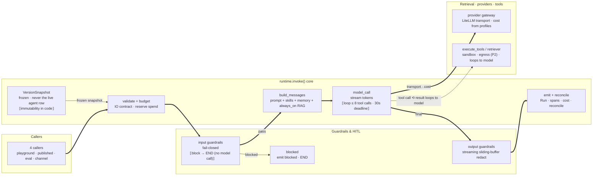

**The one core**

- Playground, published invoke, every eval case AND channel messages call this SAME runtime.invoke(snapshot, inputs, ctx)
- A sub-agent tool call is a 5th, recursive caller (run_source=subagent, P2 · depth/fan-out capped); published + playground run in api, eval + channel run in the worker
- If they diverged, a drift report would score code the endpoint never runs — runtime/ is a pure library (no FastAPI/HTTP types), imported by api + worker

**Why a frozen snapshot**

- invoke() reads an immutable VersionSnapshot, never the live agents row — editing an agent changes nothing live
- Re-pointing a published version is eval-gated: can't publish a version whose behavior drifted since its last PASS (409)
- snapshot_hash folds in prompt+params+retrieval_config+kb_index+skills — a stale hash would serve a PASS and bypass the gate

**Not a linear pipe**

- Guardrails run TWICE: input before any model call, output after the final token
- Retrieval is conditional — pre-model when always_on, else a retriever-as-tool chosen inside the loop
- model ⇄ execute_tools is a bounded agentic loop; MAX_TOOL_CALLS (8) caps cost, ctx.deadline_s (30s) caps latency; the approval gate parks the run via LangGraph interrupt() + Postgres checkpointer (survives restarts)

**Source**

- docs/backend/00-overview.md §1/§4 · 03-runtime.md §2/§4 (graph nodes) · 02 (gateway/cost) · 05 (eval gate) · 06 (guardrails)
- Companion: backend-deployment-plane.html (where api/worker/sandbox run)

## Provider Gateway — one IR, our cost, resilient transport

*The other half of the defensible core (02): normalize → adapt → retry/fallback → cost from OUR profiles, never LiteLLM*

`workflow` · source: `provider-gateway.json` / `provider-gateway.html`

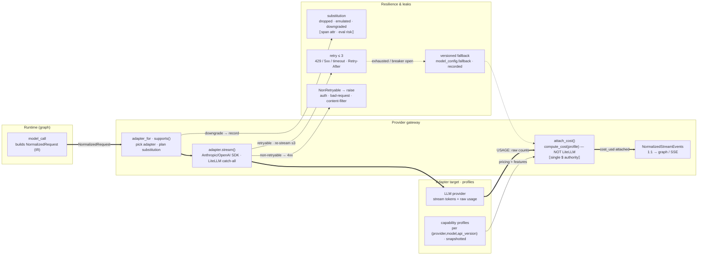

**The contract**

- One NormalizedRequest / StreamEvent / Usage IR — nothing above the gateway imports a provider SDK type
- Events re-encode 1:1 to the graph and SSE; the graph is model-agnostic at the stream level
- LangGraph owns the loop; the gateway owns transport, cost, normalization — never the other way round

**Cost is ours, not the vendor's**

- attach_cost = compute_cost(profile, usage) from our versioned capability profiles — LiteLLM's cost field is never trusted
- Single authority for runs.cost_usd, spans.cost_usd, eval cost deltas, COGS dashboards
- The resolved profile is snapshotted into agent_versions.profile_snapshot, so a price/feature change is a drift trigger, not a silent shift
- Prices cached_input / cache_write / reasoning tokens at their own rates; batch=True (eval/ingest) applies the batch multiplier

**Resilience**

- retry ≤ 3 on 429 / 5xx / timeout only, backoff + jitter, respects Retry-After
- circuit breaker per (provider,model), state in Redis shared across api + worker
- on breaker-open or exhausted → the version's pinned fallback model (recorded like a substitution)
- idempotency dedupe on idempotency_key so a retry can't double-bill

**Substitution — the leak made visible**

- supports() returns the downgrades a provider needs (dropped / emulated_via_prompt / downgraded) instead of silently dropping
- Each is emitted as a span attribute and attached to the Run
- At eval time a substitution counts against the verdict; on a published run it is a warning
- Opting into a provider-specific feature then switching provider → non-portable version → forced re-eval

**Source**

- docs/backend/02-provider-gateway.md §IR/§adapter/§profiles/§cost/§invoke-path · 07-cost-cogs.md · 01 (profile_snapshot)
- services/runtime/providers/{ir,gateway,cost,adapters,profiles}.py — companion: runtime-invoke-pipeline.html

## RAG — Ingestion & Retrieval Lineage

*Async worker writes pgvector chunks; invoke-time retrieval reads them under a frozen, access-checked binding (doc 04)*

`dataflow` · source: `rag-ingestion-retrieval.json` / `rag-ingestion-retrieval.html`

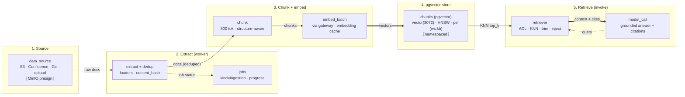

**Ingestion pipeline (async worker)**

- load_source → extract (LangChain loaders) → dedup on documents.content_hash (unchanged → skip)
- chunk (800 tok, overlap 120, structure-aware) → embed_batch via the gateway (embedding cache: sha256(text+model)→vector)
- write chunks with pgvector embeddings → bump knowledge_bases.index_version → job done
- Tracked by a generic jobs row (kind=ingestion) the UI polls — there is no ingestion_jobs table

**Retrieval at invoke**

- Reads the frozen retrieval_binding: pinned KB + kb_index_version + retrieval_config (top_k, threshold, injection)
- ACL: non-eval callers must can_use the KB; eval honors the snapshot but bypasses the per-caller ACL (policy_denied → [])
- pgvector KNN is namespaced per (workspace_id, kb_id), threshold + metadata filters, then trimmed to max_ctx_tokens
- Injection: always-on stuffing OR retriever-as-tool (model issues the query, 0..n times)

**Reproducibility & drift**

- embedding_model + kb_index_version are pinned into the version snapshot (RAG is reproducible)
- Re-ingesting a bound KB after publish → stale-index warning + drift trigger; the live version keeps its pinned index until an eval-gated re-point
- Changing the embedding model = re-ingest + new version + re-eval
- snapshot_hash MUST fold retrieval_config + kb_index_version, or a re-ingest bypasses the eval cache/gate

**Source**

- docs/backend/04-rag.md §ingestion/§chunking/§embedding/§retrieval/§reproducibility
- tables: knowledge_bases · data_sources · documents · chunks · retrieval_bindings (schema-core-authoring)

---

# Governance — eval gate

## Agent Version Lifecycle — the publishable pivot

*version_status draft→evaluated→published→deprecated, gated by the publishable flag (05 / 01)*

`lifecycle` · source: `version-lifecycle.json` / `version-lifecycle.html`

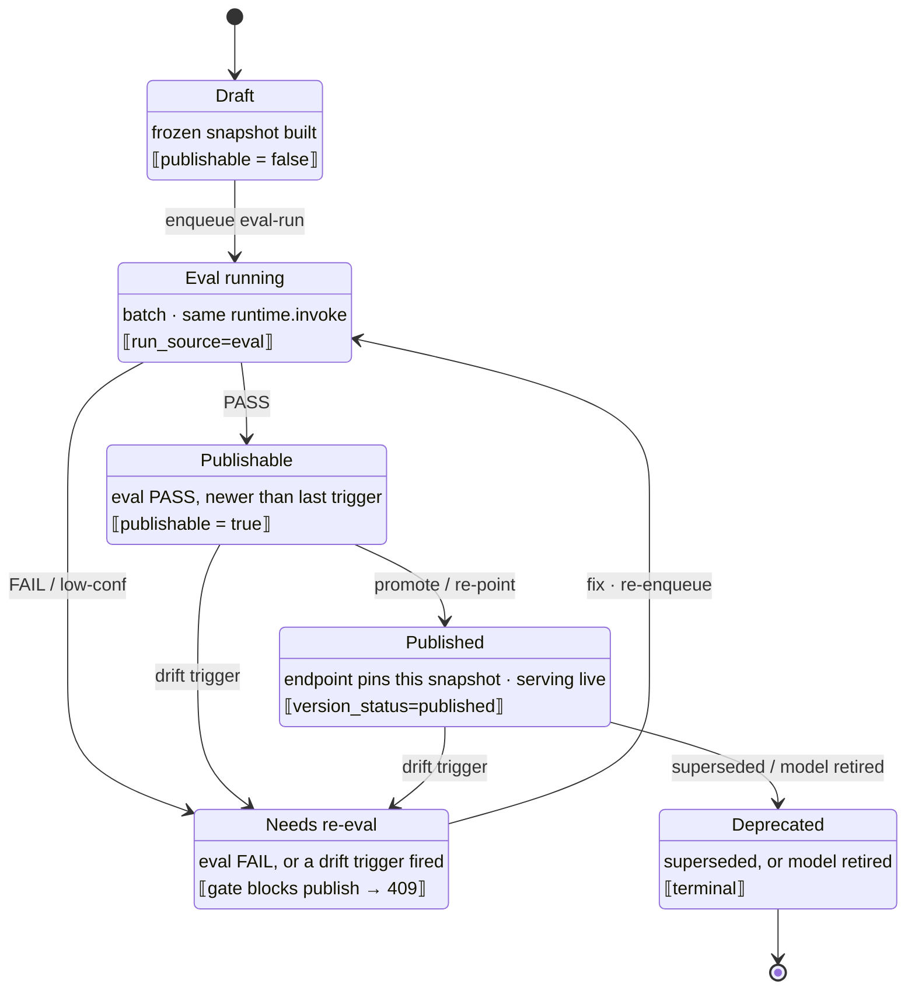

**publishable is the real control**

- version_status moves draft → evaluated → published → deprecated, but the pivot is the boolean publishable flag on the frozen version
- publishable is set TRUE only by a PASS eval that is NEWER than the last drift trigger; any trigger clears it back to false
- So a version isn't a mutable object — each edit mints a NEW draft version; the old one keeps serving until re-point

**The gate (enforced at publish AND re-point)**

- assert_publishable() rejects publishing/re-pointing a version whose behavior changed since its last PASS → 409 publish.eval_gate
- The live published snapshot is immutable and keeps serving during re-eval — editing an agent changes nothing live
- snapshot_hash must fold prompt+params+retrieval_config+kb_index+skills, or a stale PASS would bypass the gate

**Drift triggers (any → Needs re-eval)**

- model · provider · params · prompt · guardrails · tools · skills · embedding · kb · retrieval_config · capability_substitution
- Re-ingesting a BOUND knowledge base raises a stale-index warning + drift trigger even with no config edit
- A drift on a PUBLISHED version flips drift_state (watch/regressed) and notifies the owner (16) — it does NOT unpublish the live snapshot

**Source**

- docs/backend/01-data-model.md (version_status, publishable, drift_state enums) · 05-eval-drift.md §5 (gate, 409, DRIFT_TRIGGERS) · §6 (snapshot_hash) · 16 (owner notify)
- Companion: eval-drift-gate.html (the eval process) · runtime-invoke-pipeline.html (the frozen snapshot it reads)

## Eval & Drift Gate — the publish guard

*Why editing an agent changes nothing live until an eval-gated re-point*

`workflow` · source: `eval-drift-gate.json` / `eval-drift-gate.html`

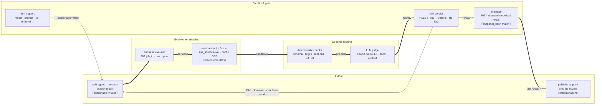

**The guarantee**

- You cannot publish — or re-point a published agent to — a version whose behavior changed since its last PASS eval (409, enforced in code)
- So editing an agent changes NOTHING live until a fresh eval passes and you re-point; the endpoint keeps serving the old frozen snapshot
- snapshot_hash folds prompt + params + retrieval_config + kb_index + skills — a stale hash would serve a PASS and silently bypass the gate

**Two-layer scoring**

- Deterministic checks are the cheap backbone: schema / regex / tool-call / refusal — no model, run first as a pre-filter
- The LLM judge is the primary COGS risk, so it is FIXED + versioned (claude-haiku-4-5, judge-v1): a drifting judge would corrupt every verdict
- Judge cost is controlled with a verdict cache + Batch; verdict is computed vs a frozen baseline (PASS / FAIL / low-confidence)

**Drift triggers (any → re-eval)**

- model · provider · params · prompt · guardrails · tools · skills · embedding · kb · retrieval_config · capability_substitution all flip publishable=false
- Re-ingesting a BOUND knowledge base raises a stale-index warning + drift trigger — the index moved under a passing version
- The eval worker runs each case through the SAME runtime.invoke (run_source=eval, cache OFF) as playground/published — else the verdict scores code prod never runs

**Source**

- docs/backend/05-eval-drift.md §2 (fixed judge) · §5 (gate, 409, DRIFT_TRIGGERS) · §6 (snapshot_hash) · §7 (job flow) · 00-overview §6 (judge model)
- Companion: runtime-invoke-pipeline.html (the shared core) · backend-deployment-plane.html (where the batch worker runs)

## Adoption & Enforcement — register → dedup → gate

*Force every new/imported agent through one funnel; reuse-first; the key-custody spine makes it enforceable (doc 14)*

`workflow` · source: `adoption-enforcement.json` / `adoption-enforcement.html`

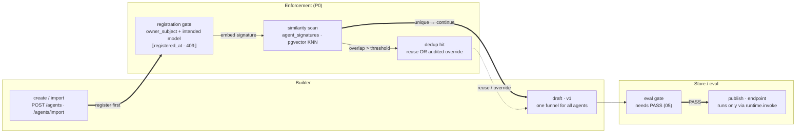

**Create-time registration gate**

- An agent MUST be registered before any version is built or published → 409 registration.gate otherwise
- Captures owner_subject (routable OIDC sub — the notification recipient) + intended model validated vs a capability profile
- Implemented as an additive agents.registered_at column (NULL = unregistered), NOT a new agent_status
- agent.register is audited; builder+ may register

**Reuse-first dedup**

- Embed {name, description, system_prompt, io_contract} with a pinned model → agent_signatures (pgvector vector(1024))
- Workspace-namespaced cosine KNN; hits above SIG_OVERLAP_THRESHOLD surface to the builder
- Resolution: reuse an existing agent OR an audited dedup.override; signature recomputed per new version
- Console / registration-time only — token & channel callers never hit the scanner

**Import & one funnel**

- POST /agents/import imports ONE agent; a thin batch driver loops it to migrate the ~40 hand-wired agents; profile must exist or 400 input.invalid
- An imported agent is NOT special: import → gate → scan → eval → publish, landing a draft + first version
- MCP servers & skills are the inverse — OPEN registration (any builder+), governed after-the-fact: MCP by access_policy + egress + audit, skills by access_policy + signing + audit (no egress — skills don't execute code)

**The key-custody spine (what makes it real)**

- Governance is only real if an agent CANNOT reach a model except via runtime.invoke
- The platform becomes the SOLE holder of provider credentials (platform-scope pool) — BYO workspace keys superseded
- Honest prereq: full enforcement needs cloud-model-IAM centralization + network egress control; without both it degrades to 'visibility + mandate'
- Per-tenant cost attribution survives (computed from our profiles per Run)

**Source**

- docs/backend/14-adoption-enforcement.md §1 key-custody /§2 register /§3 dedup /§4 import /§5 MCP /§6 skills
- tables: agents.registered_at · owner_subject · agent_signatures (schema-runtime-governance)

---

# Entry planes

## Published Invoke — the production request lifecycle

*POST /v1/agents/:id/invoke: token auth → tenant pin (RLS) → spend + Vault key → runtime.invoke → Run record*

`sequence` · source: `published-invoke-lifecycle.json` / `published-invoke-lifecycle.html`

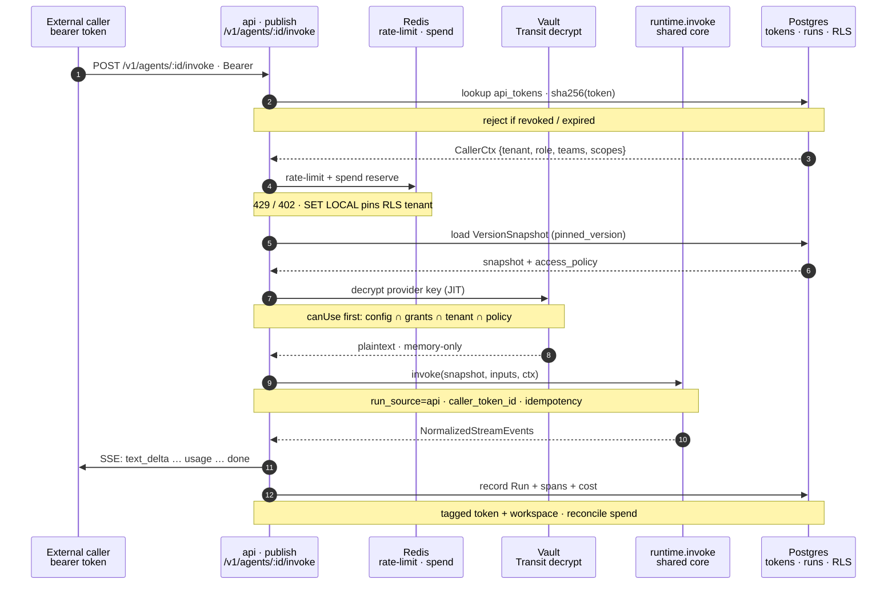

**Caller-token auth**

- Strip 'Bearer ', sha256 the secret → lookup api_tokens.token_hash (only the hash is ever stored)
- Reject on revoked_at or expires_at; per-token rate-limit via a Redis sliding window
- CallerCtx carries {workspace_id, token_id, role, teams, scopes} — the FE runtime-access decode, now server-authoritative

**Admit & isolate**

- SET LOCAL app.workspace_id pins the tenant for the request — PgBouncer MUST be transaction-pool mode or it leaks across callers
- BudgetGuard reserves spend up-front, reconciles against actual after the run (402 if over cap)
- [P2] concurrency slot; idempotency_key dedupe so a retried call can't double-run or double-bill

**Effective access (fail-closed)**

- canUse runs BEFORE any provider call: access = agent config ∩ caller grants ∩ tenant ∩ resource policy
- A token/channel caller carries no owner subject → private resources deny for everyone but an admin token
- Denied tools / KBs / skills are dropped from the run, not errored

**Same core, fully recorded**

- runtime.invoke(run_source=api) is the SAME code playground + eval run — the drift guarantee holds in prod
- Provider key is Vault-decrypted just-in-time into memory and discarded after the call
- The Run is tagged caller_token_id + workspace_id so cost attributes to the endpoint; events re-encode 1:1 to SSE

**Source**

- docs/backend/00-overview §5B · 09-security-tenancy (tokens, Vault, RLS, access) · 08-api-surface (invoke) · 02 (gateway)
- services/api/publish/endpoint.py · services/runtime/invoke.py · tables api_tokens · published_endpoints · runs

## Channel Ingress — the 4th thin caller

*POST /channels/{platform}/events: verify signature → federate to Okta → ack-fast → worker runtime.invoke → reply (doc 12)*

`sequence` · source: `channel-ingress.json` / `channel-ingress.html`

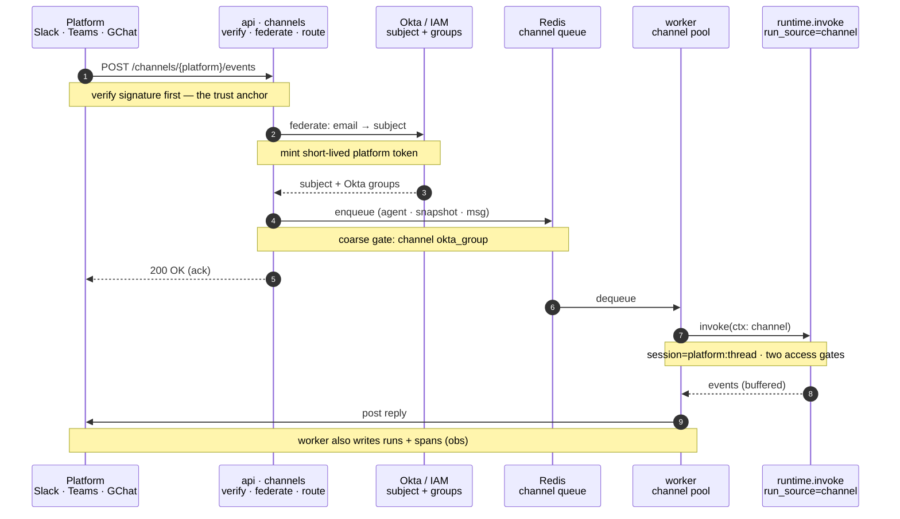

**Trust anchor = the signature**

- Signature verification is the SOLE proof of identity — trust the platform's assertion, never a user-presented token
- Slack: HMAC over raw body + timestamp (replay window) · Teams: Bot Framework JWT · GChat: Google JWT (audience)
- Reject on any mismatch; rate-limit per channel

**Federated identity (membership-independent)**

- Verified platform email → okta.lookup_subject (email is the join key); unmapped → in-chat denial
- Mint a short-lived platform token: role = CHANNEL_INVOKE_ROLE (fixed baseline 'viewer'), teams = Okta groups
- Teams uses Entra OBO exchange; federated users need NO memberships row
- Channel is pinned to one workspace_id; RLS partitions everything

**Two access gates**

- Coarse: channel.okta_group must be in the user's groups — enforced BEFORE the token is minted
- Fine: agent.access_policy via can_use inside runtime — token carries no owner subject, so private agents fail closed
- Both gates must pass for the end user to reach the agent

**4th caller, ack-fast / process-async**

- A channel is the fourth thin caller of the SAME runtime.invoke — it adds ingress + federation + delivery, nothing inside
- Ingress verifies + enqueues and returns 200 within ~2–3s; the worker runs invoke(run_source=channel) out-of-band
- Reply is delivered by the worker (buffer SSE → one message in v1); runs + spans recorded like any call

**Source**

- docs/backend/12-channels.md §ingress/§verification/§identity/§invoke-mapping · 09 (federation, token) · 00 (one core)
- services/api/channels/{router,verify,normalize,federate,route,deliver}.py · tables channels · channel_agents

## Per-User MCP Access via In-Chat Connect  [PROPOSED]

*Channel user hits a per_user MCP (Jira/GitHub/Workday) → reply with a signed connect link → OAuth → persist → act as the user. Not in current docs.*

`sequence` · source: `mcp-per-user-connect.json` / `mcp-per-user-connect.html`

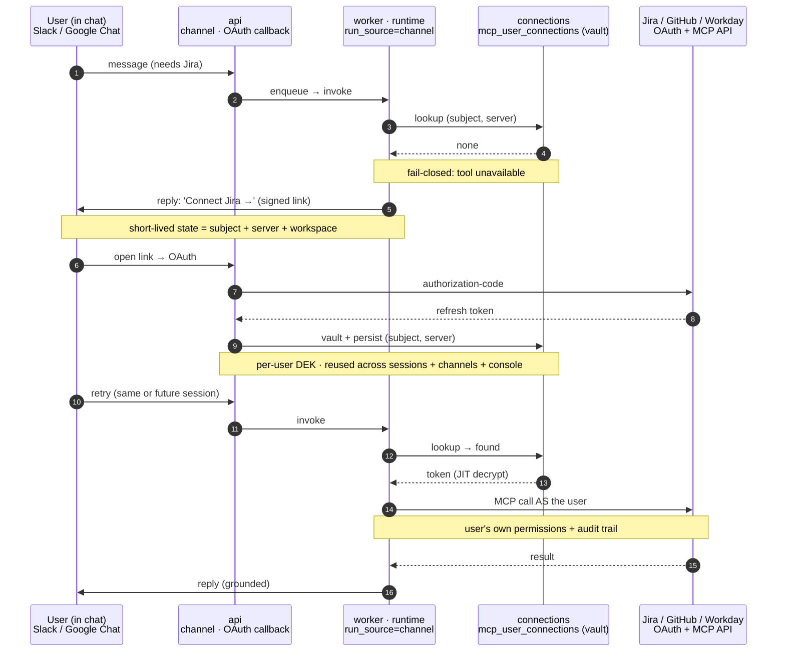

**The idea — in-chat connect = login in-session**

- A channel user hits a per_user MCP tool they haven't connected → the agent replies with a signed OAuth connect link
- They authorize in the browser (a normal web OAuth to api — out-of-band from chat), like logging in within that session
- The run fails closed until connected; v1 the user re-asks, v2 the paused run resumes (like the tool-approval interrupt)

**Persisted per user, reused everywhere**

- mcp_user_connections keyed (workspace_id, user_subject, mcp_server_id) — connect once, reused across future sessions, other channels AND the console
- The token is vaulted (per-user DEK), refreshed automatically, revoked on offboarding
- This is the 'user-specific MCP json' persisted so later sessions skip the connect step

**Signed link = the trust boundary**

- The connect link carries a short-lived signed state (subject + server + workspace) so the OAuth callback binds to the right identity (anti-CSRF / anti-mix-up)
- OAuth runs browser → api, never through the chat transport
- Shared_service mode stays the default for read-only / eval-safe tools; per_user is opt-in per MCP server

**Act as the user (least privilege)**

- The MCP call runs in the sandbox with the user's own token → their downstream permissions + a real audit trail in Jira/GitHub/Workday
- Egress allow-list still applies; the MCP server's declared scopes bound what the token can do
- Channel federation already carries the Okta subject — where the IdP supports it (Entra OBO), the connect step can be skipped via true token exchange

**Status: PROPOSED — delta vs current design**

- Not in docs/backend today: MCP creds are workspace-level + shared; access_policy only gates visibility
- Needs: mcp_servers.auth_mode ∈ {shared_service, per_user} · mcp_user_connections table · an OAuth connect/callback route
- Caveat: eval has no real user → per_user tools use a designated service connection or are excluded from scoring (not deterministically evaluable)

---

# Operations

## Observability — the per-call log & telemetry

*One span() helper in the shared runtime fans every call to three stores; two audiences read them (doc 10)*

`dataflow` · source: `observability-telemetry.json` / `observability-telemetry.html`

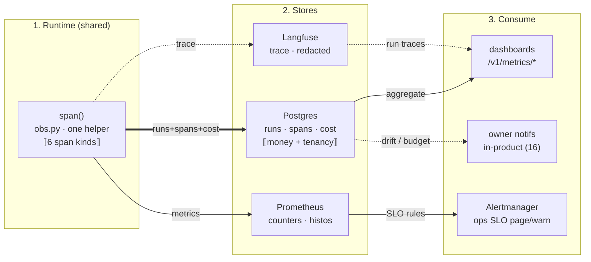

**The one rule**

- Every model call logs {model, prompt_version, input, output, latency, cost, success} — emitted from the shared runtime (obs.py), never from the three callers
- One span() context manager writes a spans row, mirrors a Langfuse generation, and increments Prometheus counters
- Span kinds: model · tool · retrieval · guardrail · judge · skill; finalize() rolls spans into one runs row

**Three stores, three jobs**

- Postgres (runs/spans): source of truth for money + tenancy; partitioned by month; cost from our profiles (02/07)
- Langfuse: full prompt/response I/O + nested traces, PII-redacted; the source of truth for 'what was said'
- Prometheus: numeric time-series labeled workspace/agent/source/model for SLOs + autoscaling

**Two audiences (don't conflate)**

- Ops alerts → Alertmanager/on-call: first-token p95<2s, e2e p99≤30s, provider errors, deadline-cut rate
- Owner notifications → in-product (doc 16): drift transitions, eval_failed, budget 80/90%, model_deprecated
- Spend appears on BOTH on purpose; both read the SAME runs.cost_usd figure the quota engine uses

**Source**

- docs/backend/10-observability-monitoring.md §per-call-log/§stores/§metrics/§SLOs/§cost · 07 (cost) · 16 (owner notifs)
- services/runtime/obs.py · tables runs · spans · trace_id → Langfuse

## Owner Notifications — triggers → fan-out → inbox

*Owner-facing in-product signals (distinct from ops alerts): deduped and addressed to the people who can act (doc 16)*

`dataflow` · source: `owner-notifications.json` / `owner-notifications.html`

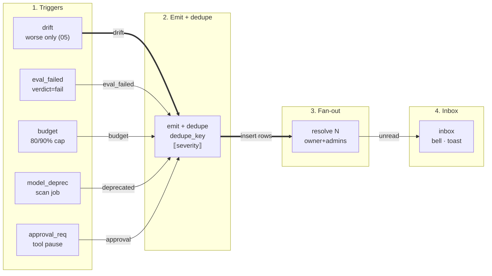

**Triggers (emit points)**

- drift — on a WORSE state transition only (none→watch, watch→regressed), not every eval
- eval_failed — on verdict=fail (critical, with reason + failing cases); budget_threshold — spend crosses 80% / 90% of cap
- model_deprecated — detector worker when a published version's pinned model goes deprecated/retired
- approval_requested — a tool_approval pause; recipients OVERRIDE to publishers + admins (not the owner)

**Dedupe**

- dedupe_key = hash(agent_id, kind, trigger)
- A partial-unique index on OPEN rows (read_at IS NULL) collapses repeat signals into one
- Marking read releases the key, so a recurrence can reopen it
- Severity (info/warning/critical) is independent of kind — the emitter sets it

**Recipients (fan-out)**

- Default: the agent owner (agents.owner_subject — hard dependency on doc 14 for a routable subject)
- + platform-admins + members of the workspace group whose member_role = publisher
- One event fans to N notification rows (one per recipient, same dedupe_key)
- Scoped by RLS (workspace) AND by recipient_subject = the signed-in principal

**Owner notifications ≠ ops alerts**

- Audience: owner + publishers/admins, vs on-call operators (Alertmanager, doc 10 §5)
- Channel: in-product bell + inbox (+ toast for critical), vs a page / Slack
- Store: notifications (Postgres), vs Prometheus — spend appears on both on purpose
- Delivery: GET /api/v1/notifications · POST /:id/read · POST /read-all

**Source**

- docs/backend/16-notifications.md §entity/§triggers/§dedupe/§recipients/§vs-ops
- table: notifications (schema-runtime-governance) · owner_subject from 14

## Org Governance — the platform-admin reporting plane

*A 4th plane above the tenant planes: one SECURITY DEFINER read across every workspace, audited, metadata-only for private (doc 15)*

`sequence` · source: `org-governance-reporting.json` / `org-governance-reporting.html`

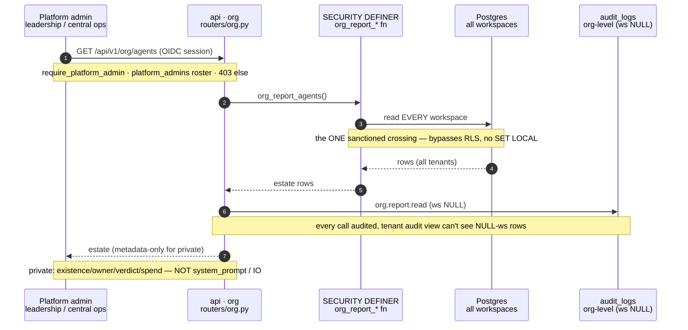

**A 4th plane, read-only**

- The three auth planes (console / token / channel) are all tenant-scoped to one workspace_id
- Org governance is deliberately NOT tenant-scoped — it sees across every workspace at once
- Modeled as a 4th plane above them: OIDC session + platform_admins roster → permission org.report.read
- Deployment-wide (one org per deploy), never mutates — governance, not publish/edit/invoke

**The one sanctioned crossing**

- A SECURITY DEFINER Postgres fn owned by the migration role — not constrained by the RLS policies that gate the app role
- EXECUTE-locked to a dedicated platform_report reader role, called only by the org router
- The tenant-isolation suite gets an explicit test: this is the ONLY path returning rows from >1 workspace
- read-only · STABLE · query-time aggregation (Redis-cached), nightly MV only if the estate outgrows a live scan

**Metadata, not content (honors private)**

- A platform admin is NOT a workspace admin and holds no owner subject, so the private tier is honored
- Report MAY show metadata: existence, owning workspace, owner, status, eval verdict, drift, 30d spend, policy tier, compliance flags
- It MUST NOT show content: system_prompt, snapshot internals, run I/O, traces, eval-case I/O
- Content on a private resource = separate, explicitly-audited org.report.content_read

**The three reports**

- GET /api/v1/org/agents — the estate (one row per agent, all workspaces)
- GET /api/v1/org/spend — rollup by workspace / agent / model (same runs.cost_usd figure)
- GET /api/v1/org/compliance — exceptions: unregistered · unevaluated · over_budget · no_owner (query-time, reads 14's registration fields)

**Source**

- docs/backend/15-org-governance-reporting.md §1 plane /§2 crossing+audit+metadata /§3 reports
- tables: platform_admins · audit_logs (workspace_id now nullable) · agents.registered_at/owner_subject (14)

---

# Platform & config

## Branding & White-labeling — org ≠ workspace

*Deploy-time org identity, resolved once above the auth/tenancy planes (doc 13)*

`architecture` · source: `branding-org-config.json` / `branding-org-config.html`

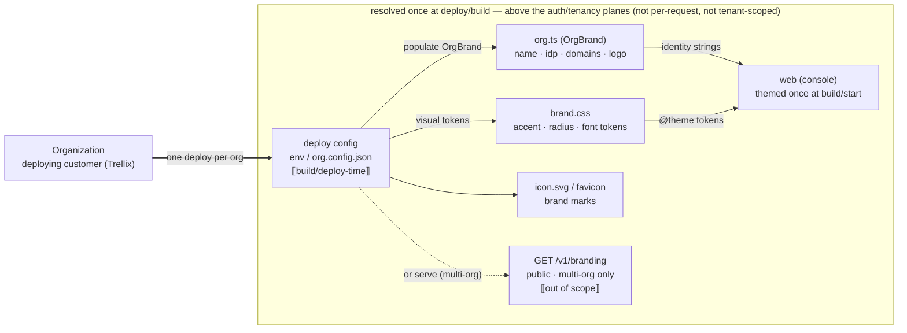

**Organization ≠ workspace**

- Organization = the deploying customer (Trellix); owns branding; ONE deployment per org; resolved once at build/deploy
- Workspace = a tenant within the org (trellix-xdr, …); owns agents/knowledge/members; resolved per request
- orgs is branding-only — it is NOT a tenant dimension (no org_id-scoped logic; see doc 15 §1)

**Where org config lives (FE)**

- src/lib/org.ts → the OrgBrand shape: orgName, productName, idpName, emailDomain, docsDomain, logo
- src/app/brand.css → visual tokens (accent for dark+light, --radius, --font-*) — one source of truth, merged by Tailwind @theme
- src/app/icon.svg + favicon.ico → the brand marks

**Backend shape (when services/ is built)**

- 1 (recommended, matches one-deploy-per-org): bake org config at build/deploy via env / org.config.json — no endpoint, no per-request cost
- 2 (only if you go multi-tenant): GET /v1/branding — a small cacheable public endpoint returning OrgBrand + token values; explicitly out of scope today
- Either way the OrgBrand shape is unchanged — same drop-in mock→backend pattern

**Not branding · caveat**

- Workspaces, members, roles, metrics stay backend-owned (09, 01); the trellix-* seeds are demo content (@backend remove)
- Status colors + the dataviz s2–s8 series are brand-neutral — never themed per org
- Caveat: the typeface can't be pure config — next/font needs a static import, so a font change edits layout.tsx
- Source: docs/backend/13-branding.md · frontend/src/lib/org.ts · frontend/src/app/brand.css

---

# Data model

## Core Schema — Authoring, Versioning, Knowledge, Skills, Evals

*Postgres+pgvector (docs/backend/01). Every tenant row carries workspace_id (RLS). Part 1 of 2.*

`erd` · source: `schema-core-authoring.json` / `schema-core-authoring.html`

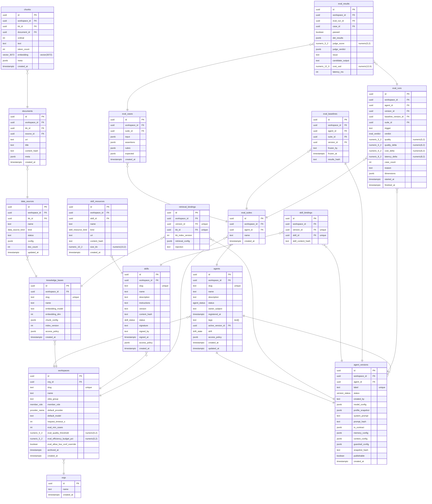

**The immutability core (why agent_versions is huge)**

- agent_versions is the frozen VersionSnapshot the runtime reads — invoke() never touches a live agents row
- snapshot_hash folds model_config + prompt_hash + retrieval_config + kb_index_version + skill_content_hash; a stale hash would bypass the eval cache/gate
- publishable is set TRUE only by a PASS eval; any DRIFT_TRIGGER edit flips it FALSE (spec B5)
- profile_snapshot freezes the capability profile so a pricing/feature change can't silently alter a published agent

**Frontend features → tables**

- agents/new + agents/[id] hub ↔ agents · agent_versions (data.ts Agent, Version)
- knowledge/* ↔ knowledge_bases · data_sources · documents · chunks (pgvector) · retrieval_bindings (DataSource, KnowledgeBase)
- skills/* ↔ skills · skill_resources · skill_bindings (Skill, SkillResource; signed at publish)
- evaluations + agents/[id] Evals tab ↔ eval_suites · eval_cases · eval_baselines · eval_runs · eval_results (EvalRun, EvalSuite, EvalCaseDef)

**Modeling rules**

- Every table carries workspace_id uuid not null (the RLS tenancy key): the four domain-root tables (agents, knowledge_bases, skills, eval_suites) draw the → workspaces line; child tables show it as an fk badge to cut noise
- Money is numeric(12,6) USD; tokens are integer; timestamps are timestamptz (UTC)
- chunks.embedding is vector(3072), HNSW-indexed via halfvec cast, namespaced per (workspace_id, kb_id)
- *_bindings and eval_* are version-scoped snapshots — they pin agent_versions.id, not the live agent

**Source & scope**

- docs/backend/01-data-model.md §4 (DDL) · §6 (RLS) · spec.md A0/B2/B5 (completeness, version pinning, eval triggers)
- Part 1 of 2 — tools/MCP, publish/runs/observability, jobs/audit/quotas, adoption & notifications follow in Part 2
- Cross-part FKs (tool_bindings, published_endpoints, runs, eval_baselines→version) all re-anchor on agent_versions

## Runtime & Governance Schema — Tools/MCP, Publish, Runs, Ops, Adoption

*Postgres+pgvector (docs/backend/01). Part 2 of 2 — anchors re-shown from Part 1. Includes PROPOSED mcp_user_connections / auth_mode (doc 17).*

`erd` · source: `schema-runtime-governance.json` / `schema-runtime-governance.html`

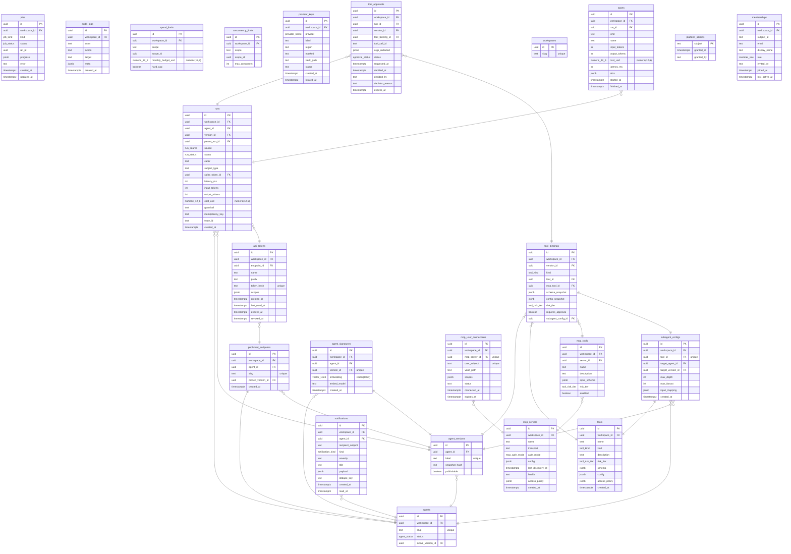

**Runtime record & cost**

- Every invoke writes one runs row (partitioned by month) + N spans (model / tool / retrieval / guardrail / judge)
- runs.cost_usd & spans.cost_usd are numeric(12,6), computed from our capability profiles — the same figure dashboards and quotas read
- runs.idempotency_key is partial-unique per workspace so a retried published call can't double-bill
- parent_run_id builds the sub-agent run tree; caller_token_id attributes cost to an endpoint

**Frontend features → tables**

- tools page ↔ tools · mcp_servers · mcp_tools · subagent_configs (RepoTool, McpServer)
- approvals page ↔ tool_approvals (ToolApproval); agents/[id] version bindings ↔ tool_bindings
- runs page ↔ runs · spans (Run); settings ↔ provider_keys · spend_limits · api_tokens
- published tokens/export ↔ published_endpoints · api_tokens; notifications bell ↔ notifications

**Governance & isolation**

- tool_bindings freeze schema_snapshot + config_snapshot per version — changing a server's tools can't alter a published agent (drift trigger)
- tool_approvals gate high-risk tool calls: run parks via interrupt, publisher+ decides, 409 tool.approval.denied on deny
- provider_keys hold only {masked, vault_path} — platform-custodied pool; the secret never lands in Postgres
- agent_signatures (pgvector vector(1024)) powers registration-time dedup / reuse-first

**Source & scope**

- docs/backend/01-data-model.md §4 (DDL) · 09 (tokens, Vault, audit) · 10 (runs/spans) · 14 (adoption) · 16 (notifications)
- Part 2 of 2 — anchors agents/agent_versions shown compact; full columns in Part 1 (schema-core-authoring)
- memberships is a read-only roster projected from the workspace Okta group (not the system of record)
