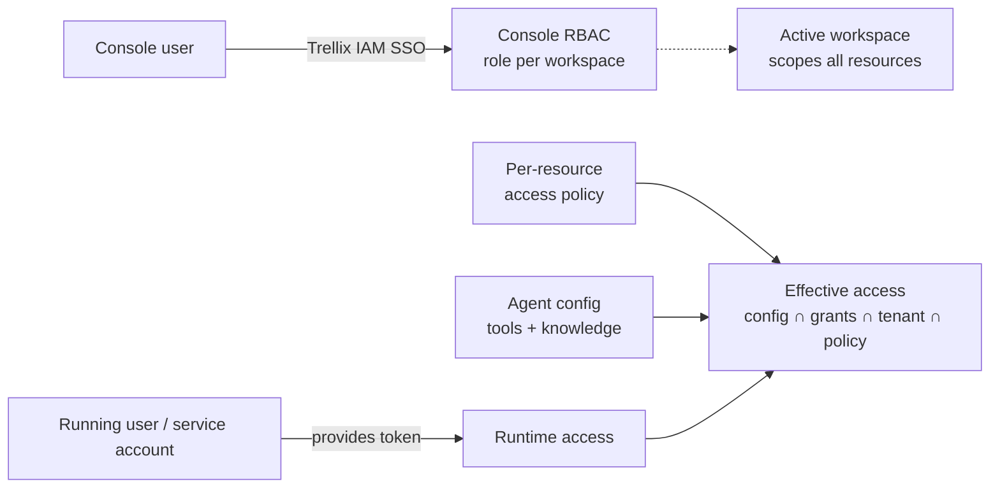
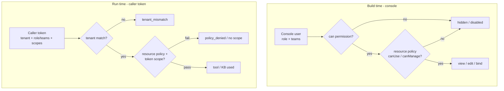

# Frontend auth & access model (Trellix IAM)

> Companion to `docs/spec.md`, `docs/scope.md`, `docs/backend-integration-plan.md`. Frontend-scoped;
> mock IAM now, shaped to swap to real Trellix IAM (OIDC) with no UI changes.

## Context

Agent Catalyst is registered in **Trellix IAM** as a separate product; the console's authentication and
authorization come from IAM. There are **two distinct access contexts**:

1. **Console access (build time)** - who can use the app and what they can do (create, edit, publish,
   manage keys/members). Driven by the signed-in user's **IAM role (per workspace)**. Gates the UI.
2. **Runtime access (agent execution)** - which tools / knowledge / MCP an agent can use at run time is
   governed by the **token the running user provides**, not the builder's.

**Key principle:** build-time visibility is not run-time access.
`effective access = agent config ∩ caller grants ∩ caller tenant ∩ resource access policy`.

**Boundary with IAM:** role *definitions*, user↔role *assignment*, and *team/group membership* live in
**Trellix IAM** (managed there, read here). What admins configure **in this app** is the **per-resource
access policy** - which roles/teams may use or manage each agent, KB, tool, and MCP server.

**Caller token vs provider key (do not conflate):** the caller token governs **tools/knowledge/MCP**
access; the **LLM provider key stays the workspace's vaulted key** (server-side), never the caller's.

Everything is **tenant-scoped**: IAM carries each user's workspace memberships and a role **per
workspace** (Admin in one workspace, Viewer in another is possible).

### Access contexts

### Enforcement: build time vs run time

Decisions locked: **Playground = run-as-me + optional run-token preview** · **mock IAM + dev role
switcher** · **per-resource policies in-app, assignment stays in IAM** · **policy granularity = roles +
IAM teams**. No backend in scope.

> **As-built notes (shipped `b26cd89` → `640453f`):** this doc was the plan; a few details shipped
> differently —
> - **No `src/lib/tenancy.ts`.** Tenancy consolidated into **`iam.ts`** (the mock IAM directory:
>   `WORKSPACES`, `TEAMS`, `MOCK_PROFILE`), **`auth.tsx`** (`useAuth`/`useWorkspace`/`usePrincipal`),
>   and the **`store.ts`** `activeWorkspaceId`.
> - **Active workspace is in-memory** in the store (defaults to `trellix-xdr`), not localStorage;
>   persistence is deferred to the backend session (`@backend` marker in `store.ts`).
> - **Four workspaces** now ship: `trellix-xdr`, `trellix-grc`, `trellix-labs`, and
>   **`trellix-people`** (Trellix People Ops, the non-security persona — see
>   `people-ops-workspace-plan.md`); `TEAMS` gained **"People"**.
> - **Standalone `/playground` route** (not only the agent-detail tab) carries the same run-context
>   model (my-session vs provided token) described in Part C.

---

## Part A0 - Tenancy & workspaces (foundational)
- `src/lib/iam.ts` + `auth.tsx` (mock) - workspaces + the user's **role per workspace** + **teams**,
  seeded from a mock IAM profile; active workspace held in the store (in-memory). `useWorkspace()` → `{
  workspace, workspaces, role, teams, setWorkspace }`; the active role feeds the permission layer.
  *(Planned as `tenancy.ts`; shipped consolidated — see As-built notes above.)*
- Wire the existing sidebar workspace switcher to `useWorkspace()`.
- Scope resources by workspace: `workspaceId` on every resource; **all** store reads filtered by the
  active workspace (lists, agent detail, dashboard, runs, evals); **creates stamp** the active
  `workspaceId`. Tenant banner shows the active workspace.
- Edge states: no product access → "No access" screen; no active workspace → workspace picker.

## Part A - Identity + permissions (mock now, IAM-ready)
- `src/lib/permissions.ts` - roles `viewer|builder|publisher|admin`; permissions `view, playground.use,
  agent.create, agent.edit, eval.run, knowledge.manage, tool.manage, mcp.manage, agent.publish,
  agent.delete, key.manage, member.manage, access.manage`; role→permission map (viewer → view+playground;
  builder → +create/edit/eval/knowledge/tool/mcp; publisher → +publish; admin → all).
- `src/lib/auth.tsx` - `AuthProvider` + `useAuth()` → `{ user, role, permissions, can(p) }`. Role comes
  from the active workspace; a **dev role switcher** overrides it for preview. Same surface real IAM OIDC
  will expose later.

## Part B - Gate the console UI
- `src/components/gate.tsx` - `<Gate permission>` + `can()`-driven disabled-with-tooltip buttons.
- Applied across topbar/agents/knowledge/tools/settings/evaluations per the permission map; viewers are
  read-only, builders can build but not publish, etc.

## Part B2 - Admin-configurable per-resource access policies
- `src/lib/access-policy.ts` - each agent/KB/tool/MCP has `accessPolicy: { visibility:
  "workspace"|"restricted", useRoles[], useTeams[], manageRoles[], manageTeams[] }`; helpers
  `canUse(resource, principal)` / `canManage(resource, principal)` where principal = `{ role, teams }`.
- `src/components/access-policy-editor.tsx` - visibility + role + **IAM team** multiselects for Use and
  Manage; shown only to `access.manage`.
- Config surfaces: **Access tab** on agent detail; access editor on KB/tool/MCP; **Roles & access** view
  in Settings.
- Enforcement: build time (restricted resources hidden/locked); run time (policy is a term in the
  effective-access formula; `policy_denied` when the caller fails the agent's policy).

## Part C - Runtime token + effective access
- `src/lib/runtime-access.ts` (mock) - `resolveRun(ctx, agent)` → `{ tenant, subjectType, role, teams[],
  scopes[], grantedTools[], grantedKbs[], status: "ok"|"expired"|"revoked"|"tenant_mismatch"|
  "policy_denied" }`. Intersects token scopes AND resource policy.
- **Playground run context:** Run as `My session` (default) or `Provide token` (decoded chip: tenant,
  subject type, scopes, expiry). Bound tools/KBs annotated granted vs denied (scope or policy reason);
  whole-run blocked for cross-tenant / policy_denied / expired / revoked.
- **Publish & Export:** snippet token labeled the caller's (service-account) Trellix IAM token; access
  note that run-time access is scoped to that token + tenant, not the publisher.

## Part D - Surface the model + Settings
- `src/components/access-note.tsx` - build-vs-run access callout reused in Configure/Playground/Publish.
- Settings: Authentication note (IAM-managed sign-in/roles); Members IAM-sourced/read-mostly + "manage
  in IAM"; provider-keys vaulted note; **Roles & access** matrix.
- Runs: show caller **subject + tenant** attribution.

## Part E - Real IAM wiring (later, not in scope)
- Auth.js + Trellix IAM OIDC provider (product client id + scopes); server login/callback/refresh;
  middleware protects `(app)/*`; roles from IAM claims. `useAuth()`/`can()` surface unchanged, so
  Parts A0-D (incl. B2) do not change when real IAM lands - only the identity source does.

---

## Journeys (per user & tenant)
- **Viewer:** read-only everywhere; create/edit/publish/manage hidden or disabled; read-only banner.
- **Builder:** build + manage knowledge/tools/MCP + eval + playground; Publish gated.
- **Publisher:** + publish/unpublish + endpoint tokens.
- **Admin:** + keys, members (view/IAM deep-link), delete, and **configures per-resource access policies**.
- **Restricted resource:** agent limited to team "SOC" is hidden/locked for a non-SOC builder and
  `policy_denied` for a caller token lacking SOC, even with the tool scopes.
- **Cross-tenant user:** switching workspace re-derives role + visible resources.
- **Runtime caller (service account / external app):** never logs in; access = token scopes ∩ config ∩
  tenant ∩ policy; previewed in the playground via "Provide token".

## Files
- **New:** `src/lib/{iam,permissions,auth,runtime-access,access-policy}.ts(x)` (tenancy folded into
  `iam.ts` + `auth.tsx`, no separate `tenancy.ts`),
  `src/components/{gate,access-note,no-access,access-policy-editor}.tsx`.
- **Edit:** `(app)/layout.tsx` (providers + no-access), `app-shell.tsx` (workspace switcher + tenant
  banner + user menu + role switcher + gate New agent), `agents/page.tsx` + `agents/[id]/page.tsx`
  (scope + gating + Access tab + Playground run context + export note), `knowledge/*`, `tools/page.tsx`,
  `settings/page.tsx`, `evaluations/page.tsx`, `dashboard/page.tsx`, `runs/page.tsx`; `data.ts`
  (`workspaceId` + `accessPolicy` on seed types), `store.ts` (active workspace, scoped hooks,
  `setAccessPolicy`).

## Verification
- `npm run build` green; em/en-dash scan clean.
- Walkthrough: role switch gates actions; workspace switch re-scopes + re-roles; playground token states
  (granted/denied/cross-tenant/expired/policy_denied); admin sets a restricted policy and a non-member
  loses access; no-access/no-workspace screens.

## Open decisions (recommended first)
1. Viewer may use the playground read-only *(recommended)* vs builders+ only.
2. Members read-only "manage in IAM" *(recommended)* vs in-app invite mock.
3. Sign out = reset role + toast *(recommended)* vs full stub login screen.
