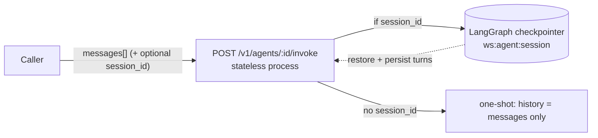

# Session & memory — status (designed, not implemented)

> Status page for one question: **when a user calls a configured/published agent, is the session
> context + memory maintained?** Short answer: **it is designed, but not implemented.** This doc records
> what the design intends, what actually exists today, the one open design question, and the checklist to
> pick it up later. Companion to `docs/backend/03-runtime.md §6`, `docs/backend/08-api-surface.md`, and
> `docs/backend-integration-map.md`.

## TL;DR

| | State |
|---|---|
| **Designed** | ✅ Hybrid: stateless invoke + optional server-side session memory via a LangGraph checkpointer. |
| **Backend implemented** | ❌ No backend exists yet (frontend is mock-only). |
| **Frontend implemented** | ⚠️ Memory settings are now **captured as config** (`AgentConfig`), but nothing enforces them: the Playground is ephemeral and the export snippet has no `session_id`. |

## What the design intends

A published agent is served by a **stateless** process. Session continuity is a **hybrid** the caller opts
into:

- **Invoke body** (`InvokeInputs`, `docs/backend/08-api-surface.md`): `messages[]` + `inputs{}` + `stream`
  + an **optional `session_id`**.
- **No `session_id`** → fully stateless; continuity depends entirely on the `messages[]` the caller re-sends.
- **With `session_id`** → server-side short-term memory is restored and persisted by a **LangGraph
  checkpointer keyed by `(workspace_id, agent_id, session_id)`** (Postgres durable / Redis for hot
  playground sessions) — `docs/backend/03-runtime.md §6`.
- **`memory_config`** (frozen per version, `docs/backend/01-data-model.md`): window size, compaction
  (summarize-old-turns), persist toggle. This is **P1**.
- **Long-term, cross-session memory** (pgvector, per end-user/agent) is **P2** — not in the first release.

## What exists today (reality)

- **Playground** (`frontend/src/components/playground.tsx`): chat turns live in ephemeral React
  `useState`; the mock reply ignores prior turns; state is wiped on agent/version switch and on reload.
  Nothing is persisted, and there is no `session_id`/`thread_id`.
- **Export snippet** (`frontend/src/app/(app)/agents/[id]/page.tsx`, Publish & Export): the generated
  cURL/TS/Python sends only `{"messages":[...],"stream":true}` — **`session_id` is absent.**
- **Config capture (new):** the Configure → *Context & memory* card is now wired to `AgentConfig`
  (`sessionMemory`, `maxTurnsRetained`, `truncationStrategy`, `longTermMemory`) and persists through the
  in-memory store — **but it is inert.** The card is labeled "Planned — not enforced at runtime yet."
- **Data model:** no session/conversation/thread entity exists in `frontend/src/lib/data.ts` or
  `store.ts`. There is no `/sessions` or `/threads` resource in the API surface, and invoke returns no
  server-minted thread id.

## Open design question (resolve before building)

On a **continuing** `session_id`, does the caller send **only the new user turn** or the **full
`messages[]`**? The checkpointer + append-reducer (`messages: Annotated[list, add]`,
`docs/backend/03-runtime.md`) imply server-side resume + append, in which case re-sending full history
would double-count the thread. The wire contract does not state this. **This defines the entire client
contract and must be pinned down before any caller depends on `session_id`.**

## Future pickup — checklist

1. Decide the continuation contract (new-turn vs full-history on `session_id`) and document it in
   `docs/backend/08-api-surface.md`.
2. Implement the checkpointer-backed runtime memory (P1) honoring `memory_config`
   (window/compaction/persist).
3. Add `session_id` to the published export snippets and show an example multi-turn call.
4. Give the Playground a persistent thread (a `session_id`, a "New session" control, and continuity
   across version switches) so the memory feature is demonstrable.
5. Remove the "Planned — not enforced at runtime yet" marker on the Configure memory card once the
   runtime honors it.
6. (P2) Long-term cross-session memory (pgvector) + its scope controls.
