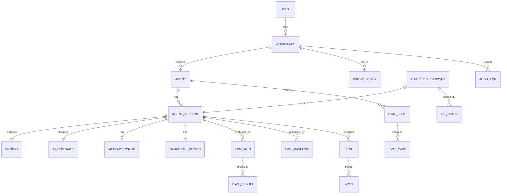
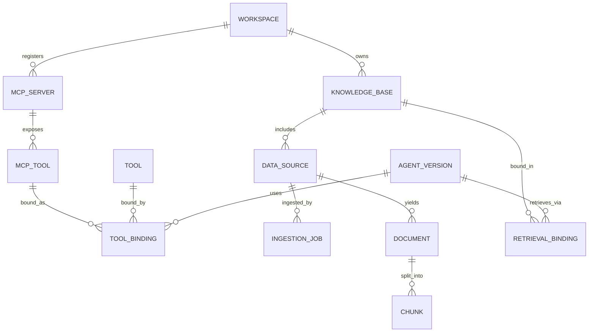
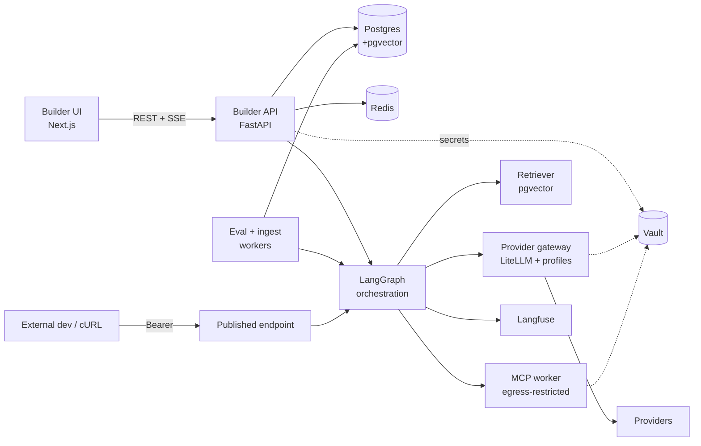

# Agent Platform — Requirements & Technical Spec

> Companion to `docs/scope.md`. Decisions live here, in the repo — not in chat history.

## Context

**Why this exists.** Internal developers and PMs waste time and repeat mistakes hand-wiring LLM
agents (prompt + model + tools + knowledge + guardrails), have no safe/consistent way to test one,
and — critically — when the underlying model changes, nobody notices the agent silently got worse.
Agent Platform is an internal platform to **build → configure → test → publish** LLM agents, with
guardrails, model-agnosticism, and a drift-aware evaluation core.

**Governing principle (`docs/scope.md`).** ~90% of this platform is boring CRUD software. Real
engineering goes into exactly two things: **(1) the provider abstraction / runtime** and **(2) the
eval + drift-detection core.** Everything else is assembled from free/OSS frameworks.

**Assumes the viability MVP has passed** (drift harness flags quality drops on model swap; provider
abstraction holds across ≥2 providers) and turns that into a phased build spec.

**Decisions locked with the user (2026-10-04):** real internal tooling · portable/container deploy
(no cloud lock-in) · **LangChain/LangGraph** for orchestration · **voice dropped** · OSS preferred ·
`docs/VID_…mp4` is a **reference product to match**.

> ⚠️ **First implementation task:** install ffmpeg, extract frames from
> `docs/VID_20260930_164111136.mp4`, reconcile the UX/feature list against the reference product. The
> brief is detailed enough to lock the architecture; the video mainly refines screens/UX.

---

## Part A — Full requirement set

### A0. Anatomy of an agent — the "all ends" checklist

Everything a configured agent needs to run. This is the completeness contract: every row is
configurable in the builder and snapshotted into an immutable AgentVersion.

| # | Agent "end" | What the user configures | Phase |
|---|---|---|---|
| 1 | Identity & lifecycle | name, description, state (draft/published/archived) | P1 |
| 2 | Model | provider · model · api-version · params · reasoning/effort · fallback model | P1 |
| 3 | Instructions | system prompt + templated input variables | P1 |
| 4 | Input contract | declared typed inputs the caller must pass (beyond `messages`) | P1 |
| 5 | Output contract | free text **or** structured output (JSON schema) + citations toggle | P1 |
| 6 | Tools | built-in · HTTP/custom · code-exec · **MCP tools** · **sub-agents** | P2 |
| 7 | Knowledge / data sources | bound **KnowledgeBase(s)** + retrieval config (RAG) | **P1-min / P2-full** |
| 8 | Memory | short-term (session) + long-term (persistent) settings | P1 (session) / P2 (long-term) |
| 9 | Context management | window limit · truncation/compaction strategy | P1 |
| 10 | Guardrails | ordered input/output stages + thresholds | P2 |
| 11 | Credentials | provider key + per-tool / per-source creds (all vaulted) | P1 (provider) / P2 (tool) |
| 12 | Runtime policy | timeout · retries · fallback · idempotency key · spend ceiling · concurrency | P1 (timeout/retry/idempotency) / P2 (spend/conc) |
| 13 | Evaluation | eval suite(s) + frozen baseline | P1 |
| 14 | Publication | pinned version · endpoint · scoped tokens · export | P1 |
| 15 | Observability | tracing/logging/cost (automatic, not user-configured) | P1 |
| 16 | Registration & provenance | owner (routable subject), `registered_at` gate, dedup-scan acknowledgement before a version is built/published | P1 (P0-1; `backend/14`) |

> **Decided (2026-10-04):** minimal **RAG ships in P1**; **MCP is P2**. (file-upload RAG → pgvector →
> retrieval-as-a-tool in the MVP; MCP's trust/sandbox surface waits for P2.)

### A1. Functional requirements (by feature area)

**1. Dashboard & management** — `[P1]` list agents (state, created, active version, owner); per-agent
version timeline + deploy status. `[P2]` usage/cost/latency rollups.

**1a. Adoption, enforcement & migration (P0-1)** — `[P1]` key-custody enforcement spine (platform holds
the only provider credentials; BYO superseded; teeth require cloud-IAM + egress control); create-time
**registration gate**; **similarity/dedup scanner** ("reuse first"); **import** of existing hand-wired
agents. Design: `backend/14-adoption-enforcement.md`.

**1b. Org-wide governance reporting (P0-2)** — `[P1]` a deployment-wide **platform-admin** plane reads an
org estate / spend / compliance report over an elevated, audited cross-tenant path (metadata-only for
`private` resources). Design: `backend/15-org-governance-reporting.md`.

**1c. Owner notifications (P0-3)** — `[P1]` in-product owner-facing notifications for drift, budget
thresholds, model deprecation, and eval failure — the "nobody noticed it got worse" fix; distinct from ops
alerting. Design: `backend/16-notifications.md`.

**2. Agent configuration** — `[P1]` identity; model-agnostic provider/model/params/system-prompt;
input/output contract; context-management settings. `[P1]` per-workspace **monthly spend cap** (hard,
enforced — revised 2026-10-19); `[P2]` concurrency controls + per-endpoint budgets.

**3. Tools & skills** — `[P2]` tool repository; HTTP/custom tools; **MCP** connect + discovery + tool
selection (B7); **sub-agent** delegation (LangGraph subgraphs).

**4. Knowledge / data sources (RAG)** — `[P1-min]` upload files → ingest → retrieve;
`[P2-full]` connectors (S3/GCS, Confluence, Notion, Drive, Git, DB), web crawl, scheduled re-sync,
reranking, doc-level ACLs (B6).

**5. Memory** — `[P1]` session memory (LangGraph checkpointer); `[P2]` long-term persistent memory
(B8).

**6. Testing & evaluation (the differentiator)** — `[P1]` chat playground (SSE, traces); eval suites
(labeled cases = baseline); drift detection (quality + efficiency vs baseline); publish gate (B5).

**7. Export & integration** — `[P1]` publish → authenticated endpoint (pinned version) + cURL/TS/
Python export from OpenAPI; scoped tokens (shown once); **never** expose provider keys.
`[P2]` **messaging-app channels** (Slack/Teams/Google Chat) — host agents behind a chat app instead of
code: inbound adapter verifies the webhook, federates the sender to an Okta identity (mint short-lived
token), routes to an agent, and replies. One channel → one workspace → many agents. Design:
`channels-design.md` + `backend/12-channels.md`.

**8. Modality** — `[P1]` chat only. `[dropped]` voice (not designed).

### A2. Non-functional requirements
Portable containers (no cloud-managed-service lock-in, self-hostable) · multi-tenant (org →
workspace → agent scoping) · provider/tool/source creds envelope-encrypted, decrypted only in memory
· SSO for builder, scoped tokens for published APIs · every model call logged `{model, promptVersion,
input, output, latency, cost, success}` · playground first-token p95 < 2s · versions immutable &
reproducible (capability profile + retrieval + tool schemas snapshotted per version).

### A3. Out of scope (decisions, not gaps)
Voice · fine-tuning / model hosting · external marketplace · billing/chargeback beyond internal cost
accounting · non-LLM workflow automation.

---

## Part B — Technical spec

### B1. Stack (reconciled to user decisions)

| Layer | Choice | Why |
|---|---|---|
| Frontend | Next.js + React + TS, shadcn/ui, TanStack Query | OSS; best streaming playground UX |
| Builder API | Python + FastAPI | Matches LangGraph; async SSE |
| Orchestration | **LangGraph** (graph, tool loop, sub-agent subgraphs, checkpointer) | User-chosen; owns the loop |
| Provider gateway | **LiteLLM** (unified call + cost, 100+ providers) **+ our capability profiles** | Free; model-agnostic + cost; profile layer on top (B2) |
| Embeddings | LiteLLM embeddings (model-agnostic) | Same gateway; pin per KB |
| Vector store | **pgvector** (in Postgres) | One store; no extra infra |
| Ingestion | LangChain loaders + splitters (OSS) | Don't hand-build parsers |
| Eval/drift | **Built in-house** + promptfoo/Langfuse datasets as scaffolding | Defensible core |
| Observability | **Langfuse** (OSS, self-hosted) | Per-call logs, traces, cost, eval — free LangSmith alt |
| Guardrails | **Guardrails AI / NeMo Guardrails** (OSS) behind our stage API | Don't hand-build PII/toxicity |
| DB / queue | Postgres + pgvector · Redis + RQ/Celery | Transactional + async eval/ingest jobs |
| Secrets | **HashiCorp Vault (Transit)** | Portable KMS-equivalent |
| Deploy | Docker + compose (dev); Helm/k8s or compose (prod) | Portable |

**Pushback captured:** LangGraph/LangChain's model wrapper flattens provider-specific features
(thinking control, caching, forced-tool-choice rules, per-provider cost) that drift + cost accounting
depend on. Mitigation: LangGraph orchestrates, but **LiteLLM + our capability-profile layer** owns
provider normalization, cost, and feature pinning (B2). The framework is never the source of truth
for cost or capability.

> ⚠️ **Licensing (do early):** LangGraph OSS lib is MIT; **LangGraph Platform** (deploy/mgmt product)
> is tiered — confirm the free self-hosted tier, else run the OSS lib behind FastAPI.

### B2. Provider abstraction + cost (hard part #1)
- IR: `NormalizedRequest` / `NormalizedStreamEvent` (`text_delta|reasoning_delta|tool_call_*|usage|
  stop`) / `NormalizedUsage` (`input/output/cached/reasoning tokens, costUsd`).
- Calls go through LiteLLM; we wrap into IR and **compute cost ourselves** from a per-`(provider,
  model, apiVersion)` **capability profile** (pricing + feature flags: `forcedToolChoice`,
  `disableThinking`, `reasoningControl`, `promptCaching`, `structuredOutput`, `toolCallFormat`, …).
- **Leak handling:** any request downgrade/rewrite to fit a provider records a `capability_
  substitution` event on the run, surfaced to user + eval.
- **Version pinning:** AgentVersion stores `modelConfig` + a resolved profile snapshot. Provider-
  specific feature opt-ins mark the version non-portable for that feature; swapping provider → new
  version + re-eval.

### B2.5. Input / output contract
- **Input variables:** typed declarations (name, type, required, default) injected into the prompt
  template; validated at invoke; become part of the published OpenAPI request schema. Edited in the
  console via the Configure → Input variables schema builder (add/remove/retype rows); persisted as the
  version's `io_contract`.
- **Output:** free text or structured output (JSON schema) via the profile's structured-output
  support; citations included when RAG is on. Declared per version → reflected in export.

### B3. Data model (hard part #1 cont.)

**Core (agents · versions · eval · publish):**

**Extensions (tools/MCP · knowledge/RAG):**

Legend: `TOOL_BINDING.kind ∈ {http, mcp, builtin, subagent}`; MCP bindings snapshot the discovered
tool schema. `CHUNK` holds the pgvector embedding. `RETRIEVAL_BINDING` = version↔KB + retrieval
config. `SpendLimit`/`ConcurrencyLimit`/RBAC tables created P1, used P2 (additive). No voice tables.

### B4. Architecture topology

Legend: orchestration + gateway + retriever is **one shared library** used by playground, eval
workers, and the published endpoint — so test, eval, and production invoke run the *same* code on the
*same* pinned version.

### B5. Eval / drift subsystem (hard part #2 — the defensible core)
- **Two layers:** deterministic checks (schema/format, required fields, regex/exact, tool-call
  correctness, refusal/empty rate) **+** LLM-judge (rubric 1–5 **and** pairwise baseline-vs-candidate),
  judge model **fixed and versioned** so it can't silently drift.
- **Drift verdict** vs frozen `EvalBaseline`: *quality drop* (weighted blend; drift if `baseline −
  candidate > threshold`) + *efficiency drop* (cost/tokens/latency/tool-calls). **PASS** only if
  quality ≥ threshold AND efficiency within budget AND deterministic hard-assertions green.
- **Triggers & gate:** change to model/provider/api-version/prompt-hash/params — **or embedding model
  / knowledge binding (RAG affects quality)** — invalidates publishable status → fresh eval required;
  publish + re-point hard-gated on a PASS newer than the last such change (409 otherwise).
- **Small-set honesty:** suites < N cases (default 10) flagged low-confidence; publish needs audited
  override + widened threshold. Baseline re-freeze is explicit + audited.
- **Cost control:** cache judge verdicts by `(caseId, baselineHash, candidateHash, judgeVersion)`;
  Batch APIs (~50% off) for non-interactive; deterministic pre-filter before judge.

### B6. Knowledge / data sources (RAG) — detailed
**How a user configures knowledge:**
1. **Create a KnowledgeBase** — pick an embedding model (pinned) + index settings. A KB is the unit an
   agent binds to.
2. **Add DataSource(s)** to the KB. Types: `[P1]` **file upload** (PDF/docx/txt/md/html), manual
   text/FAQ; `[P2]` **web crawl** (seed URLs + depth), **connectors** (S3/GCS, Confluence, Notion,
   Google Drive, Git repo, DB query). Source creds vaulted; `[P2]` scheduled re-sync.
3. **Ingestion pipeline (async job):** extract → chunk (configurable size/overlap, structure-aware) →
   embed (LiteLLM) → store vectors in **pgvector** namespaced per KB. `INGESTION_JOB` tracks status,
   doc/chunk counts, errors; surfaced in UI.
4. **Bind KB → AgentVersion** via `RETRIEVAL_BINDING` with a **RetrievalConfig:** top-k, similarity
   threshold, hybrid (BM25 + vector) toggle, optional reranker (OSS bge local to stay free), max
   injected context tokens, metadata filters.
5. **Injection strategy (user choice):**
   - **Retrieval-as-a-tool (default for agents):** a `retriever` tool the LangGraph agent calls when
     it decides it needs context — better for agentic/multi-step.
   - **Always-on context stuffing:** prepend top-k chunks every turn — simpler, best for pure Q&A.
6. **Citations:** retrieved chunks carry `{source, docId, chunkId, score}`; responses cite them;
   shown in playground + returned via API when enabled.

**Reproducibility & drift tie-in:** embedding model + index version are pinned to the AgentVersion.
Changing the embedding model or KB binding = re-ingest + **new version + re-eval** (it changes
retrieval quality → is a drift source). Stale-index warnings when a bound KB re-ingests after publish.

**MCP ↔ knowledge bridge:** MCP *resources* (read-only data a server exposes) can feed a KB or be read
inline — a lightweight alternative to full ingestion for live/system-of-record data.

### B7. MCP configuration — detailed
**How a user adds MCP:**
1. **Register an McpServer** (workspace-scoped, reusable): transport = `stdio` (command+args+env, runs
   in sandbox) or `http`/SSE (URL); auth = none/bearer/OAuth/headers (**creds vaulted**, injected at
   connect); name + description.
2. **Connect & discover:** on save the platform connects and runs MCP `tools/list` (+ resources/
   prompts), caching the catalog (name, description, input schema) as `MCP_TOOL` rows. Health check +
   last-discovery time shown.
3. **Select tools:** user picks an **allow-list** of discovered tools to expose (not all-by-default).
4. **Bind to a version:** selected MCP tools become `TOOL_BINDING(kind=mcp)` on the AgentVersion, with
   the **tool schema snapshotted** so a server changing its tools later can't silently alter a
   published agent (reproducibility). A server/tool-schema change → flagged → re-eval required.
5. **Runtime:** MCP calls execute in an **egress-restricted MCP worker** (stdio servers in a
   locked-down container; per-server egress allow/deny lists); the LangGraph loop invokes them like
   any tool; results normalized into the IR; per-tool timeouts + error handling; invocations audited.
   **Concrete stack:** the client is the official **Model Context Protocol Python SDK** (`mcp` package —
   `ClientSession` + `mcp.client.stdio` / `mcp.client.streamable_http` transports matching
   `transport ∈ {stdio, http}`), run **client-side in our runtime** inside a **hardened per-call sandbox**
   (gVisor `runsc` + deny-by-default egress via a Squid allow-list proxy). See `backend/11 §1/§12`.

**Model-agnostic note:** some providers offer server-side MCP connectors, but to stay provider-
neutral we run MCP **client-side in our runtime**, uniform across all providers — we do not depend on
provider-native MCP.

### B8. Memory
- **Short-term (P1):** session/conversation memory via LangGraph **checkpointer** (Postgres/Redis).
  Config: window size, compaction/summarize-old-turns strategy, persist-sessions toggle. Ties into
  context management (#9).
- **Long-term (P2):** persistent memory across sessions (pgvector-backed store), scope = per-end-user
  or per-agent; retrieved into context like a writable knowledge store. Enable + scope configurable.

### B9. Guardrails (P2)
Pipeline stages attached per-version via `GuardrailConfig`, identical across playground/eval/
published: `request → [input stages] → model(stream) → [output stages] → client`. Cheap deterministic
stages (regex/dict/PII) first; LLM policy stage last + optional; backed by Guardrails AI / NeMo behind
our `GuardrailStage` interface. Streaming output uses a sliding buffer so redaction precedes flush.
Immutable per version → changing guardrails = new version = re-eval.

### B10. Published-agent runtime + export
`POST /v1/agents/:endpointId/invoke` (JSON or SSE): bearer auth → `[P2]` concurrency slot → `[P2]`
spend check → input guardrails → inject decrypted provider/tool creds (Vault, in-memory only) → run
pinned version via LangGraph (retrieval + MCP as configured) → output guardrails → record Run/usage/
cost → respond. Accepts an **idempotency key** (dedupes retried invokes). Editing the agent changes
nothing live until an explicit, eval-gated re-point.
**Export:** `GET /endpoints/:eid/export?format=curl|ts|python` from the OpenAPI spec — only the
platform-scoped token, never a provider/tool secret. Supports "new agent → endpoint < 15 min."

### B11. API surface (REST + OpenAPI 3.1, not GraphQL)
REST chosen: SSE streaming fits; OpenAPI is the source for cURL/SDK export (core feature). Routes
`/api/v1` (builder-auth): agents/versions CRUD + clone; `versions/:vid/playground/chat` (SSE);
`[P1]` knowledge-bases + data-sources + ingestion-jobs + `versions/:vid/retrieval-bindings`;
`[P2]` tools, `mcp-servers` (register/connect/discover), `versions/:vid/tools` (bind); eval-suites/
cases, `versions/:vid/eval-runs` (async), `versions/:vid/baseline`; `versions/:vid/publish`,
`endpoints/:eid/tokens`, `endpoints/:eid/export`; `runs`, `agents/:id/dashboard`. Published runtime
route has separate bearer-token auth.

### B12. Security
Provider/tool/source creds: envelope encryption via **Vault Transit** (per-workspace DEK); plaintext
only in memory at call time; log-redaction scrubs key-shaped strings; never in config/traces/exports.
Builder UI: OIDC/SSO + CSRF; `[P2]` RBAC (`viewer|builder|publisher|admin`): **publish** gated to
publisher/admin, **provider-key mgmt gated to admin**, **MCP/tool mgmt gated to builder+**
(`mcp.manage`/`tool.manage`). (Reconciled 2026-10-19 — this reverses the earlier "key/MCP mgmt →
publisher/admin"; building an agent *is* binding its tools, so tool/MCP management belongs at builder+,
while only the org-wide provider key stays admin-only. See `backend/09`, `scope.md`.) Published endpoints:
scoped bearer tokens hashed at rest, revocable, expiry + rate limit. `[P2]` MCP/sub-agent blast radius:
network-isolated per-call sandbox, vaulted creds, depth/fan-out caps, plus a **designed
human-approval gate for destructive/high-risk tools** (`tool_risk_tier` + `requires_approval` →
`runtime` pause/resume → `tool_approvals`; see `backend/09 §10`, `01`, `03`, `08`). Audit log: publish,
re-point, baseline freeze, key/MCP/source create+rotate, **tool bind**, token mint/revoke, overrides.

---

## Part C — Phasing

**Phase 1 — Chat core + eval/drift + publish/export + minimal RAG.**
Agent/Version CRUD + dashboard; model-agnostic config (≥2 providers, B2); I/O contract; session
memory; **minimal knowledge (file upload → pgvector → retrieval-as-tool)**; chat playground (SSE);
eval/drift harness + publish gate; publish → endpoint + cURL/SDK export; run logging + cost
(Langfuse); provider keys vaulted; single-team SSO + minimal roles.
**+ P0 (promoted into P1):** adoption/enforcement (key custody + registration gate + dedup scanner +
import, `backend/14`); org governance reporting (platform-admin plane, `backend/15`); owner
notifications (`backend/16`). These close the three gaps that make the platform a *product* (enforceable,
leadership-visible, owner-notifying) rather than a console.

**Phase 2 — Extensibility + hardening.**
Tool repository; **MCP** connect/discover/bind; sub-agent delegation; full data-source connectors +
crawl + re-sync + reranking; long-term memory; full guardrail library; concurrency limits + per-endpoint/
finer spend controls (the per-workspace monthly cap itself is P1);
RBAC + audit hardening; usage/cost dashboards.

**Deferred (not planned):** voice.

---

## Part D — Verification (per phase, end-to-end)
- **Cross-cutting:** deterministic unit/integration tests for code around the model + AI eval set vs
  baseline in CI; a model- or knowledge-affecting PR must show a PASS drift report.
- **Phase 1 (headline):** provider-abstraction contract tests (same `NormalizedRequest` across 2
  providers; substitutions recorded; cost matches hand-calc); drift harness seeded-regression test
  (≥80% flagged, <10% false-positive on unchanged agent); **RAG test** (known Q → retrieves the right
  chunk; changing embedding model triggers re-eval); publish gate (no/failed eval → 409); export cURL
  runs + streams + **no secret in output/logs/traces/export** (automated scan); playground first-token
  p95 < 2s.
- **Phase 2:** guardrail block/redact golden cases; over-budget → 402/429; parallel load → excess
  429; **MCP round-trip vs a mock server** (discover → select → bind → invoke; schema-change →
  re-eval flag); sub-agent depth cap; connector ingestion + re-sync. The **MCP round-trip** maps to the
  dedicated **`POST /mcp-servers/:id/test-invoke`** dry-run endpoint (08); the **sub-agent depth-cap**
  test maps to **`subagent_configs.max_depth`** (01) enforced in `runtime` (`RunContext.depth`, 00 §4).

---

## Part E — Risks
1. **LLM-judge reliability & cost** (highest) — calibrate vs human labels on a held-out set; verdict
   caching + Batch API; low-confidence flagging for small suites.
2. **Provider-abstraction leakage** — profiles as versioned data + per-adapter contract tests +
   surfaced substitutions.
3. **RAG quality & drift** — retrieval is a hidden quality lever; pin embedding model per version and
   treat knowledge changes as drift triggers; evaluate retrieval (not just generation).
4. **MCP trust & blast radius** — untrusted external servers; sandbox + egress allow-lists + vaulted
   creds + schema snapshotting + audit.
5. **Spend/concurrency races** (P2) — Redis reservation + reconciliation, bounded overshoot, hard cap.
6. **Cross-provider cost accuracy** — compute from profiles + normalized usage; reconcile vs provider
   billing; show "estimated" where uncertain.
7. **LangGraph Platform licensing** — **RESOLVED (2026-10-19):** use the OSS LangGraph library (MIT)
   behind our own FastAPI; LangGraph Platform not adopted. Dependency pinning + upgrade-via-eval-gate +
   CI license scan policy in `backend/11 §12`.
8. **Reference-video reconciliation** — align screens/features before locking UX.

---

## Part F — Resolved decisions
- **RAG + MCP phasing (decided 2026-10-04):** minimal file-upload RAG in **P1**; MCP in **P2**.
- Stack: Python/FastAPI + LangGraph + LiteLLM + pgvector + Langfuse + Vault (portable containers).
- Voice dropped. Reference video to be reconciled first on implementation.
- **P0 gaps promoted into P1 (decided 2026-10-18; see `scope.md` decision log):**
  - **Adoption/enforcement = key custody** (platform-exclusive provider creds; BYO superseded; teeth
    require cloud-IAM + egress control, else "visibility + mandate") + registration gate + dedup scanner +
    import. `backend/14`.
  - **Org governance = a deployment-wide platform-admin plane** over an elevated, audited cross-tenant path
    (metadata-only for `private`); no `org_memberships` (one deploy = one org). `backend/15`.
  - **Owner notifications** at drift/budget/model-deprecation/eval-fail; model-deprecation needs a new
    `availability` field on capability profiles. `backend/16`.

---

## First files to create (on implementation)
- `services/runtime/providers/abstraction.py` — IR + adapter interface + profile resolution + LiteLLM
  wrapping (B2). *Load-bearing.*
- `services/runtime/providers/profiles/*.json` — per-(provider,model,version) profiles.
- `services/runtime/retrieval/retriever.py` — pgvector retrieval + RetrievalConfig (B6).
- `services/runtime/mcp/worker.py` — MCP connect/discover/invoke in egress-restricted sandbox (B7).
- `services/evals/drift.py` — baseline, deterministic + judge scoring, verdict, publish gate (B5).
  *Defensible core.*
- `services/api/models.py` (Alembic) — full data model, P2 tables stubbed (B3).
- `services/api/publish/endpoint.py` — published invoke: auth, guardrails, cred injection, logging
  (B9/B10/B12).
- `services/api/openapi + export/snippet.py` — OpenAPI source + secret-free export (B10/B11).
- `services/api/routers/adoption.py` — registration gate + dedup scan + import (P0-1, `backend/14`).
- `services/api/routers/org.py` + the `SECURITY DEFINER` reader — elevated org governance report (P0-2,
  `backend/15`).
- `services/api/routers/notifications.py` + `services/worker/deprecation_scan.py` — owner notifications +
  model-deprecation detector (P0-3, `backend/16`).
