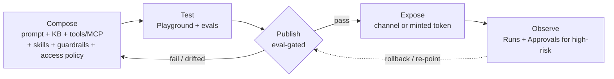

# User Flows

What you can actually do in the console today (mock-only frontend), organized four ways:

1. **The access model (build-time)** — workspace → role → capability.
2. **The caller/invoke side (run-time)** — how a published agent is called and what access the caller needs.
3. **Persona flows** — the lifecycle told through the people who run it.
4. **Domain workflow catalog** — the kinds of agents an IT company builds on the platform.

> ⚠️ **Mock-only today.** Reads come from seed fixtures, writes mutate an in-memory store, and
> auth/tenancy/invoke are simulated client-side. Knowledge bases don't really ingest, tools/MCP/channels
> don't call out, and there is no live LLM. Everything below is what the current UI lets you *configure
> and simulate*; actual execution is the designed-but-unbuilt backend.

---

## 1. The access model

> ⚠️ **Model superseded by the claim-based, IdP-agnostic refactor (2026-10-22; `scope.md`, `docs/backend/09 §1`,
> `18`).** The authoritative model is now **three planes** (Console · Caller `executer` · app-wide `admin`).
> Console roles are **`viewer` < `builder` < `publisher`** (viewer = read-only, retained), conferred by
> **per-workspace IdP group/role claims mapped by the active identity adapter** (`18`) — Okta, Ping, Entra,
> Cognito, or custom — not a single conferred `memberRole` and **not tied to one IdP**. **The FE console is now
> migrated** to this model (per-workspace `ap-<prefix>-<role>` claims via `iam.ts` `idpBinding`/`roleFor`; the
> personas below hold). **One piece remains deferred:** the **`executer` caller role** in `runtime-access.ts`
> (the playground invoke-preview still types callers as a console role — see end of §2).

A **workspace is a tenant**. Your IdP group/role claim maps you to a **role** in each workspace (via the
adapter's `idp_binding`), and the role — not the workspace — decides what you can do. Console roles are
additive: `viewer < builder < publisher`, with an app-wide `admin` above them and a caller-only `executer`
below (invoke-only).

| Workspace (seed) | Role conferred | What that role can do |
|---|---|---|
| Trellix XDR | **publisher** | everything a builder can, **plus** publish/rollback, mint tokens, approve high-risk tool calls |
| Trellix GRC | **viewer** | read-only everywhere + run Playground/token-preview; all create/edit/publish disabled |
| Trellix Labs | **builder** | create/edit agents, manage knowledge/tools/MCP/skills/channels, author & run evals |
| Trellix People Ops | **builder** | same builder capabilities, scoped to People Ops |
| Trellix Sandbox | builder | only visible to platform-admins (demo user isn't in its group) |
| *(any, as admin)* | **admin** | publisher + delete agents, manage members/keys/access policies/limits, govern evals |

**Cross-cutting freeze:** if a workspace is deactivated, every role there drops to read-only until it's
reactivated — even publishers and admins.

**Platform-admin** is separate from the role ladder: it grants admin everywhere *and* tenant lifecycle
(create/deactivate/delete workspaces), plus the dev-only "Preview as role/team" overrides.

---

## 2. The caller / invoke side (run-time access)

The §1 roles are **build-time**: who may assemble, publish, or govern agents. When a published agent is
**called in production**, the caller is a **separate access axis** — it reuses the same role *enum values*
but the caller's identity comes from a **token or a federated channel login, never console membership**.

> **Designed, not built.** The only running artifact is the frontend mock `src/lib/runtime-access.ts`
> (a deterministic string-match `decodeToken` used for the Playground preview). Real JWT validation and
> the `/resolve-run` call are specified in `docs/backend/09-security-tenancy.md` / `08-api-surface.md`
> but not implemented.

### How an agent is called

| Path | Entry point | Caller auth |
|---|---|---|
| **REST / SDK / cURL** | `POST /v1/agents/:id/invoke` (JSON or SSE) | scoped **Bearer caller token**, hashed at rest |
| **Messaging channel** | `POST /channels/{platform}/events` (Slack/Teams/GChat) | **federated** Okta login → short-lived minted token (~15m), or a **service** account |
| **Playground** | same `runtime.invoke` code path | console session (`run_source="playground"`) |

The exported cURL/TS/Python snippets hit that same endpoint with a Bearer **caller-token placeholder —
never a provider/LLM key**. The LLM key stays the workspace's vaulted, server-side key.

### What access the caller needs

- **No console privilege and no workspace membership required.** Both cURL and channel callers resolve to
  the single execute-only caller role **`executer`** (`CHANNEL_INVOKE_ROLE = "executer"`); invoke never
  requires a console role.
- Caller principal = `{tenant, role=executer, teams, scopes, subject}`. `subject` present → a **user**;
  absent → a **service account**.
- Access is computed fresh at invoke:
  **`effective = agent config ∩ caller grants (executer/teams/scopes) ∩ caller tenant ∩ per-resource access policy`**,
  evaluated fail-closed per tool / KB / skill.
- **Tenant isolation is absolute** — a token for workspace B cannot invoke an agent in A (`tenant_mismatch`).
- `private` resources are **denied to every runtime caller** (callers carry no owner `subject`). Note:
  `admin` is a **console claim, not a caller role**, so there is **no "admin token" bypass at invoke**.
- **Expired → 401; revoked → immediate reject.** `per_user` MCP tools fail closed for token callers
  (`403 mcp.connect_required`) — there's no interactive connect path.

> **One line:** a *builder* assembles and binds the agent (console session); a *caller* only invokes it,
> resolved purely by token/channel identity ∩ policy.

### Open / not-yet-implemented on the caller side

- **Entire backend unbuilt** — real IAM/JWT validation and `/resolve-run` are design-only; today it's the
  client-side mock stub.
- **Token scopes are undefined (biggest gap).** No concrete vocabulary (no literal `invoke`/`read`/`write`);
  `scopes` is an opaque jsonb array, and the mock only models `*` (full) vs `partial`. *What a scope
  actually restricts is unspecified.*
- **Rate limiting** per-token = P1; concurrency + spend quota = P2.
- **`per_user` MCP identity** (doc 17) is proposed P2+, not in the schema or frozen API; upstream OAuth
  revoke + reconciliation is open.
- **Channels:** P2.a is Slack-only, one-channel→one-default-agent; isolating public invoke into its own
  deployment is noted but undecided.

### FE migration to the claim-based, IdP-agnostic model (done, 2026-10-22)

**Done.** `src/lib/iam.ts` now resolves per-workspace `ap-<prefix>-<role>` claims via an `idpBinding` helper
(the Okta adapter's convention) and an adapter-shaped `roleFor` (highest held claim; `admin` from the
platform-admin claim); `oktaGroup`/`memberRole` are gone from the `Workspace` model; `viewer` is retained;
`MOCK_PROFILE` carries the per-workspace claims (Raman: publisher@XDR, viewer@GRC, builder@Labs/People). Create/
edit-workspace flows (`app-shell.tsx`, `settings`) now take a `groupPrefix`; the Members tab projects the
signed-in user's resolved role. `npm run build` passes.

**One piece deferred** — `src/lib/runtime-access.ts` `executer` caller role: widening the caller `role` to
`Role | "executer"` cascades into `access-policy.ts` typing (`matches()` expects a `Role`), so the invoke-
preview still types token/channel callers as a console role. Tracked with a `// TODO(executer)`; it's a
preview-only detail (the real check is server-side).

---

## 3. Persona flows

### Priya — Detection Engineer (builder, Trellix Labs)
Switches to Labs, clicks **New agent**, writes the prompt, attaches a **knowledge base** (creates one,
adds a data source → simulated ingestion), tunes config/guardrails, and iterates in **Playground**.
She authors an eval suite and runs it — but **Publish is disabled** (*"Requires Publisher role"*), so
she hands off.

### Alex — SOC Platform Owner (publisher, Trellix XDR)
Opens Priya's agent, reviews eval results, and **Publishes** — the gate lets him through *only because
the latest eval passed and config hasn't drifted since*. He mints an API token and copies the cURL/
TypeScript/Python/OpenAPI snippet for the SOC pipeline. Later he approves a high-risk tool call in
**Approvals**, and **rolls back** to re-point the live version when a bad build ships.

### Dana — Compliance Analyst (viewer, Trellix GRC)
Audits what's running: browses **Runs**, **Evaluations**, and configs read-only, and uses **Playground
→ "Provide token"** (e.g. `svc-grc`) to preview *exactly which tools/KBs that identity resolves to*.
Every write control is greyed out — her role here is observation and access-preview.

### Sam — Platform Admin (admin everywhere + tenancy)
Onboards a team: **creates a workspace** (seeds a starter agent/KB/tool, switches him in), sets its
group prefix / `idp_binding` (per-workspace role claims), then in **Settings** adds a provider key and sets spend/concurrency limits.
Governs access in *Roles & access* (e.g. restrict an agent to the SOC team), tunes the **eval policy**
and **re-freezes the baseline**, and uses **"Preview as role/team"** to see the console as Priya or
Dana would — without logging in as them.

### `svc-soc-pipeline` — the caller identity (not a console user)
The invoke-time persona: a published agent is called with a minted token; the token decodes to a
principal whose team/role determines which attached tools and KBs actually resolve. Modeled today in
**Playground → "Provide token"** (`user-soc-full` vs `expired`/`revoked`) — a preview of what the real
server enforces at invoke time.

---

## 4. Domain workflow catalog (what an IT company builds here)

Every workflow below is the **same lifecycle with different blocks wired in**. Two phases each:
**Build** (what a builder assembles) and **Run** (how an end user's request reaches it — typically via a
bound **channel** like Slack/Teams, or a minted **token** from another system).

### Already seeded in the demo

**Security / SOC alert triage** — *SOC Triage Copilot, Threat Intel Summarizer, Incident Report Writer*
- Build: triage prompt + KB of playbooks/runbooks + tools/MCP for log query, threat-intel lookup, and
  a **sub-agent** (Log Query Builder) for delegated search; guardrails keep it read-only pre-approval.
- Run: an alert fires → the agent enriches it, drafts an incident summary, and routes any containment
  action to **Approvals**; called from the SOC dashboard via the `soc-dashboard-prod` token.

**Product / customer support deflection** — *Product Docs Assistant*
- Build: Q&A prompt over a product-docs KB; optional ticket-creation tool for escalation.
- Run: a user question (web widget via the `support-widget` token, or a support channel) → cited answer
  from the docs; unresolved cases escalate to a ticket. Logged in **Runs**.

**HR / People Ops queries** — *HR Policy Assistant* (Trellix People Ops)
- Build: policy KB (leave, benefits, handbook) + a structured-lookup tool (PTO balance, holidays);
  **access policy restricts it to the People team**, with tight guardrails against cross-employee leakage.
- Run: "how many vacation days do I have left?" in the HR channel → the invoke token decodes to *that*
  employee, so the lookup resolves only their record; policy questions answered with citations.

### Buildable with the same primitives

**Developer / engineering support**
- Build: coding-assistant prompt + internal-docs KB + MCP/tools (Jira, repo search, CI status).
- Run: "why is build X failing?" in a dev channel → pulls CI status + searches docs; re-trigger/deploy
  actions go to **Approvals**.

**IT service desk (ITSM)**
- Build: IT-knowledge KB + ITSM tools (create ticket, check status, reset access), with
  access-grant/password-reset marked **high-risk**.
- Run: "VPN won't connect" → troubleshoots from KB, files a ticket and returns the ID; access grants held
  in **Approvals**; full audit trail in **Runs**.

**DevOps / on-call incident copilot**
- Build: incident prompt + runbook KB + tools for metrics/logs/status-page; sub-agent for log queries.
- Run: paged on an alert → summarizes blast radius, suggests the runbook step, drafts the status update;
  remediation actions gated by Approvals.

**Compliance / GRC Q&A**
- Build: controls/policy KB + evidence-lookup tool; restricted access policy.
- Run: "which SOC 2 control covers access reviews?" → cited answer; evidence pulls logged for audit.

**Sales / pre-sales RFP assistant**
- Build: prompt + KB of past RFPs, security questionnaires, and product collateral.
- Run: paste an RFP question → drafts an answer grounded in approved collateral for a human to finalize.

**Finance / procurement helper**
- Build: expense-policy KB + tools (PO status, expense-policy lookup), approvals on anything spending.
- Run: "is this expense reimbursable?" / "where's PO-1234?" → policy answer or live status.

**Data / analytics NL-to-query** — *pattern of the seeded Log Query Builder*
- Build: schema-aware prompt + a query-builder tool/sub-agent + read-only data tool.
- Run: "top 10 failed logins yesterday" → generates and (read-only) runs the query, returns results.

**New-hire onboarding assistant**
- Build: onboarding-checklist KB + tools (provision-access request, schedule-setup), access-grants gated.
- Run: new hire asks "what do I set up first?" → walks the checklist and files the provisioning requests.

---

## 5. The common lifecycle

The platform doesn't ship these agents — it gives builders the blocks and the guardrails to assemble
them per domain, scoped to a workspace, gated by evals on publish, and governed by access policy and
approvals at runtime.
