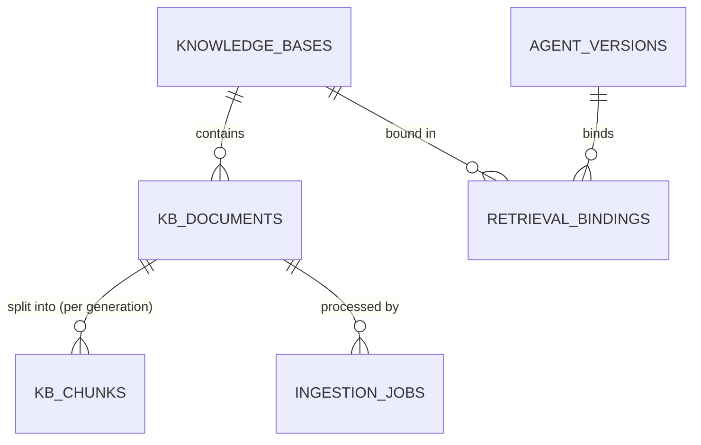

# Data Model — 024 Minimal RAG (M7)

Migration **0013** (`down_revision = "0012"`). All new tables are **workspace-scoped with RLS enabled + forced**, the
standard `{table}_ws_isolation` policy on `app.workspace_id`, and `GRANT SELECT, INSERT, UPDATE, DELETE … TO ac_app`
(the 0005/0008 helper pattern). The migration first runs `CREATE EXTENSION IF NOT EXISTS vector` (as the owner role
`ac`; the CI pgvector service and compose image both ship it).



## 1. `knowledge_bases` (existing — 0004/0006; changes)

| Column | Change | Notes |
|---|---|---|
| `embedding_model` | validated | must name an **embedding profile** with `dimension = 1024` (research D3) |
| `embedding_dim` | derived | set from the profile; client value must agree or be omitted |
| `chunk_config` | validated | `{size: 100..2000 (default 800), overlap: 0..size/2 (default 120), structure_aware: bool (default true)}` |
| `index_version` | semantics | = **refresh generation**: +1 on every successful ingest or document delete. Excluded from `snapshot_hash` (unchanged, B7 parked) |
| `last_ingested_at` | **NEW** `timestamptz NULL` | set when any document reaches `ready` |

Derived (not stored, computed in the KB read): `document_count`, `chunk_count` (active generation, ready docs),
`ingestion_status ∈ {empty, ingesting, ready, partial, stale, failed}` (`failed` added in implementation: every document failed — the original formula would have reported `ready`):
`empty` = no documents; `ingesting` = any job queued/processing; `stale` = any document `stale`; `partial` = some
ready and some failed; `failed` = documents exist but none ready/stale and some failed; else `ready`. This replaces the hard-coded `"deferred"`.

## 2. `kb_documents` (NEW)

| Column | Type | Constraint / rule |
|---|---|---|
| `id` | uuid PK | `gen_random_uuid()` |
| `workspace_id` | uuid | RLS key |
| `kb_id` | uuid FK → `knowledge_bases.id` | |
| `name` | text | original filename, sanitized (path stripped, ≤ 255 chars) |
| `media_type` | text | `CHECK IN ('text/plain','text/markdown','text/html','application/pdf','application/vnd.openxmlformats-officedocument.wordprocessingml.document')` |
| `size_bytes` | bigint | `CHECK (size_bytes > 0)` |
| `content_hash` | text | sha256 of raw bytes |
| `storage_key` | text | `ws/{ws}/kb/{kb}/doc/{id}/{sha256}`; never returned to clients |
| `source_kind` | text | `'upload'` (P2 adds connector kinds) |
| `status` | text | `CHECK IN ('queued','processing','ready','failed','stale')` |
| `active_generation` | int | default 0; 0 = nothing live yet |
| `chunk_count` | int | chunks in the active generation |
| `dedup_key` | text NULL | sha256(`content_hash` + `embedding_model` + canonical `chunk_config`) of the active generation (FR-006) |
| `injection_flags` | jsonb | `{category: count}` from ingestion-time scan; `{}` when clean |
| `error` | jsonb NULL | `{code, message, retryable}`, non-secret |
| `created_by` | text | principal subject |
| `created_at` / `updated_at` | timestamptz | |

`UNIQUE (workspace_id, kb_id, name)`: re-uploading the same name **replaces** that document (new generation).
Hard delete (FR-007): chunks via `ON DELETE CASCADE`, stored object deleted by the API after commit. **Orphan sweep
(H5)**: a crash between commit and object delete, or between `storage.put` and the upload commit, leaves an object
with no row. The executor's periodic loop runs `sweep_orphans()` hourly: for each workspace (the `workspaces` table
is not RLS-scoped) it reads that workspace's live `storage_key`s on a tenant session, lists `ws/{ws}/` in storage,
and deletes objects older than `AC_STORAGE_ORPHAN_GRACE_S` (default 3600 s) that no row references. No cross-tenant
SQL is needed. Counted in `ac_storage_orphans_deleted_total`.

**State machine**

```
queued ──▶ processing ──▶ ready ──(KB embedding_model/chunk_config patched)──▶ stale
   │            │            ▲                                                   │
   │            └──▶ failed ─┘ (retry)                                            └──(reingest)──▶ queued
   └──(reaper: heartbeat stale)──▶ failed{interrupted, retryable}
```

`status` reflects the document's **latest job**; liveness is decoupled from it. Retrieval keys only off
`active_generation > 0` (plus the chunk's `generation = active_generation`), so a document being re-uploaded keeps
serving its previous generation while the new one processes, and a failed **re-upload** never removes the previous
live generation (FR-005). A first upload that fails has `active_generation = 0`, so nothing is retrievable.

## 3. `kb_chunks` (NEW)

| Column | Type | Constraint / rule |
|---|---|---|
| `id` | uuid PK | |
| `workspace_id` | uuid | RLS key |
| `kb_id` | uuid | denormalized for namespace pruning |
| `document_id` | uuid FK → `kb_documents.id` `ON DELETE CASCADE` | |
| `generation` | int | the document generation it belongs to |
| `ordinal` | int | position within the document |
| `text` | text | passage text (customer-confidential) |
| `token_count` | int | via `runtime.tokens.count_tokens` |
| `embedding` | `vector(1024)` | NOT NULL |
| `embedding_model` | text | model that produced it (FR-014 filter) |
| `meta` | jsonb | `{heading, page, char_start, char_end}` |
| `injection_categories` | text[] | ingestion-time scan result; `{}` when clean |
| `created_at` | timestamptz | |

Indexes: `HNSW (embedding vector_cosine_ops) WITH (m=16, ef_construction=64)`;
`btree (workspace_id, kb_id, document_id, generation)`.

**kNN query** (API `KnowledgeAccess.search`, on the tenant session, so RLS applies, plus explicit filters as defence in
depth):

```sql
select c.id, c.text, c.token_count, c.meta, c.injection_categories, d.id as doc_id, d.name as doc_name,
       1 - (c.embedding <=> :qvec) as score
from kb_chunks c join kb_documents d on d.id = c.document_id
where c.workspace_id = :ws and c.kb_id = :kb
  and c.embedding_model = :model and c.generation = d.active_generation and d.active_generation > 0
  and 1 - (c.embedding <=> :qvec) >= :threshold
order by c.embedding <=> :qvec
limit :k;
```

(`:qvec` passed as a `'[..]'::vector` literal; no `pgvector` Python dependency.)

## 4. `ingestion_jobs` (NEW)

| Column | Type | Constraint / rule |
|---|---|---|
| `id` | uuid PK | |
| `workspace_id` | uuid | RLS key |
| `kb_id` / `document_id` | uuid | FK; job survives as history after a delete? **No**: `ON DELETE CASCADE` with the document |
| `kind` | text | `CHECK IN ('upload','retry','reingest')` |
| `status` | text | `CHECK IN ('queued','processing','ready','failed')` |
| `progress_done` / `progress_total` | int | chunks embedded / total chunks (0/0 until chunked) |
| `skipped_unchanged` | bool | true when dedup short-circuited (FR-006) |
| `cost_usd` | numeric(12,6) | embedding cost (D16); 0 when unchanged |
| `cost_is_estimate` | bool | from profile `provisional` |
| `error` | jsonb NULL | `{code, message, retryable}`; codes: `unsupported_type`, `content_mismatch`, `no_extractable_text`, `parse_failed`, `embedding_failed`, `budget_exceeded`, `interrupted`, `storage_failed` |
| `owner` | text NULL | executing process id (lease) |
| `heartbeat_at` | timestamptz NULL | refreshed every 15 s while processing |
| `created_by` | text | |
| `created_at` / `started_at` / `finished_at` | timestamptz | |

Index: `(workspace_id, kb_id, created_at desc)`; partial `(heartbeat_at) WHERE status IN ('queued','processing')`;
**partial UNIQUE** `ingestion_jobs_one_active_per_doc (document_id) WHERE status IN ('queued','processing')`: at most
one active job per document, enforced by the database (H3).

**`ingestion_reap_stale(stale_after interval) RETURNS integer`**: `SECURITY DEFINER`, owned by `ac`,
`SET search_path = public, pg_temp`. It updates matching jobs → `failed{interrupted, retryable:true}` and their
documents → `failed` **only if** `active_generation = 0` (otherwise the document returns to its previous live state,
`ready`), then returns the count. `REVOKE ALL … FROM PUBLIC; GRANT EXECUTE … TO ac_app`. Queued jobs use `created_at`
as the heartbeat baseline.

## 5. `retrieval_bindings` (existing — 0004; no schema change)

Now authored through `POST …/versions` (research D12). `retrieval_config` canonical shape:
`{top_k: 1..20 (6), similarity_threshold: 0..1 (0.2), max_ctx_tokens: 100..8000 (2000), hybrid: bool (false),
reranker: str|null (null), metadata_filters: {} }`. `injection ∈ {'always_on','tool'}`. `kb_index_version` frozen at
bind time (display/staleness only).

## 6. Runtime value types (pure, `services/runtime/`)

| Type | Fields | Notes |
|---|---|---|
| `KnowledgeAccess` (Protocol, `runtime/retrieval/port.py`) | `async search(ref: RetrievalRef, qvec: list[float], *, top_k, threshold) -> SearchOutcome` | implemented by API (D1); runtime never imports DB |
| `SearchOutcome` | `status: ok\|unavailable\|stale` · `passages: tuple[Passage, ...]` | `unavailable` covers denied + archived (no leak) |
| `Passage` | `chunk_id, kb_id, document_id, document_name, text, token_count, score, meta` | in-process only |
| `ScanResult` (`runtime/guardrails/injection.py`) | `flagged: bool, categories: tuple[str,...], scanner_version: str` | |
| `Citation` | `id, kb_id, document_id, document_name, chunk_id, score, page, heading` | client-visible; no text |
| `RetrievalSummary` (on `RunRecord.retrieval`) | `bindings: tuple[BindingSummary]`, `searches: int`, `embed_calls: int`, `retrieval_ms: int`, `degraded: tuple[str]` | persisted to `runs.usage.retrieval` |
| `BindingSummary` | `kb_id, kb_index_version, status: used\|no_match\|unavailable\|degraded, passages_used, passages_withheld, top_score` | |
| `EmbeddingResult` (gateway) | `vectors, usage, cost_usd: Decimal, cost_is_estimate, provider_request_id` | |
| `RetrievalRef` additions | `embedding_provider: str` (from the model's PROFILE, never settings — M3), `kb_name: str` | derived in `to_snapshot()`; **excluded** from `snapshot_hash` (like `kb_index_version`) |
| `RunContext` additions | `knowledge: KnowledgeAccess \| None`, `embedding_api_key: str \| None` | key resolved by API like the chat key (feature 014; embedding provider may differ from chat provider) |
| `InvokeResult` addition | `citations: tuple[Citation, ...]` | |
| `Outcome` | uses existing `BOUNDED_EXIT` | tool budget exhausted |
| `ModelCallRecord.role` | adds `"embedding"` | key set unchanged |

## 7. Eval types (pure, `services/evals/types.py`)

| Change | Detail |
|---|---|
| `Assertion.kind` | adds `"retrieved_source"`; `detail` = document id or exact document name |
| `CaseScore.retrieval_hit` | `bool \| None` (None when the case has no retrieved_source assertion) |
| `EvalRunResult.retrieval_hit_rate` | `float \| None` over cases with the assertion |

## 8. Data classification (FR-032)

| Data | Class | Where | External processing | Retention / deletion |
|---|---|---|---|---|
| Uploaded file bytes | Customer-confidential | S3 `ac-uploads`, workspace-prefixed key | none | deleted with the document |
| Passage text | Customer-confidential | `kb_chunks.text` (RLS) | sent to the KB's embedding provider at ingest; to the agent's model when retrieved | cascade-deleted with the document |
| Embeddings | Customer-confidential (derived) | `kb_chunks.embedding` | n/a | cascade |
| Query text | Customer content | in-process; call log only under 023 opt-in (redacted) | sent to embedding provider | not stored |
| Detection events / flags | Internal operational | structured log + `kb_documents.injection_flags` (category counts only) | none | log window / with document |
| Retrieval summary | Internal operational | `runs.usage.retrieval` (ids, counts, scores; no text) | none | with run row |
